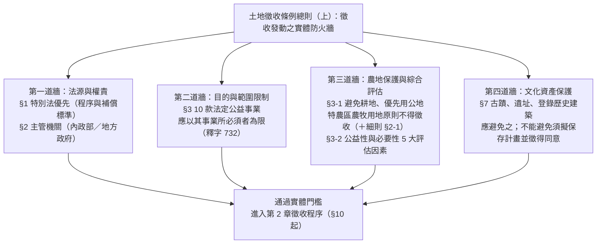

# 第 01 堂｜總則（上）：徵收要件、農地保護與公益必要性評估

> **涵蓋條文範圍**：《土地徵收條例》§1～§3-2、§7；《土地徵收條例施行細則》§1～§3（註：細則 §2 已刪除，含 §2-1；條例 §4 與細則 §3 區段徵收專章併於第 06 堂精講）
> **命題熱度**：★★★★★（歷屆必考打底＋近年大熱點！**§3-1 特定農業區農牧用地保護與細則 §2-1「零星夾雜」數字、§3-2 五大公益必要性評估因素、§7 古蹟保存計畫、釋字第 732 號**，幾乎隔年必入題！）
> **跨科關聯**：〈土地法規〉（土地法 §208～§209、平均地權條例 §10、都市計畫法、區域計畫法、國土計畫法）、〈憲法基本權〉（憲法 §15 財產權、§23 比例原則、司法院釋字第 732 號）

---

## 一、 架構鳥瞰（1 分鐘看懂體系位置）

「土地徵收」是國家基於公共利益，以公權力**強制剝奪**人民私有財產權（土地或土地改良物）之最嚴厲手段。為了避免政府濫用公權力圈地，民國 101 年大修法將憲法「比例原則」與「糧食安全／優良農地保護」正式法制化，在第一章「總則」築起**四道防火牆**：① **法律適用優先性與主管機關**（§1～§2）→ ② **法定公益事業與「所必須」範圍限制**（§3）→ ③ **優良農地保護與五大公益必要性評估**（§3-1～§3-2）→ ④ **文化資產避讓與保存計畫**（§7）。

### 母法與施行細則條文對照地圖

| 主題模組 | 母法（條例） | 施行細則 | 考點星級 |
| :--- | :--- | :--- | :---: |
| 立法目的、特別法優先順序與主管機關 | §1、§2 | §1（授權法源）、§2（刪除） | ★★★★☆ |
| 得徵收私有土地之 10 款事業與「所必須」範圍 | §3 | — | ★★★★★ |
| 勘選用地原則、農地變更同意與**特定農業區保護** | §3-1 | **§2-1（零星夾雜與重大建設定義）** | ★★★★★ |
| **公益性及必要性 5 大綜合評估因素** | §3-2 | — | ★★★★★ |
| 古蹟、遺址與登錄歷史建築之避讓與保存計畫 | §7 | — | ★★★★☆ |
| （補充）區段徵收跨轄區業務處理（詳見第 06 堂） | §4 | §3 | ★★☆☆☆ |

---

## 二、 白話精講（母法 × 施行細則 × 大法官解釋整合）

### 主題 1：特別法優先定位與主管機關（條例 §1、§2；細則 §1）★★★★☆

#### 1. 法律位階與三層適用順序（條例 §1；細則 §1）
* **立法目的（§1Ⅰ）**：規範土地徵收，確保土地合理利用，並保障私人財產，增進公共利益。
* **特別法定位（§1Ⅱ）**：土地徵收，依本條例之規定；本條例未規定者，適用其他法律（如《土地法》、《行政程序法》）之規定。
* **超級優先條款（§1Ⅲ — 必背！）**：**「其他法律有關徵收程序、徵收補償標準與本條例牴觸者，優先適用本條例。」**
* **白話解析**：台灣早期許多法律（如《土地法》第五編、《平均地權條例》§10、《水利法》、《大眾捷運法》等）都有零散的徵收程序或補償標準（例如《平均地權條例》§10 寫按「公告土地現值」補償）。為了統一全國徵收秩序、杜絕「一國多制」，§1Ⅲ 直接宣告：只要涉及**徵收程序**或**徵收補償標準**而與本條例牴觸者，**一律優先適用《土地徵收條例》**（現行即按 §30 市價補償）！
* **細則法源（細則 §1）**：本細則依本條例 §62 規定訂定之（現行施行細則共 78 條；細則 §2 原定義已刪除）。

#### 2. 主管機關（條例 §2）
* **中央**：**內政部**
* **直轄市**：直轄市政府
* **縣（市）**：縣（市）政府
* **跨法避雷提醒**：《平均地權條例》§2 在「土地債券發行事項」把中央主管機關例外劃歸「財政部」；但**《土地徵收條例》§2 沒有任何例外**，中央主管機關統一就是**內政部**！（且依本條例 §14，所有徵收案件的核准權全數集中於中央主管機關內政部。）

---

### 主題 2：徵收要件與 10 款法定公益事業（條例 §3 ＋ 釋字第 732 號）★★★★★

#### 1. 徵收發動之實體要件（條例 §3 前段）
* **條文精要**：「國家因**公益需要**，興辦下列各款事業，得徵收私有土地；**徵收之範圍，應以其事業所必須者為限**。」
* **拆解三大實體門檻**：
  1. **公益需要**：必須具備公共利益，不得為純粹私人利益或政府營利發財而徵收。
  2. **法定列舉事業**：必須屬於下列 10 款公共事業之一。
  3. **最小侵害原則（事業所必須）**：徵收的面積與範圍，嚴格限於該興辦事業「所必須」的範圍，絕不能「順便多徵收旁邊的精華地拿來蓋商場賺錢」！

#### 2. 得徵收私有土地之 10 款事業（條例 §3①～⑩）
1. **國防事業**（軍事基地、營區、要塞）。
2. **交通事業**（公路、鐵路、捷運、機場、港口）。
3. **公用事業**（自來水、電力、電信、天然氣設施）。
4. **水利事業**（水庫、堤防、灌溉排水設施）。
5. **公共衛生及環境保護事業**（焚化爐、污水處理廠、公立醫院）。
6. **政府機關、地方自治機關及其他公共建築**（區公所、警察局、消防局）。
7. **教育、學術及文化事業**（公立學校、博物館、圖書館）。
8. **社會福利事業**（公立老人安養院、身心障礙福利機構）。
9. **國營事業**（如台電、中油等依法設立之國營事業）。
10. **其他依法得徵收土地之事業**（概括條款，須另有「法律」明文授權，符合法律保留原則）。

> **速記口訣（10 款事業）**：**「國交公水衛，政教社營他」**（國防、交通、公用、水利、公衛環保；政府機關、教育文化、社福、國營、其他依法）。

#### 3. 憲法大絕招：司法院釋字第 732 號解釋（捷運毗鄰地徵收案）★★★★★
* **案件背景**：早期《大眾捷運法》第 7 條第 4 項等規定，允許主管機關為辦理捷運聯合開發、籌措建設資金，連「**非交通事業所必須之毗鄰地區土地**」也能一併報請徵收（最著名即新店美河市案）。
* **大法官核心意旨**：
  1. **侵害基本權**：徵收人民私有土地，不僅剝奪憲法 §15 所保障之**財產權**，若為地上住宅，更侵害憲法 §10 所保障之**居住自由**。
  2. **嚴格比例原則審查**：強制徵收土地必須是「興辦交通事業所必須」。如果僅為土地開發利益、籌措財源或追求一般經濟效益，而把「非交通事業所必須之毗鄰地」強制徵收，即使給了補償金，仍**不符合憲法第 23 條比例原則**，宣告違憲！
* **申論加分用法**：只要考到 §3「徵收範圍應以其事業所必須者為限」或 §3-2「公益性及必要性評估」，**務必把「釋字第 732 號」寫進去**，強調「土地徵收應受憲法財產權、居住自由及比例原則之嚴格拘束，不得僅為追求經濟開發利益而徵收非事業所必須之土地」，分數直接往上跳一級！

---

### 主題 3：勘選用地與優良農地保護（條例 §3-1 ＋ 細則 §2-1）★★★★★

民國 100 年苗栗大埔農地徵收事件引發全國震怒，立法院遂於民國 101 年增訂 **§3-1** 與 **§3-2**，被稱為「大埔條款」。這兩條是近 10 年地政士考場**出題率最高**的核心條文！

#### 1. 勘選用地之三大層次保護（條例 §3-1Ⅰ～Ⅲ）
1. **一般勘選原則（§3-1Ⅰ）**：需用土地人興辦公益事業，應按事業性質及實際需要，勘選適當用地及範圍，並應：
   * **儘量避免耕地**；且
   * **優先使用無使用計畫之公有土地或國營事業土地**。（白話：政府自己有閒置公地就先用公地，別動不動就搶農民的良田！）
2. **計畫變更前端把關（§3-1Ⅱ）**：對於經依《都市計畫法》、《區域計畫法》或《國家公園法》劃設或變更後，依法得予徵收或區段徵收之**農業用地**，於「劃設或變更時」，即應經**目的事業主管機關**考量徵收之公益性及必要性（把審查關卡從「徵收階段」提前到「土地規劃變更階段」）。
3. **免經區域計畫許可之農地變更（§3-1Ⅲ）**：需用土地人勘選用地內之農業用地，免經區域計畫擬定機關許可者，於變更為非農業使用時，應先徵得**直轄市或縣（市）農業主管機關同意**。

#### 2. 特定農業區農牧用地「原則禁止徵收」與五大例外（條例 §3-1Ⅳ ＋ 細則 §2-1）★★★★★
特定農業區是台灣灌溉完善、最肥沃的優良農田。條例 §3-1Ⅳ 設下最嚴格禁令：
* **大原則**：**特定農業區農牧用地，不得徵收！**
* **法定例外（只有 2 大類型，細分 6 種情形）**：
  * **類型 A：零星夾雜難以避免者**。
  * **類型 B：但書 5 大必要事業**（注意「公用事業」的嚴格限定！）：
    1. **國防**事業；
    2. **交通**事業；
    3. **水利**事業；
    4. **公用事業「供輸電線路使用者」**所必須（⚠️ **考場大陷阱！**不是所有公用事業都能徵收特農區，只限「供輸電線路使用」所必須，如高壓電塔！）；
    5. 經**行政院核定之重大建設**所需者（⚠️ 若因此辦理徵收且有爭議，依 §10Ⅲ 須依行政程序法舉行**聽證**！詳見第 03 堂）。

#### 3. 施行細則 §2-1 魔鬼數字與審查標準（必背到倒背如流！）
* **「零星夾雜」之法定定量標準（細則 §2-1Ⅰ）**：
  * 興辦事業計畫範圍內夾有特定農業區農牧用地，須**同時符合**兩條件：
    1. 面積**不超過 0.25 公頃**（2,500 平方公尺）；**且**
    2. 累計**不得超過興辦事業計畫總面積 10%**。
  * **彈性但書**：因興辦事業計畫完整需要，其面積或比例得為 **10% 以內之增加**（換算即：面積上限可放寬至 `0.25 × 1.1 = 0.275 公頃`，比例上限可放寬至 `10% × 1.1 = 11%`）。
* **「行政院核定之重大建設」之法定要件（細則 §2-1Ⅱ）**：
  * 由**中央目的事業主管機關**會商相關主管機關，針對以下 **4 項要件**進行審查認定為重大建設，並循程序報經行政院核定者：
    1. **政策方向**
    2. **總量管制**
    3. **合理性**
    4. **使用特定農業區農牧用地之無可替代性**（口訣：**「政、總、合、無替代」**）

> **【實務案例 1】科學園區開發案夾帶特定農業區農牧用地，合法嗎？**
> 某縣政府規劃開發面積 **10 公頃**之產業園區（未經行政院核定為重大建設），勘選範圍內夾雜了 **0.3 公頃**之特定農業區農牧用地。縣政府主張「0.3 公頃只占總面積 3%，未超過 10%，屬於零星夾雜，可以徵收」。請問縣政府的主張合法嗎？
> * **解析**：**不合法！** 依《土地徵收條例施行細則》§2-1Ⅰ，「零星夾雜」必須**同時滿足**「面積不超過 0.25 公頃」**且**「累計不超過總面積 10%」兩個要件。縱使適用但書放寬 10%，面積上限也僅為 **0.275 公頃**（0.25 × 1.1）。本案夾雜面積達 0.3 公頃，已逾越法定上限，既非零星夾雜，亦非國防、交通、水利、供輸電線路使用之公用事業或行政院核定之重大建設，依法**不得徵收**！

---

### 主題 4：公益性及必要性之 5 大綜合評估因素（條例 §3-2）★★★★★

過去政府徵收土地常被批評「只寫一句『為促進地方繁榮』就過關」。因此 §3-2 強制要求需用土地人興辦事業徵收土地時，必須依下列 **5 大因素**進行**綜合評估分析**（並納入 §13-1 第 6 款「公益性及必要性評估報告」，交由內政部土地徵收審議小組把關）：

| 評估面向 | 條例 §3-2 法定應考量之具體內容 | 考場記憶關鍵字 |
| :--- | :--- | :--- |
| **一、社會因素** | 徵收所影響**人口之多寡**、**年齡結構**，及徵收計畫對周圍社會現況、**弱勢族群生活型態**及**健康風險**之影響程度。 | 人口、年齡、弱勢、健康 |
| **二、經濟因素** | 徵收計畫對**稅收**、**糧食安全**、增減**就業或轉業人口**、**徵收費用**、各級政府配合興辦公共設施與**政府財務支出及負擔情形**、**農林漁牧產業鏈**及**土地利用完整性**。 | 稅收、糧食、就業、財務、農產鏈、利用完整 |
| **三、文化及生態因素** | 因徵收計畫而導致**城鄉自然風貌**、**文化古蹟**、**生活條件或模式**發生改變，及對該地區**生態環境**、周邊居民或社會整體之影響。 | 自然風貌、古蹟、生活模式、生態 |
| **四、永續發展因素** | **國家永續發展政策**、**永續指標**及**國土計畫**。 | 永續政策、永續指標、國土計畫 |
| **五、其他** | 依徵收計畫個別情形，認為適當或應加以評估參考之事項。 | 個案彈性條款 |

> **【老師的申論高分技巧】**：遇到題目問「如何審查徵收之公益性及必要性？」，千萬不要只背五個標題（社會、經濟、文化生態、永續、其他）就交卷！每個標題後面至少寫出 **3～4 個具體子項目**（特別是「弱勢族群生活型態、健康風險」、「糧食安全、政府財務負擔、農林漁牧產業鏈」、「國土計畫」），再搭配 §13Ⅱ 內政部審核權與釋字第 732 號比例原則，輕鬆奪下 22 分以上！

---

### 主題 5：文化資產避讓與保存計畫（條例 §7）★★★★☆

* **保護標的**：申請徵收之土地遇有**「古蹟」、「遺址」或「登錄之歷史建築」**（三類法定文化資產）。
* **兩階段處理規則**：
  1. **原則（優先避讓）**：應於可能範圍內**避免之**（例如路線改道、調整工程配置）。
  2. **例外（事前保存計畫＋同意）**：其未能避免者，需用土地人應先**擬訂保存計畫**，**徵得目的事業主管機關（文化主管機關）同意**，始得徵收。
* **程序連動（§13-1①①）**：送審的徵收計畫書中，也必須明確記載「徵收土地區內有無古蹟、遺址或登錄之歷史建築，並註明其現狀及維護措施」。

> **【實務案例 2】拓寬道路遇上登錄歷史建築，縣府能先徵收再遷建嗎？**
> 某縣政府辦理縣道拓寬工程，發現預定徵收範圍內有一棟已登錄的百年歷史建築「林家古厝」。工務局認為「先核准徵收拿到土地，之後再請文化局評估要不要原址保留或異地重組就好」。請問此作法合法嗎？
> * **解析**：**不合法！** 依《土地徵收條例》§7 規定，申請徵收土地遇有登錄之歷史建築，首先應於可能範圍內**避免徵收**（例如評估道路截彎取直或微調路寬）；若確因工程技術無法避免，亦必須「**事前**」擬訂**保存計畫**，並**徵得目的事業主管機關（文化主管機關）同意**後，始得辦理徵收，絕不可「先徵收、後補救」！

---

## 三、 考點對決（易混淆觀念比較表＋速記口訣）

### 比較表 1：《土地徵收條例》vs.《平均地權條例》總則關鍵差異

| 比較項目 | 土地徵收條例 | 平均地權條例 |
| :--- | :--- | :--- |
| **法律適用關係** | **特別法中之特別法**（§1Ⅲ：他法有關徵收程序、補償標準牴觸者，**優先適用本條例**） | 土地法之特別法（§1），但徵收程序與補償標準須讓位於《土地徵收條例》 |
| **中央主管機關** | 統一為**內政部**（§2，無例外） | 一般為內政部；**土地債券發行事項為財政部**（§2） |
| **徵收補償地價基準** | 按**徵收當期之市價**補償（§30，現行有效優先適用） | 條文仍寫按「公告土地現值」（§10，實務已被土徵 §30 取代） |

### 比較表 2：一般農地 vs. 特定農業區農牧用地之徵收門檻（條例 §3-1、細則 §2-1）

| 土地類型 | 徵收限制強度 | 法定管制重點 |
| :--- | :--- | :--- |
| **一般耕地／農業用地** | **原則儘量避免**（相對限制） | 1. 勘選時應儘量避免耕地，優先使用無使用計畫之公地或國營事業地（§3-1Ⅰ）。 2. 變更為非農用若免經區域計畫許可，應先徵得**地方農業主管機關同意**（§3-1Ⅲ）。 |
| **特定農業區農牧用地** | **原則不得徵收**（絕對原則＋列舉例外） | 僅限以下情形始得徵收（§3-1Ⅳ）： 1. **零星夾雜難以避免**（細則 §2-1Ⅰ：≤ 0.25 公頃 **且** 累計 ≤ 10%；完整需要得增 10% 以內）。 2. **國防、交通、水利**事業。 3. **公用事業「供輸電線路使用者」**所必須。 4. **行政院核定之重大建設**（細則 §2-1Ⅱ：中央目的事業主管機關審查政、總、合、無替代；有爭議依 §10Ⅲ 辦聽證）。 |

### 本堂速記口訣總整理
1. **§3 十款公益事業**：**「國交公水衛，政教社營他」**（並牢記**「事業所必須為限」＋釋字 732**）。
2. **§3-1Ⅳ 特農區例外**：**「零星（0.25/10%/增10%）、國、交、水、輸電、院重大」**（特別盯緊「公用事業僅限**輸電線路**」！）。
3. **細則 §2-1Ⅱ 重大建設 4 審查項目**：**「政、總、合、無替代」**（政策方向、總量管制、合理性、無可替代性）。
4. **§3-2 五大評估因素**：**「社、經、文生、永、其他」**（社會、經濟、文化及生態、永續發展、其他）。
5. **§7 文化資產**：**「古、遺、歷（古蹟、遺址、登錄歷史建築）→ 先避開，避不開就『保存計畫＋同意』」**。

---

## 四、 課後小測驗（地政士申論模擬演練）

### 模擬題 1（特定農業區農牧用地保護 × 施行細則魔鬼數字）
> **題目**：依《土地徵收條例》及其施行細則規定，需用土地人勘選興辦公益事業用地時，對於耕地及特定農業區農牧用地應遵循哪些限制？又法條所稱「零星夾雜」與「行政院核定之重大建設」，其法定認定標準各為何？（25 分）

👉 點此展開【擬答架構與得分關鍵字】

1. **勘選用地之一般農地保護原則（條例 §3-1Ⅰ～Ⅲ）**：
   * 應按事業性質及實際需要，勘選適當用地及範圍，並應**儘量避免耕地**及**優先使用無使用計畫之公有土地或國營事業土地**。
   * 依都市計畫法、區域計畫法或國家公園法劃設或變更後依法得予徵收或區段徵收之農業用地，於劃設或變更時，應經目的事業主管機關考量徵收之公益性及必要性。
   * 勘選用地內之農業用地，免經區域計畫擬定機關許可者，於變更為非農業使用時，應先徵得直轄市或縣（市）農業主管機關同意。
2. **特定農業區農牧用地之原則禁止與例外（條例 §3-1Ⅳ）**：
   * **原則**：特定農業區農牧用地，除**零星夾雜難以避免者**外，**不得徵收**。
   * **但書例外**：**國防、交通、水利事業、公用事業供輸電線路使用者**所必須，或經**行政院核定之重大建設**所需者，不在此限。
3. **「零星夾雜」之法定認定標準（細則 §2-1Ⅰ）**：
   * 指興辦事業計畫範圍內夾有特定農業區農牧用地，其**面積不超過 0.25 公頃**，**且累計不得超過興辦事業計畫總面積 10%**。
   * **但書彈性**：但因興辦事業計畫完整需要，其面積或比例得為 **10% 以內之增加**（最高可達 0.275 公頃、11%）。
4. **「行政院核定之重大建設」之法定認定標準（細則 §2-1Ⅱ）**：
   * 指其建設計畫由**中央目的事業主管機關**會商相關主管機關，針對計畫之**① 政策方向、② 總量管制、③ 合理性、④ 使用特定農業區農牧用地之無可替代性**等事項進行審查認定為重大建設，並循程序報經行政院核定者（並可補充：此類案件若辦理徵收有爭議，依條例 §10Ⅲ 須舉行聽證）。

---

### 模擬題 2（公益性及必要性評估 × 釋字第 732 號 × 古蹟保護綜合題）
> **題目**：國家興辦交通事業擬徵收私有土地，除應符合《土地徵收條例》第 3 條「應以其事業所必須者為限」之要求（參照司法院釋字第 732 號解釋意旨）外，依同條例第 3 條之 2 規定，需用土地人應依哪五大因素評估興辦事業之公益性及必要性？又若勘選範圍內遇有登錄之歷史建築時，應如何處理？（25 分）

👉 點此展開【擬答架構與得分關鍵字】

1. **徵收之公益要件、範圍限制與釋字第 732 號意旨（條例 §3）**：
   * 依條例 §3，國家因公益需要興辦交通等 10 款法定事業始得徵收私有土地，且「徵收之範圍，應以其事業所必須者為限」。
   * 參照**司法院釋字第 732 號解釋**，徵收私有土地涉及憲法 §15 財產權與 §10 居住自由之剝奪，須嚴格符合憲法 §23 比例原則；不得僅為土地開發或籌措財務利益，而將非交通事業所必須之毗鄰地區土地納入徵收範圍。
2. **公益性及必要性之五大綜合評估因素（條例 §3-2）**：
   * **一、社會因素**：徵收所影響人口多寡、年齡結構，及對周圍社會現況、弱勢族群生活型態及健康風險之影響程度。
   * **二、經濟因素**：對稅收、糧食安全、增減就業或轉業人口、徵收費用、各級政府配合興辦公設與財務支出及負擔情形、農林漁牧產業鏈及土地利用完整性。
   * **三、文化及生態因素**：導致城鄉自然風貌、文化古蹟、生活條件或模式發生改變，及對地區生態環境、周邊居民或社會整體之影響。
   * **四、永續發展因素**：國家永續發展政策、永續指標及國土計畫。
   * **五、其他**：依徵收計畫個別情形，認為適當或應加以評估參考之事項。
3. **遇有登錄之歷史建築之處理（條例 §7、§13-1①①）**：
   * 依條例 §7，申請徵收之土地遇有古蹟、遺址或登錄之歷史建築，**應於可能範圍內避免之**。
   * 其未能避免者，需用土地人應先**擬訂保存計畫**，**徵得目的事業主管機關（文化主管機關）同意**，始得徵收；並應於徵收計畫書內註明其現狀及維護措施（§13-1①①）。

---

> **下堂課預告**：第 02 堂｜**總則（下）：改良物徵收、殘餘地一併徵收與收回權**（條例 §5～§6、§8～§9；細則 §4～§9）— 攻克〈土地法規〉最愛考的兩大財產救濟王牌：「殘餘地 1 年請求一併徵收（一律現金！）」與「20 年原價收回權（含 108 年細則 §9 任一繼承人代全體申請新制）」！
