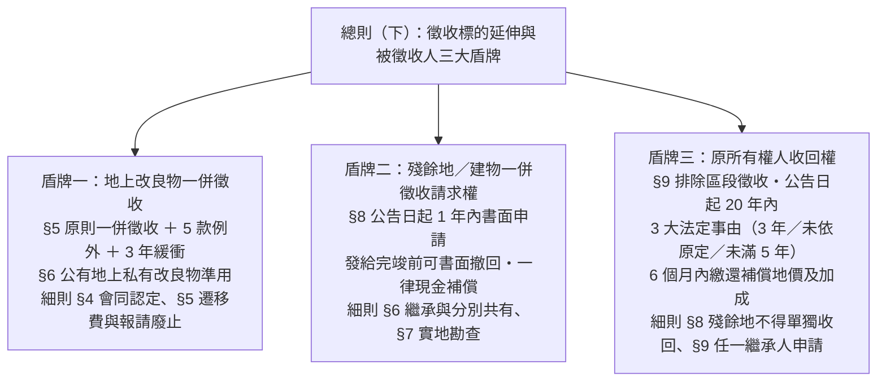

# 第 02 堂｜總則（下）：改良物徵收、殘餘地一併徵收與收回權

> **涵蓋條文範圍**：《土地徵收條例》§5～§6、§8～§9；《土地徵收條例施行細則》§4～§9（含 108 年修正之細則 §9 繼承人收回權大亮點！）
> **命題熱度**：★★★★★（地政士〈土地法規〉**超高頻王者章節**！**§5 改良物一併徵收與例外、§8 殘餘地一併徵收（1 年、現金）、§9 原所有權人收回權（20 年、3 年／未依原定／5 年）**，加上細則 §5～§9 的繼承人與分別共有規則，幾乎每隔 1～2 年就會正面命題！）
> **跨科關聯**：〈土地法規〉（土地法 §217、§219、土地徵收條例 §49～§55 撤銷與廢止徵收）、〈民法概要〉（民法 §821、§828 公同共有回復請求權、分別共有應有部分）

---

## 一、 架構鳥瞰（1 分鐘看懂體系位置）

如果說第 01 堂講的是「政府發動徵收前的防火牆」，第 02 堂講的就是**「徵收發生時與徵收完成後，保護被徵收人權益的三大盾牌」**：
1. **房地一體盾牌（§5～§6）**：政府收地時，地上的合法建物與農作物原則上要「一併徵收」，不能只收地、留下一堆廢墟或青苗不管！
2. **畸零殘餘盾牌（§8）**：土地或房子被切掉一大塊，剩下的「殘餘部分」太小或奇形怪狀根本不能用時，地主可於 **1 年內**主動叫政府「連剩的一起收（而且給現金）」。
3. **防止圈地閒置盾牌（§9）**：政府把地徵收走後如果放著長草（滿 3 年不動工）或挪作他用，原所有權人有權在 **20 年內**把土地「照原補償價額收回」！

### 母法與施行細則條文對照地圖

| 主題模組 | 母法（條例） | 施行細則 | 考點星級 |
| :--- | :--- | :--- | :---: |
| 土地改良物一併徵收原則、5 款例外與 3 年內徵收 | §5 | §4（違建／超種會同認定）、§5（自行遷移發遷移費並廢止原案） | ★★★★★ |
| 公有土地上私有土地改良物準用徵收 | §6 | — | ★★★☆☆ |
| **殘餘土地／建築改良物一併徵收請求權** | §8 | §6（繼承人與分別共有）、§7（實地勘查與免勘查例外） | ★★★★★ |
| **原土地所有權人收回權** | §9 | §8（殘餘地同時收回與不得單獨收回）、**§9（108 年修法：任一繼承人代全體申請）** | ★★★★★ |

---

## 二、 白話精講（母法 × 施行細則整合）

### 主題 1：土地改良物一併徵收原則與例外（條例 §5～§6；細則 §4～§5）★★★★★

#### 1. 大原則：徵收土地時，其土地改良物「應一併徵收」（條例 §5Ⅰ 本文）
土地與地上的建築物、農作改良物經濟上密不可分。國家徵收土地時，原則上必須連同地上的改良物一併徵收並給予補償，避免所有權人蒙受雙重損失。

#### 2. 五款「不適用一併徵收」之例外（條例 §5Ⅰ 但書 ＋ 細則 §4、§5）
考試常稱為「4 大實質例外＋1 款概括例外」，每款效果不同，務必分清：

| 款次 | 例外情形（條例 §5Ⅰ 但書） | 法律效果與細則配套（超級考點！） |
| :---: | :--- | :--- |
| **第 1 款** | 土地改良物所有權人**要求取回**，並自**公告期滿之日起 15 日內自行遷移**。 | 依**細則 §5**：須於「**公告期間**」要求取回，並自公告期滿之日起 15 日內自行遷移 → 地方主管機關**發給遷移費**；原核准之該改良物一併徵收案，依法定程序**報請廢止**之。 |
| **第 2 款** | **墳墓及其他紀念物**必須遷移。 | 基於民俗倫理，政府不可能取得先人墳墓的「所有權」，故不予徵收，改為限期遷葬並發給**遷移費**（§34）。 |
| **第 3 款** | **建築改良物依法令規定不得建造**（即違章建築）。 | 依**細則 §4**，由地方主管機關**會同其他有關機關認定**。 依 **§5Ⅲ**：於徵收土地公告期滿後，通知所有權人或使用人**限期遷移或拆除之，不予補償**；屆期不拆遷者，會同有關機關**逕行除去**！ |
| **第 4 款** | **農作改良物之種類或數量與正常種植情形不相當者，其不相當部分**（俗稱搶種、超種，如一分地密植一萬棵高價樹苗騙補償）。 | 同上！由地方主管機關會同有關機關認定（細則 §4），僅就「**不相當部分**」不予徵收、通知限期拆遷、**不予補償**、屆期逕行除去（**正常種植部分仍應徵收補償**！）。 |
| **第 5 款** | 其他法律另有規定。 | 概括條款。 |

#### 3. 三年緩衝徵收與「所有權人同時一併徵收請求權」（條例 §5Ⅱ）★★★★☆
* **需用土地人之彈性**：應徵收之土地改良物，得視興辦事業計畫之需要，於**土地徵收公告之日起 3 年內**徵收之（例如工程分期施工，先收地、後收屋）。
* **改良物所有權人之反制權（但書必背！）**：但土地改良物所有權人於**「需用土地人報請徵收土地前」**，請求同時一併徵收其改良物時，需用土地人**應同時辦理一併徵收**（避免地主領了地價卻卡著半殘的地上物苦等 3 年）。

#### 4. 公有土地上私有改良物之準用（條例 §6）★★★☆☆
* **條文精要**：需用土地人取得經核准**撥用**或**提供開發**之公有土地，該公有土地上之**私有土地改良物**，得準用前條（§5）規定徵收之。
* **白話解析**：公有土地本身是用「撥用」而非「徵收」取得，但如果公地上有私人合法承租蓋的房屋或種的果樹，為了讓公地順利騰空開發，特准「準用 §5」單獨徵收該私有土地改良物並予補償！

---

### 主題 2：殘餘土地／建物一併徵收請求權（條例 §8；細則 §6～§7）★★★★★

這是地政士考試**每考必搶分**的超級經典條文，也是對比《土地法》§217 的最愛考點！

#### 1. 法定要件與核心規則（條例 §8）
1. **適用標的與要件（§8Ⅰ）**（⚠️ **注意：不含農作改良物！**）：
   * **殘餘土地**：徵收土地之殘餘部分**面積過小或形勢不整**，致**不能為相當之使用**者。
   * **殘餘建築改良物**：徵收建築改良物之殘餘部分**不能為相當之使用**者。（例：整棟透天厝被道路切掉一半，剩下半截危樓根本不能住人！）
2. **法定申請期間（不變期間）**：**徵收公告之日起 1 年內**（⚠️ 不是「公告期滿」之日起！是「**公告之日起**」1 年內！逾期不予受理！）。
3. **受理機關**：該管**直轄市或縣（市）主管機關**（最終核准機關仍為中央主管機關內政部，見細則 §7）。
4. **申請與撤回方式（§8Ⅱ）**：
   * 申請應以**書面**為之。
   * 於**「補償費發給完竣前」**，得以**書面撤回**之。（反悔的最後期限＝補償費發給完竣前！）
5. **補償方式（§8Ⅲ — 超級必考陷阱！）**：
   * 一併徵收之土地或建築改良物殘餘部分，**「應以現金補償之」**！（就算本案是「區段徵收」，地主也不能要求把殘餘地併進去換抵價地，一律發放現金！）

#### 2. 施行細則 §6～§7 實務大細節（申論高分關鍵！）
* **申請人資格與分別共有（細則 §6）**：
  * **一般情形**：為**原被徵收土地或建築改良物之所有權人**。
  * **原所有權人死亡**：
    * **已辦竣繼承登記**者 → 為**登記名義人**。
    * **未辦竣繼承登記**者 → 為其**全體繼承人**。
  * **分別共有（超級考點！）**：一併徵收之殘餘土地或建築改良物為**分別共有**者，**各共有人得就其應有部分申請之**！（不必全體共有人同意，甲想留著、乙想叫政府買走，乙可以單獨就自己的應有部分申請一併徵收！）
* **審查程序與免勘查例外（細則 §7）**：
  * **原則程序**：地方主管機關會同**需用土地人、申請人及其他有關機關**進行**實地勘查**，並作成勘查紀錄（申請人有不同意見者，應於勘查紀錄記明）。
    * 合於規定者 → 地方主管機關轉需用土地人報請**中央主管機關核准**。
    * 不合規定者 → 地方主管機關報請**中央主管機關核定**後，將處理結果函復申請人。
  * **免實地勘查 2 款例外（細則 §7Ⅰ 但書）**：
    1. 申請人**未符合細則 §6Ⅰ 資格**（例如徵收後才買下殘餘地的第三人！）；或
    2. 申請**已逾法定期間**（超過公告日起 1 年）。
    * 以上兩種情形，免實地勘查，逕由地方主管機關報請中央主管機關核定後函復申請人。

> **【實務案例 1】徵收公告後把殘餘畸零地賣給隔壁建商，建商能申請一併徵收嗎？**
> 老張的土地於 113 年 5 月 1 日公告徵收（公告 30 日至 5 月 31 日止），留下一塊 8 坪三角形殘餘地。老張在 113 年 8 月把這塊 8 坪殘餘地賣給隔壁建商大華公司。大華公司於 114 年 4 月 15 日向市政府書面申請一併徵收。請問市政府應如何處理？
> * **解析**：**應予駁回（且免實地勘查）！**
>   1. 雖然大華公司在「徵收公告之日起 1 年內（114 年 4 月 30 日前）」提出書面申請，期限符合 §8Ⅰ；
>   2. 但依**細則 §6Ⅰ**，有權申請一併徵收者，限於「**原被徵收土地之所有權人**」（或其繼承人）。大華公司是事後受讓的第三人，不具申請人適格！
>   3. 依**細則 §7Ⅰ 但書**，市政府**免予實地勘查**，逕報中央主管機關（內政部）核定後，將不合規定之結果函復大華公司。

---

### 主題 3：原土地所有權人收回權（條例 §9；細則 §8～§9）★★★★★

為了防止政府徵收私有地後「圈而不用」或「掛羊頭賣狗肉」，§9 賦予原土地所有權人長達 20 年的「照原價買回權」，是整部《土地徵收條例》最常與 §49「撤銷／廢止徵收」及《土地法》§219 聯手出題的王牌考點！

#### 1. 適用排除與法規排他性（條例 §9Ⅰ 前段）
* **排除適用「區段徵收」**：區段徵收屬於合作開發與地籍重整，原有地主多已申領抵價地，且開發後土地涉及多元處分與標售，故明文**排除區段徵收**（以及本條例或其他法律另有規定者）。
* **排除《土地法》§219**：明文規定「**不適用土地法第 219 條之規定**」，徹底回歸土徵條例 §9 統一規範。

#### 2. 申請期限與三大法定收回事由（條例 §9Ⅰ、Ⅲ、Ⅳ）
原土地所有權人得於**「徵收公告之日起 20 年內」**，向該管直轄市或縣（市）主管機關申請**照原徵收補償價額收回其土地**。須具備以下三款事由之一：
1. **第 1 款（滿 3 年未開始使用）**：**徵收補償費發給完竣屆滿 3 年**，未依徵收計畫開始使用者。
   * **例外阻卻（§9Ⅲ）**：若係因**「不可歸責於需用土地人之事由」**（如天災、不可抗力、司法訴訟或被徵收人抗爭阻撓動工等）致未開始使用者，**不得申請收回**！
   * **「開始使用」定義（§9Ⅳ）**：指興辦事業之**「主體工程動工」**（⚠️ 只有圍籬笆、整地割草不算主體工程動工！）。但依其事業性質無需興建工程者（例如單純劃設生態保護區、開放綠地），不在此限。
2. **第 2 款（未依原定事業使用）**：**未依核准徵收原定興辦事業使用**者。（例：徵收理由是蓋「公立國小」，結果後來拿去蓋「收費停車場」或「辦公大樓」！）
3. **第 3 款（開始使用後未滿 5 年即停用）**：依原徵收計畫開始使用後**未滿 5 年**，不繼續依原徵收計畫使用者。（白話：防止政府為了躲避第 1 款而「假動工」，開工滿 1 年就收攤荒廢！）

#### 3. 核准程序與 6 個月繳還價款義務（條例 §9Ⅱ）
* **核准程序**：地方主管機關收受申請查明合於規定 → 報**原核准徵收機關**核准（現行即內政部；若是民國 89 年土徵條例施行前由行政院核准之舊案，則報行政院）→ 通知原土地所有權人。
* **繳還期限與金額（超級必考細節！）**：
  * 期限：於通知後 **6 個月內**繳還，**逾期視為放棄收回權**。
  * 應繳還金額：**「原受領之補償地價及地價加成補償」**。（⚠️ **考場陷阱**：① 當年按「市價」或舊法「公告現值＋加成」領多少，現在就還多少，**不必加計利息或改按現在市價**；② **不包含**地上改良物補償費、遷移費、營業損失等其他補償，因為那些東西已經拆掉了！）

#### 4. 施行細則 §8～§9 兩大超級殺手鐧（必背！）
* **細則 §8（殘餘地不得「單獨」申請收回！）**：
  * 原土地所有權人依 §9 申請收回被徵收土地時，得就依 §8 一併徵收之土地殘餘部分，**「同時申請收回」**。
  * **拒絕但書**：但該殘餘部分**已移轉或另有他用者**，土地管理機關得予拒絕。
  * **絕對禁令（§8Ⅱ）**：依 §8 一併徵收之土地，除上述同時申請收回外，**「不得單獨申請收回」**！（白話：殘餘地當年是你自己拜託政府買走的，本來就不在需用土地人的原計畫內，當然不能拿「沒依計畫使用」單獨要回去！）
* **細則 §9（實地勘查、免勘查 4 款例外與 108 年修法大亮點！）**：
  * **原則**：地方主管機關會同需用土地人、申請人及其他有關機關**實地勘查**，作成勘查紀錄（記明申請人不同意見）及研擬意見，報原核准徵收機關核定。
  * **免實地勘查 4 款情形（細則 §9Ⅱ）**：
    1. **申請人非原所有權人或其全體繼承人。但「任一繼承人敘明理由為其全體繼承人之利益申請」，依前項規定辦理（即應予實地勘查與實質審理！）。**
       * 🔥 **【108 年 12 月修法必考焦點】**：早期實務要求原所有權人死亡時必須「全體繼承人共同申請」，導致只要家族中有一人失聯或鬧翻，整塊祖產就無法收回。108 年修正細則 §9Ⅱ① 增訂但書，比照《民法》§828、§821 精神，明定**「任一繼承人敘明理由為其全體繼承人之利益申請」**即可合法啟動收回審查程序！（⚠️ 注意對比：細則 §6 殘餘地一併徵收仍寫「未辦竣繼承登記者為全體繼承人」，兩者出題極易對比！）
    2. 申請**已逾法定期間**（逾徵收公告日起 20 年）。
    3. 徵收補償費發給完竣**未滿 3 年**，即依 §9Ⅰ① 申請收回。
    4. **其他法律規定之使用期限屆滿前**，以尚未依徵收計畫開始使用為由申請收回（例如《都市計畫法》§83 另有使用期限規定）。

> **【實務案例 2】阿公生前被徵收的土地 5 年都沒動工，五個孫子裡只有大孫子申請收回，會成功嗎？**
> 阿公的土地於 108 年 6 月 1 日公告徵收興建鄉立圖書館，108 年 7 月 10 日補償費發給完竣。阿公於 110 年過世，留有 5 名繼承人（其中老三移居國外失聯）。至 113 年 10 月，該土地仍為空地，完全未動工（且無不可歸責於鄉公所之事由）。長孫甲遂單獨具狀，並「敘明老三失聯之理由，聲明為全體繼承人之利益」向縣政府申請照原徵收補償價額收回土地。請問縣政府應否受理並辦理實地勘查？
> * **解析**：**應予受理並辦理實地勘查！**
>   1. 實體要件符合 §9Ⅰ①：自補償費發給完竣（108/7/10）起已屆滿 3 年，主體工程仍未動工且無不可歸責事由，且在公告日起 20 年內。
>   2. 主體資格符合 108 年修正之**細則 §9Ⅱ① 但書**：原所有權人死亡後，雖非全體繼承人共同申請，但長孫甲已「**敘明理由為其全體繼承人之利益申請**」，故不適用免實地勘查駁回規定，縣政府應會同需用土地人、申請人及有關機關辦理實地勘查並報請原核准徵收機關（內政部）核定！

---

## 三、 考點對決（易混淆觀念比較表＋速記口訣）

### 比較表 1：§8 殘餘地一併徵收 vs. §9 原所有權人收回權（考場必考雙雄！）

| 比較項目 | §8 殘餘地／建物一併徵收 | §9 原所有權人收回權 |
| :--- | :--- | :--- |
| **制度方向** | 叫政府**多收**剩下的畸零地／殘餘建物 | 向政府**要回**已經被徵收走的土地 |
| **適用標的** | 殘餘**土地**、殘餘**建築改良物**（不含農作物） | 被徵收之**土地**（**排除區段徵收**；殘餘地須同時申請、不得單獨收回） |
| **法定期間** | 徵收**公告之日起 1 年內**（逾期不受理） | 徵收**公告之日起 20 年內** |
| **繼承人未辦繼承登記之申請主體** | **全體繼承人**（細則 §6Ⅰ）；分別共有者，各共有人得就其應有部分申請（§6Ⅱ） | 原所有權人或其全體繼承人；**但任一繼承人敘明理由為全體繼承人利益申請，亦得受理勘查**（細則 §9Ⅱ① 但書，108 年新制！） |
| **撤回／繳款規則** | 應以書面申請；**補償費發給完竣前**得以書面撤回；一律以**現金補償** | 核准後通知 **6 個月內**繳還「**原受領之補償地價及地價加成補償**」，逾期視為放棄 |
| **免實地勘查事由** | 2 款：資格不符、逾 1 年期間（細則 §7Ⅰ 但書） | 4 款：非適格人（除任一為全體外）、逾 20 年、發給未滿 3 年、他法使用期限未屆滿（細則 §9Ⅱ） |

### 比較表 2：《土地徵收條例》§9 收回權 vs. 《土地法》§219 收回權（歷史修法考點）

| 比較項目 | 土地徵收條例 §9（現行優先適用） | 土地法 §219（已由土徵 §9 排除適用） |
| :--- | :--- | :--- |
| **法定事由** | ① 補償發給完竣滿 **3 年**未開始使用；② 未依原定事業使用；③ 開始使用未滿 **5 年**不繼續使用 | ① 補償發給完竣滿 **1 年**未開始使用；② 未依核准計畫使用 |
| **申請期限** | 徵收**公告之日起 20 年內** | 徵收補償發給完竣屆滿 1 年之次日起 **5 年內** |
| **區段徵收適用** | 明文**排除**區段徵收 | 未明文區分排除 |

### 本堂速記口訣總整理
1. **§5Ⅰ 改良物不併徵 5 款**：**「15 日取回、墳墓紀念、違建、超種、他法」**（違建超種不給錢、公告期滿限期拆、不拆逕除去）。
2. **§5Ⅱ 改良物緩衝**：**「政府可拖 3 年收；報徵收前喊『一起收』，政府不能拖！」**
3. **§8 殘餘地一併徵收**：**「地小形不整、屋殘不能用；公告 1 年書面請、發完前可撤、一律領現金；分別共有可單請」**。
4. **§9 收回權黃金數字**：**「除區段、公告 20 年、3 年不動（主體工程、除不可歸責）、未依原定、未滿 5 年停；核准 6 個月還地價加加成；殘餘地不能單獨收；任一繼承人為全體可申請！」**

---

## 四、 課後小測驗（地政士申論模擬演練）

### 模擬題 1（改良物一併徵收 × 殘餘地一併徵收綜合題）
> **題目**：依《土地徵收條例》及其施行細則規定，徵收土地時，其地上土地改良物原則上應一併徵收，惟有哪些情形不在此限？其中屬「違法建築」與「農作改良物種植不相當」者應如何處理？另土地所有權人就殘餘土地或建築改良物申請一併徵收之要件、期限、撤回時點、補償方式及分別共有時之申請規則為何？（25 分）

👉 點此展開【擬答架構與得分關鍵字】

1. **土地改良物不適用一併徵收之 5 款例外（條例 §5Ⅰ 但書）**：
   * ① 改良物所有權人要求取回，並自公告期滿之日起 **15 日內**自行遷移（細則 §5：於公告期間要求取回並如期遷移者，發給遷移費並報請廢止原核准之該改良物徵收案）。
   * ② 墳墓及其他紀念物必須遷移。
   * ③ 建築改良物依法令規定不得建造。
   * ④ 農作改良物之種類或數量與正常種植情形不相當者，其不相當部分。
   * ⑤ 其他法律另有規定。
2. **違法建築（第 3 款）與不相當農作物（第 4 款）之處理（條例 §5Ⅲ、細則 §4）**：
   * 由直轄市或縣（市）主管機關**會同其他有關機關認定**（細則 §4）。
   * 於徵收土地**公告期滿後**，通知所有權人或使用人**限期遷移或拆除之，不予補償**；屆期不拆遷者，由地方主管機關會同有關機關**逕行除去**。
3. **殘餘土地／建築改良物一併徵收請求權（條例 §8、細則 §6）**：
   * **要件**：徵收土地之殘餘部分**面積過小或形勢不整**致不能為相當使用，或徵收**建築改良物**之殘餘部分不能為相當使用。
   * **期限與要式**：於**徵收公告之日起 1 年內**，以**書面**向該管直轄市或縣（市）主管機關申請，逾期不予受理。
   * **撤回時點**：於**補償費發給完竣前**，得以書面撤回之。
   * **補償方式**：一律**以現金補償之**。
   * **分別共有規則（細則 §6Ⅱ）**：殘餘土地或建築改良物為分別共有者，**各共有人得就其應有部分申請之**。

---

### 模擬題 2（§9 收回權 × 細則 §8～§9 實務應用題）
> **題目**：依《土地徵收條例》第 9 條及其施行細則第 8 條、第 9 條規定，原土地所有權人得於何種情形及期限內申請收回被徵收之土地？核准後應於何期限內繳還何種款項？又若原所有權人已死亡而僅由「其中一名繼承人」申請收回，以及就「原依第 8 條一併徵收之殘餘地」單獨申請收回時，主管機關應分別如何處理？（25 分）

👉 點此展開【擬答架構與得分關鍵字】

1. **原土地所有權人收回權之適用範圍、期限與三大法定事由（條例 §9Ⅰ、Ⅲ、Ⅳ）**：
   * 除**區段徵收**及本條例或其他法律另有規定外，原土地所有權人得於**徵收公告之日起 20 年內**，向地方主管機關申請照原徵收補償價額收回土地（不適用土地法 §219）：
     1. 徵收補償費發給完竣**屆滿 3 年**，未依徵收計畫開始使用者（開始使用指**主體工程動工**，無需興建工程者不在此限；惟因**不可歸責於需用土地人之事由**者不得申請收回）。
     2. **未依核准徵收原定興辦事業使用**者。
     3. 依原徵收計畫開始使用後**未滿 5 年**，不繼續依原徵收計畫使用者。
2. **核准後之繳還期限與價款範圍（條例 §9Ⅱ）**：
   * 經地方主管機關查明合於規定，報請**原核准徵收機關**核准後，通知原土地所有權人於 **6 個月內**繳還**「原受領之補償地價及地價加成補償」**，逾期視為放棄收回權。
3. **單獨一名繼承人申請收回之處理（細則 §9Ⅱ① 但書，108 年修法重點）**：
   * 原則上申請人非原所有權人或其全體繼承人者，免實地勘查逕報核定函復駁回。
   * **但任一繼承人「敘明理由為其全體繼承人之利益申請」者**，應依細則 §9Ⅰ 規定由地方主管機關會同需用土地人、申請人及有關機關辦理**實地勘查**、作成勘查紀錄及研擬意見，報請原核准徵收機關核定。
4. **就 §8 一併徵收之殘餘地「單獨」申請收回之處理（細則 §8）**：
   * 依細則 §8Ⅱ，依條例 §8 一併徵收之殘餘土地，除與被徵收之主體土地「同時申請收回」外，**不得單獨申請收回**！
   * 且縱使同時申請收回，若該殘餘部分**已移轉或另有他用者**，土地管理機關亦得予拒絕（細則 §8Ⅰ 但書）。故主管機關對單獨申請收回殘餘地之案件應予駁回。

---

> **下堂課預告**：第 03 堂｜**徵收程序（上）：公聽會、聽證、協議價購與審查核准**（條例 §10～§17；細則 §10～§19）— 進入徵收正當法律程序的核心戰場：至少 2 場公聽會、特農區聽證、絕對前置「市價協議價購」、內政部土地徵收審議小組（專家民間 ≥ 1/2）與命補正 6 個月！
