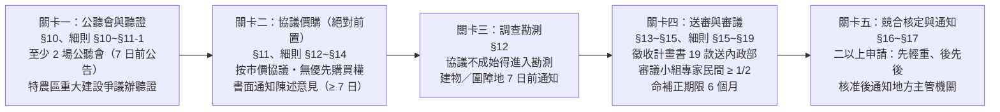

# 第 03 堂｜徵收程序（上）：公聽會、聽證、協議價購與審查核准

> **涵蓋條文範圍**：《土地徵收條例》§10～§17（含 §13-1）；《土地徵收條例施行細則》§10～§19（含 §11-1；註：細則 §17 已刪除）
> **命題熱度**：★★★★★（地政士〈土地法規〉**正當法律程序核心大戰場**！**細則 §10 至少 2 場公聽會、§10Ⅲ 特農區聽證、§11 絕對前置「市價協議價購」＋無優購權、細則 §13 陳述意見 7 日、§13～§13-1 審查與計畫書、§15 土地徵收審議小組 ≥ 1/2、細則 §16 命補正 6 個月**，處處都是申論題的黃金考點！）
> **跨科關聯**：〈土地法規〉（土地法 §34-1／§104／§107 優先購買權排除、平均地權條例 §4 地價評議委員會比較）、〈行政法與正當法律程序〉（行政程序法聽證、陳述意見、程序瑕疵撤銷）

---

## 一、 架構鳥瞰（1 分鐘看懂體系位置）

第 01 堂解決了「實體要件（能不能徵收）」，第 03 堂正式進入第二章「徵收程序」的上半場：**從興辦事業構想到內政部正式核准徵收的「五大黃金關卡」**。這套流程設計的核心精神是憲法上的**「正當法律程序（Due Process）」**與**「徵收最後手段性原則」**——政府不能說徵就徵，必須先聽民眾講話（公聽會／聽證）、再用市價誠意買地（協議價購）、給地主陳述意見，真的買不到才准寫徵收計畫書送到內政部，由專家民間占過半的審議小組嚴審核准！

### 母法與施行細則條文對照地圖

| 主題模組 | 母法（條例） | 施行細則 | 考點星級 |
| :--- | :--- | :--- | :---: |
| 事業許可、**至少 2 場公聽會**與免辦 4 例外 | §10Ⅰ、Ⅱ、Ⅳ | **§10（至少 2 場、7 日前公告）**、§11（免再辦 4 情形） | ★★★★★ |
| **特定農業區重大建設爭議「聽證」程序** | §10Ⅲ | **§11-1（1 個月異議、中央目的機關辦聽證）** | ★★★★★ |
| **絕對前置程序：市價協議價購**與陳述意見 | §11 | §12（急需例外許可）、**§13（陳述意見 ≥ 7 日）**、§14（改良物徵收） | ★★★★★ |
| 協議不成進入公私有土地調查或勘測 | §12 | — | ★★★☆☆ |
| 申請徵收、計畫書 19 款、7 大審查與補正 | §13、§13-1 | §15（層轉）、**§16（補正 6 個月）**、§18～§19（圖籍） | ★★★★★ |
| **中央主管機關核准**、**審議小組 ≥ 1/2**、競合與通知 | §14～§17 | — | ★★★★★ |

---

## 二、 白話精講（母法 × 施行細則整合）

### 主題 1：事業許可、公聽會與特農區聽證（條例 §10；細則 §10～§11-1）★★★★★

#### 1. 興辦事業計畫許可與公聽會時點（條例 §10Ⅰ、Ⅱ、Ⅳ）
* **依法應經許可之事業（§10Ⅰ、Ⅱ）**：
  * 順序：**先舉行公聽會** → **事業計畫報請目的事業主管機關許可** → **協議價購** → **申請徵收**。
* **無須報經許可之事業（§10Ⅳ）**：
  * 順序：於**與所有權人協議價購或以其他方式取得前**，先舉行公聽會。

#### 2. 公聽會黃金 SOP：至少 2 場、7 日前公告與前後場回應（細則 §10）★★★★★
細則 §10 把「公聽會不能流於形式」寫得鉅細靡遺，考場申論題最愛考這 5 大步驟：
1. **場次下限**：應**「至少舉行 2 場」**！
2. **7 日前多管道公告（第 1 款）**：應於 **7 日前**將事由、日期、地點公告於：① 需用土地所在地之公共地方；② 當地直轄市或縣（市）政府、鄉（鎮、市、區）公所、村（里）辦公處之公告處所；③ 村（里）住戶之適當公共位置；並於④ **網站張貼公告**及⑤ **刊登政府公報或新聞紙**。
3. **個別書面通知（第 2 款）**：依土地登記簿所載住所，以**書面通知**興辦事業計畫範圍內之土地所有權人。
4. **會中說明與後場回應義務（第 3 款）**：說明興辦事業概況、展示相關圖籍，並說明事業計畫之**公益性、必要性、適當與合理性及合法性**，聽取所有權人及利害關係人意見。**「後場公聽會」並應說明對「前場公聽會」陳述意見之明確回應及處理情形！**
5. **會議紀錄公告、通知與前後場銜接（第 4、5 款）**：會議紀錄應公告周知（同前述處所＋網站）並書面通知陳述意見人；且**前場公聽會紀錄之公告、書面通知及意見回應處理，必須於「舉行後場公聽會前」完成**！（不可早上開第一場、下午急著開第二場敷衍了事！）
6. **檢附送審（細則 §10Ⅱ）**：報請事業許可及送請核准徵收時，應一併檢附**所有公聽會紀錄、意見及回應處理情形**。

#### 3. 免再舉行公聽會之例外（條例 §10Ⅱ 但書 ＋ 細則 §11）★★★☆☆
原則要辦 2 場公聽會，但有下列 2 大類情形例外免辦：
* **具機密性之國防事業**：依《軍事機密與國防秘密種類範圍等級劃分準則》認定。
* **已舉行公聽會或說明會（細則 §11 四款情形）**：
  1. 規劃階段已舉行 **2 次以上**公聽會，且最近一次距申請徵收 **3 年內**。
  2. 已依《都市計畫法》舉行**公開展覽及說明會**並通知土地所有權人，且最近一次距申請徵收 **3 年內**。
  3. 原事業計畫已舉行公聽會，申請徵收後發現範圍內土地有**遺漏須補辦徵收**。
  4. 配合其他事業需**遷移或共構**，已於該其他事業公聽會或說明會就遷移或共構聽取意見。

#### 4. 特定農業區重大建設有爭議之「聽證」程序（條例 §10Ⅲ ＋ 細則 §11-1）★★★★★
還記得第 01 堂學過「特定農業區農牧用地原則不得徵收，除非行政院核定為重大建設」嗎？法律在此設下第二道強大程序鎖——**正式聽證（Hearing）**！
* **觸發要件（條例 §10Ⅲ ＋ 細則 §11-1Ⅰ、Ⅱ）**：
  1. 標的：**特定農業區「農牧用地」**。
  2. 原因：經**行政院核定為重大建設**須辦理徵收。
  3. 「爭議」之形成步驟：
     * 建設計畫經行政院核定後，需用土地人以書面通知範圍內之特農區農牧用地所有權人其土地列入徵收；
     * 土地所有權人於**收到通知後 1 個月內**，以書面向需用土地人或中央目的事業主管機關，就其農牧用地列入徵收範圍之**必要性**提出異議（**屆期未提出，視為無異議**）；
     * 經**興辦事業之中央目的事業主管機關**詳實說明後，**仍有異議者** → 構成「爭議」！
* **舉行主體、程序與時點（細則 §11-1Ⅲ）**：
  * 由**「興辦事業之中央目的事業主管機關」**（⚠️ 不是內政部，也不是縣市政府！）
  * 依**《行政程序法》**舉行**聽證**（具正式對審、詰問、紀錄拘束力，效力遠強於公聽會！）。
  * 時點：於**報送徵收計畫予中央主管機關（內政部）審查前**辦理之。

---

### 主題 2：絕對前置程序「協議價購或其他方式取得」（條例 §11；細則 §12～§14）★★★★★

「能用買的，就絕對不准用搶的！」條例 §11 是憲法「比例原則——最小侵害／最後手段性」在徵收程序中最具體的體現，**地政士考場年年必防的超級熱點**！

#### 1. 協議價購之絕對前置原則與唯一例外（條例 §11Ⅰ ＋ 細則 §12）
* **大原則（法定絕對前置程序）**：需用土地人申請徵收土地或土地改良物前，**應先與所有權人「協議價購」或「以其他方式取得」**（例如設定地上權、聯合開發、捐贈、公私有土地交換、容積移轉、信託等）；**唯有在所有權人「拒絕參與協議」或「經開會未能達成協議且無法以其他方式取得」者，始得依本條例申請徵收！**
* **唯一緊急例外（§11Ⅰ 除外 ＋ 細則 §12）**：
  * 限**「國防、交通或水利事業」**，因**「公共安全急需使用土地」**未及與所有權人協議者（⚠️ 注意：沒有公用事業、沒有社福教育！只有「**國、交、水＋公安急需**」）。
  * **細則 §12 補救程序**：縱使符合緊急例外，需用土地人仍應於申請徵收前，**擬具理由報請目的事業主管機關許可**，並**敘明事由通知土地所有權人**。
* **🔥 考場必寫：未踐行協議價購之法律效果**：
  * 依最高行政法院實務穩定見解，協議價購屬於徵收之**「法定絕對前置程序」**。若需用土地人未踐行協議價購，或協議程序流於形式（例如未提供合理市價資料供協商、未合法通知即逕稱協議不成），則後續內政部作成之**核准徵收處分具有重大程序瑕疵而違法，所有權人得循訴願及行政訴訟請求撤銷該徵收處分**！

#### 2. 協議價購四大必背細節（條例 §11Ⅱ～Ⅴ ＋ 細則 §13～§14）
1. **書面紀錄義務（§11Ⅱ）**：協議內容應作成**書面**並記明結果；如未能達成協議，應記明**未達成協議之理由**，於申請徵收時送交中央主管機關審查。
2. **排除一切優先購買權（§11Ⅲ — 超級愛考陷阱！）**：
   * **「第一項協議價購，依其他法律規定有優先購買權者，無優先購買權之適用。」**
   * **白話解析**：如果地主答應把共有的土地應有部分、或出租耕地／基地賣給政府（協議價購），其他共有人（《土地法》§34-1）、地上權人／基地承租人（§104）或耕地承租人（§107）**通通不能跳出來主張優先購買權搶地**！因為政府買地是為了辦公共建設，若讓第三人優先買走，政府還是得強制徵收，徒增程序浪費！
3. **市價協議基準（§11Ⅳ、Ⅴ）**：
   * 協議價購應由需用土地人**「依市價」**與所有權人協議；所稱市價，指**「市場正常交易價格」**（實務上需用土地人應委託估價師查估或綜合實價登錄、地價評議資料提出合理市價，不得拿偏低的公告土地現值敷衍地主）。
4. **所有權人陳述意見程序（細則 §13 — 必背「不得少於 7 日」！）**：
   * 申請徵收前，需用土地人應以**書面通知**被徵收土地或改良物所有權人陳述意見（除有細則 §12 公安急需例外）；實務上得於**協議價購時或區段徵收公聽會時一併通知**。
   * **法定給與期限**：自通知書**送達之次日起，不得少於 7 日**；已併協議會議開會通知者，自**最後一次會議之日起，不得少於 7 日**。
   * **紀錄與書面回應**：言詞陳述應作成書面經確認簽章（拒簽記明事由）；無論書面或言詞意見，需用土地人均應以**書面回應及處理**，並填載「**所有權人陳述意見及相關回應處理情形一覽表**」檢附送審。
5. **土地協議成立但地上物談不攏？（細則 §14）**：
   * 需用土地人協議取得之土地，其地上**私有土地改良物未能協議取得者**，得依 §11 規定申請徵收該地上改良物。

> **【實務案例 1】協議價購時，共有人乙可以依《土地法》§34-1 主張優先購買權嗎？**
> 甲、乙分別共有某筆土地（應有部分各 1/2），市政府為開闢公園，依《土地徵收條例》§11 與甲、乙協議價購。甲同意按市價 2,000 萬元將其 1/2 應有部分賣給市政府，乙則拒絕協議，並反過來主張依《土地法》§34-1 第 4 項，就甲出售予市政府的 1/2 應有部分行使「優先購買權」。請問乙的主張有理由嗎？
> * **解析**：**無理由！** 依《土地徵收條例》**§11Ⅲ** 明文規定：「第一項協議價購，依其他法律規定有優先購買權者，**無優先購買權之適用**。」因此《土地法》§34-1 共有人優先購買權於協議價購階段遭排除適用；市政府得合法買下甲之 1/2 應有部分，至於乙拒絕協議之 1/2 應有部分，則於完備陳述意見（細則 §13）後，檢具未達成協議理由依法報請內政部徵收！

---

### 主題 3：協議不成進入土地調查或勘測（條例 §12）★★★☆☆

* **發動時點**：需用土地人經依 §11 規定**「協議不成時」**，為申請徵收之需（例如確定精確徵收面積、分割線與地上物清冊）。
* **執行方式與容忍義務**：得洽請直轄市或縣（市）主管機關會同有關人員進入公、私有土地或土地改良物內實施調查或勘測；所有權人、占有人、使用人或管理人**不得拒絕或阻撓**。
* **7 日前通知義務（但書必背！）**：若須進入**「建築物」或「設有圍障之土地」**調查或勘測，應於 **7 日前通知**其所有權人、占有人、使用人或管理人（保障憲法住宅隱私與財產安寧）。
* **地上障礙物損失補償（§12Ⅱ）**：為調查或勘測須遷移或拆除地上障礙物，致所有權人或使用人遭受之損失，應**「先予適當之補償」**，其補償價額**以協議為之**。

---

### 主題 4：申請徵收、計畫書審核、審議小組與競合核定（條例 §13～§17；細則 §15～§19）★★★★★

#### 1. 申請文件與層轉程序（條例 §13Ⅰ、§13-1；細則 §15、§18～§19）
* **必備三件套（§13Ⅰ）**：
  1. **詳細徵收計畫書**（§13-1 規定 **19 款**必載事項；僅申請徵收土地改良物者，得免記明**第 9 款**一併徵收改良物及**第 14 款**被徵收土地使用配置！）。
     * **必記精華款次（§13-1）**：① 徵收原因、② 範圍面積、③ 事業種類及法令依據、④ 必要性說明、⑤ **協議價購經過及所有權人陳述意見情形**、⑥ **公益性及必要性評估報告**、⑪ **古蹟／遺址／登錄歷史建築現狀及維護措施**、⑫ **聽證／公聽會／說明會紀錄及出席紀錄**、⑯ 應需補償金額總數及分配、⑰ 準備金額總數及來源、⑱ **涉及原住民土地者，應檢附中央原住民族主管機關（原民會）之書面同意文件**、⑲ **安置計畫**。
  2. **徵收土地圖冊**（細則 §18：以地籍圖描繪，就工程用地範圍及徵收土地分別描繪加註圖例）**或土地改良物清冊**。
  3. **土地使用計畫圖**（細則 §19：繪明土地使用配置情形或其使用位置並加註圖例）。
  * 送由核准徵收機關（內政部）核准，並**副知該管直轄市或縣（市）主管機關**。
  * 若有 §27 但書（先行使用）情形，應一併載明於徵收計畫書送審（§13Ⅲ）。
* **細則 §15 層轉送審路線**：
  * 中央機關、直轄市或縣（市）政府 → **逕送**中央主管機關（內政部）核定。
  * 中央機關所屬機關 → 經**上級機關核轉**。
  * 鄉（鎮、市）公所 → 經**該管縣（市）政府核轉**。
  * 農田水利會（註：現行已改制公務機關為農業部農田水利署，條文原文仍列「農田水利會」）→ 經縣（市）政府報經中央目的事業主管機關核轉。

#### 2. 中央主管機關 7 大實質審查事項、現場勘查與 6 個月補正（條例 §13Ⅱ、Ⅳ；細則 §16）★★★★★
* **中央主管機關 7 大審查事項（§13Ⅱ）**：
  1. 是否符合徵收之**公益性、必要性及是否適當與合理**。
  2. 需用土地人是否具有**執行該事業之能力**。
  3. 是否符合現行**都市計畫、區域計畫或國土計畫**。
  4. 是否有助於**土地適當且合理之利用**。
  5. **財務評估**是否合理可行。
  6. 依 §34-1 提出之**安置計畫**是否合理可行。
  7. 其他依法應為或得為審查之事項。
* **現場勘查與 14 日寄送（§13Ⅳ）**：中央主管機關視需要得會同利害關係人進行**現場勘查**並作成勘查紀錄；勘查紀錄作成後應於 **14 日內**寄送利害關係人。
* **🔥 命補正期限「6 個月」與逾期慘痛效果（細則 §16 — 超高頻陷阱！）**：
  * 徵收計畫書送中央主管機關審查後，程式不合經命補正者，應於 **6 個月內**補正完竣；
  * **屆期未補正或補正不完全者，應「重新辦理協議價購程序」後，再送中央主管機關審查！**（因為拖過 6 個月，市場行情與地價早已變動，不能拿過期的舊價格直接徵收！）

#### 3. 核准權統一歸屬中央主管機關（條例 §14）與土地徵收審議小組（條例 §15）★★★★★
* **唯一核准機關（§14）**：徵收土地或土地改良物，一律由**中央主管機關（內政部）**核准之。（早期《土地法》區分行政院與省政府核准之雙軌制已走入歷史！）
* **土地徵收審議小組（§15 — 跨法必考！）**：
  * **運作方式**：以**合議制**方式辦理。
  * **組成代表**：遴聘（派）**專家學者、民間團體及相關機關代表**。
  * **專家學者 4 大專業領域**：**地政、環境影響評估、都市計畫、城鄉規劃**等專業領域學者。
  * **法定比例門檻**：其中**專家學者及民間團體代表「不得少於二分之一（≥ 1/2）」**！

#### 4. 二以上事業申請徵收之競合核定原則（條例 §16）與核准通知（條例 §17）★★★★☆
* **徵收競合核定順序（§16）**：同一土地有二以上需用土地人申請徵收時：
  1. **第一順位**：以其**興辦事業性質之輕重**為核定原則（例如國防事業、重要水利防洪設施，性質重於一般地方公園或休閒設施）。
  2. **第二順位**：其性質相同者，以其**申請之先後**為核定原則（先申請先贏）。
* **核准後通知（§17）**：中央主管機關於核准徵收土地或土地改良物後，應將**原案通知該管直轄市或縣（市）主管機關**（由地方主管機關依 §18 辦理徵收公告 30 日與書面通知，詳見第 04 堂！）。

---

## 三、 考點對決（易混淆觀念比較表＋速記口訣）

### 比較表 1：公聽會（§10Ⅱ、細則 §10）vs. 特定農業區聽證（§10Ⅲ、細則 §11-1）

| 比較項目 | 一般徵收「公聽會」 | 特定農業區重大建設爭議「聽證」 |
| :--- | :--- | :--- |
| **適用情形** | 原則所有徵收案均應舉辦（除非具機密國防或細則 §11 免辦 4 情形） | **特定農業區農牧用地**＋**行政院核定重大建設**＋**有爭議**（收到通知 **1 個月內**書面異議，說明後仍異議） |
| **舉辦主體** | **需用土地人** | **興辦事業之中央目的事業主管機關** |
| **舉行時點** | 報請事業計畫許可前（無須許可者於協議價購前） | 報送徵收計畫予中央主管機關審查前 |
| **程序與場次** | **至少 2 場**；7 日前公告＋書面通知；前場紀錄回應須於後場前完成 | 依**《行政程序法》聽證程序**辦理（具嚴格對審、言詞辯論與紀錄拘束效力） |

### 比較表 2：土地徵收審議小組（土徵 §15）vs. 地價評議委員會（平均地權 §4，112 年修法）

| 比較項目 | 土地徵收審議小組（土徵 §15） | 地價評議委員會（平均地權 §4，112 年新制） |
| :--- | :--- | :--- |
| **設置層級** | **中央主管機關（內政部）** | **直轄市或縣（市）政府** |
| **專家專業領域** | 4 領域：**地政、環境影響評估、都市計畫、城鄉規劃**（口訣：地環都城） | 5 領域：**地政、不動產估價、法律、工程、都市計畫**（口訣：地估法工都） |
| **民間專家門檻** | 專家學者及民間團體代表 **≥ 1/2** | 專家學者與民間相關團體代表 **≥ 1/2**（且刪除民代、公正人士） |
| **任一性別門檻** | 母法未明定（仍受行政實務性別比例規範） | 母法明定任一性別委員 **≥ 1/3** |

### 比較表 3：第 03 堂五大「魔鬼天數／期限」總點名

| 法條依據 | 程序事項 | 必背法定天數／期限 |
| :--- | :--- | :--- |
| **細則 §10①** | 舉行公聽會之事前公告期限（至少 2 場） | **7 日前** |
| **細則 §11①②** | 規劃階段公聽會或都計公展免再辦之有效期限 | 距申請徵收 **3 年內** |
| **細則 §11-1②** | 特農區農牧用地所有權人收到通知後提出異議（觸發聽證） | 收到通知後 **1 個月內** |
| **細則 §13③①** | 書面通知所有權人陳述意見之給與期限 | 送達次日（或最後一次協議會）起 **不得少於 7 日** |
| **條例 §12①** | 進入建築物或設有圍障之土地實施調查勘測 | **7 日前**通知 |
| **條例 §13④** | 中央主管機關現場勘查紀錄寄送利害關係人 | 作成後 **14 日內** |
| **細則 §16** | 徵收計畫書程式不合經命補正之期限 | **6 個月內**（逾期須**重辦協議價購**！） |

### 本堂速記口訣總整理
1. **公聽會（細則 §10）**：**「至少 2 場、7 日公告書面知、前場回應完才開後場」**。
2. **協議價購（§11）**：**「公安急需（國交水）才免議；市價協議、無優購、陳述意見 ≥ 7 日；漏辦就撤銷！」**
3. **審議小組（§15）**：**「內政部合議制，地環都城＋民間 ≥ 1/2」**。
4. **競合核定（§16）**：**「先比輕重，同重比先後」**。
5. **命補正（細則 §16）**：**「6 個月補不完，退回重談協議價購！」**

---

## 四、 課後小測驗（地政士申論模擬演練）

### 模擬題 1（公聽會 × 特農區聽證 × 協議價購綜合實例題）
> **題目**：中央某機關興辦經行政院核定之重大建設計畫，須使用特定農業區農牧用地並報請徵收。請問依《土地徵收條例》及其施行細則規定，其於申請徵收前應踐行之「公聽會」、「聽證」及「協議價購」程序要件各為何？又若協議價購階段有共有人依《土地法》第 34 條之 1 主張優先購買權，是否合法？另若需用土地人未踐行協議價購即逕送核准徵收，法律效果為何？（25 分）

👉 點此展開【擬答架構與得分關鍵字】

1. **公聽會程序（條例 §10、細則 §10）**：
   * 應於報請事業計畫許可前（無須許可者於協議價購前）**至少舉行 2 場**公聽會。
   * 應於 **7 日前**公告於指定處所、網站及公報／新聞紙，並依登記簿住所書面通知土地所有權人；說明公益性、必要性、適當合理性及合法性；前場紀錄之公告通知與意見回應處理，應於舉行後場公聽會前完成，並於後場說明回應情形。
2. **特定農業區重大建設聽證程序（條例 §10Ⅲ、細則 §11-1）**：
   * 建設計畫經行政院核定為重大建設後，需用土地人書面通知特農區農牧用地所有權人；所有權人於**收到通知後 1 個月內**就必要性提出書面異議，經中央目的事業主管機關詳實說明後**仍有異議**（即有爭議）者，應由**興辦事業之中央目的事業主管機關**於報送徵收計畫審查前，依《行政程序法》舉行**聽證**。
3. **協議價購與陳述意見程序（條例 §11、細則 §13）**：
   * 申請徵收前應先與所有權人**依市價（市場正常交易價格）協議價購**或以其他方式取得；協議內容應作成書面，未能達成應記明理由送中央主管機關。
   * 並應書面通知所有權人陳述意見，期限自通知書送達次日起（或併協議會者自最後一次會議之日起）**不得少於 7 日**，且須書面回應處理。
4. **優先購買權不適用與未踐行協議價購之法律效果**：
   * 依條例 **§11Ⅲ**，協議價購「**無優先購買權之適用**」，故共有人依土地法 §34-1 主張優先購買權**不合法**。
   * 協議價購屬徵收之**法定絕對前置程序**（除國防、交通、水利因公安急需例外），若未踐行或流於形式，核准徵收處分具重大程序瑕疵，所有權人得循行政救濟請求**撤銷**該徵收處分。

---

### 模擬題 2（審查核准 × 審議小組 × 競合 × 命補正綜合題）
> **題目**：依《土地徵收條例》第 13 條至第 16 條及其施行細則第 16 條規定，徵收土地之核准機關為何？其審議徵收案件之合議制組織（土地徵收審議小組）成員及比例限制為何？中央主管機關審核徵收申請應審查哪些事項？若程式不合經命補正而屆期未補正者，有何法律效果？又同一土地有二以上需用土地人同時申請徵收時，應依何原則核定？（25 分）

👉 點此展開【擬答架構與得分關鍵字】

1. **核准機關與土地徵收審議小組（條例 §14、§15）**：
   * 核准機關統一為**中央主管機關（內政部）**（§14）。
   * 內政部應遴聘（派）專家學者、民間團體及相關機關代表，以**合議制**方式審議徵收案件。專家學者由**地政、環境影響評估、都市計畫、城鄉規劃**等專業領域學者組成，其中**專家學者及民間團體代表不得少於 1/2**（§15）。
2. **中央主管機關之 7 大審查事項（條例 §13Ⅱ）**：
   * ① 是否符合徵收之公益性、必要性及是否適當與合理；② 需用土地人是否具執行事業能力；③ 是否符合現行都市計畫、區域計畫或國土計畫；④ 是否有助於土地適當且合理之利用；⑤ 財務評估是否合理可行；⑥ 依 §34-1 提出之安置計畫是否合理可行；⑦ 其他依法應為或得為審查之事項。（並可補充：視需要會同利害關係人現場勘查，紀錄於 14 日內寄送，§13Ⅳ）。
3. **命補正期限與屆期未補正之法律效果（細則 §16）**：
   * 徵收計畫書程式不合經命補正者，應於 **6 個月內**補正完竣；**屆期未補正或補正不完全者，應重新辦理協議價購程序後，再送中央主管機關審查**。
4. **二以上事業申請徵收之競合核定原則（條例 §16）**：
   * 同一土地有二以上需用土地人申請徵收時，**先以其興辦事業性質之輕重為核定原則**；**其性質相同者，以其申請之先後為核定原則**。

---

> **下堂課預告**：第 04 堂｜**徵收程序（下）：公告通知、異議救濟、保管專戶與先補償後使用**（條例 §18～§29；細則 §20～§28）— 內政部核准徵收後，接下來進入最刺激的「30 日公告 → 15 日發補償（遲發就失效！）→ 雙軌異議復議救濟 → 3 個月存專戶、15 年歸國庫」！
