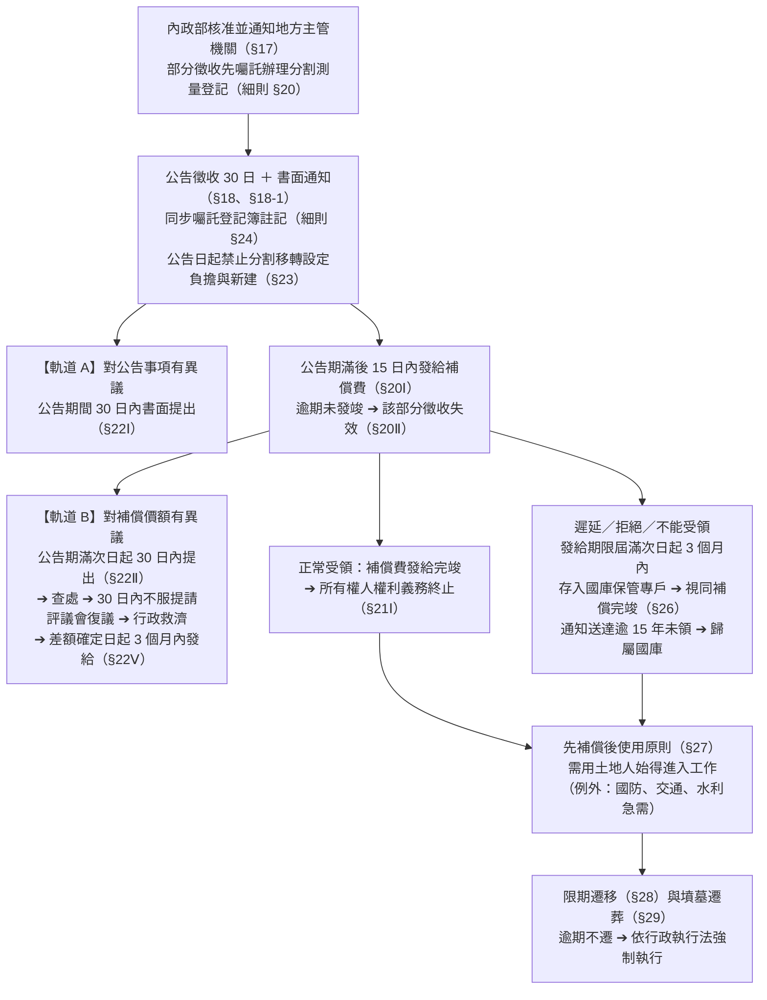

# 第 04 堂｜徵收程序（下）：公告通知、異議救濟、保管專戶與先補償後使用

> **涵蓋條文範圍**：《土地徵收條例》§18～§29（含 §18-1）、《土地徵收條例施行細則》§20～§28
> **命題熱度**：★★★★★（超級核心考區！**§20 公告期滿 15 日未發給補償費徵收失效、§22 雙軌異議與復議救濟、§23 公告日禁止處分與共有分管耕地例外、§26 補償費保管專戶 3 個月／15 年、§27 先補償後使用與急需例外**，幾乎隔年必入申論！）
> **跨科關聯**：〈土地登記規則〉（逕為分割測量、徵收註記登記、未辦繼承登記）、〈行政法／憲法〉（釋字第 516、652 號、行政執行法、訴願與行政訴訟）、〈民法〉（公同共有、提存法排除）

---

## 一、 架構鳥瞰（1 分鐘看懂體系位置）

第 03 堂我們走完了徵收的「前半場」（公聽會 → 聽證 → 協議價購 → 報內政部審議核准）。當中央主管機關（內政部）依 §17 將核准原案通知直轄市或縣（市）主管機關後，就正式進入**徵收執行與財產權移轉的「後半場」**！

這一階段環環相扣，每一個天數都是地政士考試的必考數字，請先把整條「時間軸」印在腦海裡：

### 母法與施行細則條文對照地圖

| 主題模組 | 母法（條例） | 施行細則 | 考點星級 |
| :--- | :--- | :--- | :---: |
| 部分徵收分割、徵收公告 30 日與書面通知 | §18、§18-1 | §20、§21、§25 | ★★★★☆ |
| 補償費負擔、15 日發給期限與逾期失效 | §19、§20 | §22 | ★★★★★ |
| 權利義務終止時點與從來之使用 | §21 | — | ★★★★☆ |
| 雙軌異議、地價評議會復議與 3 個月發給差額 | §22 | §23 | ★★★★★ |
| 公告日禁止處分建築、共有分管耕地例外與備案 | §23、§24 | §24 | ★★★★★ |
| 未辦繼承登記按應繼分領取補償費 | §25 | — | ★★★★☆ |
| 補償費保管專戶（3 個月存入、15 年歸國庫） | §26 | §26、§27 | ★★★★★ |
| 先補償後使用原則、急需先行使用與限期遷移 | §27～§29 | §28 | ★★★★☆ |

---

## 二、 白話精講（母法 × 施行細則整合）

### 主題 1：徵收公告 30 日、分割前置與通知對象（條例 §18、§18-1；細則 §20、§21、§25）★★★★☆

#### 1. 部分徵收之「先分割、再公告」（細則 §20）
* **實務痛點**：如果一筆 1,000 平方公尺的土地，馬路拓寬只徵收其中 200 平方公尺，如果不先分割地號，公告與登記簿註記會搞不清楚到底徵收哪一塊。
* **規定**：一宗土地部分被徵收者，直轄市或縣（市）主管機關應於**公告徵收前**，囑託該管登記機關就徵收之部分辦理**分割測量登記**，並以**分割登記後之土地標示**辦理公告徵收。

#### 2. 公告期間與應載明事項（條例 §18；細則 §21）
* **公告與通知**：地方主管機關接到內政部核准徵收案通知時，應即公告，並以**書面通知**土地或土地改良物所有權人及他項權利人。
* **法定公告期間**：**30 日**（此 30 日同時是 §22Ⅰ 公告事項異議期間、§23Ⅰ 未登記權利人申請登記期間、§24Ⅰ 備案期間，也是區段徵收 §40Ⅰ 申請抵價地期間！）。
* **細則 §21 公告應載明 9 大事項**：
  1. 需用土地人之名稱。
  2. 興辦事業之種類。
  3. 核准徵收機關及文號。
  4. 徵收之土地或土地改良物及其應補償之費額。
  5. 公告期間。
  6. 得提出異議及行政救濟之期限。
  7. 公告徵收後之禁止事項。
  8. 得申請一併徵收之要件及期限（指 §8 殘餘地一併徵收，公告日起 1 年內）。
  9. 其他依規定應公告之事項。
* **無登記標的特別載明（細則 §21Ⅱ、Ⅲ）**：徵收**農作改良物**或**未經登記之建築改良物**，公告應載明應受補償人之姓名、住所；公告並應附同徵收土地圖，公布於地方主管機關公告處所及被徵收標的所在地。

#### 3. 公告與通知之對象基準及效力延伸（條例 §18-1；細則 §25）★★★★☆
* **基準日（§18-1 前段）**：已登記者，以**「公告之日」**土地登記簿或建築改良物登記簿記載之所有權人及他項權利人姓名、住所辦理公告及通知。
* **效力及於未辦登記之真正權利人（§18-1 後段 — 必背！）**：
  * 實務上常發生「阿公過世多年，子孫沒辦繼承登記」，地政機關只能照登記簿寄給阿公，事後子孫跑出來抗議「沒通知我，徵收無效！」。
  * 為維持法律安定性，§18-1 明定：上述依登記簿辦理之公告及通知，其效力**並及於公告前因「繼承、強制執行或法院之判決」已取得所有權或他項權利，而尚未辦竣登記之人**！（注意：不含私下買賣契約未登記，因為不動產買賣採登記生效主義，未登記根本還沒取得物權；而繼承、強制執行、法院判決屬民法 §759 非因法律行為取得物權，不待登記已生取得效力！）
* **送達方式（細則 §25）**：
  * 已登記者依登記簿所載姓名住所；農作改良物或未登記建物依細則 §21Ⅱ 公告之姓名住所，皆應以**掛號交寄並取得回執**（或其他得收取回執方式）書面通知。
  * 未能送達者，辦理**公示送達**。
  * 通知核准徵收時，**得一併通知其領取補償費之日期**。

---

### 主題 2：補償費 15 日發給期限、逾期失效與權利終止（條例 §19～§21；細則 §22）★★★★★

這是整部條例最具憲法威力的條文！司法院大法官**釋字第 516 號**與**釋字第 652 號**反覆強調：國家徵收人民財產，必須給予**「迅速、相當之補償」**，逾期不給錢，徵收核准處分就會直接失效！

#### 1. 補償費之負擔與發給機關（條例 §19）
* 補償費由**需用土地人負擔**，並繳交該管直轄市或縣（市）主管機關**轉發**之（不是需用土地人自己拿現金去發，必須透過地方主管機關把關轉發）。

#### 2. 法定發給期限與逾期失其效力（條例 §20）★★★★★
* **發給期限（§20Ⅰ）**：應於**公告期滿後 15 日內**發給之（但依 §22Ⅴ 發給復議／行政救濟後之補償價額**差額**者，期限為確定日起 3 個月，不在此限）。
* **逾期未發給完竣之法律效果（§20Ⅱ 本文）**：
  * 需用土地人未於**公告期滿 15 日內**將應發給之補償費繳交該管直轄市或縣（市）主管機關發給完竣者，**「該部分土地或土地改良物之徵收從此失其效力」**！（注意是「該部分」失效，其他已準時發完的土地徵收仍有效！）
* **四大「不失效」例外事由（§20Ⅱ 但書 — 必背 4 款！）**：
  1. 於**公告期間內**因對補償之估定有異議，而由地方主管機關依 §22 規定提交**地價評議委員會復議**。
  2. 經應受補償人以**書面同意延期或分期發給**。
  3. 應受補償人**拒絕受領或不能受領**（例如拒絕領錢抗議、人失蹤、有爭議無法受領）。
  4. 應受補償人**所在地不明**。
  * 💡 **延伸連動 2 大條文**：
    * **保管專戶（§26Ⅲ）**：未受領補償費依 §26Ⅰ 期限存入國庫保管專戶時，**視同補償完竣**（不會失效）。
    * **區段徵收申領抵價地（§40Ⅴ）**：申請發給抵價地者，**不受 §20Ⅰ 15 日發給期限之限制**。
* **原所有權人主張徵收失效之程序（細則 §22）**：
  * 原土地所有權人主張逾期未發給補償費致徵收失效 → 向該管**直轄市或縣（市）主管機關**申請 → 地方主管機關查明發給情形並研擬徵收是否失效之意見 → 報**原核准徵收機關（內政部）核定**後，函復原土地所有權人。

#### 3. 權利義務終止時點（條例 §21）★★★★☆
* **終止時點（§21Ⅰ）**：被徵收土地或土地改良物之所有權人，對其土地或改良物之權利義務，於**「應受之補償費發給完竣時」終止**（並非「公告日」也不是「核准日」更不是「完成所有權移轉登記日」！）。
* **發給前之使用權（§21Ⅱ）**：補償費未發給完竣前，所有權人**得繼續為從來之使用**（例如繼續住原本的房子、繼續收割原本種好的稻子，但不得依 §23 蓋新屋或增種）。但合於 **§27 但書**（國防、交通、水利因公共安全急需先行使用）者，不在此限。

> **【實務案例 1】補償費拖到第 20 天才發，地主可以主張徵收無效嗎？**
> 某縣政府辦理公園用地徵收，公告期間為 5 月 1 日至 5 月 30 日（共 30 日）。地主老林無異議、未同意延期，也準時準備好文件等領錢；但需用土地人因預算撥款延誤，直到 6 月 20 日（公告期滿後第 21 日）才將補償費繳交縣府發給老林。
> * **解析**：公告期滿日為 5 月 30 日，15 日法定發給期限至 6 月 14 日屆滿。需用土地人未於期限內發給完竣，且無 §20Ⅱ 但書 4 款例外事由，因此**老林該筆土地之徵收自期限屆滿時起「從此失其效力」**！老林得依**細則 §22** 向縣政府申請確認徵收失效，由縣府查明後報請**內政部核定**並函復。

---

### 主題 3：雙軌異議、地價評議會復議與 3 個月發給差額（條例 §22；細則 §23）★★★★★

考場上最愛考的「天數陷阱題」就在 §22！同學一定要把**「對公告事項有異議」**與**「對徵收補償價額有異議」**分成左右兩條軌道來背：

#### 1. 軌道 A：對「公告事項」有異議（§22Ⅰ）
* **異議標的**：對 §18Ⅰ 公告事項（例如面積算錯、地號寫錯、土地改良物漏列、所有權人姓名誤載等）。
* **法定期間**：**「公告期間內」**（即公告 30 日內）。
* **處理方式**：以書面向該管直轄市或縣（市）主管機關提出 → 應即查明處理，並將查處情形以書面通知權利關係人。

#### 2. 軌道 B：對「徵收補償價額」有異議（§22Ⅱ、Ⅲ；細則 §23）★★★★★
* **為什麼期間放寬？** 民國 101 年修法考量民眾收到徵收通知時，往往要先研究市價查估資料，原本僅限公告期間內提異議太趕，因此特別延長為「公告期滿次日起 30 日內」！
* **三階段救濟流程**：
  1. **第一階段（書面異議 → 查處）**：權利關係人應於**「公告期間屆滿之次日起 30 日內」**，以書面向直轄市或縣（市）主管機關提出異議 → 主管機關應即查明處理並書面通知。
  2. **第二階段（不服查處 → 復議）**：不服查處者，依**細則 §23** 應於**「查處通知送達之日起 30 日內」**，以書面敘明不服之事實及理由送直轄市或縣（市）主管機關 → 主管機關得提請**地價評議委員會復議**。
  3. **第三階段（不服復議 → 行政救濟）**：不服復議結果者，得依法提起**行政救濟**（訴願 → 行政訴訟）。

#### 3. 不停止執行原則與差額 3 個月發給（§22Ⅳ、Ⅴ）
* **不停止執行（§22Ⅳ）**：地方主管機關依 §20 發給補償費完竣後，**徵收計畫之執行，不因權利關係人提出異議或提起行政救濟而停止**（避免單一地主對價格有意見就卡死整條捷運或高速公路工程）。
* **差額發給期限（§22Ⅴ — 釋字第 652 號修法成果！）**：
  * 徵收補償價額經**復議、行政救濟結果有變動**，或補償費已發給完竣、**嗣經發現原補償價額認定錯誤**者，其**應補償價額差額**，應於**「其結果確定之日起 3 個月內」**發給之。
  * 💡 **憲法補充加分**：大法官**釋字第 652 號**指出，過去法條未規定「增發補償費差額」的期限，若政府拖延多年不發差額，有違憲法保障財產權意旨，故增訂「結果確定之日起 3 個月內」發給！

---

### 主題 4：公告日禁止處分建築、共有分管耕地例外與權利認定（條例 §23～§25；細則 §24）★★★★★

#### 1. 公告日起之「雙重凍結管制」（條例 §23Ⅰ；細則 §24）
徵收公告一旦貼出去，為了防止地主「搶蓋違建、搶種高價樹苗騙補償」或「惡意移轉分割增加徵收作業混亂」，法律啟動兩大凍結：
* **權利處分凍結（囑託註記，細則 §24）**：自**公告日起**，不得**分割、合併、移轉或設定負擔**（地方主管機關於公告徵收時，同時囑託登記機關於登記簿註記徵收公告日期及文號）。
  * **唯一法定例外（3 類非因法律行為取得）**：於**公告前**因**「繼承、強制執行或法院之判決」**而取得所有權或他項權利，並於**「公告期間內申請登記」**者，不在此限！
* **事實行為凍結**：土地權利人或使用人不得為建築改良物之**新建、增建、改建**（注意：§23Ⅰ 未寫「重建」，區段徵收 §37 才有寫「重建」），或**採取土石、變更地形**，或為農作改良物之**增加種植**。其於**公告時已在工作中者，應即停止**！（已合法施工停工所受之改良費損失，依 §32 補償）。

#### 2. 超高頻例外考點：共有分管耕地部分被徵收（條例 §23Ⅱ、§24Ⅱ）★★★★★
* **背景**：鄉下農地常常是兄弟姊妹多人「分別共有」但有「分管契約」（大哥耕東邊、二哥耕西邊）。如果馬路只徵收東邊大哥耕作的那一小塊，照理說「按應有部分分配補償費」，二哥沒被徵收土地卻能分走一半補償費，而剩下的西邊地大哥還要跟二哥共有，極不公平！
* **破冰規定（§23Ⅱ）**：**共有分管之耕地，部分被徵收者**，土地所有權人得於**「徵收補償地價發給完竣前」**或**「核定發給抵價地前」**，申請**「共有物分割登記」**或**「應有部分交換移轉登記」**，不受 §23Ⅰ 不得分割、移轉規定之限制！
* **權利認定更新（§24Ⅱ）**：依 §23Ⅱ 辦理登記後，其權利改以**「登記後」**土地登記簿記載者為準（讓實際被徵收位置的大哥獨領該區補償費，二哥完整保有未被徵收的西邊耕地！）。

#### 3. 權利認定基準與備案制度（條例 §24Ⅰ）
* **原則**：以**公告之日**土地登記簿或建物登記簿記載者為準。
* **備案例外**：公告前因**繼承、強制執行、法院之判決或其他依法律規定**（注意：比 §18-1、§23Ⅰ 多了「其他依法律規定」！）取得所有權或他項權利而**未經登記完畢**者，其權利人應於**徵收公告期間內**，向地方主管機關申請將其權利**備案**。

#### 4. 未辦繼承登記或公同共有繼承：按應繼分領取（條例 §25）★★★★☆
* **實務難題**：依《民法》§828，公同共有物之處分及其他權利行使，原則須得全體公同共有人同意。實務上老地主過世後，繼承人多達數十人、有人旅居國外或失聯，若要全部簽名才能領補償費，錢永遠領不出來！
* **解套條文（§25）**：被徵收之土地或改良物，所有權人死亡**未辦竣繼承登記**，其徵收補償費得由**「部分繼承人按其應繼分領取之」**；其**已辦竣公同共有繼承登記**者，亦同！（不必全體繼承人會同，也不用先辦遺產分割！）。

---

### 主題 5：土地徵收補償費保管專戶（條例 §26；細則 §26、§27）★★★★★

這是地政士考試最愛跟《民法》提存法比較的大題！請把三個關鍵數字：**「3 個月」、「實收利息」、「15 年」** 刻在腦海裡：

1. **設立與排除提存法**：直轄市或縣（市）主管機關應於**國庫**設立「土地徵收補償費保管專戶」，保管因**受領遲延、拒絕受領或不能受領**之補償費，**不適用提存法之規定**（不走法院提存所，由政府專戶直接保管！）。
2. **存入期限（§26Ⅰ、細則 §26）**：應於本條例規定應發給補償費之期限（即 §20Ⅰ 公告期滿後 15 日，或 §22Ⅴ 差額結果確定日起 3 個月）**屆滿次日起「3 個月內」**存入專戶保管，並通知應受補償人。
3. **存入之法律效力（§26Ⅲ）**：未受領之補償費，依第 1 項規定**繳存專戶保管時，「視同補償完竣」**（從此發生 §21Ⅰ 權利義務終止效力，需用土地人也取得 §27 進場施工權，徵收不致失效！）。
4. **利息計算（§26Ⅱ）**：保管專戶儲存之補償費應給付利息，以**「實收利息照付」**。
5. **15 年歸屬國庫（§26Ⅰ 後段）**：自**「通知送達發生效力之日起」**，逾 **15 年**未領取之補償費，**歸屬國庫**。（對比《提存法》清償提存是逾 **10 年**歸屬國庫！土徵條例特別拉長為 15 年，保護被徵收人權益！）。
6. **報備查義務（細則 §27）**：補償完竣並完成土地登記後，地方主管機關應將辦理經過情形，報**中央主管機關（內政部）備查**。

> **【實務案例 2】拒領補償費就能阻擋政府拆房子嗎？**
> 老張抗議徵收補償價額太低，在 15 日領款期間內堅決拒絕去領補償費，心想：「只要我不領錢，補償費就沒發給完竣，政府依 §27 就不能進來拆我房子！」請問老張的策略會成功嗎？
> * **解析**：**不會成功！**
>   1. 老張拒絕受領，屬於 **§20Ⅱ 第 3 款**之「應受補償人拒絕受領」，徵收**不會**因超過 15 日而失效。
>   2. 地方主管機關會依 **§26Ⅰ**，於 15 日發給期限屆滿次日起 **3 個月內**，將補償費存入國庫「土地徵收補償費保管專戶」並通知老張。
>   3. 依 **§26Ⅲ**，一經繳存專戶保管，即**「視同補償完竣」**！老張的權利義務隨即終止，需用土地人即可合法進場施工；若老張自通知送達生效日起超過 **15 年**仍不去領，這筆錢還會直接歸屬國庫！

---

### 主題 6：先補償後使用原則、急需例外與限期遷移（條例 §27～§29；細則 §28）★★★★☆

#### 1. 先補償後使用原則與緊急例外（條例 §27；細則 §28）
* **原則（§27 本文）**：需用土地人應俟**「補償費發給完竣」**或**「核定發給抵價地」**後，始得進入被徵收土地內工作。
* **唯一例外（§27 但書）**：**「國防、交通及水利事業」**，因**「公共安全急需先行使用」**者，不在此限。（口訣：**「國、交、水，公安急需」**，與 §11 免協議價購的例外一模一樣！）。
* **嚴格事前核准程序（細則 §28；§13Ⅲ）**：
  1. 需用土地人於**申請徵收前**，擬具理由，先報請**目的事業主管機關許可**。
  2. 一併載明於徵收計畫書（§13Ⅲ），送由**中央主管機關（內政部）核准徵收及先行使用**。
  3. 地方主管機關於**徵收公告時**，應將上開先行使用事由**一併公告**。

#### 2. 限期遷移與墳墓遷葬（條例 §28、§29）
* **一般物件限期遷移（§28）**：
  * 補償費發給完竣或核定發給抵價地後，地方主管機關應通知土地權利人或使用人**限期遷移完竣**。
  * 應受領遷移費人**無可考或所在地不明**，致應遷移物件未能遷移者 → 主管機關應**公告 30 日**限期遷移完竣。
  * **逾期未遷移之強制手段**：由直轄市或縣（市）主管機關或需用土地人依**《行政執行法》**執行（例如代履行拆除或直接強制）。
* **墳墓遷葬專規（§29）**：
  * 徵收範圍內應行遷葬之墳墓，需用土地人應申請當地墳墓主管機關依**《殯葬管理條例》**規定辦理，並將情形詳細記載列冊，報請直轄市或縣（市）政府備案。

---

## 三、 考點對決（易混淆觀念比較表＋口訣）

### 比較表 1：§22「雙軌異議」終極對決表

| 比較維度 | 軌道 A：對「公告事項」異議（§22Ⅰ） | 軌道 B：對「徵收補償價額」異議（§22Ⅱ、Ⅲ、細則 §23） |
| :--- | :--- | :--- |
| **異議事由** | 面積、地號、改良物數量、姓名等公告記載事項有誤 | 認為地價市價、建物或農作物補償價額估定過低 |
| **異議期限** | **公告期間內**（30 日內） | **公告期間屆滿之次日起 30 日內** |
| **受理與初審** | 地方主管機關書面受理 → 查明處理並書面通知 | 地方主管機關書面受理 → 查明處理並書面通知 |
| **不服查處程序** | 逕依行政救濟途徑處理 | 於**查處通知送達之日起 30 日內**書面敘明理由 → 提請**地價評議委員會復議** → 不服復議結果始提行政救濟 |
| **是否停止執行** | 補償費發給完竣後，**不停止徵收計畫之執行**（§22Ⅳ） | 補償費發給完竣後，**不停止徵收計畫之執行**（§22Ⅳ） |
| **事後差額發給** | — | 復議、行政救濟變動或原認定錯誤 → **結果確定之日起 3 個月內**發給差額（§22Ⅴ） |

### 比較表 2：土徵「補償費保管專戶」vs. 民法「法院清償提存」

| 比較項目 | 土地徵收補償費保管專戶（土徵 §26） | 民法清償提存（提存法） |
| :--- | :--- | :--- |
| **法律適用** | 明文**不適用提存法** | 適用民法及提存法 |
| **保管機構** | 直轄市或縣（市）主管機關於**國庫**設立專戶 | 該管地方法院**提存所** |
| **存入期限** | 發給期限屆滿次日起 **3 個月內** | 無統一 3 個月法定上限 |
| **法定效力** | 繳存專戶保管時，**視同補償完竣**（§26Ⅲ） | 發生清償債之消滅效力 |
| **孳息計算** | **以實收利息照付**（§26Ⅱ） | 依提存法規定計息 |
| **歸屬國庫年限** | 自**通知送達發生效力之日起，逾 15 年**未領取 | 自提存通知書送達發生效力之翌日起，逾 **10 年**未領取 |

### 比較表 3：徵收程序中容易混在一起的「四大期間」

| 期限數字 | 對應法條 | 具體事項 | 速記口訣 |
| :---: | :---: | :--- | :--- |
| **15 日** | §20Ⅰ | 公告期滿後發給補償費期限（逾期徵收失效） | **「期滿 15 發完錢，不發就失效」** |
| **30 日** | §18Ⅱ、§22ⅠⅡ、細則 §23、§28Ⅱ | 公告期間、公告事項異議、補償價額異議（期滿次日起）、不服查處提復議、不明遷移物公告 | **「公告異議復議遷，通通 30 天」** |
| **3 個月** | §22Ⅴ、§26Ⅰ | 差額發給期限（結果確定日起）、保管專戶存入期限（發給期滿次日起） | **「補差額、存專戶，都是 3 個月」** |
| **15 年** | §26Ⅰ | 保管專戶未領取歸屬國庫（通知送達生效日起） | **「專戶領錢等 15 年，比提存多 5 年」** |

> **本堂總口訣**：
> * **§20 不失效 4 例外**：**「異議復議、書面同意、拒領不能、所在不明」**
> * **§27 急需先行使用（同 §11）**：**「國、交、水，公安急需（目許→中核→併公告）」**
> * **§23Ⅱ 共有分管耕地破冰**：**「分管耕地部徵收，完竣核定前，可分割交換」**

---

## 四、 課後小測驗（地政士申論模擬演練）

### 模擬題 1（高頻大熱門：補償費發給期限、逾期失效與保管專戶）
> **題目**：依《土地徵收條例》及其施行細則規定，徵收土地補償費應於何時發給？若需用土地人逾期未發給完竣，法律效果為何？又在何種例外情形下不生該效果？此外，若應受補償人拒絕受領補償費時，主管機關應如何處理？其法律效力及逾期未領之效果為何？（25 分）

👉 點此展開【擬答架構與得分關鍵字】

1. **補償費之負擔、發給期限與逾期失效（條例 §19、§20；細則 §22）**：
   * 負擔與轉發：由需用土地人負擔，繳交地方主管機關轉發（§19）。
   * 發給期限：應於**公告期滿後 15 日內**發給之（但依 §22Ⅴ 發給差額者不在此限，§20Ⅰ）。
   * 逾期法律效果：未於公告期滿 15 日內繳交發給完竣者，**該部分土地或土地改良物之徵收從此失其效力**（§20Ⅱ 本文）。原土地所有權人得向地方主管機關申請，由地方主管機關查明研擬意見後，報**原核准徵收機關（內政部）核定**後函復（細則 §22）。
2. **逾期未發給完竣之 4 款不失效例外（條例 §20Ⅱ 但書；另可補述 §40Ⅴ）**：
   * ① 於公告期間內對補償估定有異議，依 §22 提交地價評議委員會復議。
   * ② 經應受補償人以書面同意延期或分期發給。
   * ③ 應受補償人拒絕受領或不能受領。
   * ④ 應受補償人所在地不明。
   * （註：區段徵收申請發給抵價地者，依 §40Ⅴ 不受 §20Ⅰ 發給期限之限制。）
3. **拒絕受領時之保管專戶處理、效力與歸屬國庫（條例 §26；細則 §26）**：
   * 專戶保管：直轄市或縣（市）主管機關應於**國庫**設立土地徵收補償費保管專戶，**不適用提存法**。
   * 存入期限與通知：應於應發給補償費期限（§20Ⅰ 或 §22Ⅴ）**屆滿次日起 3 個月內**存入專戶保管，並通知應受補償人；儲存之補償費應給付利息，**以實收利息照付**（§26Ⅰ、Ⅱ）。
   * 法律效力：繳存專戶保管時，**視同補償完竣**（§26Ⅲ），所有權人權利義務隨即終止（§21Ⅰ）。
   * 逾期未領效果：自**通知送達發生效力之日起，逾 15 年未領取**者，**歸屬國庫**（§26Ⅰ 後段）。

---

### 模擬題 2（實例綜合題：公告後禁止事項、共有分管耕地與雙軌異議）
> **題目**：甲、乙二人分別共有並訂有分管契約之 A 耕地，因道路開闢部分被徵收。試依《土地徵收條例》及其施行細則回答下列問題：（25 分）
> (一) 徵收公告日後，原則上有何處分及使用行為之限制？甲、乙若欲辦理共有物分割登記，使被徵收部分歸由該區分管人所有並單獨受領補償費，是否可行？其申請時限及權利認定基準為何？
> (二) 若甲對「徵收面積（公告事項）」無意見，但認為「徵收補償地價過低」，應於何期限內循何種程序救濟？若日後行政救濟勝訴增加補償費，主管機關應於多久內發給差額？救濟期間道路工程是否應停工？

👉 點此展開【擬答架構與得分關鍵字】

1. **(一) 公告日後之禁止事項與共有分管耕地之例外（條例 §23、§24；細則 §24）**：
   * **原則限制（§23Ⅰ、細則 §24）**：自公告日起，地方主管機關囑託登記簿註記，除於公告前因**繼承、強制執行或法院之判決**取得權利並於公告期間內申請登記者外，不得**分割、合併、移轉或設定負擔**；亦不得為建物之**新建、增建、改建**或**採取土石、變更地形**或農作改良物之**增加種植**，已在工作中者應即停止。
   * **共有分管耕地之破冰例外（§23Ⅱ）**：**可行！** 共有分管之耕地，部分被徵收者，土地所有權人得於**「徵收補償地價發給完竣前」或「核定發給抵價地前」**，申請**共有物分割登記**或**應有部分交換移轉登記**，不受 §23Ⅰ 不得分割、移轉規定之限制。
   * **權利認定基準（§24Ⅱ）**：原則上依公告之日登記簿記載為準（§24Ⅰ），惟依 §23Ⅱ 辦理分割或交換移轉登記者，其權利改以**「登記後」土地登記簿記載者為準**。
2. **(二) 對補償價額異議之救濟程序、差額發給與不停止執行（條例 §22；細則 §23）**：
   * **救濟期限與程序**：對徵收補償價額有異議者，應於**公告期間屆滿之次日起 30 日內**，以書面向地方主管機關提出異議 → 主管機關查明處理並書面通知（§22Ⅱ）。若甲不服查處，應於**查處通知送達之日起 30 日內**以書面敘明事實及理由送交地方主管機關（細則 §23），由主管機關提請**地價評議委員會復議**；不服復議結果者，得依法提起**行政救濟**（§22Ⅲ）。
   * **差額發給期限**：經復議、行政救濟結果有變動者，其應補償價額差額，應於**其結果確定之日起 3 個月內**發給之（§22Ⅴ）。
   * **工程是否停工**：**不應停工。** 依 §22Ⅳ，地方主管機關依 §20 發給補償費完竣後，徵收計畫之執行，不因權利關係人提出異議或提起行政救濟而停止。

