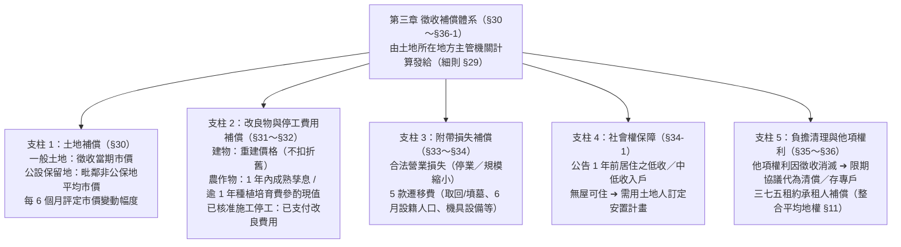

# 第 05 堂｜徵收補償篇：市價補償、地上物查估、弱勢安置與他項權利

> **涵蓋條文範圍**：《土地徵收條例》§30～§36-1（含 §34-1）、《土地徵收條例施行細則》§29～§33（含 §31-1）；並整合《土地徵收補償市價查估辦法》核心重點與《平均地權條例》§11 跨科考點
> **命題熱度**：★★★★★（地政士超級明星章節！**§30 市價補償與公設保留地毗鄰平均市價（含細則 §30～§31-1）、§31 建物重建價格與農作物 1 年分界、§33 營業損失、§34 五款遷移費、§34-1 弱勢安置計畫、§35～§36 他項權利與三七五租約代為清償**，全章皆為高頻申論考點！）
> **跨科關聯**：〈土地法規〉（平均地權條例 §10、§11 及其細則 §8～§12、§63）、〈土地稅法規〉（土地稅法 §39Ⅰ 徵收土地免徵土增稅）、〈不動產估價概要〉（市價查估辦法、比較法、收益法、重建價格）

---

## 一、 架構鳥瞰（1 分鐘看懂體系位置）

憲法第 15 條保障人民財產權，徵收既屬「為公益而課予特定人之特別犧牲」，就必須給予**「完全、相當之補償」**！民國 101 年《土地徵收條例》大修法最震撼的變革，就是全面揚棄過去偏低的「公告土地現值加成」，改採**「市價補償（§30）」**，並首創**「弱勢居住安置計畫（§34-1）」**。

整個第三章「徵收補償」可以拆成**五大補償支柱＋一大負擔清理**：

### 母法與施行細則條文對照地圖

| 主題模組 | 母法（條例） | 施行細則／關聯法規 | 考點星級 |
| :--- | :--- | :--- | :---: |
| 地價補償：徵收當期市價、公設保留地毗鄰平均市價 | §30 | 細則 §29、§30、§31、§31-1；《市價查估辦法》 | ★★★★★ |
| 建築改良物（重建價格）與農作改良物（1 年分界） | §31 | — | ★★★★★ |
| 領照或合法農地改良停工之已支付改良費用補償 | §32 | 細則 §32、§33；平均地權細則 §12 | ★★★☆☆ |
| 合法營業損失補償（停業或營業規模縮小） | §33 | — | ★★★★☆ |
| 五大法定遷移費（含 6 個月設籍但書） | §34 | — | ★★★★★ |
| 低收入戶／中低收入戶弱勢安置計畫 | §34-1 | 條例 §13Ⅱ⑥、§13-1①⑲ | ★★★★★ |
| 應有負擔清理、他項權利消滅代償與核發辦法授權 | §35、§36、§36-1 | 平均地權條例 §11；土地稅法 §39Ⅰ | ★★★★★ |

---

## 二、 白話精講（母法 × 施行細則整合）

### 主題 1：地價市價補償與公共設施保留地查估（條例 §30；細則 §29～§31-1）★★★★★

#### 1. 補償標準雙核心（條例 §30Ⅰ）
* **一般被徵收土地**：按**「徵收當期之市價」**補償其地價。
* **都市計畫區內之公共設施保留地**：因為被劃為公園、道路等保留地，市場交易價格會被嚴重壓低，若直接按本身交易價補償極不公平！因此法律規定按**「毗鄰非公共設施保留地之平均市價」**補償其地價。
* **評定與每 6 個月動態調整（§30Ⅱ、Ⅲ）**：
  * 市價由直轄市、縣（市）主管機關提交**地價評議委員會**評定之。
  * 各地方主管機關應經常調查轄區地價動態，**「每 6 個月」**提交地價評議委員會評定被徵收土地**市價變動幅度**，作為調整徵收補償地價之依據（避免評定市價跟不上快速上漲的房市！）。

#### 2. 施行細則三大必背「從高原則」與查估期程（細則 §30、§31、§31-1）★★★★★
考試常把施行細則的細節拉出來單獨問 10～15 分，以下三條是搶分王牌：

1. **「徵收當期之市價」定義與從高原則（細則 §30）**：
   * 指**「徵收公告期滿次日起算第 15 日」**經地價評議委員會評定之當期市價（剛好對齊 §20Ⅰ 補償費發給期限最後一天！）。
   * **從高保護條款（細則 §30Ⅱ）**：若該當期市價**低於徵收公告之市價**，仍按**「徵收公告之市價」**補償！（漲了照漲的發、跌了不扣減！）。

2. **公設保留地「毗鄰平均市價」三大計算細則（細則 §31）**：
   * **加權平均與排除拉低（細則 §31Ⅰ）**：指毗鄰各非公共設施保留地市場正常交易價格之平均數，比照《平均地權條例施行細則》§63Ⅱ 計算（按毗鄰各宗／地價區段之**區段線長度加權平均**）。若毗鄰部分有公共設施用地，經納入計算致平均市價**降低**者，**不予納入**！
   * **零星建築用地特別救濟（細則 §31Ⅱ）**：都市計畫農業區、保護區之**零星建築用地**，或依規定應整體開發而未開發之**零星已建築用地**，經劃屬公共設施保留地者（周邊都是便宜農地，算毗鄰會被拉超低！），以該保留地**距離最近之 3 個同使用性質地價區段之平均市價**計算；計算結果較高者，**從高計算**！
   * **事後劃定為公設保留地之從高原則（細則 §31Ⅲ）**：預定徵收土地市價評定後，始經都市計畫劃定為公設保留地者，應於公告徵收前重新計算；重新計算結果**降低**者，**仍以原市價**為補償依據。

3. **需用土地人前置通報期限（細則 §31-1）**：
   * 需用土地人應於**每年 9 月 1 日前**函文通知地方主管機關預定徵收範圍，作為**次年**市價查估之依據。
   * 屬當年具急迫性或重大公共建設推動之需者，得於**當年 3 月 1 日前**送達。
   * 逾期未提供者，應自行提供查估市價或協調地方主管機關查估並提交評議，所需費用得由需用土地人負擔。

#### 3. 整合《土地徵收補償市價查估辦法》考場必寫關鍵字（§30Ⅳ 授權）
申論題若問「徵收補償市價如何查估？」，除了寫母法 §30 與細則 §30～§31-1，再補上這 4 點《市價查估辦法》核心，直接拿滿分：
* **市價定義**：市場正常交易價格（與 §11Ⅴ 一致）。
* **估價基準日**：每年 **9 月 1 日**（配合細則 §31-1 通知期程，評定後供次年 1 月 1 日起適用）。
* **估價方法**：以**比較法**為原則（蒐集實價登錄等買賣實例，進行情況、價格日期、區域因素、個別因素調整）；無適當買賣實例時，得以**收益法**估計之。
* **估價步驟**：劃分地價區段 → 選定比準地查估「比準地地價」 → 估計各宗地「宗地單位市價」 → 提交地價評議委員會評定（並每 6 個月評定變動幅度調整）。

> **【實務計算案例 1】公設保留地毗鄰平均市價怎麼算？**
> 某都市計畫道路預定地（公共設施保留地）四面相鄰狀況如下：北側毗鄰商業區（區段線長 40 公尺、市價 30 萬/㎡）、南側毗鄰住宅區（區段線長 60 公尺、市價 20 萬/㎡）、東側毗鄰公園用地（公設用地、市價 12 萬/㎡）、西側與既有道路相接。請問該道路預定地應按多少單價補償？
> * **解析**：
>   1. 依細則 §31Ⅰ，東側公園用地為公共設施用地，納入計算會拉低平均市價（12 萬低於北側 30 萬與南側 20 萬），故**不予納入**！
>   2. 比照平均地權細則 §63Ⅱ，依毗鄰非公設保留地之區段線長度加權平均計算：
>      `(30 萬 × 40 ＋ 20 萬 × 60) ÷ (40 ＋ 60)` ＝ `(1,200 萬 ＋ 1,200 萬) ÷ 100` ＝ **24 萬元/㎡**。
>   3. 若公告徵收時市價為 24 萬元/㎡，公告期滿次日起算第 15 日當期評定市價漲至 25 萬元/㎡，則按 **25 萬元/㎡**補償；若跌至 23 萬元/㎡，依細則 §30Ⅱ 從高原則，仍按 **24 萬元/㎡**補償！

---

### 主題 2：地上改良物與合法停工改良費用補償（條例 §31、§32；細則 §32、§33）★★★★★

#### 1. 建築改良物：「重建價格」（條例 §31Ⅰ）
* **標準**：按徵收當時該建築改良物之**「重建價格」**估定之。
* **白話解析（超重要區分！）**：所謂「重建價格」，是指在徵收當時，使用相同或類似材料與工法，**重新蓋一棟同樣建築物所需的全部建築成本，原則上不扣除折舊**！因為人民被迫搬家重建家園，如果把住了 30 年的老房子扣掉一大半折舊，根本買不起或蓋不回新家，所以土徵條例採最優厚的「重建價格」（千萬別跟《平均地權條例》空地認定細則 §5 的「現存價值」搞混！）。

#### 2. 農作改良物：「1 年為界」（條例 §31Ⅱ）
* **距孳息成熟時期在「1 年以內」者**：按**「成熟時之孳息」**估定之（例如再 3 個月就要收成的稻米、芒果，直接補償成熟賣出去能賺到的收成價額！）。
* **逾「1 年」者**：按其**「種植及培育費用，並參酌現值」**估定之（例如才剛種下去 1 年、還要長 5 年才會結果的果樹或造林木，算種苗肥料人工培育費並參酌現值）。
* **查估機關（§31Ⅲ）**：由直轄市或縣（市）主管機關會同有關機關估定，查估基準由中央主管機關定之。

#### 3. 公告前領照或農地合法改良「被迫停工」之補償（條例 §32；細則 §32、§33）★★★☆☆
* **要件（§32）**：徵收土地公告前**已領有建築執照**，或於**農地上為合法改良土地**，依 **§23Ⅰ** 規定（公告時已在工作中者應即停止）停止工作者，其**已支付之土地改良費用**，應給予補償。
* **改良土地定義（細則 §32）**：包括①建築基地改良（整平填挖、水保、埋管、駁嵌、開溝、築路等）、②農地改良（耕地整理、水保、土壤改良、農路、灌溉排水防風防砂堤防等）、③其他用地開發所為之土地改良。
* **領取程序（細則 §33）**：應依**《平均地權條例施行細則》§12** 規定事前申請**驗證登記**，並持憑主管機關發給之**「改良土地費用證明書」**，向地方主管機關領取之！

---

### 主題 3：營業損失補償與五大法定遷移費（條例 §33、§34）★★★★★

#### 1. 合法營業損失補償（條例 §33）★★★★☆
* **要件**：土地或土地改良物原供**「合法營業」**之用（必須合法登記營業，違章非法營業不行！），因徵收而致**「營業停止」**或**「營業規模縮小」**之損失，應給予補償；補償基準由中央主管機關定之（《土地及土地改良物徵收營業損失補償基準》）。

#### 2. 五大法定遷移費（條例 §34 — 必背 5 款！）★★★★★
徵收土地或改良物時，有下列 5 種情形之一，應發給遷移費（查估基準由中央主管機關定之）：
1. **取回改良物或遷葬墳墓**：依 **§5Ⅰ①**（土地改良物所有權人要求取回，並自公告期滿日起 15 日內自行遷移）或 **§5Ⅰ②**（墳墓及其他紀念物必須遷移）規定遷移者。
2. **設籍人口遷移（必考但書！）**：**「徵收公告 6 個月前」**設有戶籍之人口必須遷移者。**但因「結婚或出生」而設籍者，不受 6 個月期限之限制**！（防止投機客得知要徵收，臨時遷入幾十個人頭來詐領人口遷移費，但結婚與新生兒屬正當人倫事實，特予豁免！）。
3. **生產機具設備遷移**：動力機具、生產原料或經營設備等必須遷移者。
4. **一部徵收致改良物全部遷移**：因土地一部分之徵收，而其改良物須全部遷移者。
5. **水產畜產遷移**：水產養殖物或畜產必須遷移者（例如魚塭裡的魚蝦、豬舍裡的豬隻）。

---

### 主題 4：弱勢族群安置計畫（條例 §34-1）★★★★★

這條是 101 年大埔事件後修法最具人權溫度的條文，也是近年申論必考熱點！

* **保護對象與要件（§34-1Ⅰ — 4 個關鍵詞缺一不可！）**：
  1. **時間要件**：**徵收公告 1 年前**有**居住事實**（注意不是「設籍 6 個月」，是「公告 1 年前有居住事實」！）。
  2. **身分要件**：**低收入戶**或**中低收入戶**人口。
  3. **因果要件**：因其**所有建築改良物被徵收，致無屋可居住者**（實務上擴張兜底：**「或情境相同經直轄市或縣（市）政府社會工作人員查訪屬實者」**——例如沒有低收證明但確實赤貧無屋可住，經社工訪視屬實也納保！）。
* **機關義務**：
  * **需用土地人**應訂定**「安置計畫」**，並於**徵收計畫書**內敘明安置計畫情形（§13-1①⑲）。
  * 中央主管機關審議徵收案時，依法必須審查「依 §34-1 提出之安置計畫是否合理可行」（§13Ⅱ⑥）。
* **法定安置方式（§34-1Ⅱ）**：包括**安置住宅**、**購置住宅貸款利息補貼**、**租金補貼**等。

> **【實務案例 2】「人口遷移費（§34②）」vs.「弱勢安置計畫（§34-1）」時間與條件陷阱！**
> 阿華為低收入戶，在自家老屋居住長達 10 年，但直到徵收公告前 4 個月才剛結婚並把妻子阿美的戶籍遷進來。請問：(1) 阿美可否領取人口遷移費？(2) 阿華全家是否適用弱勢安置計畫？
> * **解析**：
>   1. **阿美可領人口遷移費**：依 **§34Ⅰ② 但書**，雖然人口遷移費原則須於徵收公告 **6 個月前**設籍，但阿美是因**「結婚」**設籍，不受 6 個月期限限制！
>   2. **適用弱勢安置計畫**：阿華為低收入戶，於徵收公告 **1 年前即有居住事實**，且因自有建物被徵收致無屋可住，需用土地人應依 **§34-1** 訂定安置計畫（提供安置住宅、購屋貸款利息補貼或租金補貼），並載明於徵收計畫書送內政部審查！

---

### 主題 5：他項權利消滅、耕地三七五租約與代為清償（條例 §35～§36-1；整合《平均地權條例》§11）★★★★★

徵收屬於**「原始取得」**，國家取得被徵收土地所有權時，原本壓在土地上的抵押權、地上權、典權、耕地三七五租約，不能跟著移轉給國家（不然高速公路蓋一半銀行跑來拍賣馬路怎麼辦？），所以法律透過 §35、§36 把所有負擔「從補償費裡面一口氣清理乾淨」！

#### 1. 應有之負擔範圍與清償上限（條例 §35）
* **適用例外**：區段徵收申請發給抵價地者，不走本條，改依 **§41、§42** 處理（第 06 堂精講）。
* **清償上限（有限清償原則）**：應有負擔之款額計算，**「以該土地或建築改良物應得之補償金額為限」**，由地方主管機關於發給地價補償費或建物補償費時，為**清償結束之**。（若土地欠銀行 1,000 萬抵押債權，但徵收補償費只有 800 萬，政府最多只代償 800 萬，剩下 200 萬銀行另依債權向原所有權人追討，國家不幫地主墊錢！）。
* **「應有之負擔」兩大內容（§35Ⅱ）**：
  1. **他項權利價值**（抵押權、地上權、農育權、不動產役權、典權等）。
  2. **依法應補償耕地三七五租約承租人之地價**。

#### 2. 他項權利消滅與「協議代償 → 協議不成存專戶」（條例 §36）★★★★★
* **消滅效果**：被徵收土地或建物原設定之他項權利，**因徵收而消滅**。
* **清理二部曲**：
  1. **限期自行協議 → 代為清償**：地方主管機關應通知當事人（所有權人與他項權利人）**限期自行協議**款額，再依其協議結果**代為清償**。
  2. **協議不成 → 依 §26 存入保管專戶**：雙方若對金額喬不攏（協議不成），主管機關直接把補償費依 **§26** 規定存入國庫「土地徵收補償費保管專戶」保管（視同補償完竣，留待雙方日後私下和解或打官司確認債權後再憑判決領取！）。

#### 3. 跨科必考整合：耕地三七五租約承租人怎麼補償？（整合《平均地權條例》§11 與《土地稅法》§39Ⅰ）★★★★★
* 依《平均地權條例》§11（及細則 §8、§9）：
  * **受領資格**：須為承租耕地**實際自任耕作之自然人或合作農場**。
  * **政府補償**：承租人改良土地支付之費用 ＋ 尚未收穫之農作改良物。
  * **地主分 1/3（由主管機關代扣交）**：以地主所得之補償地價，**扣除實際應繳納之土地增值稅後餘額之 1/3** 補償承租人。
* **🔥 土地稅法超級加分點（土地稅法 §39Ⅰ）**：
  * 依現行《土地稅法》§39Ⅰ 規定，**「被徵收之土地，免徵其土地增值稅」**！
  * 因此在現行「一般徵收」實務中，地主實際應繳納的土地增值稅為 **0 元**！計算三七五租約承租人應得補償時，就是直接以**「補償地價總額 × 1/3」**由主管機關代為扣交給承租人！（若考試出計算題，記得先點出土地稅法 §39Ⅰ 免徵土增稅，再乘以 1/3，保證驚豔閱卷官！）。

#### 4. 核發辦法授權（條例 §36-1）
* 補償費之核計、核發對象、領取補償費應備文件等事項之辦法，由中央主管機關定之。

---

## 三、 考點對決（易混淆觀念比較表＋口訣）

### 比較表 1：徵收補償五大核心項目總覽表

| 補償項目 | 法條 | 估定基準／要件 | 必背陷阱與細節 |
| :--- | :---: | :--- | :--- |
| **一般土地地價** | §30Ⅰ 細則 §30 | **徵收當期之市價**（公告期滿次日起算第 15 日評定之當期市價） | 當期市價低於公告市價 → **仍按公告市價補償（從高）**；每 **6 個月**評定變動幅度調整 |
| **公設保留地地價** | §30Ⅰ 細則 §31 | **毗鄰非公共設施保留地之平均市價**（區段線長度加權平均） | 毗鄰公設拉低者不納入；零星建地取最近 **3 個同性質區段**平均市價，**從高計算** |
| **建築改良物** | §31Ⅰ | **徵收當時之重建價格** | 不扣折舊（對比平均地權細則 §5 空地採「現存價值」） |
| **農作改良物** | §31Ⅱ | 距成熟期 **1 年以內**：成熟時孳息 **逾 1 年**：種植及培育費用參酌現值 | 切記以 **1 年**為分水嶺 |
| **人口遷移費** | §34Ⅰ② | **徵收公告 6 個月前**設籍之人口 | **結婚或出生**設籍者，不受 6 個月限制 |
| **弱勢安置計畫** | §34-1 | **徵收公告 1 年前**有居住事實之低收／中低收入戶（自有建物被徵收致無屋可住，或社工查訪屬實） | 安置住宅、購屋貸款利息補貼、租金補貼；必載於徵收計畫書 |

### 比較表 2：《土地徵收條例》§30 vs. 《平均地權條例》§10

| 比較項目 | 《土地徵收條例》§30（現行實務優先適用） | 《平均地權條例》§10（舊條文尚未配合刪除） |
| :--- | :--- | :--- |
| **一般土地補償基準** | 徵收當期之**市價** | 徵收當期之**公告土地現值** |
| **公設保留地補償基準** | 毗鄰非公設保留地之**平均市價** | 毗鄰非公設保留地之**平均公告土地現值** |
| **動態調整機制** | **每 6 個月**評定市價變動幅度調整 | 一年公告一次公告土地現值 |
| **法律適用關係** | **特別法且後法**（土徵 §1Ⅲ 明定程序與補償標準牴觸者優先適用土徵條例） | 被土徵 §30 優先取代 |

> **本堂速記口訣**：
> * **§30 細則從高三連發**：**「15 日當期不低於公告、公設不拉低、零星找近 3 區段從高算」**
> * **§31 地上物查估**：**「建物重建不折舊；農作 1 年內算成熟，逾 1 年算培育現值」**
> * **§34 遷移費 5 款**：**「取回墳墓、6 月設籍（婚生除外）、機具原料、一部徵全遷、水產畜產」**
> * **§34-1 弱勢安置**：**「公告 1 年前居住＋低收中低收（或社工查實）＋無屋可住 ➔ 住、息、租」**
> * **§35～§36 負擔清理**：**「補償為限、協議代償、不成存專戶；三七五免土增稅直扣 1/3」**

---

## 四、 課後小測驗（地政士申論模擬演練）

### 模擬題 1（地政士超級必考：市價補償與公設保留地從高原則）
> **題目**：依現行《土地徵收條例》及其施行細則規定，被徵收之「一般私有土地」與「都市計畫區內公共設施保留地」之地價補償標準分別為何？又何謂「徵收當期之市價」？對於都市計畫農業區內之零星建築用地經劃屬公共設施保留地者，其毗鄰平均市價應如何特別計算？另需用土地人應於何時通知主管機關辦理市價查估？（25 分）

👉 點此展開【擬答架構與得分關鍵字】

1. **地價補償標準與動態調整（條例 §30）**：
   * **一般私有土地**：按**徵收當期之市價**補償其地價。
   * **都市計畫區內公共設施保留地**：按**毗鄰非公共設施保留地之平均市價**補償其地價。
   * **評定與調整**：由地方主管機關提交**地價評議委員會**評定之；並應經常調查地價動態，**每 6 個月**提交評議委員會評定市價變動幅度，作為調整補償地價之依據。
2. **「徵收當期之市價」之定義與從高原則（細則 §30）**：
   * 定義：指**徵收公告期滿次日起算第 15 日**經地價評議委員會評定之當期市價。
   * 從高原則：該當期市價若**低於徵收公告之市價**，仍按**徵收公告之市價**補償。
3. **公設保留地毗鄰平均市價及零星建築用地特別計算法（細則 §31）**：
   * 原則：比照平均地權條例施行細則 §63Ⅱ 計算（區段線長度加權平均）；毗鄰部分為公共設施用地經納入致平均市價降低者，**不予納入**。
   * **零星建築用地特例（細則 §31Ⅱ）**：都市計畫農業區、保護區之零星建築用地，或應整體開發而未開發之零星已建築用地，經劃屬公共設施保留地者，以該保留地**距離最近之 3 個同使用性質地價區段之平均市價**計算；計算結果較高者，**應從高計算**。
4. **市價查估前置通知期限（細則 §31-1）**：
   * 需用土地人應於**每年 9 月 1 日前**函文通知地方主管機關預定徵收範圍，作為次年查估依據；屬當年具急迫性或重大公共建設推動之需者，得於**當年 3 月 1 日前**送達。

---

### 模擬題 2（綜合實例題：地上物補償、弱勢安置與他項權利清理）
> **題目**：甲所有之農地及地上合法自住平房遭政府一般徵收開闢捷運設施。該地設定有乙銀行之最高限額抵押權 1,000 萬元，且地上種植距離成熟尚須 2 年之高經濟果樹。另甲為政府列冊之低收入戶，已於該平房實際居住 5 年，被徵收後將無屋可住。請問依《土地徵收條例》規定：(一) 該平房及果樹之補償標準為何？(二) 需用土地人對甲有何安置義務？(三) 乙銀行之抵押權因徵收而生何種法律效果？主管機關應如何清理？（25 分）

👉 點此展開【擬答架構與得分關鍵字】

1. **(一) 建築改良物與農作改良物之補償標準（條例 §31）**：
   * **平房（建築改良物）**：依 §31Ⅰ，按徵收當時該建築改良物之**重建價格**估定之（不扣折舊）。
   * **果樹（農作改良物）**：依 §31Ⅱ，農作改良物距孳息成熟時期在 1 年以內者按成熟時孳息估定；本案果樹距成熟尚須 2 年（**逾 1 年**），故應按其**種植及培育費用，並參酌現值**估定之。
2. **(二) 對甲之弱勢安置義務（條例 §34-1、§13Ⅱ⑥）**：
   * **符合要件**：甲於徵收公告 **1 年前即有居住事實**（已住 5 年），具**低收入戶**身分，且因其所有建築改良物被徵收致**無屋可居住**，完全符合 §34-1Ⅰ 要件。
   * **安置義務與方式**：需用土地人應訂定**安置計畫**，並於**徵收計畫書**內敘明安置計畫情形（亦為中央主管機關依 §13Ⅱ⑥ 必審事項）。安置方式包括**安置住宅、購置住宅貸款利息補貼、租金補貼**等（§34-1Ⅱ）。
3. **(三) 乙銀行抵押權之法律效果與清理程序（條例 §35、§36、§26）**：
   * **消滅效果**：依 §36 前段，該土地原設定之抵押權**因徵收而消滅**。
   * **清償上限**：依 §35Ⅰ，應有負擔之款額計算，**以該土地或建築改良物應得之補償金額為限**，由地方主管機關於發給補償費時為清償結束之。
   * **清理程序**：依 §36 後段，地方主管機關應通知甲與乙銀行**限期自行協議**款額，再依協議結果**代為清償**；若甲、乙**協議不成**，主管機關應將該補償費依 **§26 規定存入國庫土地徵收補償費保管專戶**保管（視同補償完竣）。

