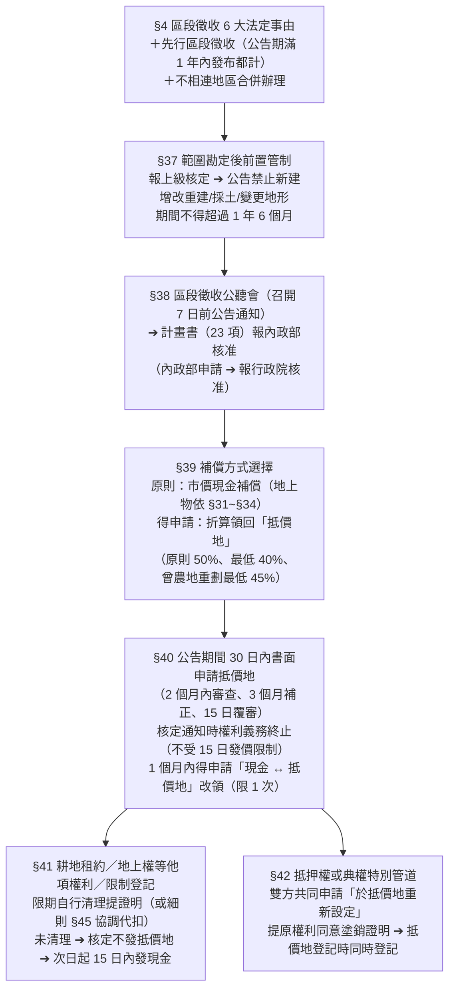

# 第 06 堂｜區段徵收（上）：法定事由、前置禁建、抵價地比例與權利清理

> **涵蓋條文範圍**：《土地徵收條例》§4、§37～§42；《土地徵收條例施行細則》§34～§49（含 §48-1）
> **命題熱度**：★★★★★（地政士超級重磅章節！**§4 六大法定事由與先行區段徵收、§37 範圍勘定後禁建最長 1 年 6 個月、§38 內政部自辦報行政院核准、§39 抵價地 50%／40%／45% 法定比例、§40 抵價地申請與 1 個月改領 1 次為限、§41～§42 耕地租約／他項權利／限制登記清理與抵押權典權重設**，年年輪流命題！）
> **跨科關聯**：〈土地法規〉（平均地權條例 §53～§55-2 區段徵收、§59 市地重劃禁建、都市計畫法 §52）、〈土地登記規則〉（囑託登記、限制登記塗銷、抵押權同時登記）

---

## 一、 架構鳥瞰（1 分鐘看懂體系位置）

什麼是**「區段徵收」**？用最白話的一句話解釋：
> **「政府把一整片還沒開發（或老舊雜亂）的土地全部徵收過來，重新鋪馬路、蓋公園、整地變黃金建地，再把其中一部分變值錢的建地（抵價地）發還給原地主，其餘土地用來做公共設施與標售回收開發成本！」**

區段徵收兼具**「強制徵收（所有權移轉給國家）」**與**「合作開發（地主領回抵價地共享開發利益）」**的雙重特性。我們把第四章切為上、下兩堂課，本堂（上篇）聚焦在**「發動事由 → 前置禁建 → 公聽報核 → 抵價地比例與申請 → 權利清理」**的完整前置與申請流程：

### 母法與施行細則條文對照地圖

| 主題模組 | 母法（條例） | 施行細則 | 考點星級 |
| :--- | :--- | :--- | :---: |
| 區段徵收 6 大事由、先行區段徵收與跨區合併 | §4 | — | ★★★★★ |
| 範圍勘定後禁建與變更地形（最長 1 年 6 個月） | §37 | §34、§41 | ★★★★★ |
| 區段徵收計畫書（23 款）、公聽會與報核機關 | §38 | §35～§39 | ★★★★☆ |
| 抵價地總面積比例（50%／40%／45%） | §39 | §40、§41 | ★★★★★ |
| 抵價地申請審查、權利終止、改領機制與接管 | §40 | §42、§43 | ★★★★★ |
| 他項權利、限制登記、三七五租約清理與協調代扣 | §41 | §44、§45 | ★★★★★ |
| 原有抵押權或典權於抵價地重新設定 | §42 | — | ★★★★★ |
| 開發配套預告：公有地撥供指配、農專區與未登記地 | （接第 07 堂 §43～§43-1） | §46～§49（含 §48-1） | ★★★☆☆ |

---

## 二、 白話精講（母法 × 施行細則整合）

### 主題 1：區段徵收 6 大法定事由與「先行區段徵收」（條例 §4）★★★★★

#### 1. 得辦理區段徵收之 6 大法定事由（§4Ⅰ — 必背！）
1. **新設都市地區**之全部或一部，實施開發建設者（例如：新市鎮開發、高鐵特定區）。
2. **舊都市地區**為公共安全、衛生、交通之需要或促進土地之合理使用實施更新者。
3. **都市土地**之**「農業區、保護區」變更為建築用地**，或**「工業區」變更為住宅區、商業區**者（口訣：**農保變建、工變住商**！）。
4. **非都市土地**實施開發建設者。
5. **農村社區**為加強公共設施、改善公共衛生之需要或配合農業發展之規劃實施更新者。
6. **其他依法**得為區段徵收者（如依《都市計畫法》、《新市鎮開發條例》、《大眾捷運法》等）。

#### 2. 先行區段徵收（§4Ⅱ～Ⅳ — 突破「先都計、後徵收」！）★★★★☆
* **為什麼要「先行區段徵收」？** 依《都市計畫法》§52 原則上要先發布都市計畫才能徵收土地，但這會讓炒地皮集團在都市計畫審議曝光時搶先買地哄抬地價！為了避免土地投機並加速建設，§4 特別設計了「先辦徵收、再發布都計／變更編定」的機制：
  * **都市計畫型（第 1～3 款，或第 4、6 款涉及都計新訂擴大變更者）**：開發範圍經**中央主管機關（內政部）核定**者，得**先行區段徵收**，並於**「區段徵收公告期滿後 1 年內」發布實施都市計畫**，**不受都市計畫法第 52 條規定之限制**。（※ 注意細則 §48-1Ⅳ：若規劃農業專用區，都市計畫應於**農業專用區劃設完成後**再發布實施！）。
  * **非都市土地／農村社區型（第 5 款，或第 4、6 款未涉都計者）**：需用土地人會同有關機關研擬開發範圍，檢具經上級目的事業主管機關核准之興辦事業計畫書，報經**中央主管機關核定**後先行區段徵收，於**公告期滿後**依土地使用計畫完成非都市土地分區或用地編定變更。

#### 3. 跨區合併辦理（§4Ⅴ）
* **不相連之地區**，得依都市計畫或興辦事業計畫書內容、範圍**合併辦理區段徵收**，並適用上述先行區段徵收規定（實務上常將「開發潛力高的建地區」與「需要保護或闢建公設的遠方區」合併辦理，達成財務平衡與移轉安置！）。

---

### 主題 2：範圍勘定後前置禁建與公聽會報核（條例 §37、§38；細則 §34～§39、§41）★★★★☆

#### 1. 範圍勘定後之禁建管制（條例 §37；細則 §34、§41）★★★★★
* **發動時點**：區段徵收**範圍勘定後**（還沒正式公告徵收之前，就可以先凍起來防搶建！）。
* **核定程序**：直轄市或縣（市）主管機關視實際需要，檢具**開發計畫及區段徵收範圍地籍圖**（細則 §34），報經**上級主管機關核定**後公告禁止。（細則 §41：屬內政部申請者，由**內政部逕行核定**）。
* **禁止事項（2 大類，不含移轉分割！）**：
  1. 建築改良物之**新建、增建、改建或重建**（注意：比一般徵收 §23Ⅰ 多了「重建」，但沒有禁止土地移轉、分割、合併、設定負擔！）。
  2. **採取土石或變更地形**。
* **最長禁止期間**：**不得超過 1 年 6 個月**！

#### 2. 區段徵收公聽會與計畫書報核（條例 §38；細則 §35～§39）★★★★☆
* **報核文件（§38Ⅰ、細則 §35～§38）**：需用土地人檢具**區段徵收計畫書**（細則 §36 明定 23 款應載明事項，包含公益性及必要性評估報告、原位置保留差額地價減輕比例、安置計畫、公有地處理、抵價地比例、財務計畫等）、**徵收土地圖冊**（地籍圖描繪）、**土地使用計畫圖**（完成都計者指都市計畫圖）各 **2 份**。
* **公聽會程序（§38Ⅰ、細則 §39）**：
  * 由當地直轄市或縣（市）主管機關邀集需用土地人及土地所有權人舉行公聽會。
  * 應於召開 **7 日前**公告於土地所在地公共地方、縣市政府、公所、村里辦公處公告處所、網站及刊登公報或新聞紙，並以書面通知區內土地及改良物所有權人。
  * **必說明 8 大事項**：必要性及目的、各項補償標準、抵價地比例及申請程序、地價稅及土增稅減免扣繳、耕地租約處理、他項權利或其他負擔處理、安置計畫、其他事項。
  * 會後應作成**會議紀錄**，於上述公告處所、村里適當公共位置及需用土地人網站公告，並以書面通知所有權人。
* **核准機關（§38Ⅰ、Ⅱ — 考場超級陷阱！）**：
  * **一般情形**：報請**中央主管機關（內政部）**核准。
  * **內政部自行申請區段徵收時**：避免球員兼裁判，準用前項規定報請**「行政院」**核准！（地政士考題超愛問：「內政部申請區段徵收，應報請何機關核准？」答案就是**行政院**！）。

---

### 主題 3：抵價地比例與申請／改領全攻略（條例 §39、§40；細則 §40～§43）★★★★★

#### 1. 補償方式與「抵價地總面積法定比例」（條例 §39；細則 §40、§41）★★★★★
* **地價補償**：依 **§30 市價**補償；但得經土地所有權人申請，以**徵收後可供建築之抵價地折算抵付**。其餘地上改良物、停工改良費、營業損失、遷移費等，仍依 **§31～§34** 規定以現金補償！
* **抵價地總面積「三層法定比例」（必背數字！）**：
  1. **原則比例**：以**徵收總面積 50%** 為原則。
  2. **特殊情形下限**：因情況特殊，經**上級主管機關核准**者（細則 §40：須於區段徵收計畫書報核前擬具具體理由先報核；細則 §41：內政部申請者逕行核定），得低於 50%，但**不得少於 40%**。
  3. **曾經農地重劃地區下限**：曾經農地重劃者，**該重劃地區部分不得少於 45%**！（立法理由：農民以前辦農地重劃時已經自己免費捐過農路、水路用地了，現在再辦區段徵收不能剝兩層皮！細則 §40 明確定義：指原有土地曾參加農地重劃並分擔農路、水路用地，且該農路、水路用地已登記為直轄市、縣（市）或農田水利會所有者）。
* **細則 §40Ⅱ 實務彈性**：若因地主領取現金較多，或大家都挑高價商業區導致實際配發面積縮小、比例低於 50%／45%／40%，**視為已符合 §39 規定**（不算違法！）。

#### 2. 申請領回抵價地、審查補正與「現金 ↔ 抵價地」改領（條例 §40；細則 §42、§43）★★★★★
* **申請期間與彈性（§40Ⅰ、Ⅱ）**：
  * 原所有權人不願領現金者，應於**「徵收公告期間內（30 日內）」**檢具證明文件，以書面向地方主管機關申請發給抵價地。
  * 可就**全部或部分**應領之補償地價申請抵價地（例如領 60% 抵價地、40% 拿現金！）。
* **審查與補正期限（細則 §42 — 必背 3 個期限！）**：
  1. 初審：收件後應於**「徵收公告期滿後 2 個月內」**審查完畢。
  2. 補正：應予補正者，通知申請人於**「接到通知書之日起 3 個月內」**補正（屆滿前申請展延，在不影響整體開發時程下得酌予展延）。
  3. 覆審：申請人補正後 **「15 日內」**審查完畢並書面通知；屆期未補正者，核定不發給抵價地。
* **權利義務終止時點與免受 15 日發價限制（§40Ⅲ 前段、Ⅴ）**：
  * 申請發給抵價地者，對其土地之權利義務，於**「接到該管直轄市或縣（市）主管機關核定發給抵價地通知時」**終止！
  * 主管機關**不受 §20Ⅰ 公告期滿 15 日發給期限之限制**（不會因為沒在 15 日內發錢就讓徵收失效）。
* **「反悔改領機制」（§40Ⅲ 後段、Ⅳ；細則 §43 — 考場超級大熱門！）**：
  * **雙向互換**：已核定發給抵價地者得申請**改發給現金**；已領竣現金補償地價者亦得申請**改發給抵價地**。
  * **准駁要件**：須經地方主管機關**徵得需用土地人同意後核准**（細則 §43：審酌資金調度及實際作業情形）。
  * **期限與次數**：應於**「核定發給抵價地通知之日」**、**「現金補償發給完竣之日」**或**「通知補償地價存入保管專戶之日」**起 **「1 個月內」**為之，並以 **「1 次為限」**！
  * **現金改抵價地前提**：主管機關應**限期繳回**其原領之徵收補償地價後，始得核准。
* **囑託登記與視為接管（§40Ⅵ）**：
  * 規劃分配後，由地方主管機關**囑託登記機關逕行辦理土地所有權登記**，並通知原所有權人定期到場接管；**未按指定期限接管者，視為已接管**。

---

### 主題 4：抵價地申請之「原有權利清理」與抵押權重設（條例 §41、§42；細則 §44、§45）★★★★★

這兩條是地政士考試的**常客魔王題**！為什麼領現金走 §35、§36，而領抵價地要特別走 §41、§42？
* **白話道理**：領現金時，政府手上有錢，可以直接從補償費扣錢還給銀行或佃農；但地主選擇「領抵價地」時，政府手上沒有要發給地主的現金，如果地主沒先把原本壓在土地上的三七五租約、地上權、查封限制登記或抵押權清理乾淨，將來抵價地配出去就會爆發權利糾紛！

#### 1. 一般負擔之「限期自行清理」與「協調代扣」（條例 §41；細則 §44、§45）
* **適用對象**：申請抵價地之原有土地上訂有**耕地租約**、設定**他項權利**或**限制登記**者（抵押權、典權可另走 §42 特別管道）。
* **清理義務（§41Ⅰ）**：主管機關應通知申請人**限期自行清理**，並依規定期限提出證明文件。
* **細則 §44 四大類證明文件（必記對應！）**：
  1. **耕地三七五租約**：提出**補償承租人之證明文件**。
  2. **地上權、不動產役權、永佃權、農育權**：提出**同意塗銷他項權利之證明文件**。
  3. **抵押權、典權**：提出**清償、回贖或同意塗銷之證明文件**（或改走 §42）。
  4. **限制登記**（如查封、假扣押、預告登記）：提出**已為塗銷限制登記之土地登記謄本**，或**預告登記權利人同意塗銷之證明文件**。
* **細則 §45「協調代扣＋賸餘領抵價地」救濟管道（超高分寫作亮點！）**：
  * 針對**「耕地三七五租約」**或**「地上權、不動產役權、永佃權、農育權」**，如果地主手頭沒現金先補償佃農或用益物權人，可以請求主管機關邀集協調！
  * 只要雙方達成兩條件：①**補償金額或權利價值經雙方確定，並同意由主管機關代為扣繳清償**；②**承租人或他項權利人同意註銷租約或塗銷他項權利** → 主管機關即可先從地主應領補償地價中代扣清償並塗銷，地主再就**「賸餘應領補償地價」**申領抵價地！
* **逾期未清理之法律效果（§41Ⅱ、Ⅲ）**：
  * 主管機關應核定**「不發給抵價地」**。
  * 並應於**「核定之次日起 15 日內」發給現金補償**（接著就回到 §35、§36 由政府從現金裡代償清理！）。

#### 2. 抵押權或典權之「移轉重新設定」特快車（條例 §42）★★★★★
* **為什麼只有抵押權與典權有特快車？** 因為抵押權、典權屬於**擔保物權／價值權**（重點在債權擔保價值，不依賴特定土地位置的使用）；而地上權、農育權、不動產役權屬於**用益物權**，原來的土地位置都重新整地重劃了，無法直接搬家！
* **三大法定要件與程序（§42Ⅰ～Ⅲ）**：
  1. **雙方共同申請＋先塗銷舊權（§42Ⅰ）**：**原土地所有權人及該他項權利人**（雙方共同）得申請於發給之抵價地設定抵押權或典權，申請時並應提出**「同意塗銷原有土地抵押權或典權之證明文件」**。
  2. **新權內容由雙方協議（§42Ⅱ）**：重新設定之**權利範圍、價值、次序**等內容，由原土地所有權人及他項權利人**協議定之**。
  3. **同時登記並事後通知（§42Ⅲ）**：該新設定之抵押權或典權，應於**抵價地登記時，「同時登記」**（防止空窗期被其他債權人查封！）；並應於登記後**通知該他項權利人**。

> **【實務案例】背著房貸的農地遇到區段徵收，地主沒錢還銀行也能領抵價地嗎？**
> 老陳有一筆市價 2,000 萬元的農地，向銀行貸款設定抵押權 800 萬元，現在納入區段徵收範圍。老陳想領抵價地，但手上拿不出 800 萬現金先清償房貸。他該怎麼辦？
> * **解析**：老陳可以走 **§42 特別管道**！只要老陳與銀行協議好未來在抵價地上的新抵押權**權利範圍、價值與次序**，由銀行出具**同意塗銷原土地抵押權證明文件**，雙方共同向主管機關申請於未來發給之抵價地重新設定抵押權。未來區段徵收完成配發抵價地時，地政機關會於**抵價地所有權登記時「同時登記」銀行的抵押權**，並通知銀行！老陳不必籌 800 萬現金也能順利領回抵價地！

---

### 主題 5：細則 §46～§49 開發配套預告（公有地、農專區與未登記地）★★★☆☆

本條例施行細則 §46～§49 規範了區段徵收範圍內「公有土地、農業專用區與未登記土地」的細部作業（對應母法 §43、§43-1，將於第 07 堂完整展開）：
* **公有土地事前協調與撥供登記（細則 §46、§47）**：申請區段徵收前應協調公地管理機關採「作價」或「領回土地」方式撥供；領取地價款或核定領回後，逕由區段徵收主管機關**囑託登記機關辦理所有權移轉或管理機關變更登記**。原已實際作為道路、溝渠、公園、綠地、兒童遊樂場、廣場、停車場、體育場所及國民學校（九項公設）使用之公地，應循**無償撥用**程序辦理。
* **公有土地指配公共設施用地 5 大順位（細則 §48）**：除原位置保留及計畫書記載讓售或有償撥用者先行指配外，其餘指配順序為：**①本直轄市、縣（市）有 → ②本鄉（鎮、市）有 → ③國有 → ④他直轄市、縣（市）有 → ⑤他鄉（鎮、市）有**（口訣：**「本市 → 本鄉 → 國 → 他市 → 他鄉」**）。
* **農業專用區作業預告（細則 §48-1）**：都市計畫規劃時應調查原所有權人繼續耕作意願；訂定配售辦法應舉行配售說明會；**徵收公告時應載明：欲申請配售農業專用區土地者，應選擇領取「現金補償」**；先行區段徵收地區，都市計畫應於**農業專用區劃設完成後**再發布實施。
* **未登記土地處理（細則 §49）**：區段徵收範圍內之未登記土地，得視需用土地人分別登記為**國有、直轄市或縣（市）有**，並由其指定管理機關。

---

## 三、 考點對決（易混淆觀念比較表＋口訣）

### 比較表 1：三大「開發禁建管制」終極對決（超愛考！）

| 比較項目 | 一般徵收公告管制（土徵 §23Ⅰ） | 區段徵收範圍勘定管制（土徵 §37） | 市地重劃公告禁止管制（平均地權 §59） |
| :--- | :--- | :--- | :--- |
| **發動時點** | **徵收公告日起** | **區段徵收範圍勘定後**（公告徵收前） | **重劃地區選定後**（公告重劃前） |
| **核定機關** | （隨徵收核准一併發生） | 報經**上級主管機關**核定（內政部自辦逕行核定） | 報經**上級主管機關**核定 |
| **禁止權利處分？** | **有**（禁止分割、合併、移轉、設定負擔；3 類例外） | **無**（僅禁止事實行為） | **有**（禁止土地移轉、分割或設定負擔） |
| **禁止事實行為** | 建物**新建、增建、改建**；採取土石、變更地形；農作物增加種植 | 建物**新建、增建、改建或重建**；採取土石或變更地形 | 建築改良物之**新建、增建、改建或重建**；採取土石或變更地形 |
| **最長期限** | 至補償完竣（或徵收失效） | **不得超過 1 年 6 個月** | **不得超過 1 年 6 個月** |

### 比較表 2：區段徵收「申請抵價地」vs. 一般「領取現金補償」之權利處理

| 比較維度 | 領取現金補償（§20、§21、§35、§36） | 申請發給抵價地（§40、§41、§42、細則 §44～§45） |
| :--- | :--- | :--- |
| **權利義務終止時點** | **補償費發給完竣時**（§21Ⅰ） | **接到核定發給抵價地通知時**（§40Ⅲ） |
| **15 日發給期限限制** | 受限制，逾期徵收失效（§20） | **不受 §20Ⅰ 期限限制**（§40Ⅴ） |
| **耕地三七五租約** | 主管機關由補償地價代扣交（§35、平均地權 §11） | 限期自行清理提補償證明，或依細則 §45 協調代扣後就賸餘領抵價地 |
| **用益物權（地上權等）** | 因徵收消滅 → 限期協議代償／存專戶（§36） | 限期自行清理提同意塗銷證明，或依細則 §45 協調代扣後就賸餘領抵價地 |
| **擔保物權（抵押權/典權）** | 因徵收消滅 → 限期協議代償／存專戶（§36） | ①自行清償回贖塗銷（§41）；或 ②**雙方共同申請於抵價地重新設定，同時登記（§42）** |
| **未清理之效果** | 直接由補償費代償或存入專戶 | 核定**不發給抵價地** → **核定次日起 15 日內發給現金補償**（§41Ⅱ、Ⅲ） |

> **本堂速記口訣**：
> * **§4 六大事由**：**「新都、舊都、農保變建／工變住商、非都開發、農村更新、其他依法」**
> * **§39 抵價地比例**：**「原則 50、特准底線 40、農地重劃 45」**
> * **§40 期限串燒**：**「30 日申請 → 2 個月審 → 3 個月補 → 15 日覆；1 個月反悔限 1 次」**
> * **§42 抵押典權搬家**：**「抵、典限定；雙方申請＋同意塗銷原權＋協議範圍價值次序＋同時登記後通知」**

---

## 四、 課後小測驗（地政士申論模擬演練）

### 模擬題 1（地政士經典考題：區段徵收法定事由、先行區段徵收與抵價地比例）
> **題目**：依《土地徵收條例》及其施行細則規定，政府得辦理「區段徵收」之法定情形有哪六款？何謂「先行區段徵收」，其與《都市計畫法》之配合期限為何？又抵價地總面積之法定比例原則及例外下限各為何？若因多數地主選擇領取現金補償致實際發給抵價地面積比例低於法定下限，是否違法？（25 分）

👉 點此展開【擬答架構與得分關鍵字】

1. **區段徵收之 6 款法定事由（條例 §4Ⅰ）**：
   * ① 新設都市地區之全部或一部，實施開發建設者。
   * ② 舊都市地區為公共安全、衛生、交通之需要或促進土地之合理使用實施更新者。
   * ③ 都市土地之農業區、保護區變更為建築用地，或工業區變更為住宅區、商業區者。
   * ④ 非都市土地實施開發建設者。
   * ⑤ 農村社區為加強公共設施、改善公共衛生之需要或配合農業發展之規劃實施更新者。
   * ⑥ 其他依法得為區段徵收者。
2. **先行區段徵收與都市計畫之配合（條例 §4Ⅱ～Ⅳ；細則 §48-1Ⅳ）**：
   * 都市計畫地區（第 1～3 款，及第 4、6 款涉及都計新訂擴大變更者）：開發範圍經**中央主管機關核定**者，得先行區段徵收，並於**區段徵收公告期滿後 1 年內發布實施都市計畫**，**不受都市計畫法第 52 條規定之限制**。（註：若有劃設農業專用區，依細則 §48-1Ⅳ 應於農專區劃設完成後再發布實施）。
   * 農村社區及未涉都計之非都開發（第 5 款及第 4、6 款未涉都計者）：檢具上級目的事業主管機關核准之興辦事業計畫書，報經中央主管機關核定後先行區段徵收，公告期滿後完成非都市土地分區或用地編定變更。
3. **抵價地總面積之法定比例與實務彈性（條例 §39Ⅱ；細則 §40）**：
   * **原則**：以徵收總面積 **50%** 為原則。
   * **特殊情形例外**：因情況特殊，於計畫書報核前擬具具體理由，報經**上級主管機關核准**者，不在此限，但**不得少於 40%**。
   * **曾經農地重劃地區**：曾參加農地重劃並分擔農路、水路用地（已登記為地方政府或農田水利會所有）者，該重劃地區部分**不得少於 45%**。
   * **實際發給比例降低是否違法**：**不違法。** 依細則 §40Ⅱ，抵價地發給比例因土地所有權人領取現金補償或選擇高價區位土地較多者，致實際發給面積比例降低，**視為已符合條例 §39 之規定**。

---

### 模擬題 2（超高頻實例題：抵價地申請、反悔改領與原有權利清理）
> **題目**：甲所有之 A 地納入區段徵收範圍，該地上訂有耕地三七五租約，並另設定有乙銀行之抵押權。甲欲申請發給抵價地，試依《土地徵收條例》及其施行細則說明：(一) 甲應於何時提出申請？若經核定發給抵價地後反悔想改領現金，有何期限及次數限制？(二) A 地上之耕地三七五租約與乙銀行之抵押權應如何處理，甲才能順利領回抵價地？若甲逾期未清理，法律效果為何？（25 分）

👉 點此展開【擬答架構與得分關鍵字】

1. **(一) 抵價地申請期限、審查及改領現金限制（條例 §40；細則 §42、§43）**：
   * **申請期限**：甲應於**徵收公告期間內（30 日內）**檢具有關證明文件，以書面向該管地方主管機關申請發給抵價地（得就全部或部分應領地價申請，§40Ⅰ、Ⅱ）。主管機關應於公告期滿後 2 個月內審查完畢（細則 §42）。
   * **反悔改領現金之要件、期限與次數**：經核定發給抵價地後欲改領現金補償，應於**核定發給抵價地通知之日起 1 個月內**申請，並以 **1 次為限**（§40Ⅳ），且須由地方主管機關就資金調度及實際作業情形**徵得需用土地人同意後核准**（§40Ⅲ、細則 §43）。
2. **(二) 原有耕地三七五租約與抵押權之處理（條例 §41、§42；細則 §44、§45）**：
   * **耕地三七五租約之處理（§41、細則 §44①、§45）**：
     1. 原則：由主管機關通知甲限期自行清理，並提出**補償承租人之證明文件**。
     2. 協調代扣機制（細則 §45）：甲得請求主管機關邀集承租人協調，若雙方確定補償金額並同意由主管機關代為扣繳清償，且承租人同意註銷租約者，由主管機關就甲應領補償地價代扣清償及註銷租約，甲再就**賸餘應領補償地價**申領抵價地。
   * **乙銀行抵押權之處理（§41、§42、細則 §44③）**：
     1. 自行清理途徑（§41）：於限期內提出抵押權之**清償或同意塗銷證明文件**。
     2. 重新設定途徑（§42）：甲與乙銀行得共同申請於發給之抵價地**重新設定抵押權**，申請時應提出**同意塗銷原有土地抵押權之證明文件**；其權利範圍、價值、次序由雙方協議定之，並於**抵價地登記時同時登記**，登記後通知乙銀行。
   * **逾期未清理之法律效果（§41Ⅱ、Ⅲ）**：若甲未依限提出清理證明或辦理重設，主管機關應核定**不發給抵價地**，並應於**核定之次日起 15 日內發給現金補償**（再依 §35、§36 代為清償結束）。

