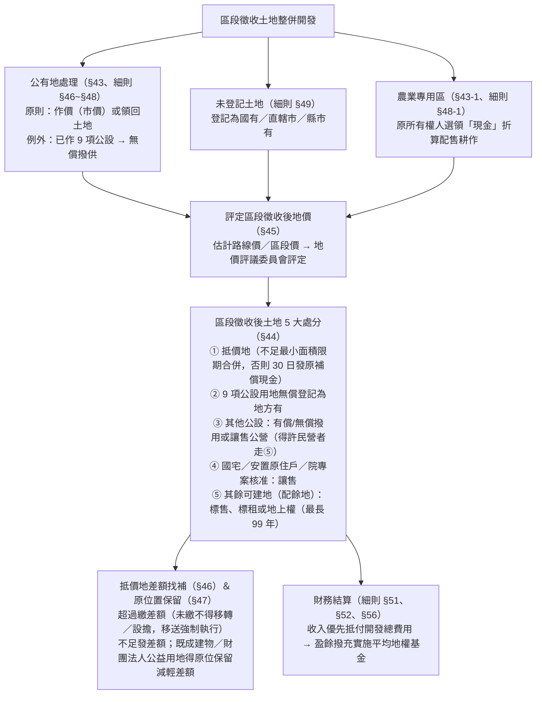

# 第 07 堂｜區段徵收（下）：公有地、農業專用區、土地處分與跨法比較

> **涵蓋條文範圍**：《土地徵收條例》§43～§48（含 §43-1）、《土地徵收條例施行細則》§46～§56（本堂以 §50～§56 為核心，並完整整合對應 §43、§43-1 之細則 §46～§49）
> **命題熱度**：★★★★★（**地政士國考〈土地法規〉超級必考單元！** 公有土地作價／領回／無償撥供（§43）、農業專用區折算配售（§43-1）、區段徵收後土地五大處分與九項無償登記公設（§44）、不足最小建築單位面積 30 日發放現金（§44Ⅱ）、差額地價找補與禁止移轉（§46）、原位置保留減輕差額（§47），以及**「土徵條例區段徵收 vs. 平均地權條例區段徵收 vs. 市地重劃 vs. 一般徵收」四維終極比較**，皆為歷屆申論常客！）
> **跨科關聯**：〈土地法規〉（《平均地權條例》§53～§55-2 區段徵收、§56～§67 市地重劃）、〈土地稅法規〉（《平均地權條例》§42-1 區段徵收領回抵價地免徵土增稅、首次移轉減徵 40%）、〈土地登記實務〉（囑託登記與差額地價未繳清之註記）

---

## 一、 架構鳥瞰（1 分鐘看懂體系位置）

上一堂課（第 06 堂）我們完成了區段徵收的「前半場」：劃定範圍、禁建管制、抵價地比例（50%／40%／45%）與原有租約他項權利清理。這一堂課進入「**後半場：土地整合、規劃分配與財務結算**」——把範圍內的公有地、未登記地、老農的農業專用區一起整併開發完成後，如何評定開發後地價、將整理好的土地分成五大去處、處理抵價地多退少補的差額地價，以及把處分盈餘撥入實施平均地權基金！

### 母法與施行細則條文對照地圖

| 主題模組 | 母法（條例） | 施行細則 | 考點星級 |
| :--- | :--- | :--- | :---: |
| 公有土地處理（作價、領回、無償撥供）與未登記地 | §43 | §46、§47、§48、§49 | ★★★★★ |
| 農業專用區規劃與現金地價補償費折算配售 | §43-1 | §48-1 | ★★★★★ |
| 區段徵收後土地 5 大處分、9 項無償公設與標租年限 | §44 | §50、§54 | ★★★★★ |
| 開發總費用、公設管理維護費、管線分擔、委辦與基金 | §44Ⅳ | §51、§52、§55、§56 | ★★★★☆ |
| 評定區段徵收後地價（路線價／區段價） | §45 | — | ★★★☆☆ |
| 抵價地差額地價找補、強制執行與禁止移轉設擔 | §46 | §53 | ★★★★★ |
| 既成建物基地與財團法人公益用地原位置保留 | §47 | — | ★★★★☆ |
| 區段徵收準用第二章（程序）及第三章（補償） | §48 | — | ★★★☆☆ |

---

## 二、 白話精講（母法 × 施行細則整合）

### 主題 1：區段徵收範圍內之公有土地與未登記土地（條例 §43；細則 §46～§49）★★★★★

區段徵收是「整片」重新規劃，範圍內不可能只有私有土地，往往夾雜著國有地、市有地、水利溝渠或連地號都沒有的未登記土地。政府之間怎麼算帳？

#### 1. 公有土地三大處理方式（條例 §43；細則 §46、§47）
需用土地人於申請區段徵收前，應會同主管機關邀集公有土地原管理機關及非公用管理機關協調處理方式（細則 §46Ⅰ）：

1. **原則方式 A — 作價撥供（拿錢走人）**：
   * 公有土地管理機關將土地作價撥供區段徵收主管機關統籌開發。
   * **地價計算**：準用 **§30 規定**計算（即按徵收當期之**市價**計算！注意：不同於《平均地權條例施行細則》§69 舊制之公告土地現值）。
2. **原則方式 B — 領回土地（一起分地）**：
   * 公有土地管理機關選擇不拿錢，改以領回開發後土地方式參與。
   * **面積計算**：領回土地面積按**區段徵收之抵價地面積比率**計算（依細則 §46Ⅱ 附件一公式），配回原管理機關。
   * **配回順序原則**：配回之土地應以 **§44Ⅰ② 以外之公共設施用地為優先**，並依區段徵收計畫處理。
3. **例外方式 C — 無償撥供（條例 §43Ⅰ 但書；細則 §47Ⅱ）**：
   * 區段徵收前，經區段徵收主管機關會同公有土地管理機關認定**實際已作為 §44Ⅰ② 九項公共設施用地**（道路、溝渠、公園、綠地、兒童遊樂場、廣場、停車場、體育場所、國民學校）使用者，**應無償撥供**主管機關統籌規劃開發，並循無償撥用程序辦理。

#### 2. 囑託登記與公有土地指配公共設施用地之 5 大順位（細則 §47Ⅰ、§48）
* **登記方式（細則 §47Ⅰ）**：公有土地領取地價款或經核定領回土地後，逕由區段徵收主管機關囑託登記機關辦理**所有權移轉或管理機關變更登記**。
* **指配公設用地順位（細則 §48）**：除按原位置保留分配者外，先由區段徵收計畫書記載「讓售或有償撥供需地機關使用」者先行指配；其餘公有土地指配公共設施用地之順序由近至遠（**本縣市優先承擔，他縣市最後**）：
  1. 本直轄市、縣（市）有土地
  2. 本鄉（鎮、市）有土地
  3. 國有土地
  4. 他直轄市、縣（市）有土地
  5. 他鄉（鎮、市）有土地
* **未登記土地處理（細則 §49）**：區段徵收範圍內之未登記土地，得視需用土地人分別登記為**國有、直轄市或縣（市）有**，並由其指定管理機關。

---

### 主題 2：農業專用區之規劃與現金折算配售（條例 §43-1；細則 §48-1）★★★★★

民國 101 年《土地徵收條例》修法（回應苗栗大埔事件等農地徵收爭議），特別增訂 **§43-1「農業專用區」**，讓世世代代以農為業、不想拿建築用地改行炒房、只想繼續種田的老農，有一條留農之路！

#### 1. 核心要件與操作機制（條例 §43-1；細則 §48-1）
* **性質定義（細則 §48-1Ⅰ）**：農業專用區，指供**農業耕作使用**之土地使用分區。
* **申請主體**：**原土地所有權人**。
* **⚠️ 超級必考陷阱 — 資金來源必須是「現金補償」**：
  * 依 §43-1Ⅰ，原土地所有權人是以其**「已領之現金地價補償費數額」**申請折算配售農業專用區土地，作為農業耕作使用。
  * 依細則 §48-1Ⅲ，各級主管機關訂定配售辦法時，應會商需用土地人並邀集原所有權人舉行**土地配售說明會**，且應於徵收公告時載明：**欲申請配售農業專用區土地之原土地所有權人，應選擇「領取現金補償」**！（換言之，如果你全部選擇領回建築用抵價地，就不能再拿那份補償去折算配售農業專用區；但若地主有部分選現金、部分選抵價地，得以已領現金部分申請配售。）
* **規劃時機與意願調查（細則 §48-1ⅡⅣ）**：
  * 需用土地人應於**都市計畫規劃時**，調查原土地所有權人於區段徵收後繼續從事耕作之意願，作為劃設農業專用區面積及位置之參考。
  * **先行區段徵收地區**，都市計畫應於**農業專用區劃設完成後**再發布實施！

> **【實務案例 1】老農阿伯想繼續種稻，該選「抵價地」還是「現金補償」？**
> 老農阿伯的 1 公頃農地被劃入某新市鎮區段徵收範圍，地方政府規劃了「農業專用區」。阿伯在公告期間內聽鄰居說「領抵價地比較值錢」，於是把全部補償地價都申請發給抵價地，等核定後才跑去問地政局：「我可以用抵價地的權利價值換農業專用區繼續種田嗎？」
> * **老師解析**：**不行直接用抵價地換！** 依條例 §43-1Ⅰ 及細則 §48-1Ⅲ，欲申請配售農業專用區土地者，應選擇領取**現金補償**，以其**已領之現金地價補償費數額**申請折算配售。不過阿伯別慌！依第 06 堂學過的 **§40ⅢⅣ**，阿伯可於**核定發給抵價地通知之日起 1 個月內**（以一次為限），向地方主管機關申請將全部或部分抵價地**改按原徵收補償地價發給現金補償**，經徵得需用土地人同意核准後，再以領取之現金申請折算配售農業專用區！

---

### 主題 3：區段徵收後土地 5 大處分方式與財務結算（條例 §44；細則 §50～§52、§54～§56）★★★★★

這是整堂課的**第一大申論熱區**！區段徵收範圍內土地經規劃整理後，扣除依 §43 配回原管理機關的公有地及 §43-1 配售的農業專用區，其餘土地依 **§44Ⅰ** 分為五大類處分：

#### 1. 五大處分方式詳解（條例 §44Ⅰ～Ⅴ）

| 款次 | 土地類別 | 處分方式與核心細節 | 老師畫重點（考場地雷） |
| :---: | :--- | :--- | :--- |
| **第 1 款** | **抵價地** | 發交被徵收土地所有權人領回。按「應領地價補償費 ÷ 區段徵收補償地價總額」算出權利價值比率，再以實際領回抵價地單位地價折算（細則 §50 附件二）。 | **不足最小建築單位面積（§44Ⅱ、細則 §54）**：應於規定期間內**申請合併**；未申請者，於規定期間屆滿之日起 **30 日內**，按**原徵收地價補償費**發給現金補償！ |
| **第 2 款** | **9 項公共設施用地** | **道路、溝渠、公園、綠地、兒童遊樂場、廣場、停車場、體育場所、國民學校**用地 → **無償登記**為當地直轄市有、縣（市）有或鄉（鎮、市）有。 | 必背口訣：**「道溝公綠兒、廣停體國小」**（9 項少 1 項都不行！）。 |
| **第 3 款** | **其他公共設施用地** | 得由主管機關依財務計畫需要，於徵收計畫書載明**有償或無償撥供需地機關**，或**讓售供公營事業機構**使用。 | ⚠️ **§44Ⅲ 關鍵例外**：該公共設施事業如**「得許民營者」**（如民營加油站、民營電廠、民營客運轉運站），**不得**依本款讓售，應依**第 5 款（標售、標租或設定地上權）**辦理！ |
| **第 4 款** | **特定政策用地** | **國民住宅用地、安置原住戶**或**經行政院專案核准**所需土地，得以**讓售**。 | 需注意「專案核准」機關為**行政院**！ |
| **第 5 款** | **其餘可供建築土地（配餘地）** | 得予**標售、標租或設定地上權**（辦法由各級主管機關定之）。 | ① **§44Ⅴ 年限限制**：標租或設定地上權期限**不得逾 99 年**！ ② **無優先買回權**：本條例已刪除舊法領現金地主優先買回權，防杜炒作！ |

#### 2. 最小建築單位面積（細則 §54）與估價基準（條例 §44Ⅳ）
* **最小建築單位面積（細則 §54）**：由主管機關會商需用土地人依開發目的及實際作業需要劃定，但**不得小於畸零地使用規則及都市計畫所規定最小建築基地之寬度、深度及面積**。
* **估價基準（條例 §44Ⅳ）**：第 3 款至第 5 款之**撥用或讓售地價及標售底價**，以**開發總費用**為基準，按其土地之位置、地勢、交通、道路寬度、公共設施及預期發展等條件之優劣估定之。

#### 3. 開發總費用、管線分擔、委辦與基金歸屬（細則 §51、§52、§55、§56）★★★★☆
1. **開發總費用構成（細則 §51）**：
   * 包含：① 徵收現金補償地價；② §8 及 §31～§34 補償費與遷移費；③ §11 協議價購地價；④ 公有土地作價地價款；⑤ 公共設施費用（規劃設計、施工、材料、工管、整地、管線分擔等）；⑥ **公共設施管理維護費**（完工日起至移交接管前及移交接管後**共計 3 年內**，以開發總面積**每年每公頃新台幣 5 萬元**為限）；⑦ 土地整理費用（獎勵金、救濟金、補助費、地籍整理費及行政作業費）；⑧ 貸款利息之總額。
2. **區段徵收範圍內必要管線費用分擔（細則 §52）**：

   | 管線項目 | 需用土地人負擔 | 管線事業機關（構）負擔 |
   | :--- | :--- | :--- |
   | **原有架空線路或管線遷移** | 原則 0%（但多次遷移時，除最後一次外之其餘各次遷移費＋用戶所有部分，由需地人負擔） | **全數負擔**（含多次遷移之最後一次） |
   | **既有架空電力改地下化** | 地下化變更設置費扣除原架空標準拆遷費差額之 **1/2** | 差額之 **1/2** |
   | **新設電力（架空／地下土木）** | **1/2** | **1/2** |
   | **新設電信（架空）** | 0% | **全部負擔** |
   | **新設電信（地下土木）** | **1/3** | **2/3** |
   | **新設自來水管線** | **全數負擔** | 0% |
   | **新設電力、電信之電氣設備及纜線** | 0% | **全部負擔** |
   | **區段徵收範圍外新設管線** | 0%（自來水因特殊地勢增設設備得個案協商） | **全部負擔** |

3. **得委託辦理之 5 項業務（細則 §55）**：各級主管機關得將 ① 現況調查及地籍測量；② 區段徵收工程之規劃、設計、施工、監造及管理；③ 土地改良物價額及區段徵收後地價之調查；④ 抵價地分配之規劃設計；⑤ 編造有關清冊，委託**事業機構、法人或學術團體**辦理。
4. **處分收入盈虧歸屬（細則 §56）**：區段徵收土地之處分收入，**優先抵付開發總費用**；如有盈餘，除其他法令另有規定外，**全部撥充實施平均地權基金**；如有不足，亦由**實施平均地權基金貼補之**。

---

### 主題 4：地價評定、抵價地差額找補、原位置保留與準用（條例 §45～§48；細則 §53）★★★★★

#### 1. 評定區段徵收後地價（條例 §45）
實施區段徵收時，直轄市或縣（市）主管機關應預計**區段徵收土地平均開發成本**，並斟酌區段徵收後各街廓之**位置、地勢、交通、道路寬度、公共設施及預期發展情形**，估計區段徵收後各路街之**路線價或區段價**，提經**地價評議委員會評定**後，作為原土地所有權人領回抵價地之計算基準。

#### 2. 抵價地差額地價之找補與強制力（條例 §46；細則 §53）★★★★★
實際分配街廓時，因為地籍形狀與最小建築單位限制，原所有權人實際領回的抵價地面積，幾乎不可能剛好等於公式算出的應領面積，這時依 **§46**「多退少補」：
* **實際領回 ＞ 應領面積（§46Ⅰ①）**：就超過部分，按**評定區段徵收後地價**繳納差額地價。
  * **逾期不繳（§46Ⅱ）**：經限期繳納，屆期仍未繳納者，得**移送法院強制執行**（現行實務屬公法上金錢給付義務，依《行政執行法》移送行政執行分署執行）。
  * **禁止處分與登記簿註記（§46Ⅲ、細則 §53）**：未繳納差額地價之抵價地，**不得移轉或設定他項權利**！主管機關應就**超過應領抵價地面積換算其應有部分**，囑託登記機關於土地登記簿加註「未繳清差額地價前，不得辦理所有權移轉或設定他項權利」字樣；繳清後立即通知登記機關註銷。
* **實際領回 ＜ 應領面積（§46Ⅰ②）**：就不足部分，按**評定區段徵收後地價**發給差額地價。

#### 3. 既成建物與財團法人公益用地「原位置保留分配」（條例 §47）★★★★☆
* **適用對象（二大類）**：區段徵收範圍內**不妨礙都市計畫事業及區段徵收計畫**之：
  1. **既成建築物基地**；或
  2. **已辦竣財團法人登記**之**私立學校、社會福利、慈善事業、宗教團體**用地（⚠️ 考點：必須「已辦竣財團法人登記」的私校、社福、慈善、宗教團體，一般未登記私壇或營利公司不適用！）。
* **優惠效果**：得按**原位置保留分配**，並**減輕**其依 §46 應繳納之差額地價（減輕比例由主管機關視實際情形定之，並載明於區段徵收計畫書）。

#### 4. 準用規定（條例 §48）
區段徵收之程序及補償，第四章未規定者，**準用第二章（徵收程序）及第三章（徵收補償）**之規定（例如公聽會、協議價購、公告 30 日、補償費異議復議、保管專戶等，除第四章有特別規定外，一體準用）。

> **【實務案例 2】百年寺廟原位置保留＋小地主不足最小建築面積，怎麼處理？**
> 某區段徵收區內有兩筆土地：
> * **甲地**：已辦竣財團法人登記之百年「福德宮」廟地，位於新劃設的宗教專用區，不妨礙都市計畫與區段徵收計畫，但原位置保留面積比其應領抵價地面積多了 50 平方公尺。
> * **乙地**：地主小陳申請領回抵價地，經核算可領回 12 平方公尺，但該區規定最小建築單位面積為 60 平方公尺，小陳未於規定期間內與他人申請合併分配。
>
> 👉 **老師解析**：
> 1. **甲地（福德宮）**：符合條例 **§47**「已辦竣財團法人登記之宗教團體用地」且不妨礙計畫，得按**原位置保留分配**，並依區段徵收計畫書所定比例**減輕**其超額 50 平方公尺應繳納之差額地價；但在繳清差額地價前，仍受 §46Ⅲ 及細則 §53 限制，不得移轉或設定他項權利。
> 2. **乙地（小陳）**：領回面積不足最小建築單位面積且未於期限內申請合併，依條例 **§44Ⅱ**，主管機關應於**規定期間屆滿之日起 30 日內**，按**原徵收地價補償費**（注意：不是區段徵收後地價！）發給現金補償！

---

## 三、 考點對決（超級四維比較表＋跨法差異＋口訣）

### 超級比較表 1：區段徵收（土徵 vs. 平均地權）vs. 市地重劃 vs. 一般徵收 ★★★★★

| 比較維度 | 《土地徵收條例》區段徵收（現行優先適用） | 《平均地權條例》區段徵收（舊制參考） | 《平均地權條例》市地重劃 | 《土地徵收條例》一般徵收 |
| :--- | :--- | :--- | :--- | :--- |
| **法律性質** | 公權力強制徵收＋合作開發（原所有權全面消滅再配地） | 同左 | 土地交換分合＋共同負擔（**原所有權未消滅**，視為原有土地延續） | 單純公權力強制剝奪所有權 |
| **辦理主體** | 僅限**政府（公辦）** | 僅限**政府（公辦）** | **公辦**或地主組織重劃會**自辦** | **國家（政府／需用土地人）** |
| **核准機關** | **內政部**（內政部自辦報行政院，§38） | 行政院（§53） | 上級主管機關（內政部／直轄市政府） | **中央主管機關（內政部）**（§14） |
| **適用事由** | **6 款**＋先行區段徵收（§4） | **4 款**（§53） | 都市土地新設、舊市區更新、農村社區等（§56） | **10 款公益事業**（§3），以事業所必須為限 |
| **補償／領回基準** | **市價**（§30）；抵價地總面積原則 **50%**、最低 **40%**、曾農地重劃 **45%**（§39） | 公告現值（§10）；原則 **50%**，經核准得少於 50%（無明定下限，§54） | 共同負擔上限 **45%**（地主原則至少領回 **55%**，§60） | **市價補償**（§30），全額發給現金 |
| **地主選擇權** | 可選領**現金**、**抵價地**，或以已領現金折算配售**農業專用區**（§43-1） | 選現金或抵價地（無農業專用區） | 原則領回重劃後土地（僅最小面積不足或差額現金找補） | 僅能領取現金補償（無配地） |
| **優先買回／收回權** | ① **無**領現金優先買回權（§44 已刪） ② **不適用** §9 收回權及 §59 標售優購權 | 領現金者**有**優先買回權（§55-2、細則 §79） | 不適用徵收收回權 | ① **有** §9 收回權（20 年內） ② **有** §59 變更目的標售優購權 |
| **土增稅優惠** | 領回抵價地免徵；**第一次移轉減徵 40%**（平均地權 §42-1） | 同左 | 重劃交換免徵；**第一次移轉減徵 40%**（平均地權 §42③） | 被徵收土地**免徵土地增值稅**（土地稅法 §39Ⅰ） |

### 比較表 2：公有土地處理方式跨法對照（土徵 §43 vs. 平均地權細則 §69）

| 比較項目 | 《土地徵收條例》§43 ＋ 細則 §46～§48 | 《平均地權條例施行細則》§69 |
| :--- | :--- | :--- |
| **原則處理方式** | **作價（準用 §30 市價）**或**領回土地（按抵價地比率，優先配 §44Ⅰ② 以外公設）** | 一律按**公告土地現值有償撥用** |
| **無償撥供範圍** | 區段徵收前**實際已作為 9 項公設用地**使用者，無償撥供 | 原屬公有之 9 項公設用地無償撥用（但**償債計畫公地、抵稅地、學產地**例外有償） |

### 速記口訣
* **9 項無償登記公設用地（§44Ⅰ②）**：**「道溝公綠兒、廣停體國小」**（道路、溝渠、公園、綠地、兒童遊樂場、廣場、停車場、體育場所、國民學校）。
* **細則 §48 公地指配公設 5 順位**：**「本縣 → 本鄉 → 國家 → 他縣 → 他鄉」**（自己的事自己先扛，中央第三，外縣市最後）。
* **細則 §52 管線分擔**：**「自來水需地全包；電力各半（1/2）；電信架空廠商全包、地下一比二（1/3 vs. 2/3）；設備纜線全歸管線商」**。
* **§46 差額地價三連招**：**「多繳少領按後價、欠錢不准賣或押、限期不繳送強執」**。

---

## 四、 課後小測驗（地政士申論模擬演練）

### 模擬題 1（公有地處理、農業專用區與土地五大處分綜合題）
> **題目**：依現行《土地徵收條例》及其施行細則規定，區段徵收範圍內之公有土地應如何處理？又為保障原土地所有權人繼續從事農作之意願，該條例第 43 條之 1 定有何種制度，申請人應符合何種資金選擇要件？最後，區段徵收土地經規劃整理後，其處理方式及盈餘歸屬各為何？（25 分）

👉 點此展開【擬答架構與得分關鍵字】

1. **區段徵收範圍內公有土地之處理（條例 §43；細則 §46～§48）**：
   * **原則**：管理機關應以**作價**（地價準用 §30 市價計算）或**領回土地**（按抵價地面積比率計算，並以 §44Ⅰ② 以外之公共設施用地優先配回原管理機關）方式，撥供區段徵收主管機關統籌規劃開發。
   * **例外無償撥供**：區段徵收前**實際已作為 §44Ⅰ② 九項公共設施用地**使用者，經會同認定後，應循無償撥用程序無償撥供主管機關統籌開發。
   * **指配順位（細則 §48）**：除原位置保留及計畫書載明讓售／有償撥供者外，依「本直轄市縣市有 → 本鄉鎮市有 → 國有 → 他直轄市縣市有 → 他鄉鎮市有」順序指配。
2. **農業專用區制度與資金選擇要件（條例 §43-1；細則 §48-1）**：
   * 區段徵收範圍內得規劃配設**農業專用區**，供**原土地所有權人**以其**已領之現金地價補償費數額**申請折算配售土地，作為農業耕作使用。
   * 依細則 §48-1，需用土地人應於都市計畫規劃時調查原所有權人繼續耕作意願；欲申請配售者，**應選擇領取現金補償**（並應舉辦配售說明會及載明於徵收公告）；先行區段徵收地區應於農業專用區劃設完成後再發布實施都市計畫。
3. **區段徵收後土地五大處理方式與盈餘歸屬（條例 §44；細則 §56）**：
   * ① **抵價地**：發交原土地所有權人領回（不足最小建築單位面積且逾期未申請合併者，屆滿日起 **30 日內**按原徵收地價補償費發給現金）。
   * ② **九項公設用地**：道路、溝渠、公園、綠地、兒童遊樂場、廣場、停車場、體育場所、國民學校用地，**無償登記**為當地直轄市、縣（市）或鄉（鎮、市）有。
   * ③ **其他公設用地**：依財務計畫於徵收計畫書載明有償或無償撥供需地機關，或讓售供公營事業機構使用（但該事業**得許民營者**，應改依第 5 款辦理）。
   * ④ **特定政策用地**：國民住宅用地、安置原住戶或經行政院專案核准所需土地，得以**讓售**。
   * ⑤ **其餘可供建築土地（配餘地）**：得予**標售、標租或設定地上權**（標租或設定地上權期限**不得逾 99 年**）。
   * **盈餘歸屬（細則 §56）**：處分收入優先抵付開發總費用，如有盈餘，除其他法令另有規定外，全部撥充**實施平均地權基金**；不足時由該基金貼補。

---

### 模擬題 2（抵價地價額評定、差額地價、原位置保留與跨法比較題）
> **題目**：依《土地徵收條例》第 45 條至第 47 條及施行細則第 53 條規定，區段徵收後原土地所有權人領回抵價地之計算基準地價如何評定？當實際領回抵價地面積與應領面積有增減時，應如何處理？又哪些特定用地得申請「原位置保留分配」？並請簡要比較《土地徵收條例》之「區段徵收」與《平均地權條例》之「市地重劃」在所有權變動、辦理主體、地主負擔／領回比例及地主選擇權上之差異。（25 分）

👉 點此展開【擬答架構與得分關鍵字】

1. **領回抵價地之計算基準地價評定（條例 §45）**：
   * 直轄市或縣（市）主管機關應預計區段徵收土地平均開發成本，斟酌區段徵收後各街廓之位置、地勢、交通、道路寬度、公共設施及預期發展情形，估計各路街之**路線價或區段價**，提經**地價評議委員會評定**之。
2. **抵價地面積增減（差額地價）處理與強制力（條例 §46；細則 §53）**：
   * **超過應領面積**：就超過部分按**評定區段徵收後地價**繳納差額地價；經限期繳納屆期未繳者，得移送**法院（行政執行分署）強制執行**。
   * **小於應領面積**：就不足部分按**評定區段徵收後地價**發給差額地價。
   * **禁止移轉與設擔**：未繳納差額地價之抵價地，**不得移轉或設定他項權利**；主管機關應就超過面積換算應有部分，囑託登記機關於登記簿加註限制字樣，繳清後立即通知註銷。
3. **得原位置保留分配之用地（條例 §47）**：
   * 區段徵收範圍內不妨礙都市計畫事業及區段徵收計畫之：① **既成建築物基地**；② **已辦竣財團法人登記**之**私立學校、社會福利、慈善事業、宗教團體**用地。
   * 效果：得按原位置保留分配，並由主管機關視實際情形**減輕**其依 §46 應繳納之差額地價（減輕比例載明於區段徵收計畫書）。
4. **區段徵收 vs. 市地重劃四大核心差異**：
   * **所有權變動**：區段徵收原所有權消滅（徵收後重新發還抵價地）；市地重劃原所有權未消滅（交換分合延續）。
   * **辦理主體**：區段徵收限政府公辦；市地重劃可公辦亦可地主組織重劃會自辦。
   * **領回／負擔比例**：區段徵收抵價地原則 50%（最低 40%、曾農地重劃 45%）；市地重劃共同負擔上限 45%（地主原則至少領回 55%）。
   * **地主選擇權**：區段徵收地主可選現金補償、抵價地或以現金配售農業專用區；市地重劃原則均領回土地（僅最小面積不足或差額現金找補）。

---

> **下堂課預告**：第 08 堂｜**徵收之撤銷與廢止：三大退場機制終極對決**（條例 §49～§55；細則 §56-1～§61-4）— 地政士國考最愛設計「三選一陷阱」的大單元！一次搞懂「撤銷徵收（2 款自始瑕疵）」vs.「廢止徵收（3 款事後情事變更）」vs.「§9 原所有權人收回權」的 10 維度終極對決！
