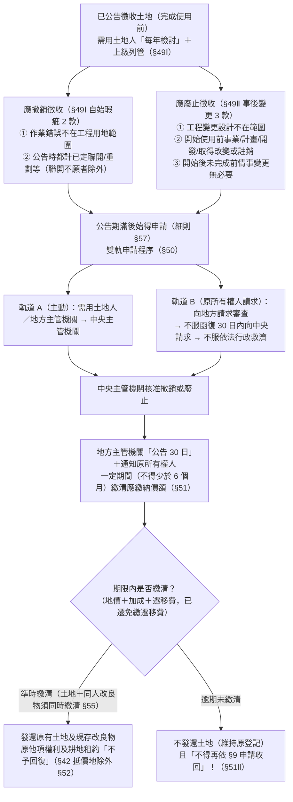

# 第 08 堂｜徵收之撤銷與廢止：三大退場機制終極對決

> **涵蓋條文範圍**：《土地徵收條例》§49～§55（含 §52-1）、《土地徵收條例施行細則》§56-1～§61-4（註：細則 §61-1～§61-3 屬 §57 地上權之延伸配套將於第 09 堂詳解，其中 **§61-4** 直接規範地上權撤銷／廢止時之一併撤銷廢止，於本堂同步整合）
> **命題熱度**：★★★★★（**地政士〈土地法規〉超級王牌考區！** 撤銷徵收 2 款自始事由 vs. 廢止徵收 3 款情事變更（§49）、需用土地人與原所有權人雙軌申請與 30 日救濟（§50）、核准後公告 30 日與不少於 6 個月繳還價額及遷移費免繳但書（§51）、原有他項權利／耕地租約不予回復與 §42 例外（§52），以及**「撤銷徵收 vs. 廢止徵收 vs. §9 收回權」三大退場機制終極對決**，幾乎每兩三年必出 25 分完整大題！）
> **跨科關聯**：〈行政法／土地法規〉（行政程序法 §117 違法處分撤銷、§123 合法處分廢止、§128 行政程序重開；《土地徵收條例》§9 收回權、§42 抵價地他項權利轉載、§57 地上權徵收）

---

## 一、 架構鳥瞰（1 分鐘看懂體系位置）

土地徵收是國家對人民財產權最劇烈的剝奪，因此必須嚴守「**徵收目的拘束原則**」：如果當初根本徵收錯了（**撤銷徵收**），或是後來計畫生變不用這塊地了（**廢止徵收**），國家不能把人民的土地「拿了不還、留著養蚊子」，必須啟動**退場發還機制**！本章（第五章 §49～§55）與第一章 §9（原所有權人收回權），合稱土地徵收的**「三大退場機制」**。

### 母法與施行細則條文對照地圖

| 主題模組 | 母法（條例） | 施行細則 | 考點星級 |
| :--- | :--- | :--- | :---: |
| 每年檢討、撤銷徵收 2 款、廢止徵收 3 款與殘餘部分一併處理 | §49 | §56-1（開始／完成使用定義） | ★★★★★ |
| 申請主體、雙軌審查程序、30 日向中央請求與共有人／繼承人資格 | §50 | §57、§57-1 | ★★★★★ |
| 核准後公告 30 日、6 個月以上繳清期限、價額構成與逾期雙重失權 | §51 | §58、§59、§60 | ★★★★★ |
| 原設定他項權利及耕地租約「不予回復」與 §42 唯一例外 | §52 | — | ★★★★★ |
| 依行政程序法或行政救濟撤銷／廢止徵收處分之準用 | §52-1 | — | ★★★★☆ |
| 土地改良物準用、一併撤銷廢止、現存酌定價額異議與同時繳清 | §53～§55 | §61、§61-4 | ★★★★☆ |

---

## 二、 白話精講（母法 × 施行細則整合）

### 主題 1：每年檢討義務、應撤銷（2 款）vs. 應廢止（3 款）（條例 §49；細則 §56-1）★★★★★

行政法最核心的區分就在 §49：
* **「撤銷」**：針對**自始違法或有錯誤**的行政處分（徵收當下就出包了！）。
* **「廢止」**：針對**作成時原本合法、但事後發生情事變更**的行政處分（徵收當下沒錯，後來計畫改了！）。

#### 1. 需用土地人之每年檢討與列管義務（條例 §49Ⅰ 前段）
已公告徵收之土地，需用土地人應切實按核准計畫及所定期限使用。在**未依徵收計畫完成使用前**，需用土地人應**每年檢討**其興辦事業計畫，並由其**上級事業主管機關列管**。

#### 2. 應辦理「撤銷徵收」之 2 款事由（條例 §49Ⅰ — 自始瑕疵）
1. **作業錯誤**：因作業錯誤，致原徵收之土地**不在工程用地範圍內**（例如地籍套繪搞錯地號、測量筆誤，把隔壁不相干的民宅徵收進來）。
2. **都市計畫已規定其他開發方式**：**公告徵收時**，都市計畫**已規定**以聯合開發、市地重劃或其他方式開發。
   * *⚠️ 考場必寫但書*：**但以聯合開發方式開發之土地，土地所有權人不願參與聯合開發者，不在此限**（如果地主自己拒絕參加聯合開發，政府依法採徵收取得就沒有違法，不應撤銷！）。

#### 3. 應辦理「廢止徵收」之 3 款事由（條例 §49Ⅱ — 事後情事變更）
1. **工程變更設計**：因**工程變更設計**，致原徵收之土地不在工程用地範圍內（⚠️ 超愛考對比：**作業錯誤→撤銷**；**工程變更設計→廢止**！）。
2. **開始使用前之四大改變／註銷**：依徵收計畫**開始使用前**，發生下列四者之一：① 興辦之**事業改變**；② 興辦事業計畫**經註銷**；③ **開發方式改變**；④ **取得方式改變**。
3. **開始使用後、完成使用前之情事變更**：**已依徵收計畫開始使用，尚未依徵收計畫完成使用**之土地，因**情事變更**，致原徵收土地之全部或一部已無徵收之必要。

#### 4. 「開始使用」與「完成使用」之法定定義（細則 §56-1 — 申論高分關鍵！）
* **開始使用**：指興辦事業之**主體工程動工**（不是拉個封鎖線或除個草就算數！）。
* **完成使用**：指興辦事業**整體工程完成驗收**（但依其事業性質無需興建工程者，不在此限）。
* *💡 老師破題*：如果整體工程已經「完成驗收（完成使用）」，嗣後才因人口減少等因素改變用途，就**不能再依 §49Ⅱ 辦理廢止徵收**，而是進入下一堂課的 **§59 變更原使用目的標售之優先購買權**！

#### 5. 殘餘部分一併辦理與溯及適用（條例 §49ⅢⅣ）
* **殘餘部分一併處理（§49Ⅲ）**：依前二項辦理撤銷或廢止徵收之土地或土地改良物，其已一併徵收（§8）之**殘餘部分，應同時辦理撤銷或廢止**。**但該殘餘部分已移轉或另有他用者，不在此限**。
* **溯及適用（§49Ⅳ）**：前三項規定，於**本條例施行前公告徵收之土地，適用之**（⚠️ 對照 §61：本條例施行前公告徵收土地之「申請收回」依舊法，但「撤銷或廢止徵收」直接適用本條例 §49！）。

> **【實務案例 1】到底該申請「撤銷徵收」還是「廢止徵收」？**
> * **情境 A**：縣政府興建外環道，承辦人員清冊繕打錯誤，把道路紅線外 20 公尺處老林的農地也打進徵收清冊並公告徵收。
>   * **解析**：屬「因**作業錯誤**，致原徵收之土地不在工程用地範圍內」，應依 **§49Ⅰ① 辦理撤銷徵收**。
> * **情境 B**：高鐵局原依計畫正確徵收老陳土地興建高架橋墩，公告徵收且發完補償費後，因地質鑽探發現斷層而**變更路線設計**，老陳的土地不再需要作為橋墩用地。
>   * **解析**：屬「因**工程變更設計**，致原徵收之土地不在工程用地範圍內」，應依 **§49Ⅱ① 辦理廢止徵收**。

---

### 主題 2：申請主體、雙軌審查程序與救濟流程（條例 §50；細則 §57、§57-1）★★★★★

符合 §49 事由後，誰能啟動程序？萬一政府裝死不申請，地主怎麼辦？

1. **申請時間點門檻（細則 §57 — 易漏考點！）**：
   * 依 §50 申請撤銷或廢止徵收，應於**土地或土地改良物徵收公告期滿後**，始得為之（公告 30 日還沒滿之前，請走 §22 異議程序，不能依 §50 申請）。
2. **三大啟動軌道（條例 §50）**：
   * **軌道一（原則主動申請，§50Ⅰ）**：由**需用土地人**向**中央主管機關（內政部）**申請之。
   * **軌道二（原所有權人被動請求＋兩階段救濟，§50Ⅱ～Ⅳ）**：
     1. **向地方請求**：需用土地人未申請時，**原土地所有權人**得向該管**直轄市或縣（市）主管機關**請求之。
        * *繼承人與共有人資格（細則 §57-1）*：原所有權人死亡者，為其全體繼承人，但**任一繼承人得敘明理由為其全體繼承人之利益請求之**；原為分別共有者，**各共有人得就其應有部分請求之**（這點與 §9 收回權之細則 §9 完全一致！）。
     2. **地方會同審查**：地方主管機關收受請求後，應會同需用土地人及其他有關機關審查。合於規定 → 由需用土地人向中央申請；不合規定 → 地方主管機關將處理結果**函復**原土地所有權人。
     3. **30 日向中央請求與行政救濟（§50Ⅳ）**：原土地所有權人不服地方函復結果，應於**函復送達之日起 30 日內**，向**中央主管機關**請求撤銷或廢止徵收。中央審查合於規定 → **逕予撤銷或廢止**；不合規定 → 函復原土地所有權人。仍不服者，**依法提起行政救濟**（訴願、行政訴訟）。
   * **軌道三（地方主管機關主動申請，§50Ⅴ）**：需用土地人未申請時，該管直轄市或縣（市）主管機關亦得主動會同需用土地人及其他有關機關審查後，直接向中央主管機關申請撤銷或廢止徵收。

---

### 主題 3：核准後公告 30 日、繳回價額與逾期雙重失權（條例 §51；細則 §58～§60）★★★★★

中央主管機關核准撤銷或廢止徵收後，並不是「地直接變回地主的」，必須經過**公告 30 日**與**原所有權人繳回補償價額**！

#### 1. 公告 30 日與應載明事項（條例 §51ⅠⅡ；細則 §58）
* 中央主管機關核准後，將原案通知該管直轄市或縣（市）主管機關。
* 地方主管機關收到通知時，應**公告 30 日**（細則 §58 明定公告應載明原需用土地人、興辦事業種類、原徵收與撤銷廢止核准文號、區域、**應繳納價額／繳回期限／受理地點**、公告期間、**逾期未繳清不發還且不得依 §9 收回之警語**、異議及行政救濟期限等 8 款事項），並**通知原土地所有權人**於一定期間繳清應繳納之價額，發還其原有土地。

#### 2. 繳清期限與逾期雙重失權（條例 §51ⅡⅢ；細則 §60）
* **繳清期限（§51Ⅲ）**：一定期間**不得少於 6 個月**（⚠️ 必背對比：§9 收回權是「6 個月內」固定期限；§51 撤銷／廢止徵收是「**不得少於 6 個月**」，對地主更寬裕！）。
* **逾期未繳清之雙重失權效果（§51Ⅱ 後段、細則 §60）**：
  1. **不發還其土地**（維持原登記；該維持原登記之土地為公有者，依公有財產管理有關法令處理之）。
  2. **不得再依第 9 條規定申請收回該土地**！（防止地主放著撤銷發還不繳錢，過幾年土地大漲又想回頭依 §9 申請收回套利！）。

#### 3. 應繳納之價額構成（條例 §51ⅣⅤ；細則 §59 — 超愛考！）
* **原則三項目（§51Ⅳ 本文）**：
  1. **徵收補償地價**
  2. **地價加成補償**（舊法曾有加成補償，現行市價補償下若無加成即為 0）
  3. **遷移費**
* **🔥 遷移費免繳但書（§51Ⅳ 但書）**：**但第 34 條第 1 項規定之人口或物件「已遷移者」，無須繳納遷移費！**（白話：如果領了遷移費卻還沒搬走，撤銷徵收後要吐回遷移費；但如果已經花錢搬家、搬機械設備走了，實質損害已發生，就不用吐回遷移費！）。
* **🔥 含代扣價金（§51Ⅴ、細則 §59）**：徵收前設定有**他項權利或耕地租約**者，前項「徵收補償地價」**包括他項權利人或耕地承租人原應受領之價金**！（例如地主原本拿 600 萬、銀行抵押權代償 400 萬，總補償地價 1,000 萬；撤銷徵收時，地主要把完整的 **1,000 萬元**全部繳回，因為政府已經幫你把銀行債務清掉了！細則 §59 亦明定，縱使原所有權人自己那部分補償尚未領取，仍須通知其繳清應繳價額後發還土地）。

---

### 主題 4：他項權利與耕地租約處理、準用與土地改良物一併處理（條例 §52～§55；細則 §61、§61-4）★★★★★

#### 1. 原有他項權利及耕地租約之命運（條例 §52 — 必背但書！）
* **原則（不予回復）**：撤銷或廢止徵收後，徵收前原設定之**他項權利及耕地租約「不予回復」**！
  * *白話理由*：徵收當時已依 §35、§36 把他項權利與耕地三七五租約代為清償消滅了，現在地主又依 §51Ⅴ 把包含銀行／佃農那份在內的全部地價繳回給政府，所以地主拿回的是一塊「乾乾淨淨、無抵押權也無租約」的土地！
* **唯一例外（准予回復）**：**但依第 42 條規定，由原土地所有權人及他項權利人申請於發給之抵價地設定抵押權或典權者，其原抵押權或典權「准予回復」**！（因為區段徵收時選擇轉載到抵價地，當初並沒有拿現金把抵押權或典權清償掉，債權還在，所以撤銷或廢止徵收時，原本的抵押權或典權當然要回復！）。

#### 2. 依行政程序法或行政救濟撤銷／廢止之準用（條例 §52-1）★★★★☆
除了依 §49 辦理撤銷／廢止外，土地徵收處分若有下列三種「外部行政法／救濟途徑」被撤銷或廢止者，其徵收補償費之繳清、土地發還、原設定他項權利及耕地租約之處理，**準用 §51 及 §52 規定**：
1. 經中央主管機關依**行政程序法**撤銷或廢止（如行政程序法 §117、§123）。
2. 經相對人或利害關係人依**行政程序法第 128 條**（行政程序重開）規定向行政機關申請後予以撤銷或廢止。
3. 經**行政救濟結果**撤銷或廢止（如訴願撤銷、行政法院判決撤銷）。

#### 3. 土地改良物之撤銷或廢止徵收（條例 §53～§55；細則 §61、§61-4）
1. **準用規定（§53）**：前五條（§49～§52-1）規定，於**土地改良物**撤銷或廢止徵收時準用之。
2. **一併撤銷廢止與滅失例外（§54Ⅰ）**：土地撤銷或廢止徵收時，原一併徵收之土地改良物**應一併辦理撤銷或廢止徵收**。**但該土地改良物已滅失者，不在此限**（房子都已經拆光滅失了，當然不可能發還）。
3. **價值減輕酌定價額與異議（§54Ⅱ；細則 §61）**：土地改良物與徵收當時相較**已減輕其價值，而仍得為相當之使用**者，原需用土地人得就其現存部分**酌定價額**，一併辦理撤銷或廢止徵收。
   * **不服酌定價額之救濟（細則 §61）**：原所有權人不服原需用土地人所定價額者，得於**撤銷或廢止徵收公告期間內（30 日）**向地方主管機關以書面提出異議，準用 **§22**（查處→地價評議委員會復議→行政救濟）規定辦理。
4. **同人須同時繳清（§55）**：撤銷或廢止徵收之土地與一併辦理撤銷或廢止徵收之土地改良物**原所有權人相同者**，應**同時繳清**土地及土地改良物應繳納之價額後，始發還原有土地及現存土地改良物（防止所有權人只繳錢領地、拒繳房屋價款把爛屋丟給政府！）。
5. **地上權撤銷廢止之連動（細則 §61-4）**：依 §57Ⅰ 準用徵收取得之地上權撤銷或廢止徵收時，已依 §57Ⅱ 核准徵收所有權之土地及原一併徵收之改良物，亦應**一併辦理撤銷或廢止徵收**！

> **【實務案例 2】撤銷徵收發還土地時，銀行抵押權、三七五租約與老屋怎麼算？**
> 老張有一塊訂有耕地三七五租約、且設有銀行抵押權 500 萬元的土地（地上有老張自建農舍一棟，原補償費 100 萬元），經徵收補償地價 1,500 萬元（其中代扣清償銀行 500 萬、補償承租人 300 萬，老張實領 700 萬）及遷移費 20 萬元（老張一家已確實搬遷）。嗣後因工程變更設計核准**廢止徵收**，但農舍因施工震動屋頂受損（價值減輕但仍可居住），需用土地人酌定現存農舍價額為 60 萬元。請問：
> 1. 老張需繳納多少價額？需在多久內繳清？
> 2. 老張可以只繳土地錢領回土地、不要領回受損農舍嗎？若嫌農舍 60 萬元太貴怎麼辦？
> 3. 土地發還後，銀行抵押權與三七五租約會復活嗎？
>
> 👉 **老師解析**：
> 1. **應繳納價額與期限（§51Ⅲ～Ⅴ）**：
>    * 土地部分：應繳回完整徵收補償地價 **1,500 萬元**（含銀行 500 萬＋佃農 300 萬＋老張實領 700 萬）；因人口與物件**已實際遷移**，**無須繳納 20 萬元遷移費**！
>    * 農舍部分：原需用土地人酌定之現存價額 **60 萬元**（§54Ⅱ）。
>    * 期限：地方主管機關公告 30 日並通知老張於一定期間（**不得少於 6 個月**）內繳清。
> 2. **同時繳清與異議救濟（§55、細則 §61）**：土地與農舍原所有權人皆為老張，依 §55 **應同時繳清 1,560 萬元**，不得拆開單領土地。若老張認為 60 萬元過高，得於**撤銷或廢止徵收公告期間內（30 日）**以書面向地方主管機關提出異議，準用 §22 辦理！
> 3. **他項權利與租約命運（§52）**：**均不予回復**（非屬 §42 抵價地轉載抵押權／典權之例外）！老張繳清 1,560 萬元後，拿回乾淨無抵押權、無租約的土地與現存農舍。

---

## 三、 考點對決（三大退場機制王牌終極對決表＋口訣）

### 王牌對決表：「撤銷徵收（§49Ⅰ）」vs.「廢止徵收（§49Ⅱ）」vs.「原所有權人收回權（§9）」★★★★★

這張表是整部《土地徵收條例》**CP 值最高、考出機率第一名**的終極比較表，請務必逐欄精熟！

| 比較維度 | 撤銷徵收（§49Ⅰ） | 廢止徵收（§49Ⅱ） | 原所有權人收回權（§9） |
| :--- | :--- | :--- | :--- |
| **法律性質** | 原徵收處分**自始違法或錯誤**，溯及既往失效 | 原徵收處分合法，**嗣後情事變更**，向後失效 | 原徵收處分合法，但國家**未按計畫期限使用**，賦予原所有權人法定買回請求權 |
| **法定事由** | **2 款（自始瑕疵）**： ① **作業錯誤**不在工程範圍。 ② 公告時都計已定聯開／重劃等（不願參與聯開者除外）。 | **3 款（事後變更）**： ① **工程變更設計**不在範圍。 ② 開始使用前事業／計畫／開發／取得改變或註銷。 ③ 開始後未完成前情事變更無必要。 | **3 款（違背計畫使用）**： ① 補償費發給完竣屆滿 **3 年**未依計畫開始使用（不可歸責需地人者除外）。 ② 未依核准原定興辦事業使用。 ③ 開始使用後未滿 **5 年**不繼續依原計畫使用。 |
| **發動主體** | 原則由**需用土地人**（或地方機關）主動申請；未申請時**原所有權人**（含任一繼承人／各共有人）得請求（§50）。 | 同左（§50）。 | **僅限原土地所有權人**（或其繼承人／共有人）主動申請（§9Ⅰ、細則 §9）。 |
| **行使時效** | **無除斥期間限制**（需用土地人完成使用前每年檢討；須於徵收公告期滿後始得申請，細則 §57）。 | 同左（須於完成使用前；公告期滿後始得申請）。 | 自**徵收公告之日起 20 年內**（除斥期間）。 |
| **是否適用區段徵收** | **適用**（§52 但書明文涵蓋 §42 抵價地抵押權回復！）。 | **適用**。 | **明確排除！**（§9Ⅰ「除區段徵收…外」；§58Ⅲ 徵用逾 3 年請求徵收者亦排除）。 |
| **核准機關** | **中央主管機關（內政部）**（§50）。 | **中央主管機關（內政部）**（§50）。 | 地方查明後報**原核准徵收機關（內政部）**核准（§9Ⅱ）。 |
| **核准後公告** | 地方主管機關**公告 30 日**並通知（§51Ⅱ）。 | 地方主管機關**公告 30 日**並通知（§51Ⅱ）。 | 條文未規定須公告，直接**通知**原所有權人（§9Ⅱ）。 |
| **應繳納價額** | **補償地價 ＋ 加成補償 ＋ 遷移費**（但已遷移者免繳遷移費；含他項權利人／佃農代扣價金，§51ⅣⅤ）。 | 同左（§51ⅣⅤ）。 | 原受領之**補償地價 ＋ 地價加成補償**（⚠️ **不含遷移費！**）。 |
| **繳清期限** | 一定期間**不得少於 6 個月**（§51Ⅲ）。 | 一定期間**不得少於 6 個月**（§51Ⅲ）。 | **6 個月內**（固定上限，§9Ⅱ）。 |
| **逾期未繳效果** | 不發還土地，且**不得再依 §9 申請收回**（§51Ⅱ）。 | 同左（§51Ⅱ）。 | **視為放棄收回權**（§9Ⅱ）。 |
| **原他項權利／耕地租約** | 原則**不予回復**；僅 §42 抵價地設定之抵押權／典權准予回復（§52）。 | 同左（§52）。 | 條文未明文，實務亦不予回復（原權利業因徵收消滅清償）。 |

### 速記口訣
* **撤銷 2 款 vs. 廢止 3 款**：**「撤銷抓錯（作業錯、都計已定他法）；廢止看變（變更設計、始前四變、始後未完情事變）」**。
* **§51 繳款地雷**：**「公告 30、期限不少 6 月、地價加成加遷移（已搬免遷移）、代扣算一起、逾期不還禁九條」**。
* **§52 權利回復**：**「他項租約全不回，唯一例外四十二（抵價地抵典權）」**。
* **§51 vs. §9 三大黃金差別**：**「區段徵收可撤廢、不能收回；撤廢要遷移（未搬）、收回免遷移；撤廢至少 6 個月、收回 6 個月內」**！

---

## 四、 課後小測驗（地政士申論模擬演練）

### 模擬題 1（撤銷與廢止事由、申請程序與價額繳回綜合題）
> **題目**：依現行《土地徵收條例》及其施行細則規定，已公告徵收之土地，在何種情形下應辦理「撤銷徵收」？在何種情形下應辦理「廢止徵收」？若需用土地人怠於申請，原土地所有權人應如何請求及救濟？又核准撤銷或廢止徵收後，原土地所有權人應於何期限內繳清哪些價額，逾期未繳清之法律效果為何？（25 分）

👉 點此展開【擬答架構與得分關鍵字】

1. **應辦理撤銷徵收之 2 款事由（條例 §49Ⅰ — 自始瑕疵）**：
   * ① 因作業錯誤，致原徵收土地不在工程用地範圍內。
   * ② 公告徵收時，都市計畫已規定以聯合開發、市地重劃或其他方式開發（但以聯合開發方式開發，土地所有權人不願參與聯合開發者，不在此限）。
2. **應辦理廢止徵收之 3 款事由（條例 §49Ⅱ；細則 §56-1 — 事後情事變更）**：
   * ① 因工程變更設計，致原徵收土地不在工程用地範圍內。
   * ② 依徵收計畫開始使用（主體工程動工）前，興辦之事業改變、興辦事業計畫經註銷、開發方式改變或取得方式改變。
   * ③ 已依徵收計畫開始使用，尚未完成使用（整體工程完成驗收）之土地，因情事變更，致原徵收土地之全部或一部已無徵收之必要。
   * *（並補充 §49Ⅲ：已一併徵收之殘餘部分應同時辦理，已移轉或另有他用者除外。）*
3. **原所有權人之請求與救濟程序（條例 §50Ⅱ～Ⅳ；細則 §57、§57-1）**：
   * 須於徵收公告期滿後始得申請（細則 §57）；死亡得由任一繼承人為全體利益請求，分別共有得就應有部分請求（細則 §57-1）。
   * 需用土地人未申請時，原所有權人得向**直轄市或縣（市）主管機關**請求 → 地方會同審查，不合規定函復。
   * 不服地方函復 → 應於**函復送達之日起 30 日內**向**中央主管機關**請求撤銷或廢止；中央不合規定函復仍不服者，**依法提起行政救濟**。
4. **公告、繳清期限、應繳價額與逾期效果（條例 §51）**：
   * 地方主管機關收到中央核准通知時，應**公告 30 日**，並通知原所有權人於一定期間（**不得少於 6 個月**）內繳清價額。
   * **應繳納價額**：**徵收補償地價**（含原他項權利人或耕地承租人原應受領之價金）、**地價加成補償**及**遷移費**（但 §34Ⅰ 人口或物件**已遷移者，無須繳納遷移費**）。
   * **逾期效果**：未於一定期間繳清者，**不發還其土地**，且**不得再依 §9 規定申請收回該土地**。

---

### 模擬題 2（三大退場機制對決＋他項權利＆改良物實例題）
> **題目**：甲所有之出租耕地（訂有三七五租約，並設有抵押權）及其上自建之農舍，經政府一併徵收後，嗣因興辦事業計畫經註銷而核准廢止徵收。試依《土地徵收條例》及其施行細則規定回答：(一) 廢止徵收發還土地後，原有之抵押權及耕地租約是否回復？有無例外？(二) 該一併徵收之農舍如已部分受損致價值減輕但仍可使用，應如何處理？甲得否僅繳回土地價款而拒絕領回農舍？(三) 請比較「廢止徵收（§49Ⅱ）」與「原所有權人申請收回土地（§9）」在適用範圍（含區段徵收）、申請時效、應繳還價額及繳納期限上之異同。（25 分）

👉 點此展開【擬答架構與得分關鍵字】

1. **原有抵押權及耕地租約之命運與例外（條例 §52）**：
   * **原則**：撤銷或廢止徵收後，徵收前原設定之他項權利（抵押權）及耕地租約**不予回復**（蓋徵收時已代為清償消滅，且原所有權人須依 §51Ⅴ 連同該等價金一併繳回）。
   * **唯一例外**：依 **§42** 規定，由原土地所有權人及他項權利人申請於區段徵收發給之抵價地設定**抵押權或典權**者，其原抵押權或典權**准予回復**。本案非屬抵價地轉載情形，故不予回復。
2. **價值減輕農舍之處理與同時繳清義務（條例 §54、§55；細則 §61）**：
   * 土地廢止徵收時，原一併徵收之農舍原則應一併辦理廢止徵收（已滅失者除外，§54Ⅰ）。
   * 農舍與徵收當時相較已減輕價值但仍得為相當使用者，原需用土地人得就其**現存部分酌定價額**一併廢止徵收（§54Ⅱ）；甲如不服酌定價額，得於**廢止徵收公告期間內（30 日）**以書面向地方主管機關提出異議，準用 §22 辦理（細則 §61）。
   * 因土地與農舍原所有權人皆為甲，依 **§55** 甲**應同時繳清土地及現存農舍應繳納之價額**，始發還土地及農舍，**不得僅領土地而拒領農舍**。
3. **「廢止徵收（§49Ⅱ）」vs.「申請收回土地（§9）」四大核心比較**：
   * **區段徵收適用與否**：廢止徵收**適用**於區段徵收；§9 收回權**明文排除**區段徵收。
   * **申請時效**：廢止徵收**無除斥期間**（於完成使用前均得辦理，公告期滿後始得申請）；§9 收回權限自**徵收公告之日起 20 年內**。
   * **應繳還價額**：廢止徵收繳納補償地價、地價加成補償及**遷移費（已遷移免繳）**；§9 收回權僅繳還原受領補償地價及地價加成補償（**不含遷移費**）。
   * **繳納期限**：廢止徵收一定期間**不得少於 6 個月**；§9 收回權須於 **6 個月內**繳還（逾期視為放棄）。

---

> **下堂課預告**：第 09 堂｜**附則、特別徵收、憲法解釋與申論實戰總複習**（條例 §56～§63；細則 §61-1～§66；釋字 732／743／747＆111 憲判字 15）— 本套課程最終壓軸大結局！一次制霸「地上權穿越徵收＋釋字 747」「土地徵用逾 3 年轉徵收」「變更使用標售優購權」，再奉上**全法 15 大數字地雷總表**與**申論四段黃金破題模板**！
