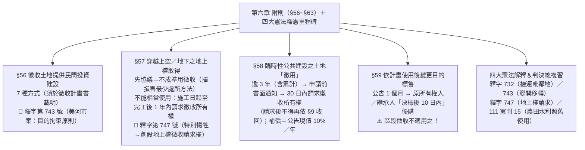

# 第 09 堂｜附則、特別徵收、憲法解釋與申論實戰總複習

> **涵蓋條文範圍**：《土地徵收條例》§56～§63、《土地徵收條例施行細則》§61-1～§66（含 §62-1、§65-1）、**司法院釋字第 732、743、747 號解釋＆憲法法庭 111 年憲判字第 15 號判決**
> **命題熱度**：★★★★★（**地政士〈土地法規〉壓軸決戰單元！** 徵收土地提供民間投資建設與釋字 743 號（§56）、**穿越上空／地下地上權徵收與不能為相當使用之所有權徵收請求權（§57）＋釋字 747 號創設地上權徵收請求權**、**臨時性公共建設土地「徵用」與逾 3 年轉徵收（§58）**、變更原使用目的標售之優先購買權（§59），以及**四大憲法釋憲里程碑**，近年命中率極高！）
> **跨科關聯**：〈憲法財產權與比例原則〉（特別犧牲理論、目的拘束原則）、〈民法物權〉（地上權、優先購買權）、〈土地法規〉（全法 15 大數字地雷總串聯）

---

## 一、 架構鳥瞰（1 分鐘看懂體系位置）

第六章「附則」（§56～§63）絕對不是無關緊要的條文收尾！恰恰相反，裡面藏著**四大重量級實戰條文**：民間參與建設（§56）、立體空間穿越之地上權徵收（§57）、臨時性工程之土地徵用（§58），以及完成使用後變更用途標售之優先購買權（§59）。再搭配大法官釋字第 732、743、747 號與 111 年憲判字第 15 號，構成地政士考試最高階的「**憲法財產權 × 特別徵收**」命題戰區！

### 母法與施行細則條文對照地圖

| 主題模組 | 母法（條例） | 施行細則 | 憲法釋憲連結 | 考點星級 |
| :--- | :--- | :--- | :--- | :---: |
| 徵收土地提供民間機構投資建設（7 種方式） | §56 | — | **釋字第 743 號** | ★★★★★ |
| 穿越上空／地下取得地上權與請求徵收所有權 | §57 | §61-1～§61-4 | **釋字第 747 號** | ★★★★★ |
| 臨時性公共建設之土地「徵用」與逾 3 年轉徵收 | §58 | §62、§62-1、§63 | 特別犧牲理論 | ★★★★★ |
| 依計畫使用後變更目的標售之優先購買權 | §59 | §64、§65 | 財產權存續保障 | ★★★★★ |
| 施行前過渡條款、損害賠償負擔與施行日期 | §60～§63 | §65-1、§66 | — | ★★☆☆☆ |
| 毗鄰地徵收違憲＆農田水利用地照舊使用違憲 | §3、§3-2 | — | **釋字 732、111 憲判 15** | ★★★★★ |

---

## 二、 白話精講（母法 × 施行細則整合）

### 主題 1：徵收土地提供民間機構投資建設（條例 §56 ＋ 釋字第 743 號）★★★★☆

現代重大建設（如高鐵站區、捷運聯合開發、BOT 案）常需引入民間資金與經營效率，但政府「徵收民地再交給財團開發」容易引發圖利財團爭議，因此 §56 設下明確的公開透明門檻：

* **7 種法定合作方式（§56Ⅰ）**：徵收之土地，得於**徵收計畫書載明**，以 ① **信託**、② **聯合開發**、③ **委託開發**、④ **委託經營**、⑤ **合作經營**、⑥ **設定地上權** 或 ⑦ **出租**，提供民間機構投資建設（⚠️ **關鍵要件**：必須事先在「**徵收計畫書載明**」，接受中央審議小組與大眾檢驗！）。
* **施行前土地補救（§56Ⅱ）**：本條例施行前申請徵收之土地，經申請**中央主管機關備案**者，得依前項方式提供民間機構投資建設。
* **🔥 憲法紅線（釋字第 743 號「美河市案」）**：大法官強調「**徵收目的拘束原則**」——主管機關依徵收規定取得之土地，應嚴格按核准計畫目的使用；**除法律有明確規定外，不得任意移轉所有權予第三人供一般商業開發**！因此 §56 僅列舉信託、聯開、委開、委營、合營、設定地上權、出租，並未授權政府任意將徵收地直接賣斷給財團。

---

### 主題 2：穿越上空／地下之地上權徵收與請求徵收所有權（條例 §57；細則 §61-1～§61-4 ＋ 釋字第 747 號）★★★★★

本條是近年地政士國考**命中率飆升最快**的明星條文！核心解決「高架橋、捷運地下隧道、超高壓電線」只需占用私有土地的「立體空間」（上空或地下），不需要剝奪整塊地所有權時該怎麼辦。

#### 1. 需用土地人主動取得地上權（條例 §57Ⅰ）
* **適用事業**：需用土地人因興辦 **§3 規定之事業**，需穿越私有土地之**上空或地下**。
* **程序順序**：
  1. 先就需用之空間範圍**協議取得地上權**；
  2. 協議不成時，**準用徵收規定取得地上權**（補償辦法由中央目的事業主管機關會同中央主管機關定之，§57Ⅳ）。
* **比例原則明文化（§57Ⅰ 但書）**：**但應擇其損害最少之處所及方法為之**！

#### 2. 🔥 大法官釋字第 747 號：創設人民「地上權徵收請求權」！
* **原本的法律漏洞**：§57Ⅰ 只寫「需用土地人得協議／準用徵收取得地上權」，如果政府蓋了地下公路或高壓電線直接穿越私有地，卻**既不協議、也不辦徵收地上權**（實務稱「事實上穿越」），土地所有權人竟然找不到條文主動請求政府徵收地上權！
* **釋字第 747 號震撼結論（106.04.21）**：
  * 需用土地人興辦公益事業穿越私有土地上空或地下，致逾越所有權人社會責任所應忍受之範圍，形成個人之**特別犧牲**，卻未予徵收地上權者，§11、§57Ⅰ 未賦予土地所有權人主動請求徵收地上權之規定，**違反憲法第 15 條財產權保障**！
  * 大法官明示：於修法期限（1 年）屆滿未完成修法時，土地所有權人得依本解釋意旨，**直接請求需用土地人向主管機關申請徵收地上權**！

#### 3. 不能為相當使用時，請求「徵收所有權」（條例 §57ⅡⅢ；細則 §61-1～§61-4）
如果穿越工程嚴重到整塊地都沒辦法正常蓋房子或耕作（**不能為相當之使用**），只補一點地上權對價根本不夠，這時法律給地主「**反向強制徵收所有權**」的王牌：
* **行使要件與法定期間（§57Ⅱ — 必背起訖日！）**：
  * 土地因事業之興辦，致**不能為相當之使用**時，土地所有權人得自**「施工之日起至完工後 1 年內」**，請求需用土地人**徵收土地所有權**，**需用土地人不得拒絕**！
* **扣除原地上權對價（§57Ⅲ）**：原設定地上權取得之對價，應在徵收補償地價內**扣除之**（防止重複補償）。
* **施行細則 4 大配套（細則 §61-1～§61-4）**：
  1. **申請人資格（細則 §61-1）**：原被徵收地上權時之土地所有權人；死亡已辦竣繼承登記者為登記名義人，未辦竣者為全體繼承人；分別共有者，各共有人得就其應有部分申請。
  2. **實地勘查與核定（細則 §61-2）**：需用土地人應會同申請人及有關機關**實地勘查**作成紀錄（申請人有不同意見應記明），報請**中央主管機關核定**後函復；但申請人資格不符或已逾法定期間者，**免實地勘查**逕報中央核定函復。
  3. **一併徵收改良物（細則 §61-3）**：徵收土地所有權時，其土地改良物所有權人相同者，應依 §5ⅠⅢ 一併徵收。
  4. **連動撤銷或廢止（細則 §61-4）**：原地上權撤銷或廢止徵收時，已依 §57Ⅱ 核准徵收所有權之土地及原一併徵收改良物，應一併辦理撤銷或廢止徵收。

> **【實務案例 1】捷運地下隧道穿越阿華家基地，阿華能行使哪兩道王牌？**
> 捷運局興建地下捷運隧道，直接從阿華家私有建地地下 12 公尺穿越，導致該建地未來無法開挖地下室興建原規劃之大樓，卻從未與阿華協議或辦理地上權徵收。請問阿華如何救濟？
> * **老師解析（層次分明拿滿分！）**：
>   1. **第一層（釋字第 747 號 — 地上權徵收請求權）**：捷運隧道實質穿越地下已逾越阿華社會義務所應忍受之範圍，構成**特別犧牲**。阿華得依**釋字第 747 號解釋意旨**，主動請求需用土地人（捷運局）向中央主管機關申請**徵收地上權**並給予相當補償。
>   2. **第二層（條例 §57Ⅱ — 所有權徵收請求權）**：若因隧道穿越嚴重影響地基載重與開挖，致該建地已達**不能為相當之使用**之程度，阿華得自**施工之日起至完工後 1 年內**，進一步請求捷運局**徵收土地所有權**，捷運局不得拒絕；若事前曾領取地上權對價，則於徵收補償地價中扣除（§57Ⅲ），且由捷運局會同實地勘查報請內政部核定（細則 §61-2）。

---

### 主題 3：臨時性公共建設之土地「徵用」（條例 §58；細則 §62、§62-1、§63）★★★★★

所謂「**徵用**」，就是國家因為**臨時性**公共建設工程（如築堤搶修便道、捷運施工臨時機具堆置場），暫時強制「借用」人民的土地或土地改良物，**所有權不移轉**，用完就歸還並按年給租金性質的「使用補償費」。

#### 1. 徵用要件、逾 3 年轉徵收所有權與失權連動（條例 §58Ⅰ～Ⅲ；細則 §62-1）
* **要件（§58Ⅰ）**：國家因興辦**臨時性之公共建設工程**，得徵用私有土地或土地改良物。
* **🔥 逾 3 年轉徵收請求權（§58Ⅱ — 必背 3 年＆30 日！）**：
  * **觸發門檻**：徵用期間**逾 3 年**，或**二次以上徵用，期間合計逾 3 年**者。
  * **書面通知**：需用土地人應於**申請徵用前，以書面通知**所有權人。
  * **請求行使**：土地或土地改良物所有權人於**收到通知書之日起 30 日內**，得請求需用土地人**徵收所有權**，**需用土地人不得拒絕**（依細則 §62-1，由需用土地人報請中央主管機關核定後函復）。
* **⚠️ 超級陷阱（§58Ⅲ — 不得依 §9 收回！）**：依前項規定由所有權人主動請求徵收土地或土地改良物所有權者，**不得再依第 9 條規定申請收回**其土地或土地改良物！（白話：是你自己嫌借太久主動要求政府買斷的，政府原本只想借用，當然不能事後又拿 §9 要求收回！）。

#### 2. 程序準用與「緊急先行使用」（條例 §58Ⅳ；細則 §62、§63）
* **一般程序（§58Ⅳ 本文、細則 §63）**：準用第二章徵收程序；需用土地人應擬具詳細**徵用計畫書（載明 16 款事項）**報由**中央主管機關核准**，並副知地方主管機關。
* **緊急例外（§58Ⅳ 但書、細則 §62、§63Ⅳ）**：因**情況緊急**，如遲延使用土地或土地改良物，公共利益有受重大危害之虞者，得經**中央主管機關核准後，先行使用**；此時依細則 §62 **得免舉行公聽會，並免協議價購或以其他方式取得**（徵用計畫書亦免載第 10、11 款）。

#### 3. 使用補償費計算公式與毀損補償（條例 §58Ⅴ～Ⅶ — 考場頭號數字地雷！）
* **起算與發放時點**：自**公告徵用之日**起計算使用補償費，於**公告期滿後 15 日內**一次發給（經應受補償人同意者，得延期或分期發給）。
* **發給對象**：所有權人、地上權、典權、不動產役權、農育權、永佃權或耕作權人（實際享有用益權之人！）。
* **🔥 每年使用補償費標準（小心！不是市價！）**：
  * **土地**：依**「徵用公告期滿第 15 日之公告土地現值 10%」**計算！
  * **土地改良物**：依**「徵收補償費 10%」**計算！
  * **畸零期間**：徵用期間不足 1 年者，**按月計算**；不足 1 月者，**按日計算**。
* **未能回復原狀之補償（§58Ⅶ）**：因徵用致土地改良物**必需拆除或未能回復為徵用前之使用**者，準用 **§31** 規定給予補償（建物按重建價格、農作物按 1 年內孳息／逾 1 年種植培育費參酌現值）。但該使用方式**經徵得所有權人同意者，不在此限**。

---

### 主題 4：變更原使用目的標售之優先購買權＆附則過渡（條例 §59～§63；細則 §64～§66）★★★★★

如果土地已經**確實依徵收計畫完成使用**（例如蓋了國小、用了 20 年），後來因為時代變遷（如少子化廢校）依法變更原使用目的，政府決定把這塊地公開**標售**，這時雖然早已超過或不符合 §9 收回權、§49 廢止徵收的條件，但法律仍給原所有權人最後一份溫柔保障——**§59 優先購買權**！

#### 1. 優先購買權五大要件與行使細節（條例 §59；細則 §64、§65）
1. **前提要件**：私有土地**經依徵收計畫使用後**，依法變更原使用目的，且土地管理機關決定**「標售」**該土地時。
2. **公告期間**：標售機關應**公告 1 個月**（並於標售公告載明原所有權人或其繼承人有依同樣條件優先購買權）。
3. **權利人與除斥期限（§59Ⅰ、細則 §65Ⅰ）**：
   * 權利人：**原土地所有權人或其繼承人**（即使原土地嗣因分割、合併、重測或重劃致無法維持原標示或位置，標售土地所坐落之原徵收地號土地之原所有權人或其繼承人仍有優購權，細則 §64）。
   * 行使期限：未於**「決標後 10 日內」**自行檢具**保證金（與該標售案投標保證金相同）**及相關證明文件，以書面向標售機關申請者，其優先購買權**視為放棄**！
4. **殘餘地連動（§59Ⅱ）**：依 §8Ⅰ 一併徵收之殘餘土地，**須與原徵收土地「同時標售」時**，始適用優先購買權。
5. **⚠️ 絕對排除（§59Ⅲ — 必考！）**：**前二項規定，於「區段徵收」不適用之！**
6. **二人以上主張優購之競合（細則 §65ⅢⅣ）**：
   * 應於接到標售機關通知之日起 **10 日內**提出全體申請人優先購買權利範圍之**協議書**；
   * 無法達成協議者：由標售機關按該標案土地徵收當時，各該原土地所有權人被徵收土地面積占全體申請人被徵收總面積之**比例**計算持分及應繳價款；
   * 若屬同一原所有權人之**繼承人有二人以上**申請優購，除依協議外，按申請優購之**繼承人數平均計算**持分。

#### 2. 過渡條款、損害賠償與施行日（條例 §60～§63；細則 §65-1、§66）
* **§60（舊案結案）**：本條例施行前已公告徵收但尚未辦竣結案者，除本條例另有規定（如 §25、§26、§49Ⅳ）外，依公告徵收時所依據之法律規定繼續辦理結案。
* **§61（舊案收回）**：本條例施行前公告徵收之土地，其申請收回，仍依施行前之規定辦理（即舊土地法 §219）。
* **細則 §65-1（損害賠償）**：土地徵收相關事件之損害賠償，由**造成損害之機關**負擔；數機關共同負擔者，協議其責任分擔（施行前公告徵收案亦適用）。
* **§62、§63（細則與施行日）**：施行細則由中央主管機關（內政部）定之；本條例自公布日（89.02.02）施行；100 年 12 月 13 日修正之 §30（市價補償）施行日期由行政院定之（行政院核定自 **101 年 9 月 1 日**施行）。

> **【實務案例 2】廢校國小變建地標售，原屋主主張 §9 收回還是 §59 優購？**
> 某市於民國 90 年依法一般徵收老林的土地興建公立國小，並已完工辦學達 20 年。嗣因少子化廢校，市政府於民國 113 年依法變更該校地為住宅區並公開標售。老林主張：「土地不蓋學校了，我要依 §9 原價收回！」請問老林的主張有理由嗎？又老林可主張什麼權利？若當初這塊校地是透過「區段徵收」無償取得呢？
> * **老師解析**：
>   1. **不能依 §9 收回，也不能依 §49 廢止**：本案已依徵收計畫完成使用達 20 年（遠逾 5 年，且超過公告日起 20 年除斥期間），完全不符合 §9 收回及 §49Ⅱ 廢止要件。
>   2. **得依 §59 主張優先購買權**：因本案屬依徵收計畫使用後，依法變更原使用目的而**標售**，標售機關應**公告 1 個月**，老林（或其繼承人）有依**同樣條件（決標價）優先購買權**，但須於**決標後 10 日內**檢具投標保證金與證明文件以書面提出申請，否則視為放棄！
>   3. **若原屬區段徵收**：依 **§59Ⅲ** 明文規定，**區段徵收不適用本條優先購買權**，老林無法主張優先購買！

---

## 三、 考點對決與全法壓軸總複習

### 總複習表 1：四大憲法解釋與憲法判決里程碑（申論加分神器！）★★★★★

| 案號與日期 | 經典案名與爭議標的 | 核心憲法見解與原則 | 對應《土徵條例》條文＆考場破題金句 |
| :--- | :--- | :--- | :--- |
| **釋字第 732 號** (104.09.25) | **捷運毗鄰地徵收違憲案** 舊大眾捷運法許為土地開發徵收「非交通事業所必須之毗鄰土地」 | 違反憲法 §23 **比例原則**，侵害 §15 財產權與 §10 居住自由！不得僅為財政收益或土地開發，強制徵收非興辦公益事業所必須之毗鄰私有地。 | **§3「以其事業所必須者為限」、§3-2 公益性與必要性評估**。 💡 金句：「國家徵收不得為商業利益或財政收益而擴張及於非事業所必須之毗鄰土地。」 |
| **釋字第 743 號** (105.12.30) | **美河市聯開移轉第三人案** 依捷運法徵收土地得否未經法律明確授權即移轉第三人開發 | 嚴守**徵收目的拘束原則**！徵收取得土地除法律有明確規定外，不得任意移轉所有權予第三人供一般商業開發；若供聯合開發須符合明確法律授權。 | **§56 民間機構投資建設（須載明於徵收計畫書）、§9 收回、§49 廢止**。 💡 金句：「徵收土地受目的拘束原則支配，移轉第三人開發須有明確法律授權並於徵收計畫書載明。」 |
| **釋字第 747 號** (106.04.21) | **穿越空間地上權徵收請求權案** 公路／管線穿越私有地上下未徵收地上權，地主得否主動請求 | 穿越私有地上空或地下逾越社會義務、構成**特別犧牲**者，未賦予地主主動請求徵收地上權違憲！**創設人民「地上權徵收請求權」**（逾期未修法得直接依解釋請求）。 | **§57 地上權取得與請求徵收所有權**。 💡 金句：「實質穿越形成特別犧牲時，依釋字第 747 號，土地所有權人得主動請求需用土地人申請徵收地上權。」 |
| **111 年憲判字第 15 號** (111.08.12) | **農田水利用地照舊使用案** 農田水利法 §11Ⅰ 令私有土地無合法權源「應照舊使用」 | 私有土地未以租用、價購等合法權源取得，卻長年依法供農田水利設施（公物）「照舊使用」，已構成**特別犧牲**，國家**應依法徵收並給予相當補償**（限期 **3 年內**擬定徵收補償計畫逐步完成）。 | **憲法 §15 特別犧牲與完全補償原則**。 💡 金句：「無權源公物使用不得無限期轉嫁由個別地主承擔，形成特別犧牲即應依法徵收補償。」 |

### 總複習表 2：「一般徵收」vs.「地上權徵收（§57）」vs.「土地徵用（§58）」三維比較

| 比較項目 | 一般徵收（第 1～3 章） | 穿越空間地上權徵收（§57） | 土地徵用（§58） |
| :--- | :--- | :--- | :--- |
| **剝奪客體** | **所有權**（永久剝奪） | **地上權**（立體空間使用權） | **臨時使用權**（所有權未移轉，期滿歸還） |
| **適用目的** | §3 之 10 款公益事業 | §3 事業需穿越私有地上空或地下 | 興辦**臨時性**之公共建設工程 |
| **補償標準** | 徵收當期**市價**（§30） | 依地上權徵收補償辦法（§57Ⅳ） | 每年：**公告土地現值 10%**（改良物為徵收補償費 10%，§58Ⅴ） |
| **地主請求「徵收所有權」要件** | （已徵收所有權；殘餘地依 §8 公告日起 1 年內請求一併徵收） | 致**不能為相當之使用** → 自**施工之日起至完工後 1 年內**請求，不得拒絕（扣除地上權對價） | 徵用期間（或二次以上合計）**逾 3 年** → 申請前書面通知 → 收到通知 **30 日內**請求，不得拒絕 |
| **是否適用 §9 收回權** | **適用**（20 年內） | （原地上權適用撤銷廢止，細則 §61-4 連動） | 依 §58Ⅱ 請求徵收所有權者，**不得再依 §9 申請收回**（§58Ⅲ） |

### 總複習表 3：全法 15 大必背數字地雷終極清單 ★★★★★

考前 10 分鐘把這 15 組數字掃一遍，地政士〈土地法規〉所有細節分數全數入袋！

| 編號 | 條文依據 | 必背黃金數字 | 一句話提醒（地雷所在） |
| :---: | :--- | :--- | :--- |
| **1** | 細則 §2-1 | **0.25 公頃／10%（得增 10% 以內）** | 特定農業區農牧用地「零星夾雜」上限：單筆 ≤ 0.25 公頃且累計 ≤ 總面積 10%。 |
| **2** | §5Ⅱ | **3 年內**（取回自行遷移 **15 日內**） | 土地改良物得視需要於土地徵收公告日起 3 年內徵收；業主取回自遷限公告期滿 15 日內。 |
| **3** | §8Ⅰ | **公告之日起 1 年內** | 殘餘土地或建物不能為相當使用，申請**一併徵收**期限（逾期不受理、限**現金補償**）。 |
| **4** | §9ⅠⅡ | **20 年／3 年／未滿 5 年／6 個月內** | 原所有權人收回權：公告日起 20 年內；發完補償 3 年未開始、未依原定、開始未滿 5 年不繼續；6 個月內繳還。 |
| **5** | §12Ⅰ | **7 日前**通知 | 進入建築物或設有圍障之土地勘測，應於 7 日前通知。 |
| **6** | §15Ⅱ | **不得少於 1/2** | 土地徵收審議小組之專家學者及民間團體代表比例（地政、環評、都計、城鄉規劃）。 |
| **7** | §18、§20 | **公告 30 日／期滿後 15 日內**發給 | 徵收公告 30 日；期滿 15 日內未發給完竣者，徵收從此**失其效力**（4 款例外除外）。 |
| **8** | §22ⅡⅤ | **期滿次日起 30 日內／確定起 3 個月內** | 對**補償價額**異議為公告期滿次日起 30 日內（公告事項為公告期間內）；差額 3 個月內發給。 |
| **9** | §26Ⅰ | **3 個月內存入／逾 15 年歸國庫** | 未受領補償費保管專戶：應發給期滿次日起 3 個月內存入；送達生效日起逾 15 年未領歸國庫。 |
| **10** | §30Ⅲ、§31Ⅱ | **每 6 個月**評定市價／農作 **1 年內** | 每 6 個月評定市價變動幅度；農作改良物距成熟 ≤ 1 年按孳息、＞ 1 年按種植培育費參酌現值。 |
| **11** | §34、§34-1 | 遷移費 **6 個月前**設籍／安置 **1 年前**居住 | 人口遷移費須公告 6 個月前設籍（結婚出生除外）；低／中低收入戶安置須公告 1 年前有居住事實。 |
| **12** | §37、§39、§40 | 禁建 **1 年 6 月**／抵價地 **50%・40%・45%**／改領 **1 個月** | 區段徵收禁建最長 1 年 6 月；抵價地原則 50%、最低 40%、曾農地重劃 45%；改領現金或抵價地限 1 個月（1 次）。 |
| **13** | §44ⅡⅤ、§51 | 合併未申請 **30 日**發現金／標租地上權 **99 年**／撤廢繳款 **≥ 6 個月** | 不足最小面積未合併 30 日按原補償發現金；配餘地標租或地上權最長 99 年；撤銷廢止繳款期不得少於 6 個月。 |
| **14** | §57Ⅱ | **施工之日起至完工後 1 年內** | 穿越上空地下致不能相當使用，請求徵收所有權之法定期間（不得拒絕、扣地上權對價）。 |
| **15** | §58、§59 | 徵用 **逾 3 年 → 30 日內**／補償 **現值 10%**／優購公告 **1 月・決標 10 日** | 徵用逾 3 年轉徵收（30 日內請求，禁 §9 收回）；每年補償費為公告現值 10%；標售優購公告 1 月、決標後 10 日內申請。 |

### 地政士申論題「四段黃金破題模板」

遇到任何 25 分《土地徵收條例》實例申論題，直接套用以下四段式骨架，版面工整、層次分明，讓閱卷委員瞬間給出 20+ 高分：

1. **第一段【破題定性與憲法上位原則】**：
   * 3 行內點出本題核心制度，並順手掛鉤憲法第 15 條財產權保障、比例原則、特別犧牲或目的拘束原則（若切合釋字 732／743／747 或 111 憲判字 15，立即點出案號！）。
2. **第二段【法條依據：母法 × 施行細則完整分項列點】**：
   * 採 `(一)、(二)、(三)` 階層條列，把母法條號、要件、但書、數字期限與施行細則補充一網打盡（務必保留「但書」與「除外規定」，那是拉開高分的關鍵！）。
3. **第三段【涵攝本案事實與爭點判斷】**：
   * 逐一將題目中的人物（甲、乙）、時間點、面積或價格套入前段要件，明確回答「有理由／無理由」、「得請求／不得請求」及具體計算結果。
4. **第四段【跨法比較或實務／修法補述（滿分畫龍點睛）】**：
   * 例如補述「本案不得再依 §9 收回」、「區段徵收不適用 §59」、「現行優先適用土徵條例市價補償取代平均地權條例 §10 公告現值」，展現專業地政士素養！

---

## 四、 課後小測驗（壓軸綜合實戰模擬演練）

### 模擬題 1（地上權穿越＋釋字 747 號＋土地徵用逾 3 年綜合實例題）
> **題目**：國家為興辦高速鐵路建設，針對甲、乙二人私有土地分別採取不同措施：(一) 高鐵地下隧道直接穿越甲所有之建築用地地下，致該地無法開挖地下室、顯然已不能為相當之使用，惟需用土地人事前未辦理協議亦未申請徵收地上權；(二) 因施工急需，政府另徵用乙所有之相鄰土地作為臨時土石堆置場，首次徵用 2 年，期滿後擬再申請第二次徵用 2 年（合計 4 年）。試依《土地徵收條例》、施行細則及大法官解釋，分別說明甲、乙二人得主張之權利、行使期限、補償費計算基準及相關法律效果。（25 分）

👉 點此展開【四段式黃金擬答架構】

1. **破題與憲法原則**：
   * 本題涉及國家興辦公益事業對人民財產權形成「特別犧牲」時，所生之立體空間穿越地上權徵收（§57、釋字第 747 號）及臨時性土地徵用轉徵收（§58）之保障機制。
2. **甲之權利、期限與法律效果（條例 §57；細則 §61-1～§61-3；釋字第 747 號）**：
   * **地上權徵收請求權（釋字第 747 號）**：高鐵地下隧道未經徵收即穿越甲土地地下，已逾越社會責任忍受範圍構成特別犧牲，依釋字第 747 號意旨，甲得主動請求需用土地人向主管機關申請**徵收地上權**並給予補償（且穿越應擇損害最少處所及方法，§57Ⅰ 但書）。
   * **所有權徵收請求權（§57ⅡⅢ）**：因該穿越致甲之土地已**不能為相當之使用**，甲得自**施工之日起至完工後 1 年內**，請求需用土地人**徵收土地所有權**，**需用土地人不得拒絕**（由需用土地人會同實地勘查報中央主管機關核定，細則 §61-2；同人改良物一併徵收，細則 §61-3）。若甲先前曾領取地上權對價，應於徵收補償地價中扣除。
3. **乙之權利、補償基準與失權效果（條例 §58；細則 §62-1）**：
   * **徵用期間之使用補償費（§58Ⅴ）**：自公告徵用之日起算，於**公告期滿後 15 日內**一次發給（經同意得延期或分期）。乙土地每年之使用補償費，按**徵用公告期滿第 15 日之公告土地現值 10%** 計算（改良物按徵收補償費 10%；不足 1 年按月、不足 1 月按日計算）；若因徵用致改良物拆除或未能回復原狀，準用 §31 補償（§58Ⅶ）。
   * **二次徵用合計逾 3 年之所有權徵收請求權（§58Ⅱ）**：本案二次徵用期間合計 4 年（**逾 3 年**），需用土地人應於**申請第二次徵用前以書面通知乙**；乙於**收到通知書之日起 30 日內**，得請求需用土地人**徵收土地所有權**，需用土地人不得拒絕（報中央主管機關核定函復，細則 §62-1）。
   * **法律效果限制（§58Ⅲ）**：乙一旦依 §58Ⅱ 請求徵收所有權後，嗣後即**不得再依 §9 規定申請收回**其土地！

---

### 模擬題 2（徵收目的拘束原則＋§56 民間參與＋§59 標售優購權＋憲法解釋綜合題）
> **題目**：請結合司法院釋字第 732 號、第 743 號解釋及憲法法庭 111 年憲判字第 15 號判決意旨，說明《土地徵收條例》如何落實「比例原則」、「目的拘束原則」與「特別犧牲補償」？又政府依法一般徵收私有土地供公有市場使用 15 年後，因商圈轉移依法變更為商業區並決定公開標售，原土地所有權人丙或其繼承人得依《土地徵收條例》第 59 條主張何種權利？其公告期間、行使期限、多數人競合之處理方式，以及於「區段徵收」是否適用，請一併說明。（25 分）

👉 點此展開【四段式黃金擬答架構】

1. **三大憲法解釋／判決與《土地徵收條例》之制度落實**：
   * **釋字第 732 號（比例原則與必要性）**：禁止為土地開發徵收非交通事業所必須之毗鄰土地 → 對應本條例 **§3**「以其事業所必須者為限」及 **§3-2** 公益性與必要性五大綜合評估。
   * **釋字第 743 號（徵收目的拘束原則）**：徵收取得土地除法律明確授權外，不得任意移轉第三人供一般商業開發 → 對應本條例 **§56**，提供民間機構以信託、聯開、委開、委營、合營、設定地上權或出租等 7 種方式投資建設時，必須**載明於徵收計畫書**；若違背目的另有 §9 收回與 §49 廢止制衡。
   * **111 年憲判字第 15 號（特別犧牲補償）**：私有土地無合法權源而依法「照舊使用」供農田水利設施（公物），已構成特別犧牲，國家應於 3 年內擬定計畫依法徵收並給予相當補償，具體展現憲法 §15 財產權保障與完全補償意旨。
2. **丙或其繼承人之優先購買權（條例 §59；細則 §64、§65）**：
   * **權利內容**：私有土地經依徵收計畫使用後，依法變更原使用目的，土地管理機關**標售**該土地時，原土地所有權人丙或其繼承人有依**同樣條件（決標條件）優先購買權**（依 §8Ⅰ 一併徵收之殘餘地，須與原徵收土地**同時標售**時始適用）。
   * **公告與行使期限**：標售機關應**公告 1 個月**；優先購買權人應於**決標後 10 日內**，自行檢具保證金（同投標保證金）及相關證明文件以書面申請，逾期**視為放棄**。
   * **多數人競合處理（細則 §65ⅢⅣ）**：同一標案有二人以上申請優購時，應於接到通知之日起 **10 日內**提出全體協議書；協議不成者，按徵收當時各原所有權人被徵收土地面積占全體申請人被徵收總面積之**比例**計算購買持分；若係同一原所有權人之**繼承人有二人以上**未協議者，按申請優購之**繼承人數平均計算**持分。
   * **區段徵收排除適用（§59Ⅲ）**：依條例 §59Ⅲ 明文規定，優先購買權於**區段徵收不適用之**！

---

> 🎉 **全課程 9 堂課圓滿結業！** 恭喜同學完整攻克《土地徵收條例》全 6 章 71 條 ＋《施行細則》全 6 章 78 條 ＋ 四大憲法釋憲里程碑！考前請善用本資料夾內的 `index.html` 數位講義網頁，搭配置頂即時法條原文檢索反覆複習「15 大數字地雷」與「三大退場機制對決表」，祝金榜題名、一次考取地政士！
