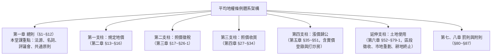

# 第 01 堂｜總則篇：平均地權四大支柱與核心名詞

> **涵蓋條文範圍**：《平均地權條例》§1～§12（註：§6、§8、§9、§12 已刪除）、《平均地權條例施行細則》§1～§14（註：§2、§6、§7 已刪除）
> **命題熱度**：★★★☆☆（基礎打底章節，但 **§3 名詞定義、§4 地價評議委員會 112 年新制、§11 出租耕地補償** 為跨科高頻申論考點！）
> **跨科關聯**：〈土地法規〉（土地法 §25、§87、土地徵收條例 §30）、〈土地稅法規〉（土地稅法 §9 自用住宅用地、土地增值稅改良費用扣除）

---

## 一、 架構鳥瞰（1 分鐘看懂體系位置）

《平均地權條例》源自國父孫中山先生「平均地權」之土地政策思想，核心目標是**「地盡其利、地利共享」**。整部條例就像一座由**「四大支柱＋土地使用」**撐起來的建築，而第一章「總則」就是這棟建築的**地基與說明書**（定義名詞、主管機關、評議組織、共通補償與處分原則）。

### 母法與施行細則條文對照地圖

| 主題模組 | 母法（條例） | 施行細則 | 考點星級 |
| :--- | :--- | :--- | :---: |
| 法律適用、主管機關與基金 | §1、§2 | §1、§14 | ★★☆☆☆ |
| 七大核心名詞（都市/非都市、農地、自用住宅、空地等） | §3 | §3、§4、§5 | ★★★★★ |
| 地價評議委員會（**112 年修法新制**） | §4 | — | ★★★★★ |
| 土地債券、公地處分特例與禁止無償撥用 | §5、§7 | §13 | ★★★☆☆ |
| 徵收補償與出租耕地補償（含公地撥用） | §10、§11 | §8、§9、§10 | ★★★★★ |
| 改良土地之認定與事前驗證程序 | （散見各章） | §11、§12 | ★★★☆☆ |

---

## 二、 白話精講（母法 × 施行細則整合）

### 主題 1：法律定位、主管機關與基金（條例 §1、§2；細則 §1、§14）

#### 1. 適用順序（條例 §1；細則 §1）
* **條文精要**：平均地權之實施，依本條例之規定；本條例未規定者，適用**土地法**及其他有關法律之規定。細則則依條例 §86 授權訂定。
* **白話解析**：在法律位階上，《平均地權條例》是《土地法》的**特別法**。遇到問題時，適用順序為：**平均地權條例 → 土地法 → 其他有關法律**（如民法）。
* **跨科提醒**：針對「土地稅」事項，日後另有更專門的《土地稅法》；針對「土地徵收」事項，另有專門的《土地徵收條例》（例如現行徵收改採「市價補償」）。考試作答時，務必留意特別法與後法優先之實務銜接！

#### 2. 主管機關（條例 §2）★★☆☆☆
* **一般事項**：
  * 中央：**內政部**
  * 直轄市：直轄市政府
  * 縣（市）：縣（市）政府
* **例外（考場陷阱！）**：有關**土地債券之發行事項**，其中央主管機關為**財政部**（因為發債籌資屬於國家財政事務）。

#### 3. 實施平均地權基金（細則 §14）
* 直轄市、縣（市）主管機關為實施本條例，應設置「實施平均地權基金」，其設置管理由地方主管機關定之（例如辦理市地重劃、區段徵收的財務調度專戶）。

---

### 主題 2：七大核心名詞白話拆解（條例 §3；細則 §3、§4、§5）★★★★★

本條是整部條例的「字典」，也是〈土地法規〉與〈土地稅法規〉共同的基礎考題。

#### 1. 都市土地 vs. 非都市土地（條例 §3①②；細則 §3）
* **都市土地**：依法發布**都市計畫範圍內**之土地。
* **非都市土地**：都市土地**以外**之土地。
* **細則 §3 實務配套（釘樁、分割與稅籍註記）**：
  * 都市土地範圍、使用分區及公共設施用地界線，由地方主管機關依《都市計畫法》§23 釘立界樁及中心樁，計算座標後點交地政機關，於**規定地價或重新規定地價前**逕行辦理地籍測量及分割登記。
  * **但書期限**：若界樁及中心樁在**公告地價前 6 個月以內**才點交者，得俟規定地價或重新規定地價後 **3 個月內**辦理完竣。
  * 辦竣後，地政機關應將類別通知當地**稅捐稽徵機關**註記稅籍（因為都市／非都市土地及分區會直接影響地價稅與土增稅課徵！）。

#### 2. 農業用地（條例 §3③）★★★☆☆
指「非都市土地」或「都市土地農業區、保護區」範圍內土地，依法供下列三類使用者：
1. **直接農用**：供農作、森林、養殖、畜牧及保育使用者。
2. **不可分離設施**：供與農業經營不可分離之農舍、畜禽舍、倉儲設備、曬場、集貨場、農路、灌溉、排水及其他農用之土地。
3. **農民組織設施**：農民團體與合作農場所有，直接供農業使用之倉庫、冷凍（藏）庫、農機中心、蠶種製造（繁殖）場、集貨場、檢驗場等用地。

#### 3. 工業用地與礦業用地（條例 §3④⑤）
* **工業用地**：依法核定之工業區土地，及政府核准工業或工廠使用之土地。
* **礦業用地**：供礦業實際使用地面之土地。

#### 4. 自用住宅用地（條例 §3⑥；細則 §4）★★★★★
* **條例 §3⑥（人的要件＋使用要件）**：
  1. **設籍要件**：土地所有權人或其配偶、直系親屬於該地**辦竣戶籍登記**。
  2. **使用要件**：**無出租**或**供營業用**之住宅用地。
* **細則 §4（建物權屬要件 — 必寫！）**：
  * 土地上之建築改良物，以屬**土地所有權人或其配偶、直系親屬所有**者為限。
* **立法目的**：讓真正自住的民眾享有優惠稅率（地價稅 2‰、土增稅 10%），防止投資客或出租營業戶搭便車。

> **【實務案例 1】這樣算「自用住宅用地」嗎？**
> * **情境 A**：土地登記在兒子名下，房子登記在爸爸名下，實際設籍住在裡面的是阿公，無出租無營業。
>   * **解析**：**符合！** 爸爸與阿公都是兒子的「直系親屬」，同時滿足條例 §3⑥（直系親屬辦竣戶籍登記、無出租營業）與細則 §4（建物屬直系親屬所有）。
> * **情境 B**：哥哥名下的土地，蓋了弟弟名下的房子，由媽媽設籍居住。
>   * **解析**：**不符合！** 弟弟是哥哥的「旁系血親」，不屬於細則 §4 所稱之「配偶或直系親屬」。
> * **情境 C**：一棟三層樓透天厝，一樓租給便利商店營業，二、三樓自己設籍居住。
>   * **解析**：並非全部喪失！實務上可依實際使用面積比例，二、三樓所占土地持分仍可申請按自用住宅用地核課，一樓營業部分則按一般用地課稅。

#### 5. 空地（條例 §3⑦；細則 §5）★★★★☆
* **立法目的**：防止地主「囤地養地、坐等漲價」，強制促使都市建設完備地區的建築用地早日蓋房使用（否則政府可加徵空地稅，甚至照價收買）。
* **條例 §3⑦ 二大認定類型**（限**私有**及**公有非公用**建築用地）：
  1. **完全未建築型**：已完成**道路、排水及電力設施**，於有自來水地區並已完成**自來水系統**（口訣：**道、排、電、水**四設施完備），而仍未依法建築使用。
  2. **低度利用型（假建築真養地）**：雖已建築使用，但其**建築改良物價值不及所占基地申報地價 10%**，且經直轄市或縣（市）政府認定應予增建、改建或重建者。
* **細則 §5（建物價值怎麼算？）**：
  * 建築改良物價值或價額，由地方主管機關按**查估當時該改良物現存價值**估計後，提交**地價評議委員會評定**之。

> **【實務案例 2】精華地段搭鐵皮屋躲空地稅，有用嗎？**
> 地主老王在市中心擁有一塊 100 坪建地，道路、水電、排水皆已完備，申報地價總額高達 5,000 萬元。老王為了避免被認定為空地，花 100 萬元蓋了一間簡易鐵皮屋收租。
> * **解析**：該鐵皮屋現存價值（100 萬元）不及所占基地申報地價（5,000 萬元）的 **10%（500 萬元）**！只要經地方政府查估並提交地價評議委員會評定，且認定應予增建、改建或重建，**依然屬於法律上的「空地」**，躲不掉空地稅與限期建築處分！

---

### 主題 3：地價評議委員會（條例 §4 — 112 年修法最新熱點！）★★★★★

地價評議委員會負責評定公告地價、公告土地現值、建築改良物現存價值等重要價格，攸關全國地主稅負與徵收補償。**民國 112 年 2 月修正公布、7 月 1 日施行**的《平均地權條例》§4 是近年必背的新修法考點！

#### 1. 現行最新條文重點（條例 §4）
* **設立與辦法**：由直轄市或縣（市）政府組織之；其組織及運作辦法，由**中央主管機關（內政部）**定之。
* **委員組成**：由相關機關代表，及**地政、不動產估價、法律、工程與都市計畫**領域之專家學者或民間相關團體代表組成。
* **兩大法定比例門檻（必背數字！）**：
  1. **專業門檻**：專家學者與民間相關團體代表，**不得少於委員總數二分之一（≥ 1/2）**。
  2. **性別門檻**：任一性別委員，**不得少於委員總數三分之一（≥ 1/3）**。

#### 2. 112 年修法新舊對照與立法理由（申論高分關鍵！）

| 比較項目 | 舊法及舊組織規程 | 112 年修法後（現行法） | 修法立法理由 |
| :--- | :--- | :--- | :--- |
| **民意代表與公正人士** | 包含地方民意代表、地方公正人士 | **全數刪除排除** | 民代具監督行政職權應迴避；「公正人士」缺乏客觀專業標準，排除以維超然公正。 |
| **專業領域與比例** | 專家學者比例未明定於母法或門檻較低 | 明定五大領域專家學者及民間團體代表 **≥ 1/2** | 落實地價評議專業化、客觀化與公信力。 |
| **性別比例** | 無明文規定 | 任一性別委員 **≥ 1/3** | 落實性別主流化與 CEDAW 公約精神。 |

> **記憶口訣**：**「除民代、五專業（地估法工都）過半（1/2）、性別三分之一（1/3）」**

---

### 主題 4：土地債券與公地處分特例（條例 §5、§7；細則 §13）★★★☆☆

#### 1. 土地債券（條例 §5）
* 政府辦理**照價收買**或**區段徵收**需要龐大資金，得由**中央或直轄市主管機關**發行土地債券籌資（縣市政府不得自行發行）；土地債券之發行，另以法律定之（中央主管機關為**財政部**）。

#### 2. 公有土地處分之特例（條例 §7）
* **一般原則（土地法 §25）**：直轄市或縣（市）政府處分公有土地（或設定負擔、超過 10 年期間之租賃），須經**該管區內民意機關同意**，並經**行政院核准**。
* **本條例特例（條例 §7）**：政府依法**照價收買、區段徵收或因土地重劃**而取得之土地，得**隨時公開出售**，**不受土地法第 25 條之限制**。
* **白話解析**：這三種方式取得的土地，本質上是政府花錢買回或為了籌措開發重劃經費（例如抵費地、標售地）所取得的土地，需要快速變現回收資金，如果還要跑議會同意與行政院核准，將緩不濟急，故特別排除土地法 §25 限制。

#### 3. 禁止軍公機關借用或無償撥用（細則 §13）
* 依本條例**照價收買或區段徵收**取得之土地，各級軍公機關學校**不得請求借用或無償撥用**。
* **立法目的**：政府辦理照價收買或區段徵收都是自籌基金（甚至發債）花大錢取得的，若讓其他機關免費拿去用（無償撥用或借用），會導致平均地權基金破產，因此明文禁止！

---

### 主題 5：徵收補償與出租耕地補償（條例 §10、§11；細則 §8～§10）★★★★★

#### 1. 土地徵收補償地價（條例 §10）
* **條文規定**：依法徵收時，按徵收當期之**公告土地現值**補償其地價；都市計畫區內之**公共設施保留地**，按**毗鄰非公共設施保留地之平均公告土地現值**補償其地價，其地上建築改良物，參照**重建價格**補償。
* **【考場必補實務銜接！】**：
  民國 101 年《土地徵收條例》§30 修正後，現行土地徵收地價補償已全面改採**「市價補償」**（公設保留地則按毗鄰非公設保留地之平均市價補償）。因《土地徵收條例》為徵收之特別法且為後法，實務上優先適用市價補償；作答申論題時，若題目問《平均地權條例》§10，應**先寫條例 §10 原文，再補充現行實務依《土地徵收條例》§30 改採市價補償**，閱卷老師會直接給滿分！

#### 2. 出租耕地之承租人補償（條例 §11；細則 §8、§9、§10）★★★★★
這是一題橫跨〈土地法規〉與〈土地稅法規〉的超級經典考點！

* **適用情形**：依法**徵收**、**照價收買**之土地為出租耕地，或**公有出租耕地依法撥用**時。
* **受領補償之承租人資格（細則 §8）**：指承租耕地**實際自任耕作之自然人或合作農場**（若是轉租當二房東、或一般營利法人，不得領取！）。
* **補償項目與負擔主體（條例 §11①②；細則 §9①、§10）**：
  1. **政府補償部分**：承租人為**改良土地所支付之費用** ＋ **尚未收穫之農作改良物**。
  2. **土地所有權人補償部分**：以所得之補償地價，**扣除實際應繳納之土地增值稅後餘額之三分之一（1/3）**，補償耕地承租人。
  3. **代為扣交機制**：由主管機關於發放補償地價時，先代扣土增稅，再**代為扣交**該 1/3 給耕地承租人（防止地主領錢跑路不給佃農）。
  4. **現金搭發債券（細則 §10）**：若以現金搭發土地債券補償地價，按地主所得**現金與債券數額比例**計算承租人應領之補償並代為扣交。
* **公有出租耕地依法撥用之特別規定（條例 §11③；細則 §9②）**：
  * **補償標準**：公有地免課土增稅，故按**核准撥用當期公告土地現值之 1/3** 補償承租人（細則 §9②）。
  * **經費負擔（超愛考！）**：
    * **有償撥用**：由**原管理機關**負擔（因為原管理機關有收到撥用地價款）。
    * **無償撥用**：由**需地機關**負擔（因為需地機關免費拿到地，理應負責補償佃農）。

> **【實務計算案例 3】阿伯的租約耕地被照價收買，能領多少錢？**
> 地主老陳將私有耕地出租給實際自任耕作的阿伯（自然人）。今政府依法照價收買該地，補償地價為 1,200 萬元，老陳實際應繳土地增值稅為 300 萬元。另外，阿伯曾花 20 萬元整地（經核准改良），地上還有價值 10 萬元尚未收割的稻作。請問阿伯總共可領多少補償？
> * **解析**：
>   1. **政府負擔**：土地改良費 20 萬 ＋ 未收穫農作改良物 10 萬 ＝ **30 萬元**。
>   2. **地主負擔（主管機關代扣交）**：`(補償地價 1,200 萬 － 實際應繳土增稅 300 萬) × 1/3` ＝ `900 萬 × 1/3` ＝ **300 萬元**。
>   3. **阿伯總計可領**：`30 萬 ＋ 300 萬 ＝ 330 萬元`。

---

### 主題 6：改良土地之認定與驗證程序（細則 §11、§12）★★★☆☆

* **為什麼重要？** 未來在「漲價歸公（土地增值稅）」章節中，地主花錢改良土地的費用，可以從漲價總數額中**扣除**（省下大筆土增稅！），也可以在徵收／照價收買時請求補償。但前提是必須符合細則 §11、§12 的規定！
* **三大改良類型（細則 §11）**：
  1. **建築基地改良**：整平或填挖基地、水土保持、埋設管道、修築駁嵌、開挖水溝、舖築道路等。
  2. **農地改良**：耕地整理、水土保持、土壤改良及修築農路、灌溉、排水、防風、防砂、堤防等設施。
  3. **其他用地開發所為之土地改良**。
* **驗證程序（細則 §12 — 必背「事前申請、10 日複勘」！）**：
  1. **事前申請**：必須於**開始興工改良之前**填具申請書向地方主管機關申請驗證（**驗證核准前已改良之部分，不予核發證明！**）。
  2. **完工複勘**：於工程完竣**翌日起 10 日內**申請複勘。
  3. **派員勘查與發證**：機關派員實地勘查開工與完工情形；核定費用後，**按宗發給證明**，並通知地政機關及稅捐稽徵機關。
  4. **建築管理地區簡化**：建築基地改良得併同**雜項執照**申請驗證。

---

## 三、 考點對決（易混淆觀念比較表＋口訣）

### 比較表 1：《平均地權條例》空地 vs. 《土地法》空地

| 比較項目 | 平均地權條例（§3⑦、細則 §5） | 土地法（§87） |
| :--- | :--- | :--- |
| **適用土地** | 私有及**公有非公用**建築用地 | 凡編為建築用地（未明文區分公私） |
| **公共設施要件** | 須已完成**道路、排水、電力**，有自來水地區並已完成**自來水系統** | 未規定須完成公共設施 |
| **低度利用門檻** | 建物現存價值不及基地申報地價 **10%**（且經認定應增改重建） | 建物價值不及基地申報地價 **20%** |
| **價值評定機關** | 地方主管機關查估 → **地價評議委員會評定** | 未特別明定細部評定程序 |

### 比較表 2：公有土地處分與撥用限制

| 制度規定 | 法條依據 | 核心規則 | 記憶關鍵字 |
| :--- | :--- | :--- | :--- |
| **公地處分原則** | 土地法 §25 | 須經民意機關同意＋行政院核准 | 原則要「議會同意＋院核准」 |
| **公地處分例外** | 平均地權條例 §7 | 照價收買、區段徵收、土地重劃取得之土地，得**隨時公開出售**，不受 §25 限制 | 口訣：**「收、區、重，免二五」** |
| **禁止借用/無償撥用** | 細則 §13 | 照價收買、區段徵收取得之土地，軍公機關學校不得借用或無償撥用 | 口訣：**「收、區，不借不無償」** |

### 比較表 3：公有出租耕地依法撥用之經費負擔（條例 §11③、細則 §9②）

| 撥用類型 | 承租人補償標準 | 補償經費負擔機關 | 白話理解 |
| :--- | :--- | :--- | :--- |
| **有償撥用** | 核准撥用當期公告土地現值 × 1/3 | **原管理機關** | 誰拿了賣地錢，誰就出錢補佃農 |
| **無償撥用** | 核准撥用當期公告土地現值 × 1/3 | **需地機關** | 免費拿地的人，自己出錢補佃農 |

---

## 四、 課後小測驗（地政士申論模擬演練）

### 模擬題 1（112 年修法＋名詞定義綜合題）
> **題目**：依現行《平均地權條例》及其施行細則規定，請說明「地價評議委員會」之組成與最新比例限制為何？又何謂「空地」？其中建築改良物價值應如何認定？（25 分）

👉 點此展開【擬答架構與得分關鍵字】

1. **地價評議委員會之組成與比例限制（條例 §4，112 年修法重點）**：
   * 組織機關：由直轄市或縣（市）政府組織之；組織及運作辦法由中央主管機關（內政部）定之。
   * 委員來源：由相關機關代表，及**地政、不動產估價、法律、工程與都市計畫**領域之專家學者或民間相關團體代表組成（**已刪除地方民意代表及地方公正人士**）。
   * 兩大法定比例：
     1. 專家學者與民間相關團體代表：**不得少於委員總數 1/2**。
     2. 任一性別委員：**不得少於委員總數 1/3**。
2. **空地之定義（條例 §3⑦）**：
   * 適用標的：私有及公有非公用建築用地。
   * 態樣一（未建築）：已完成道路、排水、電力設施，於有自來水地區並已完成自來水系統，而仍未依法建築使用者。
   * 態樣二（低度利用）：雖已建築使用，但其建築改良物價值不及所占基地申報地價 **10%**，且經直轄市或縣（市）政府認定應予增建、改建或重建者。
3. **建築改良物價值之認定（細則 §5）**：
   * 由直轄市或縣（市）主管機關按**查估當時該改良物現存價值**估計後，提交**地價評議委員會評定**之。

---

### 模擬題 2（跨科經典題：出租耕地補償）
> **題目**：依《平均地權條例》及其施行細則規定，依法徵收、照價收買之土地為出租耕地，或公有出租耕地依法撥用時，得受領補償地價之承租人資格為何？承租人得領取之補償項目、計算方式及經費負擔各為何？（25 分）

👉 點此展開【擬答架構與得分關鍵字】

1. **得受領補償地價之耕地承租人資格（細則 §8）**：
   * 指承租耕地**實際自任耕作之自然人或合作農場**。
2. **依法徵收或照價收買出租耕地之補償（條例 §11①②；細則 §9①、§10）**：
   * **政府補償部分**：承租人為改良土地所支付之費用，及尚未收穫之農作改良物。
   * **地主補償部分**：由土地所有權人以所得之補償地價，扣除**實際應繳納之土地增值稅**後餘額之 **1/3**，補償耕地承租人。
   * **扣交與搭發債券方式**：主管機關於發放補償地價、代扣土地增值稅後，應**代為扣交**耕地承租人；若以現金搭發土地債券補償地價者，應按地主所得現金及債券數額比例計算承租人應領之補償並代為扣交。
3. **公有出租耕地依法撥用之補償與經費負擔（條例 §11③；細則 §9②）**：
   * **準用補償標準**：準用前二項規定補償承租人；地價補償部分，按**核准撥用當期公告土地現值之 1/3** 補償承租人。
   * **經費負擔**：
     * **有償撥用**：由**原管理機關**負擔。
     * **無償撥用**：由**需地機關**負擔。

---

> **下堂課預告**：第 02 堂｜**規定地價篇**（條例 §13～§16；細則 §15～§29）— 帶你一次搞懂「公告地價 vs. 申報地價 ±20% 規則」，以及地主故意低報或高報地價的慘痛代價！
