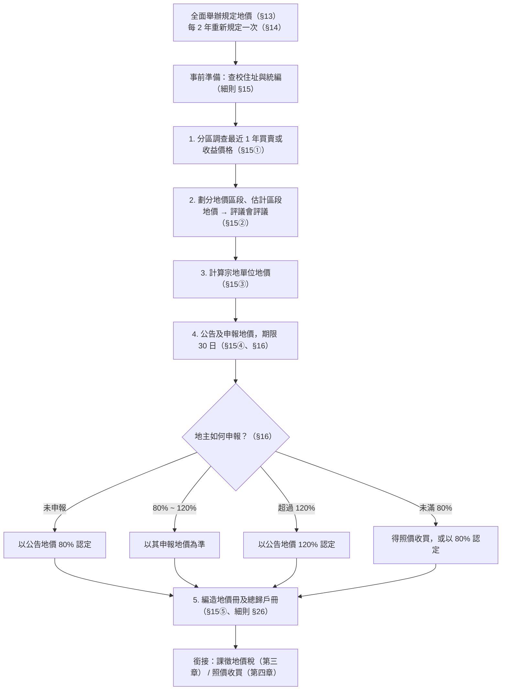

# 第 02 堂｜規定地價篇：土地價格是怎麼定出來的？

> **涵蓋條文範圍**：《平均地權條例》§13～§16、《平均地權條例施行細則》§15～§25（並銜接第三章首條細則 §26 總歸戶冊編造與異動通知；原大綱所列細則 §27～§29 屬地價稅累進起點與自用住宅認定，移至第 03 堂照價徵稅篇精講）
> **命題熱度**：★★★★☆（**條例 §15 五大程序、§16 申報地價 ±20% 機制、細則 §19～§21 共有與公有土地申報規則**，以及「公告地價 vs. 申報地價 vs. 公告土地現值」比較，均為歷屆申論高頻考點！）
> **跨科關聯**：〈土地法規〉（土地法 §148～§166 規定地價、§97 及 §105 租金上限）、〈土地稅法規〉（土地稅法 §14～§16 地價稅計徵基礎）

---

## 一、 架構鳥瞰（1 分鐘看懂體系位置）

「規定地價」是平均地權四大支柱的**第一根支柱**，也是所有土地稅負與收買制度的起點。如果沒有先訂出土地的法定價格（申報地價），政府就無法「照價徵稅（地價稅）」，也無法針對低報地價者「照價收買」。

### 母法與施行細則條文對照地圖

| 主題模組 | 母法（條例） | 施行細則 | 考點星級 |
| :--- | :--- | :--- | :---: |
| 全面規定地價、2 年週期與補辦規定地價 | §13、§14 | §25 | ★★★☆☆ |
| 規定與重新規定地價之五大程序與總歸戶冊 | §15 | §15、§16、§17、§26 | ★★★★★ |
| 申報地價 ±20% 區間、未申報與低報後果 | §16 | — | ★★★★★ |
| 申報主體（共有/法人）、低報證明、公有地與單價 | — | §18、§19、§20、§21、§22 | ★★★★★ |
| 已規定地價土地之分割與合併處理 | — | §23、§24 | ★★★☆☆ |

---

## 二、 白話精講（母法 × 施行細則整合）

### 主題 1：規定地價的範圍、時機與 2 年週期（條例 §13、§14；細則 §25）★★★☆☆

#### 1. 全面舉辦原則與分期例外（條例 §13）
* **原則**：本條例施行區域內，未規定地價之土地，應即**全面舉辦規定地價**。
* **但書（例外）**：**偏遠地區**及**未登記之土地**，得由直轄市或縣（市）主管機關劃定範圍，報經**中央主管機關（內政部）核定**後，**分期辦理**。
* **白話解析**：原則上全國土地都要一次定價，但深山偏鄉或根本還沒辦總登記的土地，一時難以測量估價，允許地方政府畫出範圍報請內政部同意後分批處理。

#### 2. 重新規定地價的週期（條例 §14）★★★★☆
* **現行規定**：規定地價後，**每 2 年重新規定地價一次**。但必要時得延長之。重新規定地價者亦同。
* **修法沿革與立法理由（申論加分點！）**：
  * 民國 106 年 5 月以前原本規定為「每 3 年重新規定地價一次」，但因 3 年間房地產景氣波動過大，常導致一次調幅劇烈引發民怨，或使公告地價嚴重脫離市價。
  * 因此 106 年修法縮短為**每 2 年一次**（例如民國 113 年、115 年……逢雙數年／偶數西元年之 1 月 1 日公告），讓地價調整更平緩、貼近市場變動。

#### 3. 補辦規定地價（細則 §25）
* **適用情形**：已經舉辦過規定地價的地區，若有土地因**新登記**（例如海埔新生地、浮覆地辦妥第一次登記）或其他原因漏未規定地價時，怎麼辦？
* **處理方式**：
  1. 視實際情形**劃入毗鄰土地之地價區段**。
  2. 以所屬地價區段土地**最近一次規定地價之區段地價**計算其公告地價。
  3. 依條例 §15④⑤ 及 §16 補辦規定地價；實務上得採**「通知土地所有權人限期申報地價」**方式辦理，若地主未依限申報，同樣以**公告地價 80%** 為其申報地價。

---

### 主題 2：規定與重新規定地價的五大程序（條例 §15；細則 §15～§17、§26）★★★★★

這五個步驟是申論題的標準骨架，務必照順序背熟！

#### 0. 事前準備：查校住址與統編（細則 §15）
* 辦理規定或重新規定地價前，地方主管機關應視實際需要，詳細查校土地所有權人或管理人之**住址**及**國民身分證統一編號（或公司統一編號）**。
* 遇有住址變更者，由地政機關**逕行辦理住址變更登記**，並通知土地所有權人或管理人（確保日後稅單與申報通知寄得到人！）。

#### 1. 法定五大程序（條例 §15）
> **記憶口訣：「調、劃評、算、公申、編」**

1. **第一款（調）**：分區調查**最近一年**之土地**買賣價格**或**收益價格**。
   * *白話解析*：由地政機關蒐集過去一年內的實價登錄買賣案例（買賣價格）或租金收益資料（收益價格），作為估價基礎。
2. **第二款（劃評）**：依據調查結果，**劃分地價區段**並**估計區段地價**後，提交**地價評議委員會評議**。
   * *白話解析*：把地段條件相近的土地畫成同一個「地價區段」，算出平均區段地價，再送交由五大領域專家過半組成的「地價評議委員會」（第 01 堂 §4）評定把關。
3. **第三款（算）**：計算**宗地單位地價**。
   * *白話解析*：依據評議通過的區段地價，進一步算出每一筆（每一宗）土地每平方公尺的單價，這就是該宗土地的「公告地價」。
4. **第四款（公申）**：**公告及申報地價，其期限為 30 日**。
   * **分區公告方式（細則 §16）**：按土地所在地之**鄉（鎮、市、區）**公告其宗地單位地價。
   * **30 日起算點（細則 §16 — 陷阱考點！）**：申報地價之 30 日期限，自**公告之次日起算**（例如 1 月 1 日公告，則從 1 月 2 日起算 30 日）。
   * **處所設置（細則 §17）**：公告申報期間，應於**直轄市、縣（市）政府、土地所在地鄉（鎮、市、區）公所，或管轄之地政事務所**設置地價申報或閱覽處所。
5. **第五款（編）**：編造**地價冊**及**總歸戶冊**。
   * **總歸戶範圍（細則 §16 — 超級必考！）**：以土地所有權人在**同一直轄市或縣（市）**之土地，為歸戶之範圍！（*為什麼重要？因為地價稅是採「縣市歸戶累進」，同一人在台北和台中的土地不會合併計算累進稅率！*）
   * **編造期限與移送（細則 §26①）**：地政機關應於舉辦規定地價或重新規定地價後，**當期地價稅開徵 2 個月前**，將總歸戶冊編造完竣，送一份給稅捐稽徵機關據以編造稅冊辦理徵稅。
   * **異動更正與通知（細則 §26②）**：土地權利、土地標示或所有權人住址有異動時，地政機關應於登記完畢後更正地價冊，並於 **10 日內** 通知稅捐稽徵機關更正稅冊。

---

### 主題 3：公告地價 vs. 申報地價 ±20% 黃金區間（條例 §16）★★★★★

這是整堂課的核心中的核心！國父原本主張「地主自行申報地價」，但怕地主亂報（報太低偷稅、報太高哄抬），現行《平均地權條例》§16 設計了一套非常巧妙的**「公告地價 ±20% 區間自動校準機制」**：

| 地主申報情形 | 法定申報地價認定結果 | 背後法律效果與政府考量 |
| :--- | :--- | :--- |
| **1. 未於 30 日公告期間內申報** | 以公告地價 **80%** 為其申報地價 | 簡政便民！讓地主不用跑地政事務所，自動享受合法最低地價稅基（省下 20% 稅基）。 |
| **2. 申報在 80% ～ 120% 之間** | 以其**自行申報之地價**為準 | 尊重地主在法定合理區間內的申報自由。 |
| **3. 申報超過 120%** | 以公告地價 **120%** 為其申報地價 | **強制封頂**！防止地主惡意哄抬申報地價（例如藉此拉高法定租金上限或規避空地認定）。 |
| **4. 申報未滿 80%** | **得照價收買**，或以公告地價 **80%** 為其申報地價 | 政府握有**選擇權**！若地主惡意低報想逃漏地價稅，政府可以選擇直接照其低報價格「強制買下」（照價收買），或直接拉回 80% 課稅。 |

> **【實務案例 1】地主故意低報、高報、不報地價的法律後果與算盤**
> 假設老陳在市區有一塊建地，115 年重新規定地價時，政府公告的「公告地價」為每平方公尺 **10 萬元**。
> * **情境 A（老陳忘了去申報）**：
>   * **結果**：政府直接以公告地價的 80%，也就是 **8 萬元** 作為老陳的申報地價，作為未來兩年課徵地價稅的依據。
>   * **老師點評**：這就是為什麼實務上台灣超過 99% 的地主在重新規定地價時「都不去申報」——因為不去報就直接打 8 折，既合法又最省地價稅！
> * **情境 B（老陳貪心想更省稅，跑去申報 5 萬元）**：
>   * **結果**：5 萬元低於公告地價 80%（8 萬元），老陳觸發了條例 §16 的「低報紅線」！政府可以選擇：① 直接拉回 **8 萬元** 課地價稅；或者 ② 依第四章規定發動**照價收買**，直接用每平方公尺 **5 萬元** 把老陳的土地強制買走！老陳偷雞不著蝕把米！
> * **情境 C（老陳反而故意高報 15 萬元）**：
>   * **結果**：15 萬元超過公告地價 120%（12 萬元），超過部分無效，政府一律以 **12 萬元** 為其申報地價。
>   * **思考題：現實中真的會有人故意申報 120% 多繳地價稅嗎？**
>   * **答案：真的有！** 最常見的原因是**出租基地的地主**。依《土地法》§97、§105 規定，出租基地或房屋的法定租金上限是以「土地及其建築物申報總價年息 10%」為限。如果地主把申報地價拉高到 120%，雖然多繳一點點地價稅（基本稅率才 10‰ = 1%），但合法可收取的租金上限卻能提高許多，精算之下反而更划算！

---

### 主題 4：申報地價的實務細節：誰來報？怎麼填？公有地怎麼辦？（細則 §18～§22）★★★★★

細則 §18～§22 是地政士考場上最容易拉開分數差距的「細節題庫」，尤其是**共有土地、法人低報、公有土地**這三條，務必一字不漏掌握！

#### 1. 申報方式與委託（細則 §18）
* 土地所有權人申報地價時，應**按戶填繳地價申報書**；其委託他人代辦者，並應附具**委託書**。

#### 2. 各類權屬之申報主體（細則 §19 — 超級愛考！）
* **分別共有土地**：由所有權人**按應有部分單獨申報**地價（各報各的，互不影響！）。
* **公同共有土地**：由**管理人**申報地價；如無管理人者，由**過半數之共有人**申報地價（注意：是人數過半數，因為公同共有沒有應有部分比例！）。
* **法人所有之土地**：由**代表人**申報地價（例如股份有限公司之董事長）。

#### 3. 管理人／代表人低報之防弊限制（細則 §20 — 必考陷阱！）
* **條文規定**：由**管理人**（如公同共有管理人、祭祀公業管理人）或**代表人**（如法人董事長）申報地價者，其申報之地價**未滿公告地價 80%** 時，應檢附該管理人或代表人**得處分其財產之合法證明文件**（例如股東會／董事會決議或派下員大會決議）；**未檢附者，視為未申報**（亦即回歸以公告地價 80% 認定）。
* **白話立法理由**：低報地價（未滿 80%）會讓土地面臨被政府「照價收買」的風險，實質上等同於**處分財產**！如果管理人或代表人未經所有權人或法人內部合法授權就亂低報，會損害全體共有人或股東權益，因此必須拿出「有權處分證明」，否則直接當作沒申報，保護團體財產安全！

#### 4. 公有土地與照價收買土地之申報地價（細則 §21 — 必考數字陷阱！）
* **原則**：**公有土地**及依條例 §16 規定**照價收買之土地**，以各該宗土地之**「公告地價（100%）」**為申報地價，**免予申報**。
  * *【考場超大陷阱】*：私有土地未申報是按公告地價 **80%**；但**公有土地及照價收買土地**是按公告地價 **100%**，免予申報！千萬不要寫成 80%！
* **但書（已出售未移轉之公地）**：若公有土地**已出售尚未完成所有權移轉登記**者，公地管理機關應**徵詢承購人之意見**後，依條例 §16 規定辦理申報地價（因為之後繳地價稅、承擔收買風險的是買家，所以要尊重買家意見！）。

#### 5. 申報單價之單位與進位（細則 §22）
* 土地所有權人申報地價時，應**按宗填報每平方公尺單價**，以**新臺幣元**為單位，不滿一元部分**四捨五入**；但每平方公尺單價**不及 10 元**者，得申報至**角位**。

> **【實務案例 2】共有土地與公司土地的低報地雷**
> 1. **情境 A（公同共有）**：甲、乙、丙、丁四人公同共有一筆祖產土地，未設管理人。重新規定地價時，只有甲、乙兩人跑去申報地價為公告地價的 100%。
>    * **解析**：無效！依細則 §19，公同共有無管理人者須由**過半數**共有人申報，4 人的過半數至少要 **3 人**，僅 2 人未過半數，視同未合法申報，最終按公告地價 80% 認定。
> 2. **情境 B（法人代表人低報）**：大發建設公司董事長未經董事會決議授權處分資產，擅自將公司土地申報為公告地價的 60%。
>    * **解析**：依細則 §20，代表人申報未滿公告地價 80% 且未檢附得處分財產之合法證明文件，**「視為未申報」**！因此政府**不能**照價收買，而是直接以公告地價 **80%** 為其申報地價。

---

### 主題 5：已規定地價土地之分割與合併處理（細則 §23、§24）★★★☆☆

土地在規定地價之後，地主常會辦理土地分割或合併，這時候「地價」不能無中生有，也不能憑空蒸發，必須遵守**「總額不變原則」**！

#### 1. 土地分割（細則 §23）
* **總額相等原則**：已規定地價之土地分割時，其分割後各宗土地之：
  1. **原規定地價或前次移轉申報現值**
  2. **最近一次申報地價**
  3. **當期公告土地現值**
  上述三種地價之**總和**，應與該土地**分割前之地價數額相等**。
* **通知義務**：分割後各宗土地之上開地價，地政機關應通知**稅捐稽徵機關**及**土地所有權人**。

#### 2. 土地合併（細則 §24）
* **總額相等原則**：已規定地價之土地合併時，其合併後土地之上開三種地價，應與**合併前各宗土地地價總和相等**。
* **統一物價指數基期（重要細節！）**：合併前各宗土地的「原規定地價或前次移轉申報現值」可能發生在不同年份（例如 A 地是 90 年買的、B 地是 110 年買的），直接相加會失真！因此細則 §24② 特別規定，原規定地價或前次移轉申報現值**應統一物價指數基期**（換算成同一基準點後再加總平均），才能確保未來計算土地增值稅時公平準確。
* **通知義務**：合併後之三種地價，地政機關同樣應通知**稅捐稽徵機關**及**土地所有權人**。

---

## 三、 考點對決（易混淆觀念比較表＋口訣）

### 比較表 1：台灣三大法定地價超級比一比（萬年必考！）★★★★★

| 比較項目 | 公告地價 | 申報地價 | 公告土地現值 |
| :--- | :--- | :--- | :--- |
| **法條依據** | 條例 §14、§15 | 條例 §16 | 條例 §46（第 05 堂詳解） |
| **評定與公告機關** | 直轄市、縣（市）主管機關查估 → 地價評議委員會評議 → 公告 | 土地所有權人申報（未申報則法定認定） | 直轄市、縣（市）主管機關查估 → 地價評議委員會評議 → 公告 |
| **調整週期** | **每 2 年一次**（必要時得延長） | 隨規定／重新規定地價辦理（**每 2 年一次**） | **每年一次**（每年 1 月 1 日公告） |
| **價格區間／關係** | 作為地主申報地價之參考基準 | 原則在公告地價 **80%～120%** 之間（未報按 80%；公地按 100%） | 反映過去一年一般正常交易價格（通常較貼近市價，遠高於公告地價） |
| **核心法定用途** | 1. 供地主申報地價之參考 2. 公有地／照價收買地之申報地價 | 1. **課徵地價稅之基礎** 2. 低報未滿 80% 時照價收買之補償標準 3. 空地低度利用（10%）及法定租金上限計算基礎 | 1. **審核土地移轉現值（課徵土地增值稅）之參考** 2. 公有出租耕地撥用補償承租人（1/3）之基準 3. 遺產稅、贈與稅核課基準 |

> **一句話記住差別**：**「地價稅看申報地價（2 年調一次，跟公告地價連體嬰）；土增稅看公告現值（1 年調一次，跟買賣移轉連體嬰）！」**

---

### 比較表 2：各類土地申報地價主體與效果速查表

| 土地類型 | 申報主體（細則 §19、§21） | 未申報之效果 | 低報（未滿 80%）之效果 |
| :--- | :--- | :--- | :--- |
| **單獨所有（私有）** | 土地所有權人（或受託人附委託書） | 按公告地價 **80%** | 得**照價收買**，或按公告地價 **80%** |
| **分別共有** | 各共有人**按應有部分單獨申報** | 未報者按公告地價 **80%** | 僅針對低報之共有人持分適用 §16 |
| **公同共有** | **管理人**；無管理人者由**過半數共有人** | 按公告地價 **80%** | 管理人低報須附**得處分財產證明**，未附**視為未申報（80%）** |
| **法人所有** | **代表人** | 按公告地價 **80%** | 代表人低報須附**得處分財產證明**，未附**視為未申報（80%）** |
| **公有土地 / 照價收買地** | **免予申報**（但已出售未移轉者，徵詢承購人意見後依 §16 辦理） | 直接以**公告地價（100%）**為申報地價 | 原則不適用（已出售未移轉者依 §16） |

---

### 比較表 3：《平均地權條例》規定地價 vs. 《土地法》規定地價（跨科對照）

| 比較項目 | 平均地權條例（§14～§16） | 土地法（§148～§166） |
| :--- | :--- | :--- |
| **名詞用語** | **公告地價** | **標準地價** |
| **重新規定週期** | **每 2 年**一次（必要時得延長） | **滿 5 年**或一年屆滿後地價已較原標準地價有 50% 以上增減時（土地法 §160） |
| **申報區間** | 公告地價 **±20%**（80%～120%） | 標準地價 **±20%** 以內（土地法 §156） |
| **未申報處理** | 以公告地價 **80%** 為申報地價 | 以標準地價（**100%**）為法定地價（土地法 §156） |
| **低報未滿 80%** | 得**照價收買**或以公告地價 **80%** 為申報地價 | 認為過低時通知另報，仍過低得**照價收買**（土地法 §157） |

---

## 四、 課後小測驗（地政士申論模擬演練）

### 模擬題 1（程序＋±20% 機制綜合題）
> **題目**：依《平均地權條例》及其施行細則規定，直轄市或縣（市）主管機關辦理規定地價或重新規定地價之週期與法定程序為何？又土地所有權人於公告期間「未申報」、「申報過高」及「申報過低」時，各產生何種法律效果？（25 分）

👉 點此展開【擬答架構與得分關鍵字】

1. **重新規定地價之週期（條例 §14）**：
   * 規定地價後，**每 2 年重新規定地價一次**。但必要時得延長之。重新規定地價者亦同。
2. **規定地價或重新規定地價之法定程序（條例 §15；細則 §15～§17、§26）**：
   * **事前查校（細則 §15）**：查校所有權人或管理人住址及統一編號，住址變更者逕行辦理變更登記並通知。
   * **五大法定程序（條例 §15）**：
     1. 分區調查**最近一年**之土地買賣價格或收益價格。
     2. 依據調查結果，**劃分地價區段**並估計區段地價後，提交**地價評議委員會評議**。
     3. 計算**宗地單位地價**。
     4. **公告及申報地價，其期限為 30 日**：按鄉（鎮、市、區）公告宗地單位地價，30 日自**公告之次日起算**，並設申報或閱覽處所（細則 §16、§17）。
     5. 編造**地價冊及總歸戶冊**：以所有權人在**同一直轄市或縣（市）**之土地為歸戶範圍；於當期地價稅開徵 **2 個月前**編竣送稅捐稽徵機關（細則 §16、§26）。
3. **土地所有權人申報地價之三種法律效果（條例 §16）**：
   * **未於公告期間申報**：以公告地價 **80%** 為其申報地價。
   * **申報過高（超過公告地價 120%）**：以公告地價 **120%** 為其申報地價。
   * **申報過低（未滿公告地價 80%）**：主管機關**得照價收買**，或以公告地價 **80%** 為其申報地價。

---

### 模擬題 2（細則高頻細節題：共有、法人低報與公有地）
> **題目**：依《平均地權條例施行細則》規定，請問：(一) 分別共有土地、公同共有土地、法人所有土地，各應由何人申報地價？若管理人或代表人申報地價未滿公告地價 80% 時，有何特別限制？(二) 公有土地及依本條例第 16 條照價收買之土地，其申報地價應如何認定？若有例外情形，應如何處理？（25 分）

👉 點此展開【擬答架構與得分關鍵字】

1. **各類土地之申報主體與低報限制（細則 §19、§20）**：
   * **分別共有土地**：由所有權人按**應有部分單獨申報**地價。
   * **公同共有土地**：由**管理人**申報地價；如無管理人者，由**過半數之共有人**申報地價。
   * **法人所有之土地**：由**代表人**申報地價。
   * **管理人或代表人低報之特別限制（細則 §20）**：由管理人或代表人申報地價者，其申報之地價**未滿公告地價 80%** 時，應檢附該管理人或代表人**得處分其財產之合法證明文件**；**未檢附者，視為未申報**（亦即以公告地價 80% 為其申報地價）。
2. **公有土地與照價收買土地之申報地價及例外（細則 §21）**：
   * **原則**：公有土地及依條例 §16 規定照價收買之土地，以各該宗土地之**公告地價（100%）**為申報地價，**免予申報**。
   * **例外但書**：公有土地**已出售尚未完成所有權移轉登記**者，公地管理機關應**徵詢承購人之意見**後，依條例 §16 規定辦理申報地價。

---

> **下堂課預告**：第 03 堂｜**照價徵稅篇**（條例 §17～§26-1；細則 §27～§44）— 地政士考試〈土地稅法規〉與〈土地法規〉雙重核心！帶你一次搞定地價稅累進起點地價公式、自用住宅 2‰ 認定順序、工業與公設保留地優惠稅率，以及空地稅與田賦！
