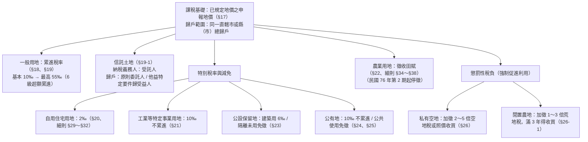

# 第 03 堂｜照價徵稅篇：地價稅、累進起點與田賦

> **涵蓋條文範圍**：《平均地權條例》§17～§26-1、《平均地權條例施行細則》§27～§42（銜接第 02 堂之細則 §26 總歸戶冊編造；原大綱所列細則 §43～§44 屬第四章照價收買事前作業，移至第 04 堂精講）
> **命題熱度**：★★★★★（**地政士考試〈土地法規〉與〈土地稅法規〉雙科超級大補丸！** 累進起點地價公式、地價稅 6 級累進與計算、自用住宅 2‰ 認定順序、公設保留地 6‰／免徵、都市農地課徵田賦 5 款與自耕／三七五限制、空地稅與荒地稅，全部都是萬年必考申論題！）
> **跨科關聯**：〈土地稅法規〉（土地稅法 §3-1、§14～§22、§41 地價稅與田賦規定、土地稅減免規則）、〈土地法規〉（空地定義 §3⑦、照價收買 §28）

---

## 一、 架構鳥瞰（1 分鐘看懂體系位置）

「照價徵稅」是平均地權四大支柱的**第二根支柱**。第 02 堂透過「規定地價」訂出了每筆土地的**申報地價**並編造**總歸戶冊**後，政府就在第三章正式開徵持有稅（地價稅與田賦），透過「**累進稅率**」抑制大地主囤地，同時用「**優惠稅率（自用住宅、工業用地、公設保留地）**」保護自住與生產，並用「**空地稅、荒地稅**」懲罰養地閒置！

### 母法與施行細則條文對照地圖

| 主題模組 | 母法（條例） | 施行細則 | 考點星級 |
| :--- | :--- | :--- | :---: |
| 地價稅開徵、延期／分期、累進起點公式與 6 級累進稅率 | §17、§18、§19 | §27（附件一）、§28（附件二） | ★★★★★ |
| 信託土地之地價稅納稅義務人與歸戶合併規則 | §19-1 | — | ★★★★☆ |
| 自用住宅 2‰ 面積／處數限制、認定順序與國民住宅起算 | §20 | §29、§30、§31、§32 | ★★★★★ |
| 特定事業用地 10‰、公設保留地 6‰／免徵、公有地與減免 | §21、§23、§24、§25 | §33、§39 | ★★★★★ |
| 徵收田賦之土地範圍、自耕／三七五限制與公設未完竣認定 | §22 | §34、§35、§36、§37、§38 | ★★★★★ |
| 私有空地加徵空地稅、農業用地閒置加徵荒地稅 | §26、§26-1 | §40、§41、§42 | ★★★★☆ |

---

## 二、 白話精講（母法 × 施行細則整合）

### 主題 1：地價稅基本原則、累進起點地價與 6 級累進稅率（條例 §17～§19；細則 §27、§28）★★★★★

#### 1. 課徵基礎與延期／分期繳納（條例 §17）
* **課徵基礎（§17①）**：已規定地價之土地，應按**申報地價**，依法徵收地價稅。
* **公告地價大漲的緩衝機制（§17②③）**：應納地價稅額因**公告地價調整**致納稅義務人繳納困難者，得於**規定繳納期間內**，向稅捐稽徵機關申請**延期**或**分期**繳納：
  * **延期繳納期間**：不得逾 **6 個月**。
  * **分期繳納期間**：不得逾 **1 年**。
  * 辦法由直轄市及縣（市）政府依社會經濟情況及實際需要定之。

#### 2. 累進起點地價的定義與計算公式（條例 §18；細則 §27 附件一）★★★★★
這條是〈土地法規〉與〈土地稅法規〉共同的**超級大熱門**，公式與四個扣除項目務必倒背如流！
* **法定意義（條例 §18）**：地價稅採累進稅率，以各該直轄市或縣（市）土地 **7 公畝**（＝ 700 平方公尺 ≈ 211.75 坪）之**平均地價**，為累進起點地價。
* **四大排除土地（但書）**：**不包括工業用地、礦業用地、農業用地及免稅土地在內**。
  * *記憶口訣*：**「工、礦、農、免」**！
  * *立法理由*：為什麼要扣掉這四類土地？因為這四類土地本身就不適用累進稅率（工業、礦業按 10‰ 單一稅率；農地徵田賦；免稅地不課稅），而且它們通常面積極大、地價較低，如果不扣掉，會把縣市的平均地價「嚴重拉低」，害一般平民百姓動不動就超過累進起點被課重稅！
* **計算公式（細則 §27 附件一）**：

$$\text{累進起點地價} = \frac{\text{直轄市或縣（市）規定地價總額} - (\text{工業用地地價} + \text{礦業用地地價} + \text{農業用地地價} + \text{免稅地地價})}{\text{直轄市或縣（市）規定地價總面積（公畝）} - (\text{工業用地面積} + \text{礦業用地面積} + \text{農業用地面積} + \text{免稅地面積})（公畝）} \times 7$$

* **計算時點、報備與進位（細則 §27 — 細節陷阱！）**：
  1. **計算完成期限**：於舉辦規定地價或重新規定地價後，**當期地價稅開徵前**計算完竣。
  2. **報請備查機關**：分別報請**中央主管機關（內政部）**及**財政部**備查（注意是**兩個部會**都要報！）。
  3. **單位與進位**：以**千元**為單位，千元以下**四捨五入**。

#### 3. 地價稅 6 級超額累進稅率與速算（條例 §19；細則 §28 附件二）★★★★★
地價稅是採**「縣市總歸戶」**且為**「超額累進」**（像綜合所得稅一樣，只有「超過」的部分才適用下一級較高稅率，不是全部都用最高稅率！）。

| 級距 | 課稅地價總額（設累進起點地價 ＝ $A$） | 稅率 | 速算公式（細則 §28 附件二邏輯） |
| :---: | :--- | :---: | :--- |
| **第 1 級** | 未超過累進起點地價（$\le A$） | **10‰**（基本稅率） | $\text{地價總額} \times 10‰$ |
| **第 2 級** | 超過累進起點地價未達 5 倍（$A \sim 6A$） | **15‰** | $\text{地價總額} \times 15‰ - 0.005A$ |
| **第 3 級** | 超過累進起點地價 5 倍至 10 倍（$6A \sim 11A$） | **25‰** | $\text{地價總額} \times 25‰ - 0.065A$ |
| **第 4 級** | 超過累進起點地價 10 倍至 15 倍（$11A \sim 16A$） | **35‰** | $\text{地價總額} \times 35‰ - 0.175A$ |
| **第 5 級** | 超過累進起點地價 15 倍至 20 倍（$16A \sim 21A$） | **45‰** | $\text{地價總額} \times 45‰ - 0.335A$ |
| **第 6 級** | 超過累進起點地價 20 倍以上（$> 21A$） | **55‰** | $\text{地價總額} \times 55‰ - 0.545A$ |

> **⚠️ 考場超級陷阱（超過倍數 vs. 總額倍數）**：
> 條文寫的是「**超過**累進起點地價未達 5 倍」，意思是指 **超過的那一段**（即 $\text{地價總額} - A$）未達 $5A$，所以**地價總額本身是 $1A$ 到 $6A$**！同理，「超過 5 倍至 10 倍」是指總額在 $6A$ 到 $11A$ 之間！千萬別把總額 $5A$ 當成第 3 級！

> **【實務案例 1】地價稅 6 級超額累進實戰演練**
> 假設甲在臺中市擁有兩筆一般建地（非自用住宅），申報地價總額合計為 **1,200 萬元**；該年度臺中市之累進起點地價為 **150 萬元**。請問甲應納地價稅額為多少？
> * **第一步（先看「超過」幾倍）**：
>   * 累進起點地價 $A = 150\text{ 萬}$。
>   * 超過部分 $= 1,200\text{ 萬} - 150\text{ 萬} = 1,050\text{ 萬}$。
>   * $1,050\text{ 萬} \div 150\text{ 萬} = 7\text{ 倍}$（落在「超過 5 倍至 10 倍」，即**第 3 級 25‰**）。
> * **第二步（分段計算驗證，最不易出錯！）**：
>   * 第 1 級（$150\text{ 萬}$）：$150\text{ 萬} \times 10‰ = 15,000\text{ 元}$
>   * 第 2 級（超過未達 5 倍，即 $5 \times 150\text{ 萬} = 750\text{ 萬}$）：$750\text{ 萬} \times 15‰ = 112,500\text{ 元}$
>   * 第 3 級（剩下超過 5 倍的部分：$1,200\text{ 萬} - 150\text{ 萬} - 750\text{ 萬} = 300\text{ 萬}$）：$300\text{ 萬} \times 25‰ = 75,000\text{ 元}$
>   * **合計應納地價稅** $= 15,000 + 112,500 + 75,000 = \mathbf{202,500\text{ 元}}$。
> * **速算公式驗算**：$1,200\text{ 萬} \times 25‰ - 0.065 \times 150\text{ 萬} = 300,000 - 97,500 = \mathbf{202,500\text{ 元}}$（完全吻合！）。

---

### 主題 2：信託土地之地價稅課徵規則（條例 §19-1）★★★★☆

有錢人把土地信託給銀行（受託人），那地價稅要找誰繳？又該跟誰的土地合併計算累進稅率？這在實務與考場都超愛考！

1. **納稅義務人（§19-1①）**：土地為信託財產者，於信託關係存續中，以**受託人**為地價稅或田賦之納稅義務人。
2. **歸戶合併計算原則（§19-1② 前段 — 自益信託或一般情形）**：
   * 信託土地**不是**跟受託人（銀行）自己的土地合併（不然銀行代管全台土地，稅率全飆到 55‰ 還得了！），而是應與**「委託人」**在同一直轄市或縣（市）轄區內所有之土地**合併計算地價總額**，依 §19 累進稅率算出總稅額後，再**分別就各該土地地價占地價總額之比例**，計算信託土地應納之地價稅（由受託人繳納）。
3. **歸戶合併計算例外（§19-1② 但書 — 實質他益信託）**：
   * 若**信託利益之受益人為非委託人**（他益信託），且符合下列二款規定之一者，改與**「受益人」**在同一直轄市或縣（市）轄區內所有之土地合併計算地價總額：
     1. 受益人享有**全部信託利益**，且**委託人不得撤銷信託**者。
     2. 受益人享有**部分信託利益**，且**委託人未保留變更受益人之權利**，該信託財產之收益於信託關係存續中歸屬受益人者。
   * *白話理解*：只要委託人已經把利益「鎖死給受益人、不能反悔撤銷或換人」，實質上這塊地就跟受益人的財產沒兩樣，所以改歸到**受益人**名下合併累進！

---

### 主題 3：自用住宅 2‰ 與各類特別稅率、公有地及減免（條例 §20、§21、§23～§25；細則 §29～§33、§39）★★★★★

#### 1. 自用住宅用地特別稅率：2‰（條例 §20；細則 §29～§32）★★★★★
先複習第 01 堂學過的自用住宅定義（條例 §3⑥＋細則 §4）：土地所有權人或其配偶、直系親屬於該地**辦竣戶籍登記**，且**無出租或供營業用**之住宅用地，且地上建物須為本人、配偶或直系親屬所有。符合上述要件後，再看 §20 的三大限制：
* **稅率**：按 **2‰（千分之二）** 計徵（比基本稅率 10‰ 整整省了 5 倍！）。
* **面積限制（§20①）**：
  * **都市土地**：面積未超過 **3 公畝**（300 ㎡ ≈ 90.75 坪）部分。
  * **非都市土地**：面積未超過 **7 公畝**（700 ㎡ ≈ 211.75 坪）部分。
* **國民住宅用地優惠（§20②、細則 §32）**：政府興建之國民住宅，**自動工興建或取得土地所有權之日起**，適用 2‰ 稅率：
  * 使用**公有土地**興建者：自**動工興建之日**起算。
  * 購買**私有土地**興建者：自國民住宅主管機關**取得該土地所有權之日**起算。
* **處數限制（§20③）**：土地所有權人與其**配偶及未成年之受扶養親屬**，適用自用住宅用地稅率繳納地價稅者，以 **一處** 為限！
  * *【考場破解秘密】*：如果家裡有「**已成年子女**」或「**父母、祖父母（直系尊親屬）**」在第二間房子設籍，**不受「一處」限制**！因為一處限制只綁住「本人、配偶、未成年受扶養親屬」這三個角色！只要所有自用住宅總面積加起來不超過都市 3 公畝／非都市 7 公畝，就可以多處同時享有 2‰！

#### 2. 細則超高頻考點：超過一處 vs. 超過面積之認定順序（細則 §29、§30、§31）★★★★★
這兩條「法定排序」是申論題最愛考的對照組，務必分清楚！

| 情況 | 細則 §29（超過「一處」之認定順序） | 細則 §30（超過「面積上限」之計算順序） |
| :--- | :--- | :--- |
| **優先原則** | 以土地所有權人**擇定**之戶籍所在地為準 | 依土地所有權人**擇定**之適用順序計算至限額為止 |
| **未擇定時之法定順序** | 1. **土地所有權人**之戶籍所在地 2. **配偶**之戶籍所在地 3. **未成年受扶養親屬**之戶籍所在地（有多人時以最年長者為準） | 1. **土地所有權人與其配偶及未成年之受扶養親屬**之戶籍所在地 2. **直系血親尊親屬**之戶籍所在地（依長幼次序） 3. **直系血親卑親屬**之戶籍所在地（依長幼次序） 4. **直系姻親**之戶籍所在地（依長幼次序） |
| **特別補充** | 土地所有權人與其配偶或未成年受扶養親屬分別以所有土地申請自用住宅時，應以**共同擇定**之戶籍所在地為準；未擇定者，以**該管稅捐稽徵機關認定地價稅最高者**為準。 | 同一順序有多處時，原則按長幼次序依序計算至 3 公畝／7 公畝額滿為止。 |

* **申請與變更申報（細則 §31）**：申請 2‰ 應填具申請書，連同**戶口名簿影本**及**建築改良物證明文件**向稅捐稽徵機關申請核定；經核准後**免再申請**，但日後若出租、營業或遷出戶籍不再符合要件時，所有權人應**主動申報**改按一般稅率課徵。

#### 3. 特定事業直接使用之土地：10‰ 單一稅率（條例 §21；細則 §33）★★★★☆
* **稅率**：按 **10‰（千分之十）** 單一稅率計徵地價稅（**不累進**！對大面積工廠非常省稅）。
* **但書要件**：**未按目的事業主管機關核定規劃使用者，不適用之**（例如工業用地拿去違規蓋豪宅或當餐廳，立刻取消 10‰ 改回累進稅率！）。
* **五大適用事業（§21①）**：
  1. **工業用地、礦業用地**（細則 §33 明定包含都市計畫／區域計畫劃定之工業區、依法編定之工業用地及主管機關核准工廠使用範圍內土地）。
  2. **私立公園、動物園、體育場所用地**。
  3. **寺廟、教堂用地、政府指定之名勝古蹟用地**。
  4. 依都市計畫法規定設置之**加油站**及**供公眾使用之停車場用地**。
  5. 其他經**行政院核定**之土地。
* **既有合法工廠準用（§21②）**：在依法劃定工業區或工業用地公告前，已在非工業區設立之工廠經政府核准有案者，其直接供工廠使用之土地，準用 10‰。
* **減免優先（§21③）**：符合 §25 減免規定者，依該條減免之。

#### 4. 都市計畫公共設施保留地：6‰ 或免徵（條例 §23；細則 §39）★★★★★
這條是地政士**每年必背的送分題**，數字 **6‰** 絕對不能記錯！
* **仍作建築使用者**：除符合自用住宅用地依 §20 按 **2‰** 課徵外，統按 **6‰（千分之六）** 單一稅率計徵地價稅。
* **未作任何使用並與使用中之土地隔離者**：**免徵地價稅**。
* **釘樁測量分割前之處理（細則 §39）**：公設保留地在尚未完成釘樁測量分割前，先照原有稅額開單課徵；其溢徵之稅額，於測量分割後准予**抵沖應納稅額**或**退還**。
* *（補充連動 §22①⑤）*：如果公設保留地是「**仍作農業用地使用**」，則依 §22 徵收**田賦**（目前停徵＝實質免稅）！

#### 5. 公有土地與公益減免（條例 §24、§25）★★★☆☆
* **公有土地（§24）**：按**基本稅率（10‰）**徵收地價稅（不累進）。但**公有土地供公共使用者，免徵地價稅**。
* **公益減免（§25）**：供國防、政府機關、公共設施、騎樓走廊、研究機構、教育、交通、水利、給水、鹽業、宗教、醫療、衛生、公私墓、慈善或公益事業等使用之土地，及重劃、墾荒、改良土地者，其地價稅或田賦得予適當減免；減免標準與程序，由**行政院**定之（即《土地稅減免規則》）。

---

### 主題 4：田賦課徵範圍與「公共設施尚未完竣」認定（條例 §22；細則 §34～§38）★★★★★

我國自**民國 76 年第 2 期起全面停徵田賦**，所以在實務上「**課徵田賦 ＝ 免繳地價稅**」！這也是為什麼地主拼命想符合 §22 的原因，更是申論題最愛考的條文！

#### 1. 原則：非都市農地或未規定地價者（條例 §22① 前段；細則 §34、§35）
* **非都市土地依法編定之農業用地**或**未規定地價者**，徵收田賦。
* **何謂「非都市土地依法編定之農業用地」（細則 §34）**：指依《區域計畫法》編定之 **7 種用地**（**農牧、林業、養殖、鹽業、水利、生態保護、國土保安**用地）及**國家公園區內**由國家公園管理機關會同有關機關認定合於上述規定之土地。
* **其他非都市用地例外徵田賦（細則 §35）**：非都市土地編為上述 7 種以外之用地，但①於 75 年 6 月 29 日條例修正公布施行前經核准徵收田賦仍作農用者，或②合於非都市土地使用管制規定作農業用地使用者，仍徵收田賦。

#### 2. 但書：都市土地 5 款仍徵收田賦（條例 §22① 但書）★★★★★
都市土地原則上課徵地價稅，但符合下列 **5 款**之一者，例外徵收田賦：
1. 依都市計畫編為**農業區及保護區**，限作農業用地使用者。
2. **公共設施尚未完竣前**，仍作農業用地使用者。
3. **依法限制建築**，仍作農業用地使用者。
4. **依法不能建築**，仍作農業用地使用者。
5. 依都市計畫編為**公共設施保留地**，仍作農業用地使用者。

> **🔥 超級考點（條例 §22② — 專殺背不熟的考生！）**：
> **「前項第二款及第三款，以『自耕農地』及『依耕地三七五減租條例出租之耕地』為限。」**
> * **白話解析**：第 2 款（公設未完竣）與第 3 款（依法限建）的土地，本質上已經是都市裡的住宅區或商業區，只是暫時還沒開好馬路或暫時限建。政府為了防止財團或建商買來「假種菜、真養地逃稅」，特別規定這兩款必須是**自耕農地**或**三七五出租耕地**才能免繳地價稅（徵田賦）！若是建設公司買的都市住宅區農作地，即使公設尚未完竣，照樣要課地價稅！

#### 3. 農民團體與合作農場用地（條例 §22③）
* 農民團體（如農會、漁會）與合作農場所有，直接供農業使用之**倉庫、冷凍（藏）庫、農機中心、蠶種製造（繁殖）場、集貨場、檢驗場、水稻育苗中心**等用地，仍徵收田賦。

#### 4. 何謂「公共設施尚未完竣」？（細則 §36 — 必背四項設施！）★★★★☆
* 條例 §22①② 所稱「公共設施尚未完竣前」，係指下列**四項公共設施**尚未建設完竣而言：
  1. **道路**（計畫道路以能通行貨車為準）
  2. **自來水**（自來水系統能接通使用）
  3. **排水系統**（能有效排水）
  4. **電力**（電力系統能接通使用）
* *記憶口訣*：**「道、水、排、電」**（只要四缺一，就還沒完竣；四項都蓋好並完成法定認定，次年起就改課地價稅！細則 §37、§38 另規範清冊編造與變動地區改課作業）。

---

### 主題 5：懲罰性稅制 — 空地稅與荒地稅（條例 §26、§26-1；細則 §40～§42）★★★★☆

政府透過「重稅逼你開發或耕作」，如果不配合，最後就祭出終極武器「**照價收買**」！

#### 1. 私有空地與空地稅（條例 §26；細則 §40～§42）
* **限期建築要件（細則 §40）**：主管機關劃定私有空地限期建築、增建、改建或重建之地區，必須是**依法得核發建造執照**，且**無限建、禁建情事**之地區。
* **限期建築之法定期限（細則 §41 — 數字必背！）**：
  * 所稱「逾期未建築、增建、改建或重建」，指未於規定期限內請領建造執照開工建築（或雖請領但未按期完工領取使用執照）。
  * 限期請領建造執照開工之期限：**直轄市或省轄市為 2 年**；**縣轄市或鄉鎮為 3 年**。
* **逾期未建之法律效果（條例 §26①）**：
  1. 按該宗土地應納地價稅**基本稅額**加徵 **2 倍至 5 倍**之**空地稅**（倍數由地方地政會同工務／建設及稅捐機關擬訂，層報**行政院核定**，細則 §42）；**或**
  2. **照價收買**。
  * *【考場陷阱】*：空地稅是按「**基本稅額（即該宗土地申報地價 × 10‰）**」加徵 2～5 倍，**不是**按累進稅額加徵喔！

#### 2. 農業用地閒置與荒地稅（條例 §26-1）
* **發動程序**：農業用地閒置不用，經直轄市或縣（市）政府報經**內政部核准**，通知限期使用或命其委託經營。
* **逾期效果（兩階段懲罰）**：
  1. **第一階段（加徵荒地稅）**：逾期仍未使用或委託經營者，按應納田賦加徵 **1 倍至 3 倍**之**荒地稅**。
  2. **第二階段（照價收買）**：經加徵荒地稅**滿 3 年**，仍不使用者，得**照價收買**。
* **五大正當免罰事由（§26-1① 但書）**：
  1. 因農業生產或政策之必要而**休閒**者。
  2. 因地區性生產不經濟而**休耕**者。
  3. 因**公害污染**不能耕作者。
  4. 因**灌溉、排水設施損壞**不能耕作者。
  5. 因**不可抗力**不能耕作者。

---

## 三、 考點對決（易混淆觀念比較表＋口訣）

### 比較表 1：地價稅與田賦各類稅率總整理表（考前必看 1 分鐘！）★★★★★

| 土地類別 | 法條依據 | 適用稅率／課徵方式 | 是否累進？ | 核心備註與陷阱 |
| :--- | :--- | :--- | :---: | :--- |
| **一般私有土地** | §18、§19 | **10‰ ～ 55‰**（6 級超額累進） | **是** | 縣市總歸戶；超過累進起點地價（7 公畝平均地價，扣工礦農免）始累進 |
| **自用住宅用地** | §20、細則 §29～§32 | **2‰** | 否 | 都市 3 公畝、非都市 7 公畝；本人配偶未成年 1 處為限；無出租營業＋設籍 |
| **工業等特定事業用地** | §21、細則 §33 | **10‰** | 否 | 須按目的事業主管機關核定規劃使用，違規即改回累進 |
| **公共設施保留地** | §23、§22①⑤ | 建築用 **6‰**（自住 **2‰**） 隔離未用 **免徵** 作農用 **田賦（停徵）** | 否 | 最容易和工業用地（10‰）搞混，務必記死「公設保留地＝**6‰**」！ |
| **公有土地** | §24 | **10‰**（供公共使用者 **免徵**） | 否 | 公有地申報地價按公告地價 100%（細則 §21） |
| **農業用地** | §22、細則 §34～§36 | 徵收**田賦**（76 年第 2 期起停徵） | 否 | 都市農地 5 款，其中第 2 款（公設未完竣）與第 3 款（限建）限**自耕／三七五** |

---

### 比較表 2：空地稅（§26） vs. 荒地稅（§26-1）超級比一比 ★★★★☆

| 比較項目 | 空地稅（條例 §26） | 荒地稅（條例 §26-1） |
| :--- | :--- | :--- |
| **適用對象** | **私有空地**（已完成道路、排水、電力等公設，未建築或建物價值不及基地申報地價 10% 者，§3⑦） | **閒置不用之農業用地** |
| **事前程序** | 地方政府劃定區域，限期建築、增建、改建或重建（直轄市/省轄市 2 年、縣轄市/鄉鎮 3 年） | 地方政府報經**內政部核准**，通知限期使用或命其委託經營 |
| **加徵基準與倍數** | 按該宗土地應納地價稅**基本稅額**加徵 **2 倍至 5 倍** | 按應納**田賦**加徵 **1 倍至 3 倍** |
| **照價收買時機** | 逾期未建築，得**擇一**加徵空地稅**或**直接**照價收買** | 須先加徵荒地稅**滿 3 年**仍不使用，始得**照價收買** |
| **免罰例外** | 須為依法得核發建照且無限建、禁建地區（細則 §40） | 5 款正當事由：政策休閒、不經濟休耕、公害污染、灌排損壞、不可抗力 |

---

### 比較表 3：《平均地權條例》照價徵稅 vs. 《土地稅法》地價稅跨科對照 ★★★☆☆

| 項目 | 平均地權條例（第三章） | 土地稅法（第二章地價稅） |
| :--- | :--- | :--- |
| **核心稅率架構** | 完全一致（10‰～55‰ 累進、自住 2‰、工業等 10‰、公設保留地 6‰、公有地 10‰、田賦 5 款） | 完全一致（§14～§22） |
| **特別差異與稽徵細節** | 著重土地政策與地政機關配合（如空地稅、荒地稅、公設未完竣認定細則 §36、總歸戶冊移送細則 §26） | 著重稅捐稽徵實務：明定**納稅義務基準日為 8 月 31 日**、開徵期為 **11 月 1 日～11 月 30 日**、優惠稅率申請期限為**地價稅開徵 40 日前（即 9 月 22 日前）**（土地稅法 §40、§41） |

---

## 四、 課後小測驗（地政士申論模擬演練）

### 模擬題 1（累進起點地價＋自用住宅認定順序綜合題）
> **題目**：依《平均地權條例》及其施行細則規定，請說明：(一) 地價稅「累進起點地價」之意義、計算公式、排除土地類別及核定備查程序為何？(二) 土地所有權人擁有多處符合自用住宅用地要件之土地，分別於「超過一處限制」及「超過法定面積限制」且未自行擇定時，稅捐稽徵機關應依何順序認定？（25 分）

👉 點此展開【擬答架構與得分關鍵字】

1. **地價稅累進起點地價之意義、公式與程序（條例 §18；細則 §27 附件一）**：
   * **意義**：以各該直轄市或縣（市）土地 **7 公畝**之平均地價，為累進起點地價。
   * **排除類別**：不包括**工業用地、礦業用地、農業用地及免稅土地**在內（工、礦、農、免）。
   * **計算公式**：$\text{累進起點地價} = \frac{\text{直轄市或縣（市）規定地價總額} - (\text{工、礦、農、免四類土地地價})}{\text{直轄市或縣（市）規定地價總面積（公畝）} - (\text{工、礦、農、免四類土地面積（公畝）})} \times 7$。
   * **期限、備查與進位**：應於舉辦規定或重新規定地價後，**當期地價稅開徵前**計算完竣，分別報請**中央主管機關（內政部）**及**財政部**備查；以**千元**為單位，以下四捨五入。
2. **自用住宅用地未擇定時之法定認定順序（條例 §20；細則 §29、§30）**：
   * **超過「一處」限制時（細則 §29）**：土地所有權人與其配偶及未成年受扶養親屬以一處為限；未擇定者，依序為：① **土地所有權人**之戶籍所在地 → ② **配偶**之戶籍所在地 → ③ **未成年受扶養親屬**之戶籍所在地（若分別申請未共同擇定者，以地價稅最高者為準）。
   * **超過「法定面積（都市 3 公畝、非都市 7 公畝）」限制時（細則 §30）**：未擇定者，依序計算至限額為止：① **土地所有權人與其配偶及未成年之受扶養親屬**之戶籍所在地 → ② **直系血親尊親屬**之戶籍所在地 → ③ **直系血親卑親屬**之戶籍所在地 → ④ **直系姻親**之戶籍所在地（各該親屬均依長幼次序定之）。

---

### 模擬題 2（都市土地課徵田賦＋空地稅與荒地稅比較）
> **題目**：依《平均地權條例》規定，都市土地在何種情形下得例外徵收田賦？其中哪幾款尚有「自耕農地及三七五減租耕地」之限制？又私有空地逾期未建築與農業用地閒置不用，各會面臨何種加徵稅賦與照價收買規定？（25 分）

👉 點此展開【擬答架構與得分關鍵字】

1. **都市土地例外徵收田賦之 5 款情形與限制（條例 §22；細則 §36）**：
   * **五款情形（§22① 但書）**：① 依都市計畫編為農業區及保護區，限作農業用地使用者；② **公共設施尚未完竣前**（指道路、自來水、排水系統、電力四項尚未完竣），仍作農業用地使用者；③ **依法限制建築**，仍作農業用地使用者；④ 依法不能建築，仍作農業用地使用者；⑤ 依都市計畫編為公共設施保留地，仍作農業用地使用者。
   * **身分／權屬限制（§22②）**：上開**第 2 款（公共設施尚未完竣前）**及**第 3 款（依法限制建築）**，以**自耕農地**及**依耕地三七五減租條例出租之耕地**為限。
2. **私有空地與閒置農地之懲罰性稅賦及照價收買（條例 §26、§26-1；細則 §41）**：
   * **私有空地（§26）**：直轄市或縣（市）政府劃定區域限期建築、增建、改建或重建（直轄市／省轄市 2 年，縣轄市／鄉鎮 3 年）；逾期未建築者，按該宗土地應納地價稅**基本稅額**加徵 **2 倍至 5 倍**之**空地稅**，**或照價收買**。
   * **閒置農業用地（§26-1）**：報經內政部核准通知限期使用或命委託經營，逾期仍未使用或委託經營者，按應納田賦加徵 **1 倍至 3 倍**之**荒地稅**；經加徵荒地稅**滿 3 年**仍不使用者，得**照價收買**（但有政策休閒、不經濟休耕、公害污染、灌排損壞、不可抗力 5 款正當事由者不在此限）。

---

> **下堂課預告**：第 04 堂｜**照價收買篇**（條例 §27～§34；細則 §43～§52）— 承接第 2 堂「低報地價」與第 3 堂「空地／荒地」，完整拆解政府發動「照價收買」的法定時機、收買程序、現金與土地債券搭售補償，以及最愛考的「照價收買 vs. 一般徵收」比較！
