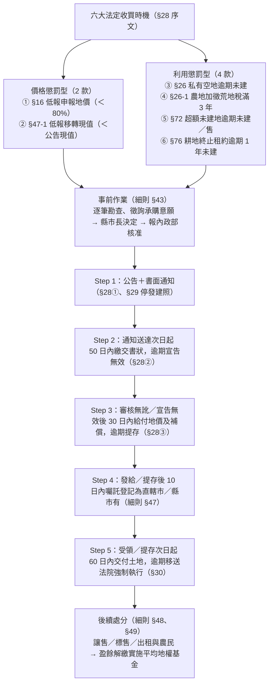

# 第 04 堂｜照價收買篇：政府何時可以強制買地？

> **涵蓋條文範圍**：《平均地權條例》§27（刪除）～§34（並串聯 §5、§6【刪除】）、《平均地權條例施行細則》§43～§49（細則第四章「照價收買」止於 §49；細則 §50 起屬第五章漲價歸公，移至第 05 堂精講）
> **命題熱度**：★★★★☆（**照價收買六大時機與三種地價計算標準（§31）、程序關鍵天數（50/30/10/60 日）、農作與建物補償（§33～§34）、他項權利與抵押權優先順序（細則 §46）、收買後處分（細則 §48）**，以及最經典的跨法大題**「照價收買 vs. 一般徵收」**，都是地政士申論高頻考點！）
> **跨科關聯**：〈土地法規〉（土地徵收條例一般徵收程序與市價補償、土地法 §157 低報收買）、〈土地稅法規〉（§47-1 低報移轉現值之土增稅核課與收買）

---

## 一、 架構鳥瞰（1 分鐘看懂體系位置）

「照價收買」是平均地權四大支柱的**第三根支柱**。如果說「照價徵稅」是怕地主亂高報地價，那「照價收買」就是專門用來**制裁「惡意低報地價／移轉現值」以及「違反土地利用義務（養空地、荒地、超額未建、終止租約不建）」的終極強制手段**！

### 母法與施行細則條文對照地圖

| 主題模組 | 母法（條例） | 施行細則 | 考點星級 |
| :--- | :--- | :--- | :---: |
| 六大收買時機與三種地價計算基準 | §27（刪）、§28 序文、§31 | §44 | ★★★★★ |
| 事前勘查核准、不收買處理、法定程序與關鍵天數 | §28、§29、§30 | §43、§47 | ★★★★★ |
| 改良費併計、農作物補償、地上建物一併收買與他項權利清償 | §32、§33、§34 | §45、§46 | ★★★★★ |
| 收買資金來源、收買後土地處分方式與盈餘歸屬 | §5、§6（刪） | §48、§49 | ★★★★☆ |

---

## 二、 白話精講（母法 × 施行細則整合）

### 主題 1：照價收買的六大法定時機與地價計算基準（條例 §27【刪】、§28、§31；細則 §44）★★★★★

原本集中規定收買時機的 **條例 §27 已經刪除**，現行法將六大收買時機分散於各章，並統一彙整於 **條例 §28 序文** 與 **§31** 中。考場上只要把這 6 種情形分成「**價格懲罰型（2 種）**」與「**利用懲罰型（4 種）**」，就能一眼秒記補償地價標準！

| 類型 | 法條依據 | 觸發照價收買之法定事由 | 照價收買地價計算基準（§31） |
| :--- | :---: | :--- | :--- |
| **價格懲罰型** | **§16** | 重新規定地價時，地主申報地價**未滿公告地價 80%** | **以其申報地價為準**（§31①） *（報越低被買越便宜，自食惡果！）* |
| **價格懲罰型** | **§47-1** | 土地移轉時，申報土地移轉現值**低於公告土地現值** | **以其申報土地移轉現值為準**（§31②） *（想逃土增稅亂低報，直接照低價買走！）* |
| **利用懲罰型** | **§26** | 私有空地經限期建築、增建、改建或重建，**逾期未建築** | **以收買當期之公告土地現值為準**（§31③） 📌 **細則 §44**：指「**公告收買當期**」之公告土地現值！ |
| **利用懲罰型** | **§26-1** | 農業用地閒置不用，經**加徵荒地稅滿 3 年**仍不使用 | 同上：**公告收買當期之公告土地現值**（§31③） |
| **利用懲罰型** | **§72** | 私有尚未建築土地超過最高面積（10 公畝），**逾期未建築或出售** | 同上：**公告收買當期之公告土地現值**（§31③） |
| **利用懲罰型** | **§76** | 出租耕地因編為建築用地終止租約收回後，**滿 1 年未建築使用** | 同上：**公告收買當期之公告土地現值**（§31③） |

> **一句話記住 §31 地價標準**：**「亂低報（§16、§47-1）就照你報的價買；不乖乖利用（§26、§26-1、§72、§76）就照『公告收買當期之公告土地現值』買！」**

---

### 主題 2：照價收買的完整程序與黃金天數（條例 §28～§30；細則 §43、§47）★★★★★

照價收買因為涉及剝奪人民財產權，法定程序非常嚴格，且**每一個天數都是申論題的必考得分點**！

#### 1. 公告前之事前審查與「不收買」之處理（細則 §43 — 必考細節！）
在正式公告收買之前，地方政府不能隨便說買就買，必須先走完三步驟：
1. **逐筆勘查與徵詢**：檢具地籍圖，逐筆勘查土地使用情形及編定使用概況，並**徵詢地上權人或土地承租人是否願意承購**之意見。
2. **縣市長決定**：依據勘查結果，簽註擬收買或不擬收買之意見；擬收買者應連同**財務計畫**，簽報直轄市或縣（市）長決定。
3. **報請中央核准**：經決定擬予照價收買者，應報請**中央主管機關（內政部）核准**。

* **若最後決定或核定「不照價收買」怎麼辦？（細則 §43②③ — 陷阱考點！）**：
  * **§16 低報地價不收買**：應以**公告地價 80%** 核定為申報地價，並通知土地所有權人。
  * **§47-1 低報移轉現值不收買**：地政機關應於 **5 日內** 通知稅捐稽徵機關**照公告土地現值**課徵土地增值稅！

#### 2. 奉准收買後之正式程序與五大天數（條例 §28～§30；細則 §47）
> **天數記憶口訣：「50 交狀 → 30 給錢 → 10 日登記 → 60 交地」**

1. **公告與書面通知（§28①、§29）**：
   * 直轄市或縣（市）政府應將奉准照價收買之土地**先行公告**，並以**書面通知**土地所有權人及土地移轉之權利人或他項權利人。
   * **§29 兩大時間與禁建限制**：
     * **§16 低報收買之期限（§29①）**：其公告及通知，應於申報地價後**開徵當年期地價稅之前**辦理完竣（以免稅單都開了又收買，造成課稅混亂！）。
     * **§26、§72 停止受理建照（§29②）**：依 §26（空地）或 §72（超額未建地）得照價收買之土地，自**限期屆滿之次日起**，當地主管建築機關應**停止受理申請建築執照**（防止地主逾期後才臨時搶掛建照規避收買！）。
2. **繳交書狀證件 — 50 日（§28②）**：
   * 受通知人應於**通知送達之次日起 50 日內**，繳交土地所有權狀、土地他項權利證明書及有關證件；**逾期不繳交者，宣告其書狀、證件無效**。
3. **給付地價與補償費 — 30 日（§28③）**：
   * 政府對繳交之書狀、證件審核無訛，或依前款宣告其書狀、證件無效後，應於 **30 日內** 給付地價及他項權利補償費；**逾期不領取者，依法提存**。
4. **權屬歸屬與囑託登記 — 10 日（細則 §47）**：
   * 照價收買之土地，其權屬為**「直轄市、縣（市）有」**（*注意！不是國有喔！*）。
   * 主管機關應於補償費發給完竣或依法提存後 **10 日內**，囑託地政機關辦理所有權移轉登記；其為出租耕地者，並應辦理**租約註銷登記**（一併收買地上建物者亦同）。
5. **交付土地與強制執行 — 60 日（§30）**：
   * 原所有權人應於**受領地價完竣或其地價經依法提存之次日起 60 日內**，將其土地交付該管直轄市或縣（市）政府；**逾期不交付者，必要時主管機關得移送法院裁定後強制執行**。

---

### 主題 3：改良費用、農作物、地上建物一併收買與他項權利清償（條例 §32～§34；細則 §45、§46）★★★★★

政府強制買地時，地主之前花錢整地、地上種的果樹、蓋的房子、銀行設定的抵押權，到底怎麼算？這四條幾乎年年輪考！

#### 1. 改良土地費用與工程受益費併入地價（條例 §32；細則 §45）
* **要件（§32）**：土地所有權人有改良土地情事，其**改良土地之費用**及**已繳納之工程受益費**，經該管主管機關**驗證登記**者，應併入地價內計算之（提驗土地改良費用證明書或工程受益費繳納收據）。
* **發生時點限制（細則 §45 — 防重複計算！）**：限於下列基準時點「**之後**」發生者，才可併入地價：
  1. 依 §16 收買者：在**申報地價後**。
  2. 依 §47-1 收買者：在**申報土地移轉現值後**。
  3. 依 §26、§26-1、§72、§76 收買者：在**當期土地現值公告後**。
  * *白話理解*：基準時點「之前」做的改良，價值早就已經反映在申報地價或公告現值裡了，不能重複領兩次錢！

#### 2. 地上農作改良物補償（條例 §33）★★★★☆
地上如有農作改良物，應予補償，估價標準以「**1 年**」為界線：
* **孳息成熟時間在收買後 1 年以內者**：按其**成熟時之孳息**估定之（快收成了，直接賠你收成賣得的錢！）。
* **孳息成熟時間在收買後 1 年以上者**：依其**種植、培育費用，並參酌現值**估定之（還要很久才成熟，賠你投入的成本與現值！）。

#### 3. 地上建築改良物一併收買（條例 §34）★★★★★
* **原則（同屬一人）**：地上建築改良物**同屬土地所有權人所有**者，**應一併收買**！
* **但書（非屬同一人）**：**不屬土地所有權人所有**者（例如租地建屋，房子是承租人或地上權人的），**不在此限**（政府只買地、不收買別人的房子，後續還可以依細則 §48 讓售土地給屋主！）。
* **估價評定程序（§34②）**：地上建築改良物之價額，由直轄市或縣（市）政府查估後，提交**地價評議委員會評定**之。

#### 4. 他項權利之扣交清償與「抵押權 vs. 耕地承租人」優先順序（細則 §46 — 魔王必考！）★★★★★
* **扣交與塗銷原則**：照價收買土地設有他項權利（如抵押權、地上權）者，他項權利補償費由主管機關於發給地主之補償地價內**代為扣交**他項權利人，並**塗銷**之。
* **清償上限（防政府倒貼！）**：他項權利價值之總和，以不超過「**該宗土地收買地價 − 土地增值稅 − §11 規定補償耕地承租人之地價後之餘額**」為限。
* **權利價值認定**：有登記數額者以登記數額為準；未登記數額者，由地政機關通知權利人及義務人會同申報或協議；協議不成時，由地政機關估計後提交**地價評議委員會評定**。
* **🔥 超級考點（細則 §46③ — 抵押權人優先受償例外！）**：
  * 照價收買土地設有抵押權者，**如其設定登記在耕地租約訂立之前，該抵押權人應優先於耕地承租人受償**！
  * *白話理解*：原則上扣款順序是「① 土增稅 → ② 耕地承租人（1/3 補償） → ③ 他項權利人」；但如果銀行抵押權**早在租給佃農之前**就設定好了，基於物權優先與保護既有債權，銀行（抵押權人）可以插隊排在耕地承租人前面先拿錢！

> **【實務案例】地上有別人蓋的房子＋銀行抵押權的照價收買**
> 老王有一筆市區土地，出租給小美蓋了一棟鐵皮餐廳（建物登記在小美名下），且老王早年曾向 A 銀行設定 500 萬元抵押權。某年老王惡意將申報地價低報至公告地價 60%，經政府核准依 §16 照價收買。請問：
> 1. **小美的鐵皮餐廳會被政府一併收買嗎？**
>    * **不會！** 依條例 §34① 但書，地上建築改良物「不屬土地所有權人所有」者，不予一併收買。政府只收買老王的土地，之後還可依細則 §48① 優先將土地讓售給房屋所有權人小美！
> 2. **A 銀行的 500 萬元抵押權怎麼辦？**
>    * 依細則 §46①，主管機關會直接從要發給老王的收買地價中（扣除土增稅等法定優先款項後之餘額範圍內）**代為扣交 A 銀行**，並將抵押權塗銷。

---

### 主題 4：資金來源、修法沿革與收買後土地處分（條例 §5、§6【刪】；細則 §48、§49）★★★★☆

#### 1. 資金來源與盈餘歸屬（條例 §5、§6【刪】；細則 §49）
* **土地債券與墊借（§5、細則 §49①）**：照價收買所需之現金及土地債券，由**中央或直轄市主管機關**統籌墊借或發行（土地債券之發行由**財政部**為中央主管機關，§2）。
* **修法沿革提醒（申論加分！）**：早年條例 §6 原規定每戶收買地價超過 10 萬元以上分級搭發 6 成、8 成、9 成、10 成土地債券，但該條已於**民國 100 年 6 月 15 日刪除**，現行實務不再強制按 10 萬元級距搭發債券。
* **盈餘歸屬（細則 §49②）**：出售照價收買土地之價款收入，除歸還墊款及債券之本息外，如有盈餘，應悉數解繳**實施平均地權基金**。

#### 2. 收買後土地之三大處分方式（細則 §48 — 必背！）★★★★☆
政府照價收買土地後，並不是自己一直囤著，而是依土地現況分三種方式處分：
1. **建有房屋之土地**：得**讓售**與**地上權人、土地承租人或房屋所有權人**；不願承購或在限期內不表示意見時，得予**標售**。
2. **空地**：除依規定得**讓售與有合併使用必要之鄰地所有權人**外，應予**標售**。
3. **農業用地**：應予**標售或出租與農民**。
* **公共目的優先讓售（細則 §48② — 最新用語！）**：前項應行標售之土地，如適宜興建**社會住宅**（舊法為國民住宅，已修正！）或**公共設施使用**者，得**優先讓售與需用土地人**；其餘土地應隨時公開底價標售。

---

## 三、 考點對決（易混淆觀念比較表＋口訣）

### 比較表 1：照價收買 vs. 一般土地徵收（萬年必考跨法超級比一比！）★★★★★

| 比較項目 | 照價收買（平均地權條例第四章） | 一般土地徵收（土地徵收條例） |
| :--- | :--- | :--- |
| **制度性質與目的** | **懲罰性／政策強制買受**：制裁低報地價、低報現值或違反土地利用義務（空地、荒地等），促進地盡其利 | **公益性公用徵收**：因興辦國防、交通、水利、公共事業等公共利益需要，強制取得私人土地 |
| **核准機關** | **中央主管機關（內政部）**（細則 §43①③） | **中央主管機關（內政部）**（土徵條例 §14） |
| **收買／徵收後權屬** | **直轄市、縣（市）有**（細則 §47） | 歸屬於**需用土地人**（國有、直轄市／縣市有或鄉鎮市有） |
| **地價補償標準** | 依事由區分（§31）： ① 低報地價 → **申報地價** ② 低報現值 → **申報移轉現值** ③ 空地等 4 款 → **公告收買當期之公告土地現值** | 一律按徵收當期之**市價**補償（土徵條例 §30） |
| **補償費給付期限** | 書狀審核無訛或宣告無效後 **30 日內**（§28③） | 公告期滿後 **15 日內**發給完竣（土徵條例 §20） |
| **地上建物處理** | **同屬土地所有權人所有**者，應一併收買；**非屬同一人**者，不予收買（§34） | 土地徵收時，其土地改良物原則**一併徵收**（不論是否同一人，土徵條例 §5） |
| **取得後處分** | 讓售（地上權人／承租人／屋主／鄰地／社宅）、標售或出租與農民（細則 §48） | 須依核准徵收計畫使用，原則不得任意移轉或標售；未依計畫使用有收回權（土徵條例 §9） |

---

### 比較表 2：照價收買全流程「關鍵天數」速查表 ★★★★☆

| 關鍵天數 | 法條依據 | 對應事項與法律效果 |
| :---: | :---: | :--- |
| **5 日內** | 細則 §43③ | §47-1 低報移轉現值核定**不照價收買**時，地政機關通知稅捐機關照公告現值課土增稅之期限 |
| **10 日內** | 細則 §47② | 補償費發給完竣或依法提存後，主管機關**囑託辦理移轉登記**（及耕地租約註銷）之期限 |
| **30 日內** | 條例 §28③ | 書狀證件審核無訛或宣告無效後，政府**給付地價及他項權利補償費**之期限（逾期提存） |
| **50 日內** | 條例 §28② | 公告並書面通知送達之次日起，受通知人**繳交書狀證件**之期限（逾期宣告無效） |
| **60 日內** | 條例 §30 | 受領地價完竣或依法提存之次日起，原所有權人**交付土地**之期限（逾期移送法院強制執行） |
| **1 年** | 條例 §33② | 農作改良物補償估價分界線：成熟期 **1 年以內**按成熟孳息；**1 年以上**按種植培育費參酌現值 |

---

## 四、 課後小測驗（地政士申論模擬演練）

### 模擬題 1（照價收買時機、程序天數與補償標準綜合題）
> **題目**：依《平均地權條例》及其施行細則規定，政府得實施照價收買之法定情形有哪六種？其收買地價各應如何計算？又奉准照價收買後，關於「繳交書狀」、「給付補償費」、「囑託登記」及「交付土地」之法定期限與逾期效果各為何？（25 分）

👉 點此展開【擬答架構與得分關鍵字】

1. **照價收買之六大法定時機與收買地價計算基準（條例 §28、§31；細則 §44）**：
   * **依 §16（申報地價未滿公告地價 80%）**：以其**申報地價**為準（§31①）。
   * **依 §47-1（申報土地移轉現值低於公告土地現值）**：以其**申報土地移轉現值**為準（§31②）。
   * **依 §26（私有空地逾期未建築）、§26-1（農地加徵荒地稅滿 3 年仍不使用）、§72（超額未建築土地逾期未建築或出售）、§76（出租耕地終止租約滿 1 年未建築使用）**：以**收買當期之公告土地現值**為準（§31③；細則 §44 明定為「公告收買當期」之公告土地現值）。
2. **奉准照價收買後之四階段法定期限與逾期效果（條例 §28、§30；細則 §47）**：
   * **繳交書狀（50 日，§28②）**：通知送達之次日起 **50 日內**繳交所有權狀、他項權利證明書及有關證件；逾期不繳交者，**宣告其書狀、證件無效**。
   * **給付補償費（30 日，§28③）**：書狀審核無訛或宣告無效後 **30 日內**給付地價及他項權利補償費；逾期不領取者，**依法提存**。
   * **囑託登記（10 日，細則 §47）**：補償費發給完竣或依法提存後 **10 日內**，囑託地政機關登記為**直轄市、縣（市）有**（出租耕地併辦租約註銷登記）。
   * **交付土地（60 日，§30）**：受領地價完竣或提存之次日起 **60 日內**交付土地；逾期不交付者，必要時得**移送法院裁定後強制執行**。

---

### 模擬題 2（地上建物、他項權利清償與收買後處分題）
> **題目**：政府依《平均地權條例》實施照價收買時，請說明：(一) 地上農作改良物與建築改良物各應如何補償或收買？(二) 該收買土地若同時設有「抵押權」並訂有「耕地租約」，其清償扣交上限與受償優先順序為何？(三) 照價收買之土地應如何處分？（25 分）

👉 點此展開【擬答架構與得分關鍵字】

1. **地上改良物之補償與一併收買（條例 §33、§34）**：
   * **農作改良物（§33）**：應予補償；孳息成熟時間在收買後 **1 年以內**者，按**成熟時之孳息**估定；在 **1 年以上**者，依**種植、培育費用並參酌現值**估定。
   * **建築改良物（§34）**：**同屬土地所有權人所有**者，應**一併收買**；不屬土地所有權人所有者，不在此限。價額由地方政府查估後，提交**地價評議委員會評定**。
2. **他項權利清償上限與抵押權優先順序（細則 §46）**：
   * **扣交與上限**：由主管機關於補償地價內代為扣交並塗銷，他項權利價值總和以不超過「**收買地價扣除土地增值稅及 §11 補償耕地承租人之地價後之餘額**」為限。
   * **優先順序例外**：抵押權設定登記在**耕地租約訂立之前**者，該**抵押權人應優先於耕地承租人受償**。
3. **照價收買土地之處分方式（細則 §48）**：
   * **建有房屋**：得讓售與地上權人、土地承租人或房屋所有權人；不願承購或限期不表示意見者，得予標售。
   * **空地**：除得讓售與有合併使用必要之鄰地所有權人外，應予標售。
   * **農業用地**：應予標售或出租與農民。
   * **優先讓售**：應行標售土地如適宜興建**社會住宅**或**公共設施使用**者，得優先讓售與需用土地人；其餘隨時公開底價標售。

---

> **下堂課預告**：第 05 堂｜**漲價歸公（上）：土地增值稅與公告現值**（條例 §35～§46、§48～§51；細則 §50～§65）— 地政士考試〈土地稅法規〉與〈土地法規〉另一超級核心！完整拆解公告土地現值、漲價總數額計算、20%/30%/40% 累進與長期持有減徵、自用住宅「一生一次／一生一屋（10%）」與重購退稅！
