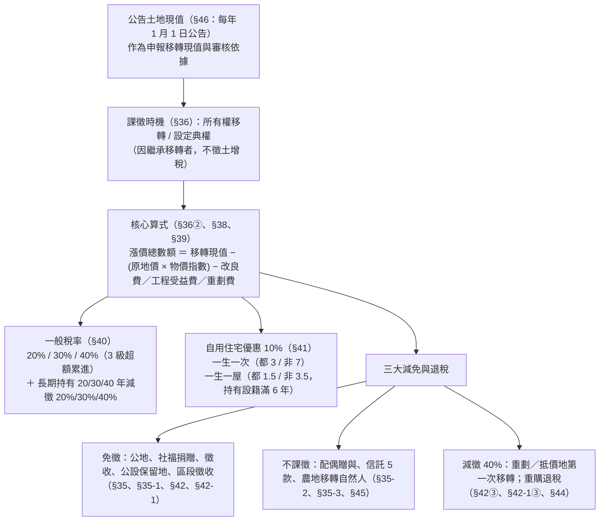

# 第 05 堂｜漲價歸公（上）：土地增值稅與公告現值

> **涵蓋條文範圍**：《平均地權條例》§35～§46、§48～§51（§43、§48～§50 已刪除）、《平均地權條例施行細則》§50～§65（其中實價登錄 2.0 與打炒房五大新制 §47、§47-1～§47-5 獨立於第 06 堂精講）
> **命題熱度**：★★★★★（**地政士考試〈土地法規〉與〈土地稅法規〉雙科最高分值熱區！** 土地漲價總數額計算、20%/30%/40% 累進與長期持有 20/30/40 年減徵、自用住宅「一生一次 vs. 一生一屋（10%）」、重購退稅、公設保留地免徵、農地不課徵與配偶贈與不課徵，幾乎年年必出申論與計算題！）
> **跨科關聯**：〈土地稅法規〉（土地稅法第三章 §28～§39-2 土地增值稅完整對應）、〈土地法規〉（區段徵收抵價地 §54、市地重劃 §56）

---

## 一、 架構鳥瞰（1 分鐘看懂體系位置）

「漲價歸公」是平均地權四大支柱的**第四根支柱**，也是國父土地政策的核心思想：土地的「自然漲價」（因為政府開路、蓋捷運、社會繁榮帶來的增值，而非地主自己努力改良）應歸全體國民共享！具體工具就是於土地所有權移轉或設定典權時課徵**土地增值稅**。

### 母法與施行細則條文對照地圖

| 主題模組 | 母法（條例） | 施行細則 | 考點星級 |
| :--- | :--- | :--- | :---: |
| 漲價歸公目的、納稅義務人、公告現值與收入用途 | §35、§36①、§37、§37-1、§46、§51 | §65（共有分割合併） | ★★★★☆ |
| 漲價總數額公式、物價指數、增繳地價稅抵繳、一般稅率與長期減徵 | §36②③、§38、§39、§40 | §53、§55 | ★★★★★ |
| 自用住宅 10%（一生一次 vs. 一生一屋）與重購退稅 | §41、§44 | — | ★★★★★ |
| 免徵、減徵 40% 與不課徵（社福、配偶、信託、徵收、公設地、農地） | §35-1～§35-3、§42、§42-1、§45 | §50、§60 | ★★★★★ |

---

## 二、 白話精講（母法 × 施行細則整合）

### 主題 1：課徵時機、納稅義務人、公告現值與收入用途（條例 §35～§37-1、§46、§51；細則 §65）★★★★☆

#### 1. 課徵時機與「繼承不徵」（條例 §36①；細則 §65）
* **開徵時點**：於土地**所有權移轉**或**設定典權**時徵收土地增值稅。
* **繼承不徵（§36① 但書）**：因**繼承**而移轉者，**不徵**土地增值稅（因為已經課遺產稅，且以後繼承人再賣出時，前次移轉現值會自動以「繼承開始時之公告土地現值」重新起算，舊的增值直接一筆勾銷！）。
* **共有土地分割／合併（細則 §65）**：分別共有或公同共有土地分割後，各共有人取得土地價值與分割前原有應有部分價值**相等**者，**免徵**土地增值稅；有價值減少者，就其**減少部分**課徵土地增值稅。土地合併後價值相等者亦同。

#### 2. 納稅義務人認定（條例 §37、§37-1）
| 移轉或設定類型 | 納稅義務人 | 記憶邏輯 |
| :--- | :--- | :--- |
| **有償移轉**（買賣、交換、政府照價收買） | **原土地所有權人**（賣方） | 賣地賺到錢的人繳稅 |
| **無償移轉**（贈與、遺贈） | **取得所有權人**（受贈人） | 白白拿到土地的人繳稅 |
| **設定典權**（搭配《土地稅法》§5） | **出典人** | 典權回贖時可無息退還 |
| **信託土地：有償移轉、設典、轉自有**（§37-1①） | **受託人** | 信託存續中由受託人處分 |
| **信託土地：依信託本旨移轉予委託人以外之歸屬權利人**（§37-1②） | **歸屬權利人** | 實質等同無償取得（他益信託） |

#### 3. 公告土地現值（條例 §46）與漲價歸公收入用途（條例 §51）
* **公告土地現值（§46）**：直轄市或縣（市）政府應經常調查地價動態，繪製地價區段圖並估計區段地價，提經**地價評議委員會評定**，於**每年 1 月 1 日公告**，作為土地移轉及設定典權時申報土地移轉現值之參考，並作為主管機關審核土地移轉現值之依據。
  * *（跨法提醒：§46 雖仍保留「補償徵收土地地價之依據」字樣，但現行徵收補償已優先適用《土地徵收條例》§30 改按**市價**補償！）*
* **漲價歸公收入用途（§51）**：供育幼、養老、救災、濟貧、衛生、扶助身心障礙等公共福利事業、興辦**社會住宅**、徵收公共設施保留地、興辦公共設施、促進農業發展、農村建設、推展國民教育及實施平均地權之用。

---

### 主題 2：漲價總數額公式、一般稅率（20%/30%/40%）與長期持有減徵（條例 §36②③、§38～§40；細則 §53）★★★★★

#### 1. 土地漲價總數額計算公式（§36②、§38、§39；細則 §53）
$$\text{土地漲價總數額} = \text{申報土地移轉現值} - \left(\text{原規定地價或前次移轉現值} \times \frac{\text{臺灣地區消費者物價總指數}}{100}\right) - \text{改良土地費用（含工程受益費、重劃負擔總費用）}$$

* **物價指數調整（§39）**：為了扣除「通貨膨脹」造成的虛假漲價，必須把原地價乘以政府公告之消費者物價指數，才真正對「實質自然漲價」課稅！
* **改良費用減除（§36②、細則 §53）**：包括土地改良費用、已繳納之**工程受益費**（檢附繳納收據）及土地重劃負擔總費用。
* **增繳地價稅抵繳上限（§36③ — 必背 5%！）**：持有期間內因重新規定地價而「增繳之地價稅」，就其移轉土地部分准予抵繳應納之土地增值稅，但**准予抵繳之總額，以不超過土地移轉時應繳增值稅總額 5% 為限**！

#### 2. 一般 3 級超額累進稅率與長期持有減徵（條例 §40）★★★★★
土地增值稅一般稅率按「**漲價倍數**（＝ 漲價總數額 ÷ 經物價指數調整後之原地價）」分三級超額累進，並對**持有超過 20 年、30 年、40 年**之土地，就「**超過最低稅率（20%）之部分**」給予減徵：

| 級距 | 漲價總數額占「調整後原地價」之比例 | 持有未滿 20 年（一般） | 持有滿 **20 年**（超 20% 部分減徵 **20%**） | 持有滿 **30 年**（超 20% 部分減徵 **30%**） | 持有滿 **40 年**（超 20% 部分減徵 **40%**） |
| :---: | :--- | :---: | :---: | :---: | :---: |
| **第 1 級** | 未達 100%（未滿 1 倍） | **20%** | 20%（無超過部分） | 20%（無超過部分） | 20%（無超過部分） |
| **第 2 級** | 100% 以上未達 200%（1～2 倍） | **30%** | **28%** $20\% + (30\%-20\%)\times 80\%$ | **27%** $20\% + 10\%\times 70\%$ | **26%** $20\% + 10\%\times 60\%$ |
| **第 3 級** | 200% 以上（2 倍以上） | **40%** | **36%** $20\% + (40\%-20\%)\times 80\%$ | **34%** $20\% + 20\%\times 70\%$ | **32%** $20\% + 20\%\times 60\%$ |

> **【實務案例 1】土地增值稅＋物價指數＋持有 35 年長期減徵計算演練**
> 老林 35 年前買入一塊建地，前次移轉現值為 **200 萬元**（當時至出售時物價指數為 **150%**），期間繳納工程受益費 **50 萬元**。今年老林出售該地，申報移轉現值為 **1,100 萬元**（非自用住宅）。請問老林應繳多少土地增值稅？
> * **Step 1：算「調整後原地價」**
>   $$200\text{ 萬} \times 150\% = \mathbf{300\text{ 萬元}}$$
> * **Step 2：算「土地漲價總數額」**
>   $$1,100\text{ 萬} - 300\text{ 萬} - 50\text{ 萬（工程受益費）} = \mathbf{750\text{ 萬元}}$$
> * **Step 3：判斷漲價倍數與分段計算（持有 35 年 → 滿 30 年，超過 20% 部分減徵 30%，三級稅率為 20% / 27% / 34%）**
>   * $750\text{ 萬} \div 300\text{ 萬} = 2.5\text{ 倍}$（落在第 3 級！）
>   * 第 1 級（未達 100%，即 $300\text{ 萬}$）：$300\text{ 萬} \times 20\% = 60\text{ 萬元}$
>   * 第 2 級（100%～200%，即 $300\text{ 萬}$）：$300\text{ 萬} \times 27\% = 81\text{ 萬元}$
>   * 第 3 級（超過 200% 部分：$750\text{ 萬} - 300\text{ 萬} - 300\text{ 萬} = 150\text{ 萬}$）：$150\text{ 萬} \times 34\% = 51\text{ 萬元}$
>   * **合計應納土地增值稅** $= 60 + 81 + 51 = \mathbf{192\text{ 萬元}}$！（比未減徵的 210 萬元整整省了 18 萬元！）

---

### 主題 3：自用住宅 10%（一生一次 vs. 一生一屋）與重購退稅（條例 §41、§44）★★★★★

#### 1. 自用住宅 10% 優惠稅率：一生一次 vs. 一生一屋（條例 §41）
這是地政士考試**每 2 年就考 1 次的超級必背表**，每一個數字（3/7、1.5/3.5、1 年、5 年、6 年、10%）都不能錯！

| 比較項目 | 一生一次（§41①～④） | 一生一屋（§41⑤） |
| :--- | :--- | :--- |
| **適用前提** | 土地所有權人**出售**（贈與不適用！）自用住宅用地 | 必須**曾適用過「一生一次」**後，再次出售自用住宅用地 |
| **適用稅率** | **10%**（超過面積部分按一般 20%/30%/40% 計徵） | **10%**（超過面積部分按一般 20%/30%/40% 計徵） |
| **面積上限** | 都市土地 **3 公畝**；非都市土地 **7 公畝** | 都市土地 **1.5 公畝**；非都市土地 **3.5 公畝**（直接減半！） |
| **無出租或營業期間** | 出售前 **1 年內**無供營業使用或出租 | 出售前 **5 年內**無供營業使用或出租 |
| **持有與設籍年限** | **無年限限制**（只要出售時有本人、配偶或直系親屬設籍即可） | 1. 出售前持有該土地 **6 年以上** 2. 本人、配偶或未成年子女於該地**設有戶籍且持有該自用住宅連續滿 6 年** |
| **名下房屋數限制** | **無限制**（名下有 5 間房，同時出售也可在 3 公畝內適用一次） | 出售時，**土地所有權人與其配偶及未成年子女，無該自用住宅以外之房屋**（真正「一屋」！） |
| **建物價值防弊（§41②）** | 建物評定現值不及所占基地公告土地現值 **10%** 者不適用；但**建築工程完成滿 1 年以上**者不在此限 | 同左適用 |
| **適用次數** | 每人一生**限一次** | 符合要件者，**不限次數**！ |

#### 2. 重購退稅（條例 §44，串聯《土地稅法》§35）★★★★☆
* **適用三大土地類型（§44①②）**：土地所有權人**出售**或**被徵收**其：
  1. **自用住宅用地**（都市 3 公畝／非都市 7 公畝內）
  2. **自營工廠用地**
  3. **自耕之農業用地**
  另行購買「**使用性質相同**」之土地者，依法退還其出售或徵收土地所繳之土地增值稅！
* **跨科實務必背關鍵條件（土地稅法 §35、§37）**：
  * **時間限制**：完成移轉登記之日起 **2 年內**重購（先買後賣、先賣後買皆可！）。
  * **價格門檻（小屋換大屋原則）**：新購土地地價**超過**原出售土地地價扣除已繳土地增值稅後之餘額，就其**不足支付新購土地地價之數額**，於已納土增稅額內退還！
  * **5 年列管**：重購土地自完成移轉登記日起 **5 年內**再行移轉或改作其他用途者，**追繳原退還稅款**！

---

### 主題 4：免徵、減徵與不課徵土地增值稅總整理（條例 §35～§35-3、§42、§42-1、§45；細則 §50）★★★★★

地政士申論題最愛考你「**免徵**」與「**不課徵**」的差別！
* **免徵** ＝ 該次移轉的增值「永遠免除」，下次再移轉時，原地價會「**跳升**」到這次的新地價（唯一例外：公設保留地若日後解編變非公設保留地，則要追溯回來課稅！）。
* **不課徵** ＝ 這次「**先不課、暫時記帳**」，下次再移轉給第三人時，原地價會「**追溯回前一手**」，把累積的全部漲價一次算總帳！

#### 1. 法定「免徵」土地增值稅（5 大類）
1. **公有土地與政府受贈地（§35 但書）**：政府出售或依法贈與之公有土地，及政府接受捐贈之私有土地。
2. **私人捐贈社會福利事業土地（§35-1、細則 §50）**：須同時符合三要件：① 受贈人為**財團法人**；② 法人章程載明解散時**賸餘財產歸屬當地地方政府所有**；③ 捐贈人**未以任何方式取得所捐贈土地之利益**。
3. **被徵收土地與協議價購（§42①）**：被徵收之土地免徵；依法得徵收之私有土地，地主自願按徵收補償價售與需地機關（協議價購）亦免徵。
4. **都市計畫公共設施保留地移轉（§42② — 超級必考！）**：依都市計畫法指定之公共設施保留地，**尚未被徵收前之移轉，準用免徵**！
   * *⚠️ 但書陷阱*：但經變更為**非公共設施保留地**後再移轉時，以該土地**第一次免徵土地增值稅前之原規定地價或前次移轉時申報現值**為原地價，計算漲價總數額課稅！
5. **區段徵收之土地（§42-1①②）**：以現金補償地價、以抵價地補償地價，或領回抵價地不足最小建築單位面積改領現金補償者，均免徵！

#### 2. 法定「減徵 40%」（2 大類）
1. **重劃後第一次移轉（§42③）**：經重劃之土地，於重劃後**第一次移轉**時，減徵土地增值稅 **40%**。
2. **區段徵收領回抵價地後第一次移轉（§42-1③）**：以原土地所有權人**實際領回抵價地之地價**為原地價，計算漲價總數額課徵土增稅，並準用重劃土地**減徵 40%**！

#### 3. 法定「不課徵」土地增值稅（3 大類）
1. **配偶相互贈與（§35-2）**：不課徵土增稅；但再移轉第三人時，以該土地**第一次贈與前之原規定地價或前次移轉現值**為原地價計算課稅。
2. **信託關係人間 5 款移轉（§35-3）**：
   * ① 因信託行為成立，委託人 ↔ 受託人間。
   * ② 信託存續中受託人變更，原受託人 ↔ 新受託人間。
   * ③ 自益信託（受益人為委託人）關係消滅時，受託人 ↔ 受益人間。
   * ④ 遺囑信託關係消滅時，受託人 ↔ 受益人間。
   * ⑤ 信託行為不成立、無效、解除或撤銷，委託人 ↔ 受託人間。
3. **作農業使用之農業用地移轉予自然人（§45 — 必考！）**：
   * **申請要件（§45①）**：**作農業使用**之**農業用地**，移轉與**自然人**（法人不行！）時，得申請**不課徵**土地增值稅。
   * **違規追罰條款（§45②③）**：承受人於持有期間內，曾被查獲**未作農業使用**且未於期限內恢復，或雖已恢復但**再有未作農業使用**情事者，於**再移轉時應課徵土地增值稅**（配偶相互贈與時，未農用情事應**合併計算**！）。
   * **原地價認定（§45④⑤）**：民國 **89 年 1 月 6 日**（農發條例修法施行日）修正施行後第一次移轉，或依第 1 項取得不課徵後再移轉依法應課稅者，以 **89 年 1 月 6 日當期之公告土地現值**為原地價！

---

## 三、 考點對決（易混淆觀念比較表＋口訣）

### 比較表 1：土地增值稅「不徵（繼承）」vs.「免徵」vs.「不課徵」終極對照 ★★★★★

| 類型 | 代表條文 | 這次要不要繳稅？ | 下次再移轉時，原地價如何認定？ |
| :--- | :--- | :---: | :--- |
| **不徵（繼承）** | §36① 但書 | 不用 | 以**繼承開始時之公告土地現值**為原地價（舊增值永久歸零！） |
| **免徵** | §35、§35-1、§42①②、§42-1 | 不用 | 原則以**本次移轉現值**為新原地價 （⚠️ 唯一例外：§42② 公設保留地解編後再移轉，追溯第一次免徵前原地價） |
| **不課徵** | §35-2 配偶贈與、§35-3 信託、§45 農地 | 不用（暫緩記帳） | **追溯前次原地價**（配偶贈與追溯第一次贈與前；農地原則追溯 89/1/6 公告現值或前次課稅現值） |

---

### 比較表 2：地價稅自用住宅（2‰）vs. 土增稅自用住宅（10%）跨章比較 ★★★★☆

| 比較項目 | 地價稅自用住宅（第 3 堂 §20） | 土增稅自用住宅（第 5 堂 §41） |
| :--- | :--- | :--- |
| **優惠稅率** | **2‰**（基本稅率 10‰ 的 1/5） | **10%**（一般稅率 20%/30%/40%） |
| **面積上限** | 都市 3 公畝、非都市 7 公畝 | 一生一次：都 3 / 非 7；一生一屋：都 **1.5** / 非 **3.5** |
| **處數／次數限制** | 本人、配偶、未成年受扶養親屬以**一處**為限 | 一生一次限 1 次；一生一屋須**無其他房屋**且不限次數 |
| **無出租營業年限** | 申請及課稅當時無出租營業即可 | 一生一次出售前 **1 年**；一生一屋出售前 **5 年** |
| **贈與可否適用？** | 持有稅無涉移轉 | **不可以**！土增稅 10% 僅限「**出售**」，贈與不得適用 |

---

## 四、 課後小測驗（地政士申論模擬演練）

### 模擬題 1（一生一次 vs. 一生一屋＋重購退稅綜合題）
> **題目**：依《平均地權條例》第 41 條及第 44 條規定，土地所有權人出售自用住宅用地適用 10% 優惠稅率之「一生一次」與「一生一屋」要件有何不同？又適用「重購退稅」之三大土地類別為何？（25 分）

👉 點此展開【擬答架構與得分關鍵字】

1. **「一生一次」與「一生一屋」要件比較（條例 §41）**：
   * **適用次數與前提**：一生一次每人限 1 次；一生一屋須曾適用過一生一次後再出售，符合條件者不限次數。
   * **面積上限**：一生一次為都市 **3 公畝**、非都市 **7 公畝**；一生一屋減半為都市 **1.5 公畝**、非都市 **3.5 公畝**。
   * **無出租營業年限**：一生一次為出售前 **1 年內**；一生一屋為出售前 **5 年內**。
   * **持有與設籍年限**：一生一次無年限限制；一生一屋須出售前持有該土地 **6 年以上**，且本人、配偶或未成年子女設有戶籍並持有該自用住宅**連續滿 6 年**。
   * **房屋數限制**：一生一次無限制；一生一屋於出售時，土地所有權人與其配偶及未成年子女**無該自用住宅以外之房屋**。
   * **共同防弊（§41②）**：建物評定現值不及基地公告現值 10% 者不適用，但建築工程完成滿 1 年以上者不在此限。
2. **重購退稅之三大土地類別（條例 §44）**：
   * 土地所有權人**出售**或**被徵收**下列三大土地，另行購買**使用性質相同**之土地者，得依法申請退還已納土地增值稅：
     1. **自用住宅用地**
     2. **自營工廠用地**
     3. **自耕之農業用地**

---

### 模擬題 2（免徵、不課徵與農地違規追課綜合題）
> **題目**：依《平均地權條例》規定，請回答下列問題：(一) 私人捐贈供興辦社會福利事業使用之土地，須符合哪三項要件始得免徵土地增值稅？(二) 都市計畫公共設施保留地尚未被徵收前之移轉，其土地增值稅如何處理？若日後變更為非公共設施保留地再移轉時，原地價如何認定？(三) 依第 45 條申請不課徵土地增值稅之農業用地，在何種情形下於再移轉時應改課土地增值稅？（25 分）

👉 點此展開【擬答架構與得分關鍵字】

1. **私人捐贈社會福利事業免徵三要件（條例 §35-1；細則 §50）**：
   * ① 受贈人為**財團法人**。
   * ② 法人章程載明法人解散時，其**賸餘財產歸屬當地地方政府所有**。
   * ③ 捐贈人**未以任何方式取得所捐贈土地之利益**。
2. **公共設施保留地移轉免徵與解編後之原地價（條例 §42②）**：
   * 依都市計畫法指定之公共設施保留地，**尚未被徵收前之移轉，準用免徵土地增值稅**。
   * 但經變更為**非公共設施保留地**後再移轉時，應以該土地**第一次免徵土地增值稅前之原規定地價或前次移轉時申報現值**為原地價，計算漲價總數額課徵土地增值稅。
3. **不課徵農地再移轉應課稅之情形（條例 §45②③）**：
   * 承受人於具有土地所有權之期間內，曾經有關機關查獲該土地**未作農業使用**，且**未在有關機關所令期限內恢復作農業使用**；或雖在期限內已恢復作農業使用，而**再有未作農業使用情事**者，於再移轉時應課徵土地增值稅。
   * 且上開未作農業使用之情事，於**配偶間相互贈與**之情形，應**合併計算**。

---

> **下堂課預告**：第 06 堂｜**漲價歸公（下）：實價登錄 2.0 與打炒房五大新制**（條例 §47、§47-1～§47-5、§79-1）— 近年地政士國考**最強命題大魔王**！一次拆解買賣與預售屋簽約／解約 30 日申報、禁止紅單轉售、預售屋與新建成屋限制換約轉售、重罰不動產炒作，以及私法人購買住宅許可制（5 年閉鎖期）！
