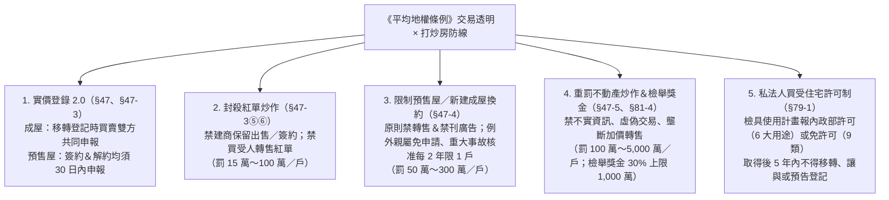

# 第 06 堂｜漲價歸公（下）：實價登錄 2.0 與打炒房五大新制

> **涵蓋條文範圍**：《平均地權條例》§47、§47-1～§47-5、§79-1（並串聯對應罰則 §81-2、§81-3、§81-4 及兩大核心子法：《預售屋及新建成屋買賣契約讓與或轉售審核辦法》、《私法人買受供住宅使用之房屋許可辦法》）
> **命題熱度**：★★★★★（**近年地政士國考「絕對必考」第一大魔王！** 民國 112 年 7 月 1 日施行的「平均地權條例 2.0 打炒房五大新制」幾乎年年入題，條文新、架構完整、實務案例豐富，務必把每一個數字、親等、年限與罰鍰背到滾瓜爛熟！）
> **跨科關聯**：〈土地法規〉（不動產經紀業管理條例實價登錄、土地登記規則預告登記）、〈土地稅法規〉（§47-1 土地移轉現值審核標準與土增稅核課）

---

## 一、 架構鳥瞰（1 分鐘看懂「實價登錄 2.0 × 打炒房五大新制」）

民國 110 年推動「實價登錄 2.0」（全面揭露門牌、預售屋 30 日申報、禁止紅單轉售），民國 112 年再祭出「打炒房五大新制」，從**資訊透明、預售屋交易、市場炒作、私法人購屋到全民檢舉**五大面向全面封鎖投機炒房：

### 母法條文與子法／罰則對照地圖

| 主題模組 | 核心條文 | 對應子法／罰則 | 考點星級 |
| :--- | :--- | :--- | :---: |
| 成屋移轉登記、現值審核標準與實價登錄 2.0 | §47、§47-1、§47-2 | §81-2（3 萬～15 萬／30 萬～100 萬） | ★★★★★ |
| 預售屋備查、簽約與解約 30 日申報、紅單禁止轉售 | §47-3 | §81-2（紅單 15 萬～100 萬） | ★★★★★ |
| 預售屋及新建成屋限制換約轉售與例外核准 | §47-4 | 讓與或轉售審核辦法；§81-3①（50 萬～300 萬） | ★★★★★ |
| 禁止不動產炒作行為與檢舉獎金制度 | §47-5 | §81-3②（100 萬～5,000 萬）、§81-4 | ★★★★★ |
| 私法人買受供住宅使用房屋許可制與 5 年閉鎖期 | §79-1 | 私法人買受住宅許可辦法 | ★★★★★ |

---

## 二、 白話精講（母法 × 子法 × 實務案例整合）

### 主題 1：移轉現值審核與實價登錄 2.0（條例 §47、§47-1、§47-2）★★★★★

#### 1. 成屋買賣實價登錄 2.0 核心變革（條例 §47）
* **登記與申報現值（§47①）**：土地所有權移轉或設定典權時，權利人及義務人應於訂定契約之日起 **30 日內**，共同申請登記並共同申報土地移轉現值。
* **實價登錄義務人與時點（§47② — 2.0 重大修法！）**：
  * 權利人及義務人應於買賣案件**申請所有權移轉登記時**，檢附申報書**共同**向直轄市、縣（市）主管機關申報登錄土地及建物成交案件實際資訊。
  * *（過去實價登錄 1.0 是委由地政士或經紀業在登記完畢後 30 日內申報，常造成責任推諉與時間差；2.0 直接回歸「買賣雙方」於「辦理移轉登記時」同步申報，一手交件、一手登錄！）*
* **全面揭露門牌與查核權（§47③～⑧）**：
  * 登錄資訊除涉及個人資料外，得提供查詢（實價登錄 2.0 改為**完整揭露門牌、地號**，不再 30 號區間去識別化！）。
  * 主管機關為查核申報資訊，得向權利人、義務人、地政士或不動產經紀業要求查詢、取閱有關文件或提出說明；**受查核者不得規避、妨礙或拒絕**。

#### 2. 申報土地移轉現值之審核標準（條例 §47-1 — 土地稅法跨科必考！）★★★★★
土地移轉申報現值到底要對照「哪一天的公告土地現值」？§47-1 明確規定了 6 種情形：

| 移轉情形 | 審核基準日之公告土地現值 |
| :--- | :--- |
| **1. 訂約日起 30 日內申報** | **訂約日**當期之公告土地現值 |
| **2. 逾訂約日起 30 日始申報** | **受理申報機關收件日**當期之公告土地現值 |
| **3. 遺贈之土地** | **遺贈人死亡日**當期之公告土地現值 |
| **4. 依法院判決移轉登記者** | 申報人向法院**起訴日**當期之公告土地現值 |
| **5. 經法院拍賣之土地** | **拍定日**當期之公告土地現值（但拍定價額低於公告現值者，以**拍定價額**為準！） |
| **6. 政府核定照價收買或協議購買** | 政府收買日或購買日當期之公告土地現值（但給付地價低於公告現值者，以**政府給付之地價**為準！） |

* **低報移轉現值之效果（§47-1②）**：申報移轉現值經審核低於公告土地現值者，主管機關**得照其申報之移轉現值收買**（銜接第 4 堂照價收買！），或**照公告土地現值徵收土地增值稅**。
* **免徵土增稅土地之現值核定（§47-2）**：公有土地實際出售以「實際出售價額」為準；繼承土地以「繼承開始時」公告現值為準；區段徵收抵價地以「實際領回抵價地之地價」為準。

---

### 主題 2：預售屋全面納管 — 備查、解約申報與封殺紅單（條例 §47-3）★★★★★

1. **銷售前備查（§47-3①）**：銷售預售屋者，應於**銷售前**將坐落基地、建案名稱、銷售地點、期間、戶（棟）數及預售屋買賣定型化契約，以書面報請地方主管機關**備查**。
2. **簽約「及解約」均須 30 日內實價登錄（§47-3② — 打炒房五大新制之一！）**：
   * 銷售預售屋者，應於**簽訂買賣契約書之日起 30 日內**申報登錄資訊。
   * **解除買賣契約**時，亦應於**解除契約之日起 30 日內**申報登錄（委託不動產經紀業代銷者，由經紀業辦理簽約申報；但解約申報原則由建商／銷售者辦理）。
   * *立法理由*：過去投資客與建商聯手「假簽約衝高實價登錄行情，幾個月後再默默解約」，讓接盤俠以為社區行情很高；強制「解約 30 日申報」直接戳破假行情！
3. **紅單（書面契據）雙重封殺（§47-3⑤⑥ — 超級必考！）**：
   * **適用對象**：銷售**預售屋**或**領得使用執照且未辦竣建物所有權第一次登記之新建成屋**者。
   * **對建商／代銷之限制（§47-3⑤）**：收受定金或類似名目之金額時，應以**書面契據（俗稱紅單）**確立買賣標的物及價金等事項，並**不得約定保留出售、保留簽訂買賣契約之權利或其他不利於買受人之事項**。
   * **對買受人之限制（§47-3⑥）**：買受人取得之書面契據，**不得轉售予第三人**！
   * **罰則（§81-2⑥）**：違反者，按戶（棟）處新臺幣 **15 萬元以上 100 萬元以下**罰鍰。

---

### 主題 3：預售屋及新建成屋「限制換約轉售」（條例 §47-4 ＋ 審核辦法）★★★★★

這是打炒房五大新制中**殺傷力最強、考場最愛出案例題**的條文！

#### 1. 原則全面禁止（§47-4①③）
* **對買受人（§47-4①）**：預售屋或新建成屋買賣契約之買受人，於簽訂買賣契約後，**不得讓與或轉售買賣契約與第三人**，並**不得自行或委託刊登讓與或轉售廣告**。
* **對建商／代銷（§47-4③）**：銷售預售屋或新建成屋者，除符合法定例外情形外，**不得同意或協助**買受人將買賣契約讓與或轉售第三人，並**不得接受委託刊登**讓與或轉售廣告。

#### 2. 兩大類例外容許情形（§47-4① 但書 ＋《預售屋及新建成屋買賣契約讓與或轉售審核辦法》）
| 例外類型 | 具體法定情形 | 是否須向政府申請核准？ | 戶數限制 |
| :--- | :--- | :---: | :--- |
| **一、免申請直接換約** | 1. **配偶、直系血親或二親等內旁系血親**（如兄弟姊妹）間之讓與或轉售 2. 買受人簽約後死亡，由繼承人因繼承辦理契約名義變更 3. 法人合併、改制或解散清算後財產歸屬承受 | **不須申請核准** | 無每 2 年 1 戶限制 |
| **二、重大事故核准換約** | 簽約後發生中央主管機關公告之重大事故致無力履約，包括： 1. **非自願離職**且逾 **6 個月**未就業 2. 本人或家庭成員罹患**重大傷病**或特定病症須 **6 個月以上全日照顧** 3. 房屋因**災害毀損**不堪居住須另行租屋 4. 發生**重大意外事故**致第三人重傷或死亡 5. **共同買受人間**之轉讓等 | **須向直轄市、縣（市）主管機關申請核准** | **全國每 2 年以 1 戶（棟）為限**（§47-4②） |

* **罰則（§81-3①）**：違反 §47-4 換約轉售、刊登廣告或建商協助者，按戶（棟）處 **50 萬元以上 300 萬元以下**罰鍰！

> **【實務案例 1】投資客把預售屋轉賣給表弟或找仲介私下換約？**
> 投資客阿豪 113 年買了一戶預售屋，114 年房價大漲想獲利了結，打算把預售屋買賣契約轉讓給「**表弟**」（或「叔伯」），甚至請房仲在網路社團貼文「平轉讓售」。請問合法嗎？
> * **解析**：**完全違法！**
>   1. 依條例 §47-4① 但書，免經核准之親屬僅限「配偶、直系血親或**二親等內旁系血親**（僅限兄弟姊妹）」；「表弟」是四親等旁系血親、「叔伯」是三親等旁系血親，皆**不符合**親屬例外！
>   2. 阿豪自行或委託房仲刊登轉售廣告、私下換約，將依 §81-3① 按戶處 **50 萬～300 萬元**罰鍰（協助的房仲或建商亦同受重罰！）。

---

### 主題 4：重罰不動產炒作行為與檢舉獎金制度（條例 §47-5、§81-3②、§81-4）★★★★★

#### 1. 三大禁止炒作行為（條例 §47-5①）
**任何人**（不限建商、代銷、房仲，包含網紅、團購主、投資客！）均不得有下列行為：
1. **散布不實資訊**：以電子通訊、網際網路、說明會或其他傳播方式散布**影響不動產交易價格之不實資訊**（例如造謠「本建案開賣 3 小時完銷」、「捷運站確定設在門口」）。
2. **通謀虛偽交易**：與他人**通謀或為虛偽交易**，營造不動產交易活絡之假象（例如找走路工排隊假簽約）。
3. **違規銷售／壟斷加價轉售**：自行、以他人名義或集結多數人**違規銷售、連續買入或加價轉售**不動產，且**明顯影響市場秩序或壟斷轉售牟利**（例如揪團掃貨、包銷哄抬）。

#### 2. 查核權、天價罰鍰與檢舉獎金
* **查核權（§47-5②）**：主管機關得要求查詢、取閱文件或提出說明，不得規避、妨礙或拒絕。
* **天價罰鍰（§81-3②）**：違反 §47-5① 炒作行為者，按交易戶（棟、筆）數處 **100 萬元以上 5,000 萬元以下**罰鍰；經限期改正而屆期未改正者，得**按次處罰**！
* **檢舉獎金制度（§81-4）**：民眾實名檢舉不動產銷售、實價登錄、換約轉售或炒作違規，經查證屬實並裁處罰鍰確定者，由實收罰鍰中提撥 **30%** 作為檢舉獎金（每案上限 **1,000 萬元**）。

---

### 主題 5：私法人買受住宅許可制與 5 年閉鎖期（條例 §79-1 ＋ 許可辦法）★★★★★

過去高資產族常成立「投資公司（私法人）」買豪宅，既能節稅又能規避個人房地合一稅與貸款成數限制，成為炒作溫床。條例 §79-1 徹底終結此漏洞！

#### 1. 管制原則與「5 年閉鎖期」（§79-1①③）
* **許可原則（§79-1①）**：**私法人買受供住宅使用之房屋**（主要登記用途含「住」或「住宅」之成屋、新建成屋、預售屋），應檢具**使用計畫**，經**中央主管機關（內政部）許可**！但經中央主管機關公告**免經許可**之情形者，不在此限。
* **5 年閉鎖期（§79-1③ — 必背！）**：私法人依規定經許可取得供住宅使用之房屋，於**登記完畢後 5 年內不得辦理移轉、讓與或預告登記**！
  * *但書例外*：因強制執行、徵收、法院判決或其他法律規定而移轉或讓與者，不在此限。

#### 2. 兩大分類：6 大「須經許可」用途 vs. 9 類「免經許可」情形（《私法人買受供住宅使用之房屋許可辦法》）
| 類型 | 代表情形（申論寫出 3～4 項即高分！） |
| :--- | :--- |
| **須檢具使用計畫報內政部許可（6 大用途）** | 1. **員工宿舍**（累計買受戶數不得超過經常僱用員工數） 2. **出租經營**（限「成屋」，營業項目含不動產租賃業，且同使照內達 **5 戶以上**） 3. **衛生福利機構場所**（老人、身障、長照機構等） 4. **合作社**設置住宅公用設備 5. **都市更新、危老重建或合建**（如購入屋齡 30 年以上老屋等法定條件） 6. 其他經中央主管機關公告之用途 |
| **免經許可（9 類公告情形）** | 1. 公（國）營事業或受政府捐助之財團法人 2. 金融機構轉投資之資產管理公司（AMC）買受不良債權擔保品或政府標售住宅 3. 經紀業買受瑕疵物件（如海砂屋、輻射屋、凶宅） 4. 依法院拍賣程序拍定取得 5. 文化資產保存法指定古蹟／歷史建築 6. 優先購買權取得（如土地法 §34-1、§104、§107） 7. 都市更新或危老重建實施者／所有權人依核定計畫買受等 |

> **【實務案例 2】科技公司老闆想用公司名義買一間億萬豪宅自住？**
> 某科技公司總經理打算以「公司名義」買下台北市一戶 2 億元豪宅，打算作為自己家族居住兼接待客戶使用，並預計 3 年後逢高賣出。請問可行嗎？
> * **解析**：**完全不可行！**
>   1. 依條例 §79-1 及許可辦法，私法人買受供住宅使用房屋須符合 6 大許可用途（且單純作「高階主管豪宅／招待所」不符合員工宿舍審查標準，亦不符出租經營同使照 5 戶以上規定），內政部將**不予許可**！
>   2. 即使日後以合法員工宿舍用途獲准買受，依 §79-1③ 仍受 **5 年閉鎖期**限制，登記完畢後 **5 年內不得辦理移轉、讓與或預告登記**，無法在 3 年後轉賣套利！

---

## 三、 考點對決（易混淆觀念比較表＋口訣）

### 比較表 1：打炒房五大新制與對應罰則終極速查表 ★★★★★

| 新制項目 | 條文依據 | 核心管制內容 | 對應罰鍰（§81-2～§81-4） |
| :--- | :---: | :--- | :--- |
| **1. 預售屋解約申報** | §47-3② | 預售屋簽約與**解約**均須於 **30 日內**實價登錄 | 按戶（棟）處 **3 萬～15 萬元**（按次處罰，2 次未改加重 30 萬～100 萬） |
| **2. 禁止紅單轉售** | §47-3⑤⑥ | 禁建商約定保留出售／簽約；禁買受人轉售紅單 | 按戶（棟）處 **15 萬～100 萬元** |
| **3. 限制換約轉售** | §47-4 | 預售屋／新建成屋簽約後禁轉售＆禁刊廣告（例外：配偶／直系／二親等旁系免申請；重大事故核准每 2 年限 1 戶） | 按戶（棟）處 **50 萬～300 萬元** |
| **4. 重罰炒作行為** | §47-5 | 禁散布不實資訊、通謀虛偽交易、違規壟斷加價轉售 | 按戶（棟、筆）處 **100 萬～5,000 萬元**（得按次處罰） |
| **5. 私法人購屋許可** | §79-1 | 買受住宅須報**內政部許可**（除非屬免許可 9 類）；許可取得後 **5 年內不得移轉、讓與或預告登記** | 未經許可者地政機關**不予辦理移轉登記**；5 年內違規移轉亦無法登記 |
| **（配套）檢舉獎金** | §81-4 | 民眾實名檢舉上述違規經查證屬實裁罰確定 | 實收罰鍰 **30%**，每案上限 **1,000 萬元** |

---

### 比較表 2：預售屋「紅單轉售（§47-3）」vs.「契約換約轉售（§47-4）」對照 ★★★★☆

| 比較項目 | 紅單（書面契據）轉售（§47-3⑥） | 正式買賣契約換約轉售（§47-4①） |
| :--- | :--- | :--- |
| **交易階段** | 尚未簽訂正式買賣契約，僅付定金取得之「預約單／購屋預約書面契據」 | 已正式簽訂預售屋或新建成屋「買賣契約」後 |
| **有無親屬或重大事故例外？** | **完全禁止，無例外！** | **有例外**：配偶／直系／二親等旁系免核准；重大事故核准每 2 年限 1 戶 |
| **對應罰鍰** | 按戶（棟）**15 萬～100 萬元**（§81-2⑥） | 按戶（棟）**50 萬～300 萬元**（§81-3①） |

---

## 四、 課後小測驗（地政士申論模擬演練）

### 模擬題 1（預售屋限制換約轉售＋紅單管制綜合題）
> **題目**：依《平均地權條例》第 47 條之 3 及第 47 條之 4 規定，請說明：(一) 銷售預售屋或新建成屋收受定金時，對於「書面契據（紅單）」有哪些禁止規定？(二) 預售屋或新建成屋買受人簽訂買賣契約後，原則上不得讓與或轉售第三人，請問有哪些「免經申請核准」及「須經核准」之例外情形？經核准者有何戶數限制？（25 分）

👉 點此展開【擬答架構與得分關鍵字】

1. **書面契據（紅單）之雙重禁止規定（條例 §47-3⑤⑥）**：
   * 銷售預售屋或領得使用執照且未辦竣建物所有權第一次登記之新建成屋者，收受定金或類似名目金額時，應以書面契據確立買賣標的物及價金等事項，並**不得約定保留出售、保留簽訂買賣契約之權利或其他不利於買受人之事項**。
   * 買受人取得之前項書面契據，**不得轉售予第三人**（違者依 §81-2⑥ 按戶處 15 萬～100 萬元罰鍰）。
2. **預售屋／新建成屋限制換約轉售之例外與戶數限制（條例 §47-4 ＋ 審核辦法）**：
   * **免經申請核准之例外**：① **配偶、直系血親或二親等內旁系血親**間之讓與或轉售；② 買受人於簽約後死亡，其繼承人因繼承辦理契約名義變更；③ 法人合併、改制或解散清算後財產歸屬承受。
   * **須經直轄市、縣（市）主管機關核准之例外**：簽約後因中央主管機關公告之重大事故致無力履約者，包含非自願離職逾 6 個月未就業、本人或家庭成員罹患重大傷病須 6 個月以上全日照顧、房屋因災害毀損須另行租屋、重大意外事故致第三人重傷或死亡、共同買受人間轉讓等。
   * **戶數限制（§47-4②）**：依規定經核准得讓與或轉售之戶（棟）數，**全國每 2 年以 1 戶（棟）為限**（違規換約或刊登廣告者依 §81-3① 按戶處 50 萬～300 萬元罰鍰）。

---

### 模擬題 2（不動產炒作定義＋私法人購屋許可制綜合題）
> **題目**：為遏止不動產投機炒作，民國 112 年施行之《平均地權條例》修正案增訂了第 47 條之 5 及第 79 條之 1。請分別說明：(一) 第 47 條之 5 所禁止之三大不動產炒作行為類型及對應罰則為何？(二) 私法人買受供住宅使用之房屋，其許可程序、主要許可用途及取得後之移轉限制為何？（25 分）

👉 點此展開【擬答架構與得分關鍵字】

1. **禁止之三大不動產炒作行為與罰則（條例 §47-5、§81-3②）**：
   * **三大行為**：
     1. 以電子通訊、網際網路、說明會或其他傳播方式，**散布影響不動產交易價格之不實資訊**。
     2. 與他人**通謀或為虛偽交易**，營造不動產交易活絡之假象。
     3. 自行、以他人名義或集結多數人**違規銷售、連續買入或加價轉售**不動產，且**明顯影響市場秩序或壟斷轉售牟利**。
   * **對應罰則**：依 §81-3② 按交易戶（棟、筆）數處新臺幣 **100 萬元以上 5,000 萬元以下**罰鍰；經限期改正而屆期未改正者，得按次處罰。
2. **私法人買受供住宅使用房屋之許可程序、用途與限制（條例 §79-1 ＋ 許可辦法）**：
   * **許可程序**：除符合中央主管機關公告免經許可之情形（如公營事業、AMC 買不良債權、法院拍賣、都更危老實施者等 9 類）外，應檢具**使用計畫**，經**中央主管機關（內政部）許可**。
   * **主要許可用途（6 大類）**：① 員工宿舍；② 出租經營（限成屋且同使照達 5 戶以上）；③ 衛生福利機構場所；④ 合作社設置住宅公用設備；⑤ 參與都市更新、危老重建或合建；⑥ 其他經中央主管機關公告之用途。
   * **取得後移轉限制（5 年閉鎖期，§79-1③）**：經許可取得供住宅使用之房屋，於登記完畢後 **5 年內不得辦理移轉、讓與或預告登記**（但因強制執行、徵收、法院判決或其他法律規定而移轉或讓與者不在此限）。

---

> **下堂課預告**：第 07 堂｜**土地使用（上）：區段徵收與抵價地**（條例 §52～§55-2；細則 §66～§81）— 進入第六章「土地使用」！一次搞懂區段徵收實施條件、抵價地發給比例（原則 50%、不得少於 40%）、原有他項權利與耕地租約清理，以及與《土地徵收條例》區段徵收之跨法異同比較！
