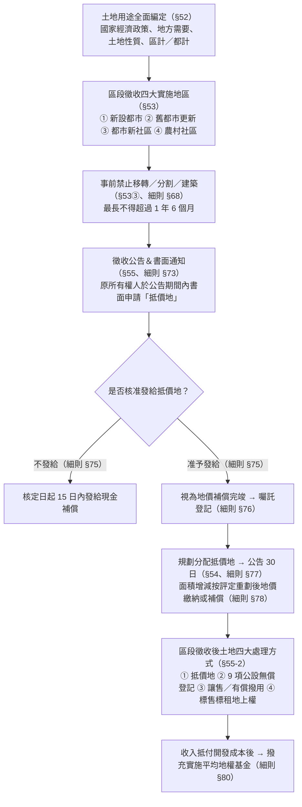

# 第 07 堂｜土地使用（上）：區段徵收與抵價地

> **涵蓋條文範圍**：《平均地權條例》§52～§55-2、《平均地權條例施行細則》§67～§80（細則 §81 起屬市地重劃，移至第 08 堂精講）
> **命題熱度**：★★★★★（**地政士國考〈土地法規〉超級核心考區！** 區段徵收四種實施地區、抵價地比例（50%／40%／45% 跨法對照）、申請抵價地程序與檢附文件（細則 §74）、不發給抵價地 15 日發放現金（細則 §75）、九項無償登記公設用地（§55-2、細則 §69），以及**「《平均地權條例》vs.《土地徵收條例》區段徵收」**與**「區段徵收 vs. 市地重劃」**比較，都是歷屆必考申論大題！）
> **跨科關聯**：〈土地法規〉（《土地徵收條例》第四章 §37～§48 區段徵收）、〈土地稅法規〉（§42-1 區段徵收免徵土增稅、抵價地第一次移轉減徵 40%）

---

## 一、 架構鳥瞰（1 分鐘看懂體系位置）

從本堂課開始進入《平均地權條例》第六章「**土地使用**」（§52～§79）。土地使用章節有兩大整體開發神器：**區段徵收**（本堂課）與**市地重劃**（第 08 堂）。所謂「區段徵收」，是政府將一定區域內的私有土地**全部徵收**、重新規劃整理興建公共設施，再把部分可供建築土地（**抵價地**）發還原所有權人折抵地價補償費，達到「政府取得公共設施、地主共享開發增值」的雙贏！

### 母法與施行細則條文對照地圖

| 主題模組 | 母法（條例） | 施行細則 | 考點星級 |
| :--- | :--- | :--- | :---: |
| 土地用途全面編定、區段徵收 4 地區與事前禁建 | §52、§53 | §67、§68 | ★★★★☆ |
| 公有土地有償／無償撥用與未登記土地處理 | — | §69、§69-1 | ★★★★☆ |
| 抵價地比例、申請程序、15 日發放現金與 30 日分配公告 | §54、§55 | §70～§78 | ★★★★★ |
| 原有租賃關係與他項權利清理（準用市地重劃） | §55-1 | §74、§76 | ★★★★☆ |
| 區段徵收後土地處分、9 項無償公設、優先買回與基金歸屬 | §55-2 | §79、§80 | ★★★★★ |

---

## 二、 白話精講（母法 × 施行細則整合）

### 主題 1：土地用途編定、區段徵收實施地區與事前禁止（條例 §52、§53；細則 §67～§69-1）★★★★☆

#### 1. 全面編定土地用途（條例 §52）
主管機關為促進土地合理使用並謀求經濟均衡發展，應依下列四項依據全面編定各種土地用途：① 國家經濟政策；② 地方需要情形；③ 土地所能提供使用之性質；④ 區域計畫及都市計畫之規定。

#### 2. 區段徵收四大實施地區與核准程序（條例 §53；細則 §67、§68）
各級主管機關得就下列**四類地區**報經核准後施行區段徵收（條例 §53 寫報行政院核准；現行實務依《土地徵收條例》§14 優先適用，改由**中央主管機關內政部**核准）：
1. **新設都市地區**之全部或一部，實施開發建設者。
2. **舊都市地區**為公共安全、公共衛生、公共交通之需要或促進土地之合理使用實施更新者。
3. **都市土地開發新社區**者。
4. **農村社區**為加強公共設施、改善公共衛生之需要者。

* **事前禁止移轉與建築（§53③、細則 §68）**：為防止地主在區段徵收公告前搶建、細分土地套利，徵收機關得報請上級主管機關核定公告，**禁止土地移轉、分割、設定負擔、新建／增建／重建建物、採取土石或變更地形**，禁止期間最長不得超過 **1 年 6 個月**。

#### 3. 區段徵收範圍內「公有土地」與「未登記土地」處理（細則 §69、§69-1 — 必背細節！）
* **無償撥用（9 項公設用地）**：區段徵收範圍內原屬公有之**道路、溝渠、公園、綠地、兒童遊樂場、廣場、停車場、體育場所、國民學校**等 9 項公共設施用地，應**無償撥用**！
  * *⚠️ 例外不無償*：**已列入償債計畫之公有土地、抵稅地及學產地**，不在此限（仍須有償撥用）。
* **有償撥用**：其餘公有土地應照**公告土地現值**有償撥用，統籌處理。
* **未登記土地（細則 §69-1）**：得視開發主體分別登記為國有、直轄市有或縣（市）有，並以徵收機關或其指定機關為管理機關。

---

### 主題 2：抵價地比例、申請程序、權利清理與分配公告（條例 §54、§55、§55-1；細則 §70～§78）★★★★★

這段是區段徵收的**靈魂考區**，每一個數字與程序都極愛入題！

#### 1. 抵價地總面積比例與計算（條例 §54；細則 §70、§71）
* **抵價地總面積比例（§54① — 跨法必考比較！）**：
  * **《平均地權條例》§54**：預計以抵價地抵付補償地價之總面積，占徵收總面積（不含公有土地）之比例，原則上**不得少於 50%**；但經上級主管機關核准者，得少於 50%。
  * **🔥 跨法連結《土地徵收條例》§39**：現行實務優先適用《土地徵收條例》§39，明定以徵收總面積 **50%** 為原則；因情況特殊經上級主管機關核准者，**不得少於 40%**；**曾經農地重劃者，不得少於 45%**！（*考場上把這三個數字 50%／40%／45% 一起寫出來，立刻拿滿分！*）
* **個人領回抵價地面積與不足最小建築單位面積（§54②③、細則 §70、§71）**：
  * 依原土地所有權人**應領補償地價**占徵收區內**徵收總地價**之比例，計算其應領抵價地之權利價值，再除以評定後之區段價／路線價算出面積。
  * 若應領抵價地面積**不足最小建築單位面積**（不得小於畸零地使用規則及都計規定）者，得申請合併分配，或改發給**現金補償**。

#### 2. 申請抵價地程序、他項權利清理與 15 日／30 日天數（條例 §55、§55-1；細則 §73～§78）
1. **申請期限（§55①、細則 §73）**：原土地所有權人不願領取現金補償者，應於**徵收公告期間內（30 日）**以書面申請發給抵價地。
2. **原有租約、他項權利與限制登記之清理（§55-1、細則 §74）**：
   * 依條例 §55-1，以抵價地抵付補償地價者，其原有租賃關係及他項權利，**準用市地重劃有關規定**處理。
   * 依細則 §74，申請發給抵價地時，若原土地訂有耕地租約、設定他項權利（地上權、抵押權、典權等）或限制登記者，應先提出**已依法補償、清償、回贖、同意塗銷之證明文件**，或法院塗銷限制登記囑託書、預告登記權利人同意塗銷文件（*亦即要先把地上的權利糾紛清乾淨，或依規定轉載，才能順利領回乾淨的抵價地！*）。
3. **核定結果與 15 日期限（細則 §75、§76 — 超級必考！）**：
   * **核定「准予發給抵價地」**：**視為地價補償完竣** → 地政機關囑託辦理所有權登記及他項權利塗銷或變更登記。
   * **核定「不發給抵價地」**：應於**核定之日起 15 日內**發給現金補償！
4. **分配結果公告 30 日與面積增減處理（細則 §77、§78）**：
   * 抵價地分配完畢後，地政機關應將分配結果**公告 30 日**，並以書面通知受分配之人。
   * 實際領回面積與應領面積有增減時（已達最小建築單位面積者），得徵得所有權人同意：**超過者**按評定重劃後地價**繳納差額地價**；**不足者**按評定重劃後地價**發給現金補償**。

---

### 主題 3：區段徵收後土地四大處分方式與基金歸屬（條例 §55-2；細則 §79、§80）★★★★★

區段徵收開發完成後，整片重劃好的土地該歸誰、怎麼賣？條例 §55-2 明確分成**四大類**：

1. **抵價地**：發交原土地所有權人領回（並享有 §42-1 領回免徵土增稅、首次移轉減徵 40% 優惠）。
2. **九項公共設施用地 — 無償登記為當地直轄市、縣（市）或鄉（鎮、市）有**：
   * 哪九項？**道路、溝渠、公園、綠地、兒童遊樂場、廣場、停車場、體育場所、國民學校**！（*記憶口訣*：**「道溝公綠兒、廣停體國小」**！）
3. **其他公共設施用地、國民住宅（社會住宅）用地及安置原住戶所需土地**：以**讓售**或**有償撥用**方式提供需地機關使用。
4. **其餘可供建築之土地（配餘地）**：得予**標售、標租或設定地上權**！
   * *（條例 §55-2 原訂「原所有權人領現金者之優先買回權」及細則 §79 計算方式，但現行《土地徵收條例》§44 已刪除優先買回權，考試若考跨法差異務必點出！）*
* **盈餘歸屬（細則 §80）**：出售區段徵收土地之地價收入，**抵付開發成本後，應全部撥充實施平均地權基金**；若有不足，亦由實施平均地權基金貼補之。

---

## 三、 考點對決（兩大跨法／跨制度超級比較表！）

### 比較表 1：《平均地權條例》區段徵收 vs. 《土地徵收條例》區段徵收（考場必考！）★★★★★

| 比較項目 | 平均地權條例（§53～§55-2） | 土地徵收條例（§4、§37～§48 — 現行優先適用） |
| :--- | :--- | :--- |
| **適用地區條件** | 4 款（新設都市、舊都市更新、都市新社區、農村社區） | 擴增為 **6 款**（增列非都市土地開發建設、農業區保護區變更為建築用地或工業區變更為住宅／商業區等），並增訂「先行區段徵收」 |
| **核准機關** | 行政院（§53①） | **中央主管機關（內政部）**（土徵條例 §14） |
| **地價補償標準** | 公告土地現值（舊制 §10） | **市價**（土徵條例 §30） |
| **抵價地總面積比例** | 原則 **50%**；經上級核准得少於 50%（未明定下限） | 原則 **50%**；情況特殊經上級核准**不得少於 40%**；曾經農地重劃者**不得少於 45%**（土徵條例 §39） |
| **領現金者優先買回權** | **有**（§55-2、細則 §79） | **已取消**（土徵條例 §44 無優先買回權，防弊炒作！） |

---

### 比較表 2：區段徵收（第 7 堂）vs. 市地重劃（第 8 堂預習）核心對決 ★★★★★

| 比較項目 | 區段徵收（合作開發＋公權力徵收） | 市地重劃（土地交換分合＋共同負擔） |
| :--- | :--- | :--- |
| **所有權變動** | 原土地所有權**全面徵收消滅**，再由政府發還抵價地（性質屬公權力徵收） | 所有權**未消滅**，僅透過交換分合重新分配土地（視為原有土地之延續） |
| **地主選擇權** | 可選擇領**現金補償**，或申請領**抵價地** | 原則上均領回重劃後土地（僅最小面積不足或差額始以現金找補） |
| **地主領回比例／負擔上限** | 抵價地總面積原則 **50%**（不低於 40%；曾農地重劃 45%） | 共同負擔原則上限 **45%**（故地主原則至少領回 **55%**！） |
| **辦理主體** | 僅限**政府（公辦）** | 可**公辦**，亦可由地主組織重劃會**自辦**！ |
| **土增稅優惠** | 領回抵價地免徵；**第一次移轉減徵 40%**（§42-1） | 重劃交換免徵；**第一次移轉減徵 40%**（§42③） |

---

## 四、 課後小測驗（地政士申論模擬演練）

### 模擬題 1（區段徵收條件、抵價地比例與 15 日／30 日程序題）
> **題目**：依《平均地權條例》及其施行細則規定（並對照《土地徵收條例》現行規定），請說明：(一) 實施區段徵收之法定地區有哪些？(二) 抵價地總面積占徵收總面積之比例規定為何？(三) 原土地所有權人申請發給抵價地之期限、核定「不發給」及「准予發給」之法律效果，以及抵價地分配完畢後之公告期間與面積增減處理方式各為何？（25 分）

👉 點此展開【擬答架構與得分關鍵字】

1. **實施區段徵收之法定地區（條例 §53）**：
   * ① 新設都市地區之全部或一部實施開發建設者；② 舊都市地區為公共安全、衛生、交通需要或促進合理使用實施更新者；③ 都市土地開發新社區者；④ 農村社區為加強公共設施、改善公共衛生需要者（現行實務併行《土地徵收條例》§4 之 6 款規定）。
2. **抵價地總面積比例（條例 §54；土徵條例 §39）**：
   * 依《平均地權條例》§54，原則不得少於徵收總面積（不含公有土地）之 **50%**，經上級主管機關核准得少於 50%。
   * 現行優先適用《土地徵收條例》§39：以 **50%** 為原則；情況特殊經上級主管機關核准**不得少於 40%**；**曾經農地重劃者，不得少於 45%**。
3. **申請抵價地程序、核定效果與分配處理（條例 §55；細則 §75～§78）**：
   * **申請期限**：徵收公告期間內（30 日）以書面提出申請。
   * **核定不發給（細則 §75）**：應於核定之日起 **15 日內**發給現金補償。
   * **核定准予發給（細則 §75、§76）**：**視為地價補償完竣**，由地政機關囑託辦理所有權登記及他項權利塗銷或變更登記。
   * **分配公告與增減處理（細則 §77、§78）**：分配結果應**公告 30 日**並書面通知；實際領回面積有增減時（達最小建築單位面積者），徵得所有權人同意，超過部分按評定重劃後地價**繳納差額地價**，不足部分發給**現金補償**。

---

### 模擬題 2（九項無償公設用地、土地處分與盈餘歸屬題）
> **題目**：依《平均地權條例》第 55 條之 2 及施行細則第 69 條、第 80 條規定，區段徵收範圍內之土地經規劃整理後，應如何處理？其中哪九項公共設施用地應無償登記為地方自治團體所有（或無償撥用）？又有哪三類公有土地例外不適用無償撥用？最後出售區段徵收土地之盈餘應歸屬何處？（25 分）

👉 點此展開【擬答架構與得分關鍵字】

1. **區段徵收後土地之四大處理方式（條例 §55-2）**：
   * ① **抵價地**：發交原土地所有權人領回。
   * ② **九項公共設施用地**：無償登記為當地直轄市、縣（市）或鄉（鎮、市）有。
   * ③ **其他公設用地、國民住宅（社會住宅）用地及安置原住戶用地**：讓售或有償撥供需地機關使用。
   * ④ **其餘可供建築土地（配餘地）**：得予標售、標租或設定地上權。
2. **九項無償登記／無償撥用之公共設施用地（細則 §69）**：
   * **道路、溝渠、公園、綠地、兒童遊樂場、廣場、停車場、體育場所、國民學校**（口訣：道溝公綠兒、廣停體國小）。
3. **三類例外不無償撥用之公有土地（細則 §69 但書）**：
   * **已列入償債計畫之公有土地、抵稅地及學產地**。
4. **地價收入盈餘歸屬（細則 §80）**：
   * 出售區段徵收土地之地價收入，抵付開發成本後，應全部撥充**實施平均地權基金**（不足時亦由該基金貼補）。

---

> **下堂課預告**：第 08 堂｜**土地使用（下）：市地重劃（公辦與自辦）**（條例 §56～§67；細則 §81～§102）— 地政士考試與區段徵收並列雙雄的必考大章！圖解「100 坪土地重劃後變幾坪？」、重劃負擔上限 45%、抵費地處分、地上物補償、他項權利與耕地租約清理，以及自辦市地重劃與獎勵！
