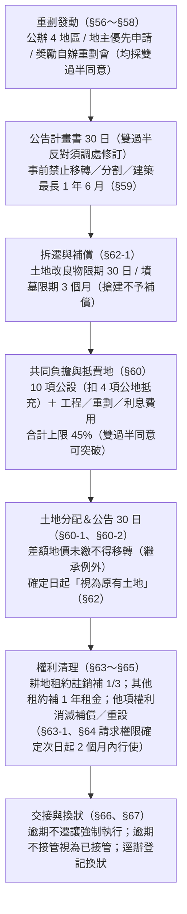

# 第 08 堂｜土地使用（下）：市地重劃（公辦與自辦）

> **涵蓋條文範圍**：《平均地權條例》§56～§67、《平均地權條例施行細則》§81～§92（並串聯《市地重劃實施辦法》與《獎勵土地所有權人辦理市地重劃辦法》核心考點）
> **命題熱度**：★★★★★（**與區段徵收並列地政士〈土地法規〉最強雙雄！** 市地重劃雙過半門檻、十項共同負擔公設用地與 45% 上限、抵費地、未繳差額地價禁止移轉（繼承例外）、改良物 30 日／墳墓 3 個月拆遷、耕地租約 1/3 補償、其他租約 1 年租金補償、他項權利消滅與 **2 個月請求權期限**，全部都是年年必考的黃金申論題！）
> **跨科關聯**：〈土地法規〉（區段徵收 §55-1 準用市地重劃權利清理）、〈土地稅法規〉（§42③ 重劃後第一次移轉土增稅減徵 40%、重劃期間免徵地價稅與重劃後減半 2 年）

---

## 一、 架構鳥瞰（1 分鐘看懂市地重劃全流程）

「市地重劃」是把都市裡畸零不整、缺乏道路公園的土地，透過「**交換分合**」重新整理成方正建地並開闢公共設施，由全體地主共同分擔公設用地與開發費用（以未建築土地折價抵付，稱**抵費地**），地主雖然面積變小，但地價大幅上漲且所有權延續不斷！

### 母法與施行細則條文對照地圖

| 主題模組 | 母法（條例） | 施行細則 | 考點星級 |
| :--- | :--- | :--- | :---: |
| 公辦／地主申請／自辦市地重劃、雙過半與事前禁建 | §56、§57、§58、§59 | — | ★★★★★ |
| 十項公設、四項抵充、共同負擔上限 45% 與抵費地 | §60 | §81、§82、§84、§84-1 | ★★★★★ |
| 土地分配、差額地價、30 日公告確定、交接與換狀 | §60-1、§60-2、§61、§62、§66、§67 | — | ★★★★★ |
| 地上物／墳墓拆遷、耕地／其他租約、他項權利與 2 個月期限 | §62-1、§63、§63-1、§64、§64-1、§65 | §91、§92 | ★★★★★ |

---

## 二、 白話精講（母法 × 施行細則整合）

### 主題 1：公辦與自辦市地重劃、雙過半門檻與事前禁建（條例 §56～§59）★★★★★

#### 1. 公辦市地重劃四大地區與反對調處（§56）
* **四大實施地區（§56①）**：報經上級主管機關核准後辦理：
  1. **新設都市地區**之全部或一部，實施開發建設者。
  2. **舊都市地區**為公共安全、公共衛生、公共交通或促進土地合理使用之需要者。
  3. **都市土地開發新社區**者。
  4. **經中央主管機關指定限期辦理**者（*對照區段徵收第 4 款是「農村社區」，市地重劃第 4 款是「中央指定限期辦理」，別背混！*）。
* **公告 30 日與雙過半反對（§56②③）**：重劃計畫書核定後**公告滿 30 日**實施；公告期間內若有私有地主**人數半數以上，且其所有土地面積超過區內私有土地總面積半數**（簡稱「**雙過半**」）表示反對，主管機關應予調處並參酌反對理由修訂計畫書重行報核。

#### 2. 地主優先申請公辦（§57）與獎勵自辦市地重劃（§58）
* **優先申請公辦（§57）**：私有地主**雙過半同意**，得申請地方政府核准優先實施市地重劃。
* **獎勵自辦市地重劃（§58 — 必背獎勵與門檻！）**：
  * **同意門檻**：由重劃區內私有地主**雙過半同意**（人數過半＋面積過半），組織「**重劃會**」報請主管機關核准實施。
  * **四大法定獎勵**：① 給予低利重劃貸款；② 免收或減收地籍整理規費及換發權利書狀費用；③ 優先興建重劃區及其相關地區之公共設施；④ 免徵或減徵地價稅與田賦（搭配《土地稅減免規則》：重劃期間不能耕作或無法使用者免徵地價稅，重劃完成後減半徵收 2 年！）。

#### 3. 事前禁止移轉與建築（§59）
重劃地區選定後，地方政府得報上級核定公告禁止土地移轉、分割、設定負擔、新建、增建、改建及採取土石或變更地形，**禁止期間不得超過 1 年 6 個月**。

---

### 主題 2：十項公設、共同負擔上限 45% 與抵費地（條例 §60；細則 §81～§84-1）★★★★★

這條是市地重劃**最核心、最愛出計算與申論的超級大條文**！

#### 1. 共同負擔的「兩大塊」與「四項抵充」（§60①；細則 §82）
1. **公共設施用地負擔（十項公設用地）**：
   * 哪十項？**道路、溝渠、兒童遊樂場、鄰里公園、廣場、綠地、國民小學、國民中學、停車場、零售市場**。
   * *記憶口訣*：**「道溝兒鄰廣綠、國小國中停市」**！
   * **先以四項公有土地抵充**：原公有之**道路、溝渠、河川及未登記地**（口訣：**道、溝、川、未**）優先抵充，不足的部分才由參加重劃之地主按受益比例共同負擔！
   * *（非共同負擔之其他公設用地，以區內公有土地優先指配，§60②）*
2. **費用負擔（三項費用）**：
   * **工程費用**（規劃設計、施工、整地、材料、工程管理費、空污費等）
   * **重劃費用**（拆遷補償費、地籍整理費、業務費）
   * **貸款利息**

#### 2. 抵費地與 45% 天花板（§60①③；細則 §84、§84-1）
* **抵費地意義**：地主不用掏現金出來付公設與工程費，而是用重劃區內未建築土地**折價抵付**（即「**抵費地**」）；無未建築土地者才改以現金繳納，逾期不繳移送法院強制執行。
* **45% 共同負擔上限（§60③ — 必背！）**：折價抵付共同負擔之土地合計面積，以**不超過各該重劃區總面積 45%** 為限！
  * **但書例外**：經重劃區內私有土地所有權人**雙過半同意**（人數半數以上且面積超過半數）者，不在此限！
* **抵費地處分與盈餘專戶（細則 §84、§84-1）**：抵費地可按底價讓售作為社會住宅用地、公共事業用地或經行政院專案核准所需用地，其餘公開標售；盈餘半數留供該重劃區增加建設、管理、維護之用（專戶設立滿 15 年裁撤）。

> **【圖解實務案例】100 坪土地參加市地重劃，重劃後到底變幾坪？虧了還是賺了？**
> 假設老陳在某重劃區擁有 **100 坪** 農地／畸零地，重劃前地價每坪 10 萬元（總價值 **1,000 萬元**）。
> * 該重劃區之**公共設施用地負擔比例為 30%**，**費用負擔比例為 12%** → **總共同負擔比例 ＝ 42%**（未超過 45% 上限！）。
> * **重劃後老陳領回幾坪？**
>   $$100\text{ 坪} \times (1 - 42\%) = \mathbf{58\text{ 坪方正建地}}$$
> * **老陳是虧還是賺？**
>   重劃完成後，道路、公園、學校全都蓋好，土地變成方正建地，每坪市價飆漲到 **35 萬元**！老陳 58 坪總價值高達 **$58 \times 35\text{ 萬} = \mathbf{2,030\text{ 萬元}}$**（資產翻倍！），且日後首次出售還享有土增稅**減徵 40%** 優惠（§42③）！這就是市地重劃讓地主趨之若鶩的秘密！

---

### 主題 3：土地分配、差額地價、30 日公告確定與法律效力（條例 §60-1～§62、§66、§67）★★★★★

1. **土地分配與差額地價（§60-1）**：
   * 扣除共同負擔土地後，其餘土地依各宗土地**地價數額比例**分配予原所有權人（未達最小分配面積標準不能分配者，得以現金補償）。
   * 實際分配面積多於應分配面積者 → **繳納差額地價**（逾期移送法院強制執行）；少於者 → **發給差額地價**。
   * **🔥 超級必考陷阱（§60-1④）**：**「未繳納差額地價之土地，不得移轉。但因繼承而移轉者，不在此限。」**
2. **分配結果公告 30 日與異議調處（§60-2）**：
   * 分配完畢後**公告 30 日**並通知所有權人；未提異議者於公告期滿確定。
   * 公告期間書面提異議 → 主管機關**調處**；調處不成 → 報請**上級主管機關裁決**。
3. **重劃後土地之法律效力（§62 — 必背法條金句！）**：
   * 市地重劃後重行分配予原土地所有權人之土地，**自分配結果確定之日起，視為其原有之土地**！（但行政上或判決上處分效力與原土地性質不可分者除外）。
4. **交接與換狀（§66、§67）**：
   * 書面通知限期遷讓或接管：**逾期不遷讓** → 移送法院強制執行；**逾期不接管** → 自限期屆滿之日起，**視為已接管**！
   * 重劃機關重新編號列冊送登記機關**逕為辦理權利變更登記**並換發書狀；未於期限內換領者，**宣告原書狀無效**。

---

### 主題 4：地上物拆遷、租約與他項權利清理（條例 §62-1～§65；細則 §91～§92）★★★★★

這一段是市地重劃**申論題最愛考的權利清理大魔王**，請把每一個「期限」與「補償標準」死記起來！

| 清理對象 | 條文依據 | 具體處理方式與補償標準 | 請求權期限 / 特別注意 |
| :--- | :---: | :--- | :--- |
| **應拆遷土地改良物／墳墓** | §62-1 | 公告並通知自行拆除／遷葬：**土地改良物限期 30 日內**、**墳墓限期 3 個月內**；逾期代為拆除遷葬並於補償金扣回費用 | 違反 §59 公告禁止事項搶建者，**不予補償**！ |
| **出租耕地租約（公、私有）** | §63 | 不能達原租賃目的 → 地方政府**逕為註銷租約**並通知： ① **重劃後分配土地**：承租人向出租人請求計畫書公告當期公告現值 **1/3** 補償 ② **未受分配土地**：補償地價出租人領 **2/3**、承租人領 **1/3** ③ **公有出租農地抵充公設**：按公告現值 **1/3** 補償承租人，列為**重劃共同負擔** | 注意：與 §11（徵收）及 §77（終止租約）不同，重劃 §63① 是直接按公告現值 **1/3**（**不扣土增稅**，因為重劃沒課土增稅！） |
| **其他土地租約（非耕地）** | §63-1 | 不能達原租賃目的 → 承租人得**終止租約**並請求相當 **1 年租金**之補償；增減利用價值 → 雙方得請求變更租約及增減相當租金 | **重劃分配結果確定之次日起 2 個月內**行使（§65）！ |
| **用益物權（地上、農育、永佃、不動產役權）** | §64① | 不能達設定目的 → 各該權利**視為消滅**；權利人得向土地所有權人請求**相當之補償** | **分配結果確定次日起 2 個月內**行使（§65）！ |
| **建物擔保物權（抵押權、典權）** | §64②、§64-1 | 建物抵押權／典權不能達設定目的 → **視為消滅**；得向地主請求**以其分配之土地設定抵押權或典權**（未受分配者由重劃機關在補償數額內協調清理） | **分配結果確定次日起 2 個月內**行使（§65）！ |

---

## 三、 考點對決（兩大易混淆比較表！）

### 比較表 1：區段徵收 9 項無償公設 vs. 市地重劃 10 項共同負擔公設（必考細節！）★★★★★

| 項目 | 區段徵收 9 項無償公設（§55-2、細則 §69） | 市地重劃 10 項共同負擔公設（§60①） |
| :--- | :---: | :---: |
| **共同項目（8 項）** | 道路、溝渠、兒童遊樂場、廣場、綠地、停車場、國民小學（國民學校）、公園 | 道路、溝渠、兒童遊樂場、廣場、綠地、停車場、國民小學、**鄰里公園** |
| **獨有項目（必背差異！）** | **體育場所**（＋1 項 ＝ 共 9 項） | **國民中學、零售市場**（＋2 項 ＝ 共 10 項） |

---

### 比較表 2：出租耕地「1/3 補償」三種情形大集合（跨章必考！）★★★★★

| 發生原因 | 條文依據 | 補償基準（有無扣除土增稅？） | 誰給錢？ |
| :--- | :---: | :--- | :--- |
| **1. 依法徵收** | §11（第 1 堂） | 公告土地現值**扣除土增稅後餘額 1/3**（實務因徵收免徵土增稅，即為補償地價 1/3） | 徵收機關於補償地價內代為扣交 |
| **2. 市地重劃註銷租約** | §63（第 8 堂） | 重劃計畫書公告當期**公告土地現值 1/3**（未分配者領補償地價 1/3） | 出租人（公有地抵充公設則列為共同負擔） |
| **3. 編為建築用地終止租約** | §77（第 9 堂預習） | 終止租約當期公告土地現值**扣除土地增值稅後餘額 1/3** | 出租人（地主） |

---

## 四、 課後小測驗（地政士申論模擬演練）

### 模擬題 1（共同負擔 10 項公設、45% 上限與差額地價綜合題）
> **題目**：依《平均地權條例》第 60 條及第 60 條之 1 規定，實施市地重劃時，土地所有權人應共同負擔之公共設施用地有哪十項？哪四項公有土地應優先抵充？折價抵付共同負擔土地之面積上限為何，有無例外？又土地所有權人未繳納差額地價時，其土地移轉有何限制？（25 分）

👉 點此展開【擬答架構與得分關鍵字】

1. **十項共同負擔公共設施用地與四項抵充（條例 §60①）**：
   * **十項公設**：道路、溝渠、兒童遊樂場、鄰里公園、廣場、綠地、國民小學、國民中學、停車場、零售市場。
   * **四項優先抵充公地**：原公有道路、溝渠、河川及未登記地。
2. **共同負擔土地面積上限與例外（條例 §60③）**：
   * 折價抵付共同負擔之土地（抵費地）合計面積，以**不超過各該重劃區總面積 45%** 為限。
   * **例外**：經重劃區內私有土地所有權人**半數以上，且其所有土地面積超過區內私有土地總面積半數**（雙過半）同意者，不在此限。
3. **未繳納差額地價之移轉限制與例外（條例 §60-1④）**：
   * **未繳納差額地價之土地，不得移轉**（且逾期未繳納者得移送法院強制執行）。
   * **例外但書**：**因繼承而移轉者，不在此限**。

---

### 模擬題 2（市地重劃之地上物拆遷、耕地租約、其他租約與他項權利清理題）
> **題目**：依《平均地權條例》第 62 條之 1 至第 65 條規定，辦理市地重劃時：(一) 應拆遷之土地改良物與墳墓，自行拆遷之法定期限各為何？(二) 出租耕地租約與其他非耕地租約因重劃不能達原租賃目的時，各應如何處理與補償？(三) 地上權及建物抵押權因重劃不能達設定目的時，法律效果及請求權行使期限各為何？（25 分）

👉 點此展開【擬答架構與得分關鍵字】

1. **應拆遷土地改良物與墳墓之期限（條例 §62-1）**：
   * **土地改良物**：限期 **30 日內**自行拆除；**墳墓**：限期 **3 個月內**自行遷葬（逾期代拆遷並扣回費用；違反 §59 禁建規定者不予補償）。
2. **出租耕地與其他土地租約之處理與補償（條例 §63、§63-1）**：
   * **出租耕地（§63）**：地方政府**逕為註銷租約**；① 分配土地者，承租人向出租人請求重劃計畫書公告當期公告土地現值 **1/3** 補償；② 未受分配者，補償地價出租人領 **2/3**、承租人領 **1/3**；③ 公有出租農地抵充公設者，按公告現值 1/3 補償並列入共同負擔。
   * **其他土地租約（§63-1）**：承租人得**終止租約**，並向出租人請求相當 **1 年租金**之補償（增減利用價值者得請求變更租約及增減相當租金）。
3. **他項權利之法律效果與請求權行使期限（條例 §64、§65）**：
   * **地上權等用益物權（§64①）**：**視為消滅**，權利人得向土地所有權人請求**相當之補償**。
   * **建物抵押權、典權（§64②）**：**視為消滅**，權利人得向地主請求**以其所分配之土地設定抵押權或典權**。
   * **請求權行使期限（§65）**：§63-1 及 §64 請求權，均應於**重劃分配結果確定之次日起 2 個月內**為之。

---

> **下堂課預告**：第 09 堂｜**土地使用其餘限制與耕地租約終止**（條例 §68～§79；細則 §93～§102）— 破解私有未建築用地最高面積 **10 公畝** 限制，以及萬年必考大題：**出租耕地因都市計畫編為建築用地終止租約（§76～§78）**之「扣除土增稅後餘額 1/3」補償計算與程序！
