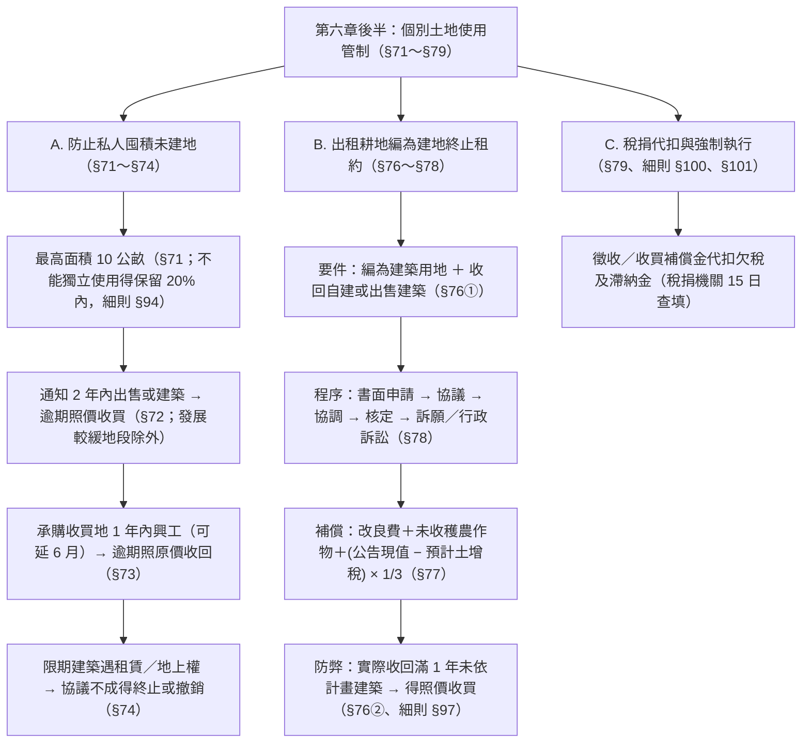

# 第 09 堂｜土地使用其餘限制與耕地租約終止

> **涵蓋條文範圍**：《平均地權條例》§68～§79（§68～§70、§75 已刪除；§79-1 私法人購屋許可制已於第 06 堂精講）、《平均地權條例施行細則》§93～§101（細則共 102 條，§100～§101 屬附則但直接配合 §78、§79 實務運作，於本堂一併整合！）
> **命題熱度**：★★★★☆（**§76～§78「出租耕地因依法編為建築用地終止租約」是地政士〈土地法規〉萬年必考超級大題！** 扣除土增稅後餘額 1/3 補償計算、協議→協調→核定→行政救濟程序、實際收回屆滿 1 年未建照價收買，以及 **§71～§74 私有未建築用地最高 10 公畝限制**與**承購照價收買地 1 年興工建築（逾期照原價收回）**，都是必背高分區！）
> **跨科關聯**：〈土地法規〉（《耕地三七五減租條例》§13 改良通知、§17 耕地終止租約比較）、〈土地稅法規〉（§77 預計土地增值稅計算、§79 補償金代為扣繳欠稅）

---

## 一、 架構鳥瞰（1 分鐘看懂體系位置）

本堂課是第六章「土地使用」的壓軸！在學完區段徵收與市地重劃兩大整體開發工具後，§71～§79 處理的是「**個別私有土地囤地不建**」以及「**都市擴張時，出租農地變更為建地該如何合法收回並保障佃農權益**」兩大實務難題：

### 母法與施行細則條文對照地圖

| 主題模組 | 母法（條例） | 施行細則 | 考點星級 |
| :--- | :--- | :--- | :---: |
| 私有尚未建築用地最高面積 10 公畝、2 年限期與收買後 1 年興工 | §71、§72、§73 | §93、§94、§95、§96 | ★★★★☆ |
| 限期建築空地遇租賃／借貸／地上權之協議與終止 | §74 | — | ★★★☆☆ |
| 出租耕地編為建地終止租約、1/3 補償計算與申請協調程序 | §76、§77、§78 | §97、§98、§99、§101 | ★★★★★ |
| 徵收或照價收買補償金代為扣繳欠稅及滯納金 | §79 | §100 | ★★★☆☆ |

---

## 二、 白話精講（母法 × 施行細則整合）

### 主題 1：私有未建築用地 10 公畝上限與收買後 1 年興工（條例 §71～§74；細則 §93～§96）★★★★☆

#### 1. 尚未建築私有建築用地之最高面積限制（條例 §71；細則 §93～§95）
* **最高額原則（§71①②）**：地方政府對於**尚未建築之私有建築用地**，應限制土地所有權人所有面積之最高額，以 **10 公畝**（1,000 ㎡ ≈ 302.5 坪）為限！
* **兩大例外排除與扣除（§71②③）**：
  1. **專案核定用地**：**工業用地、學校用地及經政府核准之大規模建築用地**，視實際需要分別訂定（細則 §95：欲保留者應於接獲通知次日起 **1 年內**擬具建築使用計畫書報核）。
  2. **法令限建扣除**：因**法令限制不能建築**之土地，應予扣除不計入 10 公畝。
* **🔥 細則 §94 細節考點（20% 彈性保留）**：清查時，超過 10 公畝之部分若**不能供獨立使用**者，得視土地坵形為 **20% 以內之保留**（最多留至 12 公畝）；但足供獨立使用者，仍嚴守 10 公畝上限！

#### 2. 超額土地限期 2 年出售或建築（條例 §72；細則 §96）
* 超過 10 公畝之土地，地方政府應通知地主於 **2 年內**出售或建築使用；**逾期未出售或未建築使用者，得予照價收買**（按公告收買當期公告土地現值，§31③），整理後出售與需用土地人建築使用。
* **但書例外**：在**建設發展較緩之地段**（細則 §96：指公共設施尚未完竣地區或依法不得核發建照地區），不在此限。

#### 3. 承購照價收買地之「1 年興工＋原價收回」條款（條例 §73 — 數字必背！）
* 依 **§26（空地）、§72（超額未建地）、§76（耕地終止未建）**照價收買後再出售之土地，以及依 §55-2①⑤ 出售之土地，承購人應自**承購之日起 1 年內興工建築**。
* 逾期不建築，亦未報准延期建築（**延期期限不得逾 6 個月**）者，地方政府得**照原價收回**！（防止政府好不容易收買賣給人，新買家又拿去囤地！）

#### 4. 限期建築空地遇租約、借貸或地上權之處理（條例 §74）
依 §26 限期建築之土地，若有出租、貸與或設定地上權（或地上建物出租貸與他人）者，地主應於接到限期使用通知後與承租人、借用人或地上權人**協議建築、增建或改建**；**協議不成時，得終止租約、借貸或撤銷地上權**。

---

### 主題 2：萬年必考大魔王 — 出租耕地編為建地終止租約（條例 §76～§78；細則 §97～§99、§101）★★★★★

台灣早年許多農地訂有三七五耕地租約，後來都市計畫擴大，這些農地搖身一變成為住宅區或商業區（建地），地主想收回蓋房子，佃農卻靠這塊地維生！條例 §76～§78 建立了最經典的「**合法終止租約＋給佃農 1/3 補償＋滿 1 年不蓋就照價收買**」三部曲！

#### 1. 終止租約之要件與「1 年未建照價收買」（條例 §76；細則 §97）
* **終止要件（§76①）**：出租耕地經**依法編為建築用地**者，出租人為**收回自行建築**或**出售作為建築使用**時，得終止租約。
* **防弊反制（§76②）**：依前項終止租約，**實際收回耕地屆滿 1 年後，不依照使用計畫建築使用者，直轄市或縣（市）政府得照價收買之**！
* **「滿 1 年」起算點（細則 §97 — 必背細節！）**：
  1. **協議終止者**：自**達成協議之次日**起算。
  2. **主管機關核定終止者**：自**核定終止租約送達之次日**起算。

#### 2. 給承租人之「三大法定補償」（條例 §77；細則 §98）★★★★★
地主終止租約收回耕地時，必須給承租人三項補償：
1. **改良土地所支付之費用**：但以承租人已依《耕地三七五減租條例》§13 規定**以書面通知出租人者為限**（§77②，未通知地主自己亂花錢的不算！）。
2. **尚未收穫之農作改良物**。
3. **地價三分之一補償（核心計算公式！）**：
   $$\text{承租人 1/3 補償費} = \Big(\text{申請終止租約當期之公告土地現值} - \text{預計土地增值稅}\Big) \times \frac{1}{3}$$
   * **細則 §98①**：所稱「申請終止租約當期之公告土地現值」，係指地主依 §78 以書面提出申請終止租約**收件當期**之公告土地現值！
   * **公有出租耕地比照辦理（§77③、細則 §98②）**：公有出租耕地終止租約時，亦應依照第 1 項規定補償承租人，其預計土地增值稅及補償，**按照同條件之私有土地方式辦理**！

> **【實務計算案例】終止耕地租約 1/3 補償怎麼算？**
> 老林有一筆訂有三七五租約之私有耕地，因都市計畫變更為住宅區，老林於今年向縣政府書面申請終止租約收回自建。申請收件當期之**公告土地現值總額為 1,500 萬元**，經試算該筆土地之**預計土地增值稅為 300 萬元**；此外承租人阿農曾書面通知老林並投入改良土地費用 **40 萬元**，地上尚有未收穫稻作價值 **20 萬元**。請問老林總計須補償阿農多少元？
> * **Step 1：計算 1/3 餘額補償**：$(1,500\text{ 萬} - 300\text{ 萬}) \times \frac{1}{3} = 1,200\text{ 萬} \times \frac{1}{3} = \mathbf{400\text{ 萬元}}$。
> * **Step 2：加上合法通知之改良費與未收穫農作物**：$400\text{ 萬} + 40\text{ 萬} + 20\text{ 萬} = \mathbf{460\text{ 萬元}}$！

#### 3. 終止租約之「四階段法定程序」與強制執行（條例 §78；細則 §99、§101）★★★★★
1. **書面申請**：由土地所有權人以書面向直轄市或縣（市）政府提出申請。
2. **審核協議 / 邀集協調**：已與承租人協議成立者 → 准予終止租約；尚未達成協議者 → 主管機關應即**邀集雙方協調**。
3. **主管機關核定與救濟**：承租人拒不接受協調或對補償金額有爭議時，由地方政府依 §77 規定**予以核定**；不服核定者，得依法提起**訴願或行政訴訟**。
4. **逕辦終止租約登記與返還強制執行（細則 §99、§101）**：
   * 承租人領取補償費，或補償費依法**提存**後，主管機關**逕行辦理終止租約登記**（細則 §99）。
   * 承租人拒不返還耕地，移送法院裁定及強制執行時，以**出租人**為聲請人（細則 §101②；相對地，§30、§60、§60-1、§66 之強制執行是以**移送機關**為聲請人！）。

---

### 主題 3：被徵收或照價收買土地之稅捐代為扣繳（條例 §79；細則 §100）★★★☆☆

* **代為扣繳原則（§79）**：被徵收或照價收買之土地，**應納未納之土地稅捐及滯納金**，由地方政府於發放補償金時**代為扣繳**，並以餘款交付原土地所有權人。
* **範圍與 15 日查填期限（細則 §100）**：代扣範圍以**該被徵收或照價收買土地本身應納未納者為限**（不可拿 A 地的補償金去扣地主欠繳 B 地的稅！）；稅捐稽徵機關應於收到補償清冊後 **15 日內**查填欠稅及土增稅額函復。

---

## 三、 考點對決（易混淆觀念比較表＋口訣）

### 比較表 1：《平均地權條例》§76～§78 vs. 《耕地三七五減租條例》§17 終止租約對照 ★★★★☆

| 比較項目 | 平均地權條例（§76～§78） | 耕地三七五減租條例（§17） |
| :--- | :--- | :--- |
| **適用前提** | 出租耕地經依法**編為建築用地**，出租人收回自建或出售建築 | 涵蓋 5 款終止事由（承租人死亡無繼承人、放棄耕作、積欠地租達 2 年、非因不可抗力繼續 1 年不耕作、**經依法編定或變更為非耕地使用**） |
| **終止補償內容** | ① 書面通知之土地改良費 ② 尚未收穫之農作改良物 ③ **(公告現值 − 預計土增稅) × 1/3** | 依第 5 款（變更為非耕地）終止者，補償項目與公式**完全相同**（改良費＋未收穫農作＋扣土增稅後餘額 1/3） |
| **特別反制規定** | 實際收回耕地**屆滿 1 年**不依使用計畫建築使用者，政府得**照價收買**（§76②） | 無照價收買規定 |
| **公有出租耕地** | **適用**（§77③ 明定公有出租耕地終止租約比照補償） | 準用 |

---

### 比較表 2：本堂課所有「期限與數字」速查表 ★★★★☆

| 數字／期限 | 法條依據 | 對應內容 |
| :---: | :---: | :--- |
| **10 公畝**（＋20% 彈性） | §71、細則 §94 | 尚未建築私有建築用地最高面積限額（不能獨立使用部分得視坵形保留 20% 以內） |
| **2 年** | §72 | 超額未建築私有地通知出售或建築使用期限（逾期得照價收買） |
| **1 年**（延期不得逾 **6 月**） | §73 | 承購照價收買再出售地之興工建築期限（逾期照原價收回） |
| **1 年** | §76②、細則 §97 | 出租耕地終止租約實際收回後須依計畫建築期限（逾期得照價收買） |
| **15 日** | 細則 §100 | 稅捐稽徵機關查填被徵收／收買土地欠稅及土增稅額函復期限 |

---

## 四、 課後小測驗（地政士申論模擬演練）

### 模擬題 1（出租耕地編為建築用地終止租約全攻略題）
> **題目**：依《平均地權條例》第 76 條至第 78 條及施行細則相關規定，出租耕地經依法編為建築用地時，請說明：(一) 出租人得終止租約之要件及收回後不建築之法律效果為何？(二) 出租人終止租約應給予承租人哪三項補償？若為公有出租耕地應如何辦理？(三) 終止租約之申請、協調、核定與登記程序為何？（25 分）

👉 點此展開【擬答架構與得分關鍵字】

1. **終止要件與滿 1 年未建之效果（條例 §76；細則 §97）**：
   * **要件**：出租耕地經依法編為建築用地，出租人為**收回自行建築**或**出售作為建築使用**時，得終止租約。
   * **效果**：實際收回耕地**屆滿 1 年**後（協議終止自達成協議次日起算；核定終止自核定送達次日起算），不依照使用計畫建築使用者，地方政府得**照價收買**之。
2. **三項法定補償與公有耕地（條例 §77；細則 §98）**：
   * ① 承租人為改良土地所支付之費用（以已依耕地三七五減租條例 §13 **書面通知出租人者為限**）。
   * ② 尚未收穫之農作改良物。
   * ③ 就申請終止租約**收件當期之公告土地現值**，減除**預計土地增值稅**後餘額之 **1/3**。
   * **公有出租耕地（§77③、細則 §98②）**：應比照第 1 項規定補償耕地承租人，預計土增稅與補償按照同條件之私有土地方式辦理。
3. **程序與登記（條例 §78；細則 §99、§101）**：
   * 地主書面申請 → 審核協議成立准予終止；未達協議即邀集雙方協調 → 承租人拒不接受協調或對補償有爭議時，由地方政府依 §77 核定 → 不服核定得提訴願或行政訴訟。
   * 承租人領取補償費或依法提存後，主管機關**逕行辦理終止租約登記**；承租人拒不返還耕地聲請法院強制執行時，以**出租人**為聲請人。

---

### 模擬題 2（私有未建築用地 10 公畝上限＋承購收買地 1 年興工題）
> **題目**：依《平均地權條例》第 71 條至第 73 條及施行細則相關規定，請問：(一) 尚未建築之私有建築用地最高面積限制為多少？有哪些排除、扣除及保留彈性？(二) 超額土地逾期未出售或未建築之效果為何？有何但書例外？(三) 承購政府依本條例照價收買後再出售之土地，承購人應於多久內興工建築？逾期未建有何效果？（25 分）

👉 點此展開【擬答架構與得分關鍵字】

1. **最高面積限制與彈性（條例 §71；細則 §94、§95）**：
   * **最高額**：以 **10 公畝**為限。
   * **分別訂定例外**：工業用地、學校用地及經政府核准之大規模建築用地視實際需要分別訂定（欲保留者於通知次日起 1 年內擬具計畫書報核）。
   * **法令扣除**：因法令限制不能建築之土地應予扣除。
   * **20% 彈性保留（細則 §94）**：超過 10 公畝部分不能供獨立使用者，得視土地坵形為 **20% 以內之保留**。
2. **超額土地處理與但書例外（條例 §72；細則 §96）**：
   * 通知地主於 **2 年內**出售或建築使用；逾期得予**照價收買**，整理後出售與需用土地人建築使用。
   * **但書**：在**建設發展較緩之地段**（公設尚未完竣地區或依法不得核發建照地區），不在此限。
3. **承購收買再出售地之興工期限與效果（條例 §73）**：
   * 承購人應自承購之日起 **1 年內**興工建築（報准延期建築不得逾 **6 個月**）；逾期不建築亦未報准延期者，地方政府得**照原價收回**。

---

> **下堂課預告**：第 10 堂（完結篇）｜**罰則、附則與申論實戰總複習**（條例 §80～§87；細則 §100～§102）— 一次打包全法所有罰則金額對照表（實價登錄、紅單、換約、炒作 5,000 萬、檢舉獎金）、附則重點，並附上歷屆地政士經典申論題破題模板總複習！
