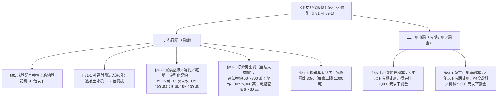

# 第 10 堂（完結篇）｜罰則、附則與申論實戰總複習

> **涵蓋條文範圍**：《平均地權條例》§80～§87（§80、§82、§84 已刪除）、《平均地權條例施行細則》§100～§102（附則）＋ **全套 10 堂課申論實戰總複習**
> **命題熱度**：★★★★☆（**§81-2 實價登錄與紅單罰則、§81-3 違法換約與炒作重罰 5,000 萬＋法人兩罰、§81-4 檢舉獎金制度、§81-1 社福捐贈追補 2 倍罰鍰，以及 §83、§83-1 刑事責任**，常搭配第 6 課與第 8 課出成 25 分完整申論大題！）
> **跨科關聯**：〈土地法規〉（全法橫向串聯：土地法、土地徵收條例、地政士法）、〈土地稅法規〉（土地稅法罰則對照）

---

## 一、 架構鳥瞰（1 分鐘看懂第七章罰則 × 第八章附則）

來到《平均地權條例》的最後兩章！如果沒有罰則當後盾，前面九堂課的實價登錄、打炒房、市地重劃與社福免稅就會淪為無牙老虎。本堂課先用一張架構圖把「**行政罰（罰鍰）**」與「**刑事罰（有期徒刑／罰金）**」徹底分清楚：

---

## 二、 白話精講（第七章罰則 × 第八章附則）

### 主題 1：傳統行政罰 — 未登記轉售與社福財團法人違規（條例 §81、§81-1）★★★★☆

1. **未辦移轉登記再行出售（條例 §81）**：
   * 土地買賣**未辦竣權利移轉登記**，承買人**再行出售**該土地者（俗稱「中間省略登記」逃漏登記費與稅負），處**應納登記費 20 倍以下**之罰鍰！
   * *（與《土地法》§73 逾期申請登記罰鍰相同上限為 20 倍，但處罰行為不同：土地法 §73 是逾期申請，平均地權條例 §81 是未登記再轉售！）*
2. **社會福利事業財團法人違規處罰（條例 §81-1 — 必背三款！）**：
   * 依 §35-1 受贈免徵土增稅土地之財團法人，有下列情形之一者，除**追補應納之土地增值稅**外，並處**應納土地增值稅額 2 倍**之罰鍰：
     1. **未按捐贈目的使用土地**者。
     2. **違反各該事業設立宗旨**者。
     3. **土地收益未全部用於各該事業**者。

---

### 主題 2：最新打炒房與實價登錄重罰總表（條例 §81-2、§81-3、§81-4）★★★★★

這三條是民國 110 年與 112 年修法的重頭戲，考場上最容易混淆「**規避查核的罰鍰金額**（§81-2 是 3～15 萬，§81-3 是 6～30 萬！）」與「**兩罰規定**」，請直接看這張終極對照表：

| 條文依據 | 違規行為類型 | 罰鍰金額與處罰單位 | 累進加重 / 特別機制 |
| :--- | :--- | :--- | :--- |
| **§81-2①②** | 成屋未共同申報實價登錄（屆期未申報且已辦竣移轉登記）、價格不實；預售屋未依限申報、價格／面積／**解約**資訊不實 | **3 萬～15 萬元** （含建物者按戶／棟處罰） | 限期改正屆期未改按次處罰；**經處罰 2 次仍未改正者，加重為 30 萬～100 萬元**！ |
| **§81-2③** | 實價登錄查核中，金融機構、權利人、義務人、地政士或經紀業**規避、妨礙或拒絕查核** | **3 萬～15 萬元** | 限期改正，屆期未改正按次處罰 |
| **§81-2⑥** | 違反 §47-3⑤⑥ **預售屋／新建成屋紅單管制**（建商約定不利條款、買受人轉售紅單） | **15 萬～100 萬元** （按戶／棟處罰） | 無親屬例外，直接開罰！ |
| **§81-3①** | 違反 §47-4 **預售屋／新建成屋限制換約轉售**、刊登廣告或建商同意協助 | **50 萬～300 萬元** （有交易按戶／棟處罰） | 刊登廣告者限期改正，屆期未改按次處罰 |
| **§81-3②** | 違反 §47-5① **三大不動產炒作行為**（不實資訊、通謀虛偽交易、壟斷加價轉售） | **100 萬～5,000 萬元** （按戶／棟／筆處罰） | 得限期改正按次處罰；🔥 **法人兩罰規定**：代表人、代理人、受僱人因執行業務違規，除罰行為人外，**對該法人或自然人亦併處該罰鍰**！ |
| **§81-3③** | 換約／炒作查核中，**規避、妨礙或拒絕查核** | **6 萬～30 萬元** | 限期改正，屆期未改正按次處罰（*注意比實價登錄規避查核重一倍！*） |
| **§81-4** | **民眾檢舉獎金制度**（實名敘明事實並檢具證據檢舉不動產銷售、買賣或實價登錄違規） | 實收罰鍰 **30%** 提充獎金（每案上限 **1,000 萬元**） | 檢舉人身分嚴格保密；實收罰鍰亦得提撥供主管機關辦理查核經費 |

---

### 主題 3：刑事罰則與第八章附則（條例 §83、§83-1、§85～§87；細則 §100～§102）★★★☆☆

1. **土地壟斷投機罪（條例 §83）**：以經營土地買賣，違背土地法律，從事土地壟斷、投機者，處 **3 年以下有期徒刑**，並得併科 **7,000 元以下罰金**。
2. **妨害市地重劃罪（條例 §83-1 — 兩款行為！）**：有下列行為之一者，處 **3 年以下有期徒刑、拘役或科或併科 5,000 元以下罰金**：
   * ① **移動或毀損重劃測量標樁**，致妨害市地重劃工程之設計、施工或土地之分配者。
   * ② **以強暴、脅迫或其他非法方法妨害市地重劃之實施**者。
3. **第八章附則（條例 §85～§87；細則 §100～§102）**：
   * 施行區域由**行政院**以命令定之（§85）；施行細則由**行政院**定之（§86）；重要修法條文（如 112 年打炒房新制）授權由**行政院**定施行日期（§87，實際施行日為 112 年 7 月 1 日）。
   * 施行細則附則 §100（徵收／收買代扣欠稅，稅捐機關 15 日查填）、§101（強制執行聲請人：§30/§60/§60-1/§66 為**移送機關**；§78② 耕地返還為**出租人**）、§102（自發布日施行）。

---

## 三、 全套 10 堂課「考前 5 分鐘」黃金總複習

### 終極速查表：全法最易混淆「十大數字與天數地雷」★★★★★

| 考點主題 | 必背黃金數字 | 條文依據 |
| :--- | :--- | :---: |
| 1. 重新規定地價週期＆公告申報期 | 每 **2 年** 1 次；公告申報 **30 日**（次日起算） | §14、§15、細則 §16 |
| 2. 申報地價區間＆私有 vs. 公有未申報 | ±20%（80%～120%）；私有未報 **80%**；**公有免報 100%** | §16、細則 §21 |
| 3. 累進起點地價＆特別稅率 | **7 公畝**（扣工礦農免）；自住 **2‰**、公設保留地 **6‰**、工業／公有 **10‰** | §18、§20、§21、§23、§24 |
| 4. 空地稅 vs. 荒地稅 | 空地按基本稅額加 **2～5 倍**（直轄市 2 年/縣 3 年）；荒地按田賦加 **1～3 倍**（滿 3 年收買） | §26、§26-1、細則 §41 |
| 5. 照價收買程序四天數 | 繳書狀 **50 日** → 給付補償 **30 日** → 囑託登記 **10 日**（直轄市/縣市有）→ 交地 **60 日** | §28、§30、細則 §47 |
| 6. 土增稅長期減徵＆增繳地價稅抵繳 | 持有 **20/30/40 年**超 20% 部分減徵 **20%/30%/40%**；增繳地價稅抵繳上限 **5%** | §36③、§40 |
| 7. 土增稅一生一次 vs. 一生一屋 | 一生一次（都 3/非 7、1 年無租營）；一生一屋（都 **1.5**/非 **3.5**、**5 年**無租營、**6 年**持有設籍、無他屋） | §41 |
| 8. 打炒房罰鍰階梯＆私法人閉鎖期 | 解約 **3～15 萬** → 紅單 **15～100 萬** → 換約 **50～300 萬** → 炒作 **100～5,000 萬**；私法人 **5 年**閉鎖期 | §47-3～§47-5、§79-1、§81-2～§81-3 |
| 9. 區段徵收抵價地 vs. 市地重劃負擔 | 抵價地原則 **50%**（土徵 ≥ **40%**、曾農地重劃 ≥ **45%**）；市地重劃負擔上限 **45%**（10 項公設） | §54、§60、土徵 §39 |
| 10. 耕地終止租約＆市地重劃請求期限 | 編為建地終止租約補 **(公告現值 − 預計土增稅) × 1/3**（收回滿 1 年未建收買）；重劃 §63-1、§64 請求期限 **2 個月** | §65、§76～§78 |

---

### 地政士〈土地法規〉申論題「四段黃金破題模板」

考場面對 25 分申論題（每題建議作答時間 22 分鐘，寫滿 1.5～2 頁），請嚴格套用以下四段式結構，閱卷老師一眼給高分：
1. **【破題結論】**：開門見山直接回答「可以／不可以」或「計有四大要件／三種法律效果」，並點出核心條文（例如：「依《平均地權條例》第 47 條之 4 規定，本案甲不得轉售，理由如下：」）。
2. **【法條依據與要件拆解】**：分點條列（一、二、三；(一)、(二)）引述母法＋施行細則要件，務必把**關鍵數字、期限、比例、排除項目**寫清楚。
3. **【案例涵攝（有案例題時）】**：把題目中的人名、事實（如「表弟屬四親等旁系血親」、「3 年前曾出租半年」）逐一代入法條要件，推論出法律效果。
4. **【跨法補充或制度目的加分（1～2 句）】**：順手點出關聯法規差異（如「現行實務優先適用《土地徵收條例》§39…」或「並依 §81-3① 按戶處 50 萬～300 萬元罰鍰」），直接拉開與一般考生的分數差距！

---

## 四、 終極申論實戰演練（跨章節大魔王模擬題）

### 終極模擬題 1（打炒房罰則＋兩罰規定＋檢舉獎金綜合題）
> **題目**：某建設公司業務經理小王為拉抬預售屋買氣，在網路社團散布「本建案開賣當天已完銷九成、預計下月每坪漲價 10 萬元」之不實資訊，並協助已購客將預售屋買賣契約私下轉讓予第三人（非親屬且未經核准）。請問依《平均地權條例》規定：(一) 小王與該建設公司各違反哪些條文？分別面臨何種罰鍰處分？(二) 若民眾掌握證據向地方政府檢舉，是否得領取檢舉獎金？其法源與機制為何？（25 分）

👉 點此展開【滿分擬答架構】

1. **散布不實資訊炒作行為（條例 §47-5①①、§81-3②）**：
   * 小王於網路社團散布影響不動產交易價格之不實資訊，違反 **§47-5①①**。
   * 依 **§81-3②**，按交易戶（棟、筆）數處新臺幣 **100 萬元以上 5,000 萬元以下**罰鍰，得令限期改正，屆期未改正按次處罰。
   * **法人兩罰規定（§81-3② 後段）**：法人之代表人、代理人、受僱人因執行業務違反規定者，除處罰行為人（小王）外，**對該法人（建設公司）亦併處該罰鍰**！
2. **協助預售屋買賣契約換約轉售（條例 §47-4③、§81-3①）**：
   * 銷售預售屋者除符合法定例外（配偶、直系血親、二親等內旁系血親或經核准重大事故）外，不得同意或協助買受人讓與或轉售契約。
   * 違反者依 **§81-3①** 按交易戶（棟）處新臺幣 **50 萬元以上 300 萬元以下**罰鍰（買受人違反 §47-4① 亦同受 50 萬～300 萬元罰鍰）。
3. **民眾檢舉獎金制度（條例 §81-4 ＋ 檢舉獎金辦法）**：
   * 依 **§81-4**，民眾對不動產銷售、買賣或申報登錄資訊知有違規情事，得實名敘明事實並檢具證據向地方主管機關檢舉；經查證屬實並處以罰鍰確定者，得以**實收罰鍰總金額一定比率（現行辦法為 30%，每案上限 1,000 萬元）**提充檢舉獎金予檢舉人，並嚴格保密檢舉人身分。

---

### 終極模擬題 2（全法跨章整合：規定地價 → 照價收買 → 租約終止與稅捐代扣）
> **題目**：地主甲擁有一筆位於都市計畫區內之出租耕地（訂有三七五租約）。請依《平均地權條例》及其施行細則回答：(一) 若該地於重新規定地價時，甲故意申報地價未滿公告地價 80%，政府得如何處理？若政府決定照價收買，其收買地價如何計算？地上耕地承租人與早年設定之銀行抵押權人受償順序為何？(二) 若該地嗣後依法編為住宅區，甲欲終止租約收回自建，應給予承租人哪些補償？若甲收回滿 1 年未建築，又有何法律效果？（25 分）

👉 點此展開【滿分擬答架構】

1. **低報申報地價與照價收買（條例 §16、§31①；細則 §46③）**：
   * **處理方式（§16）**：申報地價未滿公告地價 80% 者，主管機關**得照價收買**，或以**公告地價 80%** 為其申報地價。
   * **收買地價（§31①）**：依 §16 收買者，**以其申報地價為準**（且依 §79 及細則 §100 代扣該土地本身應納未納之稅捐及滯納金）。
   * **受償優先順序（細則 §46③）**：原則上由收買地價依序扣除土增稅、§11 耕地承租人補償後之餘額範圍內扣交他項權利人；但**抵押權設定登記在耕地租約訂立之前者，該抵押權人應優先於耕地承租人受償**。
2. **耕地編為建地終止租約與滿 1 年未建之效果（條例 §76、§77；細則 §97、§98）**：
   * **三項補償（§77）**：① 承租人已依耕地三七五減租條例 §13 **書面通知出租人**之土地改良費用；② 尚未收穫之農作改良物；③ 申請終止租約**收件當期公告土地現值減除預計土地增值稅後餘額之 1/3**。
   * **收回滿 1 年未建之效果（§76②、§31③）**：實際收回耕地屆滿 1 年後不依照使用計畫建築使用者，地方政府得**照價收買**之，其收買地價以**公告收買當期之公告土地現值**為準！

---

> 🎉 **恭喜完課！** 您已完成**《平均地權條例及其施行細則》完整 10 堂攻略班**！建議考前搭配數位網頁講義的「複習進度勾選」與「隨堂小練習」反覆刷題，預祝您地政士國家考試金榜題名！
